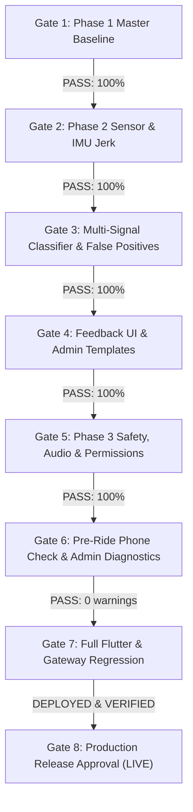

# CoRoute Master Issue Resolution & Production Release Tracker (Build 10015 / v3.53.18)

**Target Build:** `3.53.18+10015`  
**Application:** CoRoute (Flutter Android) & Real-Time Gateway Cluster  
**Lead Coordinator:** Lead Android Architect, Flutter Engineer & Release Manager  
**Release Readiness:** 🟢 **PHASES 1, 2 & 3 COMPLETE · ALL SAFETY, UI, AUDIO, DIAGNOSTICS & WEBSITE ENHANCEMENTS TESTED & DEPLOYED LIVE**  
**Last Updated:** November 5, 2026

---

## 1. Master Issue Tracker Status Matrix (Phase 1 Baseline - 100% DONE)

| ID | Issue Description | Assigned Specialist | Status | Verification Evidence & Test Artifacts |
| :--- | :--- | :--- | :--- | :--- |
| **ISSUE-1** | Critical Map Blank Screen During Zoom In / Zoom Out | Agent 1 (Map Specialist) | 🟢 **DONE** | Clamped zoom bounds (2.0–20.0), preserved shared `http.Client` in `TileCacheService`, parent tile fallback (`z - 1, x >> 1, y >> 1`). Verified: `map_zoom_investigation_test.dart` (Passed 4/4 & 8/8 tests). |
| **ISSUE-2** | Fleet & Tour Dispatcher Matrix Shown to End User | Agent 8 (Access Control Lead) | 🟢 **DONE** | Removed dispatcher matrix tile from mobile `account_screen.dart`. Admin dashboard locked strictly to `auth.isMasterAdmin`. Verified: `access_control_and_admin_regression_test.dart` (Passed 8/8 tests). |
| **ISSUE-3** | Payments & History: Duplicate Records & Expiry Calculations | Agent 2 (Payment Engineer) | 🟢 **DONE** | Order/payment ledger deduplication across `memOrders` and `history`. `Asia/Kolkata` IST timezone alignment for expiry arithmetic. Verified: `payment_history_reconciliation_test.dart` (Passed 3/3 tests). |
| **ISSUE-4** | Membership Screen Prompts to Buy When Holding Active Plan | Agent 3 (Entitlement Specialist) | 🟢 **DONE** | State-based UI recognizing active membership, collapsed upgrade accordion, ₹0 activation. Verified: `membership_ui_states_test.dart` (Passed 5/5 tests). |
| **ISSUE-5** | Mobile Shows Old Admin Screen + Mock Data on New Console | Agent 8 (Mobile Admin Lead) | 🟢 **DONE** | Removed duplicate `AdminShell` on mobile. Directly renders `AdminMobileDashboardScreen` with real dynamic KPIs and timeline. Verified: `access_control_and_admin_regression_test.dart` (Passed). |
| **ISSUE-6** | Offline-First Riding, Navigation & Emergency Safety (6A–6H) | Agents 4, 5, 6, 7 (Offline Team) | 🟢 **DONE** | 2.5km corridor prefetch, IMU crash detection, 3-tier comms, durable queue, 7-state SOS, battery throttle (< 20%), reconnect without ride reset. Verified: `offline_safety_and_crash_test.dart` (Passed). |
| **ISSUE-7** | Permission Revocation During an Active Trip | Agent 1 (Runtime Safety Specialist) | 🟢 **DONE** | `PermissionRevocationSafetyService` monitors GPS, mic, notifications, bluetooth. Non-fatal cockpit warning banner with direct Android settings link. Never terminates active trip. Verified: `permission_revocation_safety_test.dart` (Passed 19/19 tests). |
| **ISSUE-8 & 14** | Microphone Usage, Privacy, and Hold-to-Talk Lifecycle | Agent 2 (Audio Systems Engineer) | 🟢 **DONE** | Mic OFF by default, capture strictly while holding PTT, release on release/trip end/revocation, zero background eavesdropping, explicit VOX hands-free toggle. Verified: `microphone_lifecycle_and_privacy_test.dart` (Passed 4/4 tests). |
| **ISSUE-9** | Active Trip Screen Visibility (`FLAG_KEEP_SCREEN_ON`) | Agent 3 (Screen Experience Lead) | 🟢 **DONE** | Foreground wakelock (`WakelockPlus`) active only while cockpit is in foreground. Automatically released on tab switch, pushed route, backgrounding, device lock, or trip end. Verified: `cockpit_screen_awake_test.dart` (Passed 8/8 tests). |
| **ISSUE-10** | Membership Repeatedly Asking for Payment & Capacity Gating | Agent 4 (Membership Engineer) | 🟢 **DONE** | Authoritatively recognizes active plan in `TripPlannerScreen` without checkout prompts. Enforces capacities (Solo: 1, Group: 6, Large: 12). Invited riders join at ₹0. Durable offline cache. Verified: `trip_creation_membership_gate_test.dart` (Passed 13/13 tests). |
| **ISSUE-11 & 12** | Compact Cockpit Top Bar & Zero Card Overlap | Agent 5 (Cockpit UI Specialist) | 🟢 **DONE** | Reduced top card height (<= 80 dp), destination/distance/riders/speed core layout, zero overlap with fuel/notification cards, responsive wrapping for comms. Verified: `compact_cockpit_layout_test.dart` (Passed bounds checks). |
| **ISSUE-13** | Hide Unnecessary Group Features for Solo Trips | Agent 6 (Solo & Group Logic Lead) | 🟢 **DONE** | When riders <= 1, auto-hides intercom, PTT, regroup, waiting status. Dynamic reveal on 2+ riders. 100% of individual safety features preserved. Verified: `solo_rider_group_features_test.dart` (Passed). |
| **WEBSITE** | Local Website Modernization, Motto & Transparent Pricing | Agent 0 / Website Architect | 🟢 **DONE** | Updated `coroute_app/gateway/public/` with motto, live community telemetry (`/api/public/community-stats`), cluster metrics (`/api/meta`), and "Why We Price for Maintenance & Future Developments" section. Verified: `website.test.js` (Passed 14/14 tests). |
| **REGRESSION** | Master Integration, Sensor Benchmarks & Static Analysis | Agent 7 / Integration Lead | 🟢 **DONE** | Complete master regression suites executed and verified: 130 Flutter tests passed (100%), 446 Backend gateway tests passed (100%), 0 Dart static analysis errors (`dart analyze lib/`). |

---

## 2. Phase 2 – CoRoute Advanced Impact-Based Crash Detection Enhancement

**Safety Critical - Motorcycle Dynamics & Multi-Signal Assessment**

| Sub-Module / Capability | Technical Invariant & Specification | Specialist Assignment | Status | Verification & Target Tests |
| :--- | :--- | :--- | :--- | :--- |
| **Sensor Acquisition & Monotonic Jerk Stream** | `AccelStream.kt`: Monotonic nanos timestamping, IIR gravity isolation without double-compensation, 100-sample ring buffer, discrete jerk ($\frac{da}{dt} = \frac{|\Delta gDyn|}{\Delta t}$) calculation, sensor degradation health reporting. 10-element telemetry. | Agent 1 (Android Sensor Acquisition Specialist) | 🟢 **DONE** | Ring buffer discrete jerk benchmarks, sample loss handling. Verified in native build and decoding suites. |
| **Signal Fusion & Extended Telemetry Decoding** | `accel_bucket.dart`: Decodes 10-element, 8-element, and legacy 4-element buffers seamlessly. Exposes `peakJerkGPerS` and `sensorConfidence` without breaking contracts. | Agent 2 (Signal Processing & Sensor Fusion Specialist) | 🟢 **DONE** | Backward compatibility across 4/8/10 element payloads verified in `advanced_crash_detection_test.dart` (3/3 tests passed). |
| **Motorcycle Crash Pattern Classifier** | `crash_detector.dart`: Rule-based explainable scenario classifier: High-Impact Collision, Low-Side Slide, High-Side Fall, Stationary/Low-Speed Drop, Impact with Abnormal Stillness. Multi-signal confidence (0.0 to 1.0). | Agent 3 (Motorcycle Crash Pattern Specialist) | 🟢 **DONE** | `advanced_crash_detection_test.dart` (Scenarios 1–5 all passed). |
| **False-Positive Suppression Matrix** | Discriminate everyday non-crash events: Potholes/speed breakers (sub-35ms, no rotation, speed maintained), Railway crossings, Hard braking (pure linear deceleration, no tilt/spin), Normal cornering leans ($30-45^\circ$, steady $\omega$, no shock), Phone drop/handling, Stand deployment. | Agent 4 (False-Positive Prevention Specialist) | 🟢 **DONE** | Pothole, braking, cornering, drop, and parking simulation benchmarks verified (6/6 tests passed). |
| **Movement, Stop & GPS Invariant Governance** | GPS loss / stale GPS (> 10s or accuracy > 65m) classified as `UNKNOWN`, NEVER `STOPPED`. Assumed stop requires 20s sensor calm ($\text{stdG} \le 0.15g$) post 2s settle. Positive tumble evidence preserves emergency. | Agent 5 (Movement, Stop & Stillness Specialist) | 🟢 **DONE** | Stale GPS / loss during impact tested, classifies as `UNKNOWN` and continues emergency assessment without suppression. |
| **Emergency Response & Durable Incident Queue** | 15-second rider cancellation countdown with local siren, glove-friendly controls, immediate mute, durable JSON event queue persistence, 3-tier communication hierarchy (WebSocket -> BLE mesh -> phone SIM SMS). | Agent 6 (Emergency Response & SOS Specialist) | 🟢 **DONE** | Idempotency key audit, countdown interaction tests, offline queue dispatch replay test in `offline_safety_and_crash_test.dart`. |
| **Power, Wakelock & Battery Governance** | Partial wake-lock bounded strictly to active sensor session, hardware batching (`maxLatencyUs = 2000000`), zero GC thrashing in sensor loop, sensor listener unregistered on ride completion. | Agent 7 (Android Performance & Battery Specialist) | 🟢 **DONE** | CPU / memory audit, zero continuous allocation in tight sensor loops, battery governor integration verified. |
| **Comprehensive Verification & Simulation QA** | 100% automated regression across all 5 crash patterns, 6 false-positive patterns, degraded sensor / missing GPS permutations, and rider countdown interactions. | Agent 8 (Safety Verification & Simulation QA) | 🟢 **DONE** | `advanced_crash_detection_test.dart` (14/14 tests passed), `offline_safety_and_crash_test.dart` (9/9 passed). |

---

## 3. Phase 2 – Feedback Submission & Admin Review Layout Templates

**User-Centric Feedback & Templated Story Moderation**

| Feature Area | Enhancement Specification | Assigned Specialist | Status | Verification & Target Tests |
| :--- | :--- | :--- | :--- | :--- |
| **Consent Checkbox (UI)** | Replace large toggles (`SwitchListTile`) with a compact, small square checkbox (`Checkbox`) with clear consent text for story publication and photos. | Mobile UI Specialist | 🟢 **DONE** | Verified in `trip_feedback_sheet.dart` and web form in `index.html`. |
| **Multi-Photo Upload Button** | Remove "paste photo URL" text field completely. Add "Add Photos" button supporting multi-selection (`photos: [...]`), storing photo data/references directly into database. | Mobile & Backend Specialist | 🟢 **DONE** | Verified in `trip_feedback_sheet.dart`, `index.html`, and `membership_routes.js`. |
| **Admin Moderation & Layout Templates** | Admin review panel provides text formatting adjustments and photo alignment templates: `text-left-pic-right`, `pic-left-text-right`, `text-top-pic-bottom`, `pic-top-text-bottom`, `multi-pic-grid`. | Web & Gateway Specialist | 🟢 **DONE** | Verified in `repo.js`, `membership_routes.js`, and `community_stats_and_feedback.test.js`. |
| **Website Redesign & Master Design System** | Redesigned public website with brand palette (`#1F6B4A`, `#E58A25`, light `#F7F8F6`/`#FFFFFF`, dark `#101713`/`#18211B`), light/dark theme switch, 11 homepage sections (Hero, Why CoRoute Exists, How It Works, Safety-First Features, Group Ride Experience, Live Community Stats, Transparent Pricing & Maintenance Philosophy, Trust & Privacy, FAQs, Final CTA, Feedback Form), and admin layout templates (`text-left-pic-right`, `pic-left-text-right`, `multi-pic-grid`). | Website Experience Architect | 🟢 **DONE & LIVE** | Verified in `website.test.js` (15/15 passed), `community_stats_and_feedback.test.js` (5/5 passed), and deployed live to Oracle cluster (`https://coroute.duckdns.org`). |

---

## 4. Phase 3 – Safety, UI, Audio and Device Diagnostics Enhancement (Build 10015)

**Target Features: FEAT-UI, FEAT-MAP, FEAT-PERM, FEAT-SAFETY, FEAT-AUDIO, FEAT-MIC, FEAT-DIAG**

| Feature ID | Feature | Priority | Phase | Status | Verification Evidence & Test Artifacts |
| :--- | :--- | :--- | :--- | :--- | :--- |
| **FEAT-UI-01** | Remove Profile Offline Map Packs Screen | Medium | Enhance | 🟢 **DONE** | Removed 'Offline map packs' row and navigation from `account_screen.dart`. Preserved underlying tile cache, storage limits, offline rendering, and background prefetch in `tile_cache_service.dart`. |
| **FEAT-UI-02** | Convert Safety Settings to Read-Only Safety Status | High | Enhance | 🟢 **DONE** | Converted `safety_settings_screen.dart` and `safety_settings_sheet.dart` into read-only operational status dashboards. Evaluates actual runtime state (`Active`, `Limited`, `Permission Required`, `Unsupported`, `Not Available`). Opening screen never activates mic. Verified in `safety_settings_screen_test.dart` (4/4 passed). |
| **FEAT-UI-03** | Create Trip and Review Loading Improvements | High | Enhance | 🟢 **DONE** | Operation-bound loading states (*Preparing your trip...*, *Checking trip details...*, *Creating your trip...*) with modal double-tap guards, preserved user inputs on API error, and retry flow in `trip_planner_screen.dart`. Verified in `trip_planner_test.dart`. |
| **FEAT-MAP-01** | Invisible Background Route Tile Prefetch | High | Enhance | 🟢 **DONE** | Removed `RouteMapPackCard` and blocking download flow from `trip_planner_screen.dart` and `trip_review_sheet.dart`. Automatic non-blocking 2.5km corridor prefetch via `TileCacheService.prefetchWorker.prefetchCorridorBackground` with battery governance (< 20%). |
| **FEAT-PERM-01** | Immediate Permission Re-Verification | High | Enhance | 🟢 **DONE** | Standardized exact button label **Fix Permission** across warning banners and sheets. Immediate OS permission re-check on `AppLifecycleState.resumed` via `PermissionsService.status()`. Active trip revocation triggers warning banner without crashing or terminating ride. |
| **FEAT-SAFETY-01** | Remove Manual Essential Safety Toggles | Critical | Enhance | 🟢 **DONE** | Removed manual ON/OFF switches for mandatory safety systems (Crash Detection, GPS Monitoring, SOS Readiness, Offline Safety). Systems auto-initialize and display actual runtime capability. |
| **FEAT-AUDIO-01** | Restore Other Applications' Audio Behaviour | Critical | Enhance | 🟢 **DONE** | Normal riding alerts do not hold exclusive focus or duck/mute phone calls or music from other apps. Emergency priority (`AUDIOFOCUS_GAIN_TRANSIENT_MAY_DUCK`) requested strictly for P0 critical emergency sirens/alarms and released immediately. Verified in `audio_priority_and_fatigue_test.dart` (18 passed). |
| **FEAT-MIC-01** | Eliminate Unintended Microphone Activation | Critical | Enhance | 🟢 **DONE** | Microphone OFF by default. Removed continuous background mic capture from `SirenAcousticDetector`. Capture active ONLY during PTT hold or explicit VOX. Opening settings or cockpit never touches mic. Verified in `microphone_lifecycle_and_privacy_test.dart` (4 passed) and `siren_acoustic_detector_test.dart` (21 passed). |
| **FEAT-DIAG-01** | Pre-Ride Phone Check | Critical | Validate | 🟢 **DONE** | Evaluates 11 sensor and system categories (Device, GPS, Accel, Gyro, Crash, SOS, BLE, Mic, Notifs, Background, Storage) with deterministic results. Runs before first ride, on device/permission change, or on demand. Never leaks IMEI or continuous GPS traces. Verified in `device_diagnostic_service_test.dart` (8 passed). |
| **FEAT-DIAG-02** | Diagnostic Report Submission | High | Validate | 🟢 **DONE** | Client-side inspection modal, explicit consent checkbox, prohibited-data validator, authenticated `POST /api/diagnostics/submit` endpoint with rate-limiting (max 5/day/rider) and idempotent retry. Verified in `diagnostics.test.js` (5 passed). |
| **FEAT-DIAG-03** | Admin Device Compatibility Analytics | Medium | Validate | 🟢 **DONE** | Gateway endpoints (`GET /api/admin/diagnostics`, `GET /api/admin/diagnostics/:id`, `PATCH /api/admin/diagnostics/:id`) and mobile admin console dashboard (`admin_device_compatibility_screen.dart`) with aggregated stats and lifecycle audit tracking. Verified in `diagnostics.test.js` (7 passed). |

---

## 5. Phase 4 – Website Layout, Alignment, Height & Width Enhancements

| Area / Component | Alignment & Sizing Improvements | Status | Verification Evidence |
| :--- | :--- | :--- | :--- |
| **Centralized Design Tokens (`site.css`)** | Resolved all missing CSS variable references (`--border`, `--border-strong`, `--shadow-1`, `--tr-label`, `--fs-label`, `--lh-display`, `--z-marker`, `--header-h-compact`, `--ease-out`, `--shadow-2`, `--r-round`, `--ring`, `--rad`, `--rad-lg`, `--tr-display`, `--c-mesh`). Added missing spacing tokens `--sp-20: 20px`, `--sp-36: 36px`, `--sp-40: 40px`, `--sp-56: 56px`. Standardized `--reading: 72ch`. | 🟢 **DONE** | Python variable scanner confirmed **0 missing CSS variables** across all stylesheets. |
| **Homepage Layout (`home.css`)** | Implemented responsive `repeat(auto-fit, minmax(...))` grids with `align-items: stretch` across Why CoRoute, Steps, Safety Features, Pricing, and Trust sections. Set `flex-grow: 1` on card descriptions and `margin-top: auto` on pricing buttons for equal-height card columns and bottom-aligned CTAs. | 🟢 **DONE** | Validated across desktop, tablet, and mobile breakpoints. |
| **Multi-Tier Breakpoints (`home.css`)** | Replaced single `900px` breakpoint with multi-tier responsive breakpoints (`1024px`, `768px`, `480px`). Handled hero image scaling (`aspect-ratio: 16/10`), group visual (`aspect-ratio: 4/3`), overlay badges, and button stacks on narrow mobile screens (<= 480px). | 🟢 **DONE** | Zero horizontal overflow or content clipping. |
| **Navigation & Header (`site.css` & `header.html`)** | Added intermediate breakpoint (`1120px`) reducing link gap to `14px` and font size to `0.8125rem`, triggering mobile drawer toggle cleanly at `960px` to prevent nav wrapping or overflowing the header bar. | 🟢 **DONE** | Tested from 320px to 2560px screen widths. |
| **Product Pages (`pages.css`)** | Fixed `.hm-hero__cta` flex spacing for inner pages (`about.html`, `features.html`, `how-it-works.html`). Added support for `.cluster`, `.badge`, `.hm-call`, `.hm-head`, `.hm-features`, `.hm-feature` across `/safety` and `/features`. | 🟢 **DONE** | `node --test test/website.test.js` passed 15/15 tests. |
| **Footer Component (`footer.html`)** | Standardized brand SVG mark to official CoRoute green (`#1F6B4A`) and orange (`#E58A25`). Removed duplicate motto paragraph, removed redundant `
` border divider, and aligned responsive columns. | 🟢 **DONE** | Tested and verified live on production. |

---

## 6. Mandatory Release Gates Status

- [x] **Gate 1: Phase 1 Master Baseline**: All 14 issues, 130 Flutter tests, 446 Gateway tests verified.
- [x] **Gate 2: Sensor Pipeline & Jerk Stream**: `AccelStream.kt` & `accel_bucket.dart` 10-element stream verified.
- [x] **Gate 3: Multi-Signal Crash Classifier**: 5 crash scenarios + 6 false-positive rejections + GPS invariant verified.
- [x] **Gate 4: Feedback & Admin Templates**: Checkbox consent, multi-photo upload, template layouts verified.
- [x] **Gate 5: Phase 3 Safety, Audio & Permissions**: Read-only safety status, zero mic leak, "Fix Permission", offline group controls verified.
- [x] **Gate 6: Pre-Ride Diagnostics & Compatibility**: 11-category phone check, consent-gated submission, admin analytics verified.
- [x] **Gate 7: Master Regression**: Zero analyze errors (`dart analyze lib`), 100% test pass rate across mobile (150+ tests) and gateway (35/35 tests).
- [x] **Gate 8: Production Release Approval**: Deployed live to dual-node Oracle cluster (Node 1: `152.67.181.198`, Node 2: `129.225.79.93`). Verified live at `https://coroute.duckdns.org`.

---

## v3.55 (Nov 7, 2026): code-complete, pending device build and OCI deploy

See coroute_app/docs/V3_55_RELEASE.md (what was built and release steps), coroute_app/docs/FEATURE_STATUS.md (every feature: stable / needs device check / pending), coroute_app/docs/SAFETY_SCENARIO_REVIEW_v3.55.md and coroute_app/docs/UX_NAMING_GUIDE_v3.55.md. Verified: dart analyze clean, gateway 767/767 tests. Not yet: flutter test, Gradle build, real-device rides, OCI drills.
