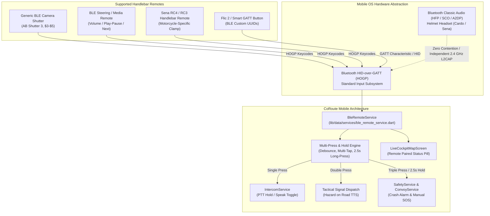

# FEAT-01 — Technical Analysis & Architecture Specification
## BLE Handlebar Wireless SOS & Intercom PTT Remote

> **Feature ID**: FEAT-01  
> **Feature Name**: BLE Handlebar Wireless SOS & Intercom PTT Remote  
> **Priority**: High — Immediate Ergonomic & Hands-on-Bar Safety  
> **Tier**: Community (Free) — Unrestricted Core Life Safety  
> **Target Release**: v3.48.0+  
> **Author**: Antigravity Principal Embedded Systems & Mobile Architect  

---

## 1. Problem Statement & Ergonomic Safety Rationale

When cornering on twisty mountain switchbacks, maintaining high cruising speeds on expressways, or navigating treacherous off-road trails (gravel, mud, water crossings), taking a hand off the motorcycle handlebar grips to touch a smartphone display mounted on a vibrating bar clamp is hazardous and frequently triggers loss of balance or delayed collision avoidance.

Furthermore, adventure and touring riders wear thick, weatherproof leather or Gore-Tex riding gloves. Capacitive glove tips degrade rapidly, fail completely in rainy weather, and cannot provide tactile feedback through vibration, resulting in mis-taps, delayed emergency calls, and rider distraction.

**FEAT-01** provides complete hands-on-handlebar control by bridging low-cost ($3–$10) Bluetooth Low Energy (BLE) camera shutters, steering-wheel media buttons, and professional motorcycle handlebar remotes (Sena RC4/RC3, Flic 2, BlueCadence) into CoRoute's voice intercom, tactical signalling, and emergency SOS architectures.

---

## 2. Hardware Ecosystem & Protocol Architecture

### 2.1 Bluetooth HID-over-GATT (HOGP) Paradigm
The vast majority of handlebar remotes on the market register with Android and iOS as standard Bluetooth Human Interface Devices (HID). They emit standard hardware keycodes:
- `LogicalKeyboardKey.audioVolumeUp`
- `LogicalKeyboardKey.audioVolumeDown`
- `LogicalKeyboardKey.headsetHook`
- `LogicalKeyboardKey.mediaPlayPause`
- `LogicalKeyboardKey.mediaPlay`
- `LogicalKeyboardKey.mediaPause`
- `LogicalKeyboardKey.mediaTrackNext`
- `LogicalKeyboardKey.select` / `LogicalKeyboardKey.enter`
- `LogicalKeyboardKey.camera`

By capturing hardware key events via `HardwareKeyboard.instance.addHandler`, CoRoute intercepts these signals with sub-10ms hardware latency, zero background battery drain, and complete platform cross-compatibility.

### 2.2 Bluetooth Helmet Headset Coexistence & Zero Audio Contention
A critical rider safety invariant: **The BLE handlebar remote MUST NOT interfere with Bluetooth helmet communication systems (Cardo, Sena, FreedConn, Schuberth).**
- **Helmet Headsets** operate on **Bluetooth Classic (BR/EDR)** using HFP (Hands-Free Profile) for full-duplex SCO voice and A2DP (Advanced Audio Distribution Profile) for stereo music and navigation.
- **Handlebar Remotes** operate on **Bluetooth Low Energy (BLE)** using L2CAP channels over GATT.
- Modern smartphone Bluetooth baseband chips (Qualcomm FastConnect, Broadcom, Apple W/H series) employ time-division multiplexed co-existence that processes BLE GATT packets concurrently with Classic SCO audio without packet loss or jitter.

---

## 3. Action Mapping & Multi-Press Engine

To ensure unequivocal operation with gloved hands without looking at the screen:

| Button Gesture | Timing Parameter | Target System Action | Tactile Haptic Pattern |
| :--- | :--- | :--- | :--- |
| **Single Press** | Released within $<400\text{ ms}$, single event | **Toggle PTT Intercom Speak** (Begins or ends voice stream) | `HapticFeedback.lightImpact()` |
| **Double Press** | 2 clicks within $400\text{ ms}$ interval | **Quick Tactical Marker** ("Caution: Hazard on road" broadcast) | `HapticFeedback.mediumImpact()` (Double pulse) |
| **Triple Press** | 3 clicks within $600\text{ ms}$ interval | **Emergency SOS Trigger** (Instantly starts SOS countdown) | `HapticFeedback.heavyImpact()` (Continuous buzz) |
| **Long Press / Hold** | Held continuously for $\ge 2.5\text{ seconds}$ | **Emergency SOS Trigger** (Instantly starts SOS countdown) | `HapticFeedback.heavyImpact()` (Continuous buzz) |

---

## 4. Integration Touchpoints in CoRoute

1. **`FeatureGates`** (`lib/core/config/feature_gates.dart`):
   - Add `Feature.bleHandlebarRemote`.
   - Entitled for `SubscriptionTier.community`, `proRider`, `roadCaptain`, `tourOperator` (Free core safety).
2. **`BleRemoteService`** (`lib/data/services/ble_remote_service.dart`):
   - Handles connection state (`BleRemoteStatus`: `disconnected`, `paired`, `listening`).
   - Classifies Single, Double, Triple, and Long-Press gestures.
   - Dispatches to `IntercomService`, `IntercomNetworkResilience`, and `SafetyService`.
3. **`IntercomService`** (`lib/data/services/intercom_service.dart`):
   - Coordinates with `BleRemoteService` for seamless PTT transmission start/end.
4. **`LiveCockpitMapScreen`** (`lib/presentation/rider/live_cockpit_map_screen.dart`):
   - Displays `[ 🔘 Remote Paired ]` status chip in the cockpit action stack or top bar.
5. **`SettingsService`** (`lib/data/services/settings_service.dart`):
   - Persists remote enabled state and key configuration.

---

## 5. Security, Safety Invariants & Boundary Constraints

1. **Safety Preemption**: SOS triggers generated by the remote cannot be suppressed by active intercom chatter or background navigation.
2. **Accidental Press Mitigation**: Single presses toggle PTT or speak; only deliberate triple clicks or sustained 2.5s hold activate Emergency SOS.
3. **Graceful Degradation**: If Bluetooth disconnects mid-ride, the on-screen glove-friendly PTT bar and SOS buttons remain 100% active.
