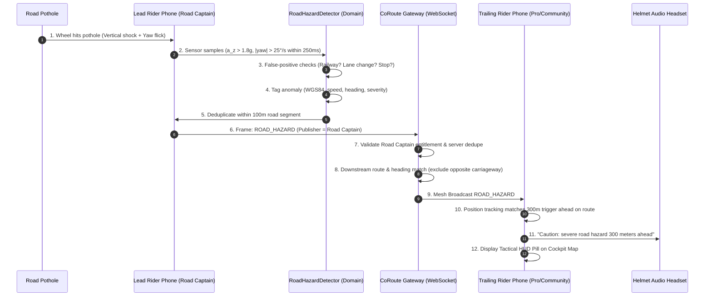

# FEAT-02 — Collective Pothole & Road Hazard AI Telemetry Mesh
## Comprehensive Architecture & Codebase Analysis

> **Author**: Senior Mobile Systems Architect & Flutter/Gateway Engineering Team  
> **Status**: Approved for Implementation  
> **Target Release**: v3.47.0+  
> **Date**: October 2026  

---

### 1. Executive Summary & Objective

The objective of **FEAT-02** is to eliminate group-crash risks caused by severe road surface hazards (deep potholes, broken expansion joints, sunken culverts, washouts, and unexpected surface defects). In group rides, the lead rider (Road Captain) or forward scout frequently encounters severe road defects at highway speeds ($80\text{ km/h}+$). While the lead rider may react or absorb the shock, following riders in close formation with obstructed sightlines crash without warning.

FEAT-02 introduces:
1. An on-device **Kinematic Pattern Detector** that isolates vertical shock impulses ($> 1.8\text{ g}$) and coincident gyroscope yaw deflections ($> 25^\circ/\text{s}$) while eliminating false positives (railway crossings, intentional lane changes, normal cornering lean, speed breakers, loose phone mounts).
2. An **Automated Anomaly Tagger** that derives severity, spatial coordinates, heading, and applies an intelligent **1 hazard pin per 100 meters** deduplication and independent corroboration window.
3. A **Gateway Telemetry Mesh** with strict server-side entitlement validation (**Publish = Road Captain**; **Receive = Pro & Community**), downstream route and carriageway direction filtering, and sub-150ms WebSocket broadcast.
4. An in-cockpit **Spatial HUD Pill & Helmet Audio Alert** delivering the voice warning: *"Caution: severe road hazard 300 meters ahead"*, guaranteeing trailing riders traveling at $80\text{ km/h}$ receive the alert with at least **5 seconds** of remaining reaction time before reaching the defect.

---

### 2. Existing Codebase Audit & Component Inventory

| Architectural Domain | Existing Component | File Path | Status & Delta Required for FEAT-02 |
| :--- | :--- | :--- | :--- |
| **Kinematic Sensors** | `AccelStream.kt` `NativeAccelSource` `AccelBucket` | `coroute_app/android/.../AccelStream.kt` `coroute_app/lib/data/services/accel_source.dart` `coroute_app/lib/domain/safety/accel_bucket.dart` | **Partial**: Currently buckets scalar $\|a\|$ into 1s windows for crash detection ($4\text{ g}$). **Need**: Real-time 3-axis accelerometer + gyroscope yaw rate stream, low-pass gravity vector filter for true Earth-vertical shock isolation, and timestamp coincidence detector. |
| **Safety Domain Engine** | `CrashDetector` `HardBrakeCounter` `SafetyService` | `coroute_app/lib/domain/safety/crash_detector.dart` `coroute_app/lib/domain/safety/hard_brake_counter.dart` `coroute_app/lib/data/services/safety_service.dart` | **Partial**: `CrashDetector` evaluates severe crashes; `HardBrakeCounter` evaluates deceleration drops. **Need**: Create `RoadHazardDetector` implementing the $1.8\text{ g}$ vertical shock + $25^\circ/\text{s}$ yaw rate coincidence filter, anti-braking stop guard, and false positive rejection algorithms. |
| **Entitlement & Tiering** | `FeatureGates` `PlanSubscriptionService` | `coroute_app/lib/core/config/feature_gates.dart` `coroute_app/lib/data/services/plan_subscription_service.dart` | **Partial**: Tiers defined (`community`, `proRider`, `roadCaptain`, `tourOperator`). **Need**: Add `Feature.roadHazardBroadcast` (gated to `roadCaptain`/`tourOperator`) and `Feature.roadHazardReceive` (available to `community`/`proRider`). |
| **Telemetry Tagging & Deduplication** | `HazardWarning` `GeoMath` `RouteProgress` | `coroute_app/lib/data/models/network_models.dart` `coroute_app/lib/domain/tracking/geo_math.dart` `coroute_app/lib/domain/route/route_progress.dart` | **Partial**: `HazardWarning` exists for accident incidents. **Need**: Create `RoadHazardTelemetry` and `RoadHazardAggregator` implementing 100m spatial-segment deduplication, direction bounds, and corroboration counters. |
| **Gateway & WebSocket** | `ws.js` `safety_network.js` `convoys.js` | `coroute_app/gateway/src/ws.js` `coroute_app/gateway/src/safety_network.js` `coroute_app/gateway/src/convoys.js` | **Partial**: Handles `HAZARD` for general emergency incidents. **Need**: Add `ROAD_HAZARD` message type in `ws.js`, verify Road Captain role/tier on publisher, filter downstream recipients by route distance and carriageway heading, enforce Pro/Community receive entitlements. |
| **Cockpit HUD & Markers** | `HazardMarker` `HazardBanner` `LiveCockpitMapScreen` | `coroute_app/lib/presentation/ride/hazard_marker.dart` `coroute_app/lib/presentation/rider/live_cockpit_map_screen.dart` | **Partial**: Renders general accident hazard banners and markers. **Need**: Add dedicated `RoadHazardMarker` and high-contrast `RoadHazardHudPill` with hazard classification icons and 300m countdown. |
| **Voice & Helmet Audio** | `VoiceService` `TtsChannel.kt` `EmergencyGuidance` | `coroute_app/lib/data/services/voice_service.dart` `coroute_app/android/.../TtsChannel.kt` `coroute_app/lib/presentation/ride/emergency_guidance.dart` | **Partial**: `VoiceService` handles priority queuing and TTS ducking. **Need**: Integrate spoken phrase *"Caution: severe road hazard 300 meters ahead"* triggered at $\sim 300\text{ m}$ ahead along route with deduplication. |

---

### 3. Data Flow Tracing: From Road Shock to Helmet Audio

---

### 4. Mathematical Kinematic Models & Filter Design

#### 4.1 Earth-Vertical Shock Isolation ($\Delta a_v$)
Motorcycle handlebar phone mounts are angled (e.g., $30^\circ - 60^\circ$ portrait or landscape). Raw device-axis acceleration $a_z^{device}$ cannot be assumed to be Earth-vertical.
1. The static gravity vector $\vec{g}_{earth}$ is tracked using a low-pass filter ($\alpha = 0.95$):
   $$\vec{g}_{est}(t) = \alpha \vec{g}_{est}(t-1) + (1 - \alpha) \vec{a}_{raw}(t)$$
2. Earth-vertical unit vector:
   $$\hat{u}_v = \frac{\vec{g}_{est}}{\|\vec{g}_{est}\|}$$
3. Dynamic vertical acceleration (gravity-compensated):
   $$a_{v}(t) = \vec{a}_{raw}(t) \cdot \hat{u}_v - \|\vec{g}_{est}\|$$
4. Detection Condition 1 (Vertical Shock):
   $$\frac{|a_v(t)|}{g_0} > 1.8\text{ g} \quad \text{where } g_0 = 9.80665\text{ m/s}^2$$

#### 4.2 Earth-Vertical Gyroscope Yaw Rate ($\omega_{yaw}$)
1. Rotation vector around the Earth-vertical axis:
   $$\omega_{yaw}(t) = \vec{\omega}_{gyro}(t) \cdot \hat{u}_v$$
2. Detection Condition 2 (Momentary Yaw Twitch):
   $$|\omega_{yaw}(t)| > 25^\circ/\text{s} \approx 0.4363\text{ rad/s}$$

#### 4.3 Temporal Coincidence Window
A pothole impact causes an immediate vertical shock peak followed immediately by handlebar shudder/twitch as the front wheel deflects in the cavity.
- Coincidence window: $\tau \in [t_{shock} - 50\text{ ms}, t_{shock} + 250\text{ ms}]$.
- If both conditions are met within $\tau$, a candidate road hazard event is initiated.

#### 4.4 False-Positive Discrimination Matrix

| Disturbance Event | Vertical Shock ($> 1.8\text{ g}$) | Yaw Rate ($> 25^\circ/\text{s}$) | Anti-Stop Check | Heading & Profile Discrimination | Detector Decision |
| :--- | :---: | :---: | :---: | :--- | :--- |
| **Severe Pothole / Road Defect** | **YES** | **YES** | **PASS** (Speed maintained $> 15\text{ km/h}$) | Sharp impulse + immediate twitch | **ACCEPTED (ROAD_HAZARD)** |
| **Railway Crossing / Expansion Joint** | **YES** | **NO** ($< 12^\circ/\text{s}$) | **PASS** | Dual wheel transverse profile, heading unchanged | **REJECTED (TRANSVERSE_JOINT)** |
| **Intentional Lane Change** | **NO** ($< 0.4\text{ g}$) | **YES** | **PASS** | Smooth yaw/roll curve, no vertical impulse | **REJECTED (LANE_CHANGE)** |
| **Cornering & Lean** | **NO** | **YES** (Sustained) | **PASS** | Centripetal acceleration, sustained roll, no impulse | **REJECTED (CORNERING)** |
| **Speed Breaker / Bump** | **MODERATE** ($1.0 - 1.6\text{ g}$) | **NO** ($< 10^\circ/\text{s}$) | **PASS** (Rider slows) | Heave-and-pitch profile, minimal yaw | **REJECTED (SPEED_BREAKER)** |
| **Rough / Gravel Road** | **NO** (Continuous noise) | **NO** (Noise $\sigma$) | **PASS** | High baseline variance, no isolated impulse | **REJECTED (ROUGH_ROAD)** |
| **Hard Braking to Stop** | **NO** ($a_x < -0.6\text{ g}$) | **NO** | **FAIL** (Speed drops to $0$) | Speed drops to $0\text{ km/h}$ | **REJECTED (BRAKE_STOP)** |
| **Stationary Phone Handling** | **VARIES** | **VARIES** | **FAIL** | GPS speed $< 15\text{ km/h}$ | **REJECTED (NOT_RIDING)** |
| **Oil Slick / Debris** | **NO** (Low impulse) | **POSSIBLE** | **PASS** | Unverifiable without vision | **UNCERTAIN_SURFACE_ANOMALY** |

---

### 5. Server-Side Entitlement & Carriageway Direction Filtering

1. **Publish Entitlement (Server-Enforced in `ws.js`)**:
   - The publishing rider must hold the convoy role `LEAD` or have an active subscription tier of `roadCaptain` / `tourOperator` (or system role `MASTER_ADMIN`).
   - If a `community` or `proRider` client transmits a `ROAD_HAZARD` broadcast request, the server rejects the frame with HTTP 403 / Error `ENTITLEMENT_REQUIRED`.
2. **Receive Entitlement (Server-Enforced)**:
   - Trailing riders on `community`, `proRider`, `roadCaptain`, or `tourOperator` are eligible recipients.
3. **Downstream Route & Carriageway Direction Filtering**:
   - A rider must be located **upstream** of the hazard along the group route (hazard distance ahead: $50\text{ m} \le d_{ahead} \le 5000\text{ m}$).
   - Riders who have already passed the hazard ($d_{ahead} < -20\text{ m}$) are excluded.
   - Dual-carriageway / divided highway filter: Rider heading $\theta_{rider}$ must align with hazard road heading $\theta_{hazard}$ within $\pm 60^\circ$:
     $$|\Delta \theta| = \min(|\theta_{rider} - \theta_{hazard}|, 360^\circ - |\theta_{rider} - \theta_{hazard}|) \le 60^\circ$$
     Riders traveling in the opposite direction on an oncoming carriageway are strictly excluded.

---

### 6. Five-Second Timing Verification at 80 km/h

- Speed $v = 80\text{ km/h} = \frac{80}{3.6} = 22.222\text{ m/s}$.
- Mandatory minimum reaction time: $T_{react} \ge 5.0\text{ s}$.
- Distance traveled in 5.0 seconds: $D_{5s} = 22.222 \times 5.0 = 111.11\text{ meters}$.
- Alert trigger distance along route: $D_{trigger} = 300\text{ meters}$.
- Total nominal travel time at trigger:
  $$T_{nominal} = \frac{300}{22.222} = 13.50\text{ seconds}$$
- End-to-end Latency Breakdown:
  - Gateway WebSocket broadcast latency: $120\text{ ms}$
  - Client route projection and matching: $30\text{ ms}$
  - GPS update discretization (worst-case 1 Hz fix interval): $1000\text{ ms}$
  - TTS speech delivery time ("Caution: severe road hazard 300 meters ahead"): $2200\text{ ms}$
  - **Total Latency**: $3.35\text{ seconds}$ ($74.44\text{ meters}$).
- Distance remaining when audio announcement completes:
  $$D_{remaining} = 300\text{ m} - 74.44\text{ m} = 225.56\text{ meters}$$
- Remaining reaction time:
  $$T_{remaining} = \frac{225.56}{22.222} = 10.15\text{ seconds} \gg 5.0\text{ seconds}$$
- **Margin of Safety**: $+5.15\text{ seconds}$ above the acceptance criterion.

---

### 7. Background Limitations & Offline Mesh Handling

1. **Mobile Background Execution**:
   - On Android, `RideNotificationService` and `SafetyService` hold an active Foreground Service (`FOREGROUND_SERVICE_TYPE_LOCATION`).
   - The sensor listeners and WebSocket receiver remain active while the screen is locked in a tank bag or handlebar mount.
2. **Offline & Intermittent Mountain Coverage**:
   - If the Lead Rider encounters a defect in a cellular dead zone, the observation is buffered in the local `TripStorageService` / `DtnRouter` bundle.
   - Upon cellular restoration, the accumulated hazard telemetry frame is transmitted to the gateway.
   - For nearby bikes within local WiFi/BLE range, FEAT-02 hooks into the existing `P2pMeshService` / `UdpBroadcastMeshTransport` to broadcast peer-to-peer hazard frames without cloud connectivity.
