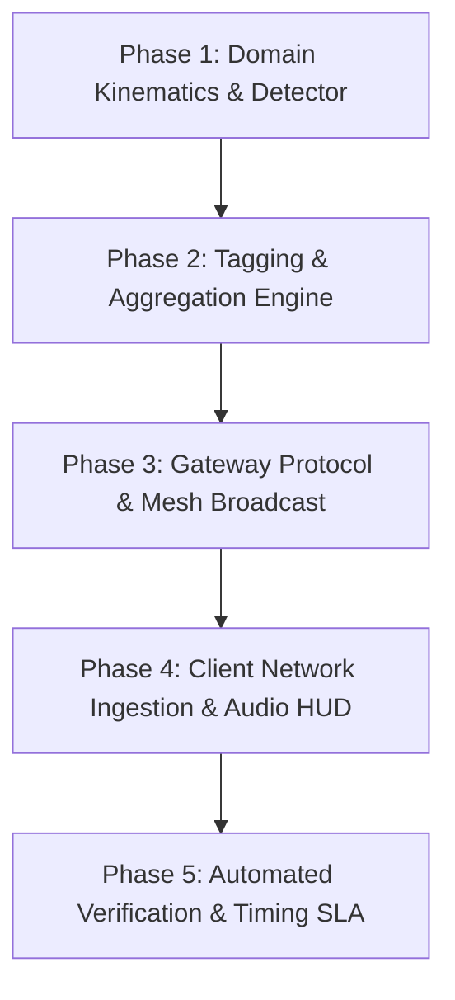

# FEAT-02 — Collective Pothole & Road Hazard AI Telemetry Mesh
## Implementation Plan & Architectural Roadmap

> **Author**: Senior Mobile Systems Architect & Flutter/Gateway Engineering Lead  
> **Status**: Ready for Code Execution  
> **Target Release**: v3.47.0+  
> **Date**: October 2026  

---

### 1. Task Breakdown & Implementation Phasing



#### Phase 1: Kinematic Pattern Detector & Sensor Fusion (Mobile Domain)
- **Task 1.1**: Create `coroute_app/lib/domain/safety/road_hazard_detector.dart`.
  - Class `RoadHazardDetector` with configurable thresholds:
    - `shockThresholdG` = 1.8
    - `yawRateThresholdDegS` = 25.0
    - `coincidenceWindowMs` = 250
    - `minSpeedKmh` = 20.0
    - `cooldownMs` = 2000
  - Gravity-compensating low-pass orientation filter to extract the true Earth-vertical vector $\hat{u}_v$.
  - Temporal coincidence evaluator between dynamic vertical shock and yaw twitch.
  - False-positive filters for:
    - Transverse joints and railway crossings ($a_v > 1.8\text{ g}$, $|\omega_{yaw}| < 15^\circ/\text{s}$, dual pulse).
    - Intentional lane changes and cornering ($|\omega_{yaw}| > 25^\circ/\text{s}$, $|a_v| < 0.4\text{ g}$).
    - Speed breakers (moderate heave, rider deceleration).
    - Rough / gravel roads (continuous high baseline variance, no isolated impulse).
    - Stationary phone handling ($v < 15\text{ km/h}$).
    - Braking stop check ($v \le 5\text{ km/h}$ within $5\text{ s}$).

#### Phase 2: Automated Anomaly Tagging & Spatial Aggregator (Data Domain)
- **Task 2.1**: Create `coroute_app/lib/data/models/road_hazard_telemetry.dart`.
  - Data class `RoadHazardObservation` containing event ID, WGS84 lat/lng, GPS accuracy, speed, heading, peak vertical shock in g, peak yaw rate, confidence, severity, hazard classification, pseudonymous rider hash, timestamp, and detector version.
- **Task 2.2**: Create `coroute_app/lib/domain/safety/road_hazard_aggregator.dart`.
  - Deduplication key: $100\text{ m}$ road segment and direction bin.
  - Aggregation logic: merges observations within $100\text{ m}$ of existing hazards, increments corroboration count, updates peak severity and confidence without creating duplicate pins.
  - Separate raw observations from aggregated hazard pins.

#### Phase 3: Gateway Protocol, Entitlement & Mesh Broadcast (Backend)
- **Task 3.1**: Create `coroute_app/gateway/src/road_hazards.js`.
  - Class `RoadHazardRegistry` to manage active road hazards with $100\text{ m}$ spatial index and TTL expiry (12 hours).
- **Task 3.2**: Update `coroute_app/gateway/src/ws.js`:
  - Register `case 'ROAD_HAZARD'`:
    - Check publisher entitlement: user must be `LEAD` or have tier `roadCaptain` / `tourOperator` or role `MASTER_ADMIN`. Otherwise return 403 `ENTITLEMENT_REQUIRED`.
    - Validate schema: lat, lng, speed, severity, heading.
    - Feed into `RoadHazardRegistry` for 100m spatial deduplication.
    - Identify downstream subscribers on the same route.
    - Filter recipients: check Pro & Community receive entitlement, ensure rider is upstream ($50\text{ m} \le d_{ahead} \le 5000\text{ m}$) and traveling in the matching carriageway direction ($\Delta \theta \le 60^\circ$).
    - Broadcast `ROAD_HAZARD` frame.

#### Phase 4: Client Ingestion, Cockpit HUD & 5-Second Helmet Audio (Presentation)
- **Task 4.1**: Update `coroute_app/lib/core/config/feature_gates.dart`:
  - Add `Feature.roadHazardBroadcast` (gated to `SubscriptionTier.roadCaptain` / `tourOperator`).
  - Add `Feature.roadHazardReceive` (available to `community`, `proRider`, `roadCaptain`, `tourOperator`).
- **Task 4.2**: Update `coroute_app/lib/data/services/convoy_service.dart`:
  - Handle incoming `ROAD_HAZARD` frame, store in `_roadHazards` collection, and expose `roadHazards` stream/list.
  - Add method `broadcastRoadHazard(RoadHazardObservation observation)`.
- **Task 4.3**: Update `coroute_app/lib/presentation/ride/emergency_guidance.dart` and `coroute_app/lib/presentation/rider/live_cockpit_map_screen.dart`:
  - Monitor distance to upcoming road hazards along the route.
  - At $300\text{ m}$ trigger distance:
    - Display tactical HUD pill: `[ ⚠️ SEVERE ROAD HAZARD 300M AHEAD ]`.
    - Speak helmet audio alert: *"Caution: severe road hazard 300 meters ahead"*.
    - Prevent duplicate speech calls with deduplication token.

#### Phase 5: Comprehensive Automated Testing & SLA Verification
- **Task 5.1**: Write `coroute_app/test/road_hazard_detector_test.dart` (Kinematic filter, coincidence window, false-positive datasets).
- **Task 5.2**: Write `coroute_app/test/road_hazard_mesh_timing_test.dart` (5-second reaction time verification at $80\text{ km/h}$, deduplication, entitlement gating).
- **Task 5.3**: Write `coroute_app/gateway/test/road_hazard_gateway.test.js` (Server WebSocket broadcast, Road Captain entitlement enforcement, downstream filtering).
- **Task 5.4**: Run `dart analyze` and full test suite to ensure zero regressions.

---

### 2. Wire Protocol Specification (`ROAD_HAZARD`)

#### Client to Gateway Frame
```json
{
  "type": "ROAD_HAZARD",
  "hazardId": "rh-9f4b-4a3d",
  "lat": 12.971598,
  "lng": 77.594562,
  "accuracyM": 4.5,
  "speedKmh": 78.5,
  "heading": 85.0,
  "classification": "POTHOLE",
  "severity": "HIGH",
  "confidence": 0.92,
  "peakVerticalG": 2.35,
  "peakYawRateDegS": 36.2,
  "timestamp": 1729603200000,
  "schemaVersion": "2.0"
}
```

#### Gateway to Downstream Client Broadcast Frame
```json
{
  "type": "ROAD_HAZARD",
  "hazardId": "rh-9f4b-4a3d",
  "lat": 12.9716,
  "lng": 77.5946,
  "classification": "POTHOLE",
  "severity": "HIGH",
  "confidence": 0.92,
  "aheadM": 300,
  "heading": 85.0,
  "corroborationCount": 1,
  "reportedAt": 1729603200000,
  "expiresAt": 1729646400000,
  "spokenWarning": "Caution: severe road hazard 300 meters ahead"
}
```

---

### 3. Module & File Mapping Summary

| File Path | Action | Description |
| :--- | :--- | :--- |
| `coroute_app/lib/domain/safety/road_hazard_detector.dart` | **Create** | Core kinematic shock and yaw rate coincidence detector with false-positive filtering. |
| `coroute_app/lib/data/models/road_hazard_telemetry.dart` | **Create** | Road hazard telemetry models, classifications, and wire JSON serializers. |
| `coroute_app/lib/domain/safety/road_hazard_aggregator.dart` | **Create** | 100-meter spatial segment deduplication and corroboration engine. |
| `coroute_app/lib/core/config/feature_gates.dart` | **Modify** | Add `roadHazardBroadcast` and `roadHazardReceive` feature gates. |
| `coroute_app/lib/data/services/convoy_service.dart` | **Modify** | Add `ROAD_HAZARD` frame handling and broadcast dispatch. |
| `coroute_app/gateway/src/road_hazards.js` | **Create** | Gateway spatial deduplication registry and TTL cache. |
| `coroute_app/gateway/src/ws.js` | **Modify** | WebSocket handler with Road Captain publishing check and downstream routing. |
| `coroute_app/lib/presentation/ride/emergency_guidance.dart` | **Modify** | Route-ahead distance tracking and helmet audio announcement trigger. |
| `coroute_app/lib/presentation/rider/live_cockpit_map_screen.dart` | **Modify** | Cockpit HUD pill and map marker integration. |
| `coroute_app/test/road_hazard_detector_test.dart` | **Create** | Automated test suite for kinematic detection and false-positive rejection. |
| `coroute_app/test/road_hazard_mesh_timing_test.dart` | **Create** | Automated timing test verifying $\ge 5\text{ s}$ reaction time at $80\text{ km/h}$. |
| `coroute_app/gateway/test/road_hazard_gateway.test.js` | **Create** | Backend WebSocket unit tests verifying entitlements and downstream filters. |
