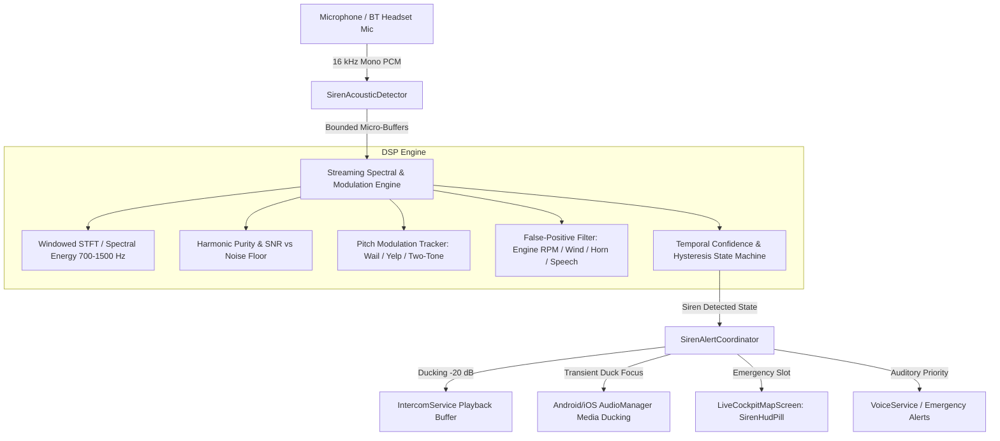

# FEAT-03 — Emergency Siren Acoustic Frequency Detector
## Comprehensive Technical Analysis & Hardware Feasibility Assessment

**Document Version:** 1.0.0  
**Feature ID:** `FEAT-03`  
**Feature Category:** Auditory Situational Awareness & Passive Safety  
**Tier Entitlement:** Community (Free) — Core Life Safety Feature  
**Target Release:** v3.47.0+  

---

### 1. Executive Summary

Motorcycle riders face severe sensory isolation. At speeds of $60\text{--}100\text{ km/h}$, wind buffeting around the helmet generates ambient noise levels of $85\text{--}105\text{ dB SPL}$. Riders frequently wear noise-isolating silicone or custom-molded earplugs (providing $15\text{--}30\text{ dB}$ attenuation), listen to helmet audio intercom streams, or play music. Under these conditions, an approaching emergency vehicle (ambulance, fire engine, police vehicle) with a siren ($115\text{--}120\text{ dB SPL}$ at source) may only become audible to the rider when it is $15\text{--}30\text{ meters}$ away, leaving virtually zero reaction time to safely yield or evade.

**FEAT-03** introduces an on-device, real-time **Emergency Siren Acoustic Frequency Detector** designed to continuously analyze ambient acoustic streams, identify siren modulation patterns (Wail, Yelp, and Two-Tone/Hi-Lo in the $700\text{--}1500\text{ Hz}$ band), duck in-app intercom and external media by $-20\text{ dB}$, and present a high-contrast emergency HUD alert (`🚨 EMERGENCY SIREN DETECTED · YIELD`).

---

### 2. Architectural Analysis & Existing System Integration

#### 2.1 Audio Capture Infrastructure
- **Package**: `package:record/record.dart` (v7.1.1) is integrated into CoRoute for intercom capture. It supports `startStream(RecordConfig(encoder: AudioEncoder.pcm16bits, sampleRate: 16000, numChannels: 1))`.
- **Concurrency & Platform Constraint**:
  - On both Android (`AudioRecord`) and iOS (`AVAudioSession`), hardware audio input is an exclusive or tightly shared platform resource. If `IntercomService` is already transmitting in VOX or PTT mode, opening a second independent `AudioRecorder` instance triggers `IllegalStateException` or returns empty streams.
  - **Resolution**: `SirenAcousticDetector` must support a shared capture architecture or tap into the incoming mic stream when intercom mic is open, falling back cleanly when the mic is occupied or unavailable without crashing or interrupting intercom PTT.
- **Privacy & Memory Architecture**:
  - **Zero Audio Storage**: Audio frames are processed strictly in RAM using fixed circular buffers and immediately overwritten.
  - **Zero Network Transmission**: Raw audio is never transmitted to the gateway or cloud.

#### 2.2 Feature Gating & Subscription Tier
- Authority: `FeatureGates` in `lib/core/config/feature_gates.dart`.
- Defined under: `Feature.sirenAcousticDetector`.
- Tier Mapping: **Community (Free)**, Pro Rider, Road Captain, and Tour Operator all have access (`isUnlocked(...) == true`).

#### 2.3 Audio Ducking Architecture (-20 dB)
- A reduction of $-20\text{ dB}$ corresponds to:
  $$\text{Gain Factor} = 10^{\frac{-20}{20}} = 0.10$$
  Amplitude is scaled to $10\%$ of original signal ($1\%$ acoustic power).
- **In-App Ducking**: `IntercomService` already provides `attenuatePcm16(chunk, factor)`. When siren ducking is asserted, incoming intercom chatter is attenuated by $0.10$.
- **System Media Ducking**: Through Android `AudioManager.AUDIOFOCUS_GAIN_TRANSIENT_MAY_DUCK` in `TtsChannel` / native audio channel, external players (Spotify, etc.) are ducked by the OS.
- **Critical Safety Override**: Spoken SOS emergency alerts from `VoiceService` and crash alarms are **NOT** ducked.

#### 2.4 Cockpit Map HUD Integration
- Primary HUD file: `lib/presentation/rider/live_cockpit_map_screen.dart`.
- Uses `_Slot` list with `AlertPriority.hazard` or emergency priority.
- Dedicated widget: `lib/presentation/rider/widgets/siren_hud_pill.dart`.

---

### 3. Acoustic Signal Processing & Pattern Classification

Emergency vehicle sirens exhibit well-defined, internationally standardized acoustic signatures (SAE J1849, Title 13 California, DIN 14610):

| Siren Mode | Fundamental Frequency Range | Modulation Rate / Period | Acoustic Signature |
| :--- | :--- | :--- | :--- |
| **Wail** | $700\text{ Hz} \longleftrightarrow 1500\text{ Hz}$ | $10\text{--}18\text{ cycles/min}$ ($3.5\text{--}6.0\text{ s}$ period) | Continuous sinusoidal/triangular frequency modulation |
| **Yelp** | $700\text{ Hz} \longleftrightarrow 1500\text{ Hz}$ | $120\text{--}300\text{ cycles/min}$ ($0.2\text{--}0.5\text{ s}$ period) | Rapid continuous saw/triangle modulation |
| **Two-Tone (Hi-Lo)**| $650\text{--}750\text{ Hz} \longleftrightarrow 900\text{--}1000\text{ Hz}$| $40\text{--}60\text{ cycles/min}$ ($0.5\text{--}1.0\text{ s}$ dwell) | Square-wave alternating discrete tones |

#### 3.1 Digital Signal Processing Pipeline
1. **Windowing**: 512-sample frames ($32\text{ ms}$ at $16\text{ kHz}$) with Hanning window to prevent spectral leakage.
2. **Frequency Domain Representation**: Windowed STFT / FFT or discrete Goertzel filter bank spanning $600\text{--}1600\text{ Hz}$ in $25\text{ Hz}$ bins.
3. **Spectral Prominence (Tonal vs Wideband)**:
   - Compute spectral peak-to-average ratio ($PAR$) and spectral flatness:
     $$PAR = \frac{\max(P_{band})}{\text{mean}(P_{band})}$$
   - Siren tones exhibit high tonal concentration ($PAR > 4.5$), whereas wind buffeting and road noise are wideband ($PAR < 2.0$).
4. **Instantaneous Peak Frequency Tracking**:
   - Track $f_{peak}(t) = \arg\max_{f \in [650, 1550]} P(f, t)$ across time windows.
5. **Modulation Frequency Analysis**:
   - Detect zero-crossings or peak-trough inflections in $f_{peak}(t)$ buffer (stored for the past $3\text{--}4\text{ seconds}$).
   - Wail: $\Delta f \ge 400\text{ Hz}$, period $3.0\text{--}6.0\text{ s}$.
   - Yelp: $\Delta f \ge 400\text{ Hz}$, period $0.15\text{--}0.5\text{ s}$.
   - Two-Tone: Alternating stable plateaus at $f_1 \in [650, 780]\text{ Hz}$ and $f_2 \in [880, 1020]\text{ Hz}$ with duration $\ge 200\text{ ms}$ each.

#### 3.2 False-Positive Rejection Matrix

| Sound Source | Frequency Profile | Rejection Mechanism |
| :--- | :--- | :--- |
| **Motorcycle Engine RPM** | Harmonics sweep with throttle ($100\text{--}400\text{ Hz}$ base + harmonics) | Engine harmonics do not cycle back and forth periodically; linear progression with gear shifts |
| **Wind Buffeting** | Pink/Brownian noise concentrated below $400\text{ Hz}$, turbulence | High spectral flatness, low $PAR$ in $700\text{--}1500\text{ Hz}$, no coherent frequency modulation |
| **Loud Exhaust** | High amplitude low-frequency rumble ($80\text{--}300\text{ Hz}$) | Low spectral energy in the $700\text{--}1500\text{ Hz}$ siren core; rejected by bandpass filter |
| **Vehicle Horns** | Single or dual static tones ($400\text{--}500\text{ Hz}$ or $800\text{ Hz}$ constant) | Monolithic frequency: lacks periodic pitch modulation ($\Delta f < 50\text{ Hz}$) |
| **Music / Radio** | Dynamic multi-harmonic, vocals, percussion | Formant spreads, lack of sustained cyclic modulation, irregular spectral peaks |
| **Speech / Intercom**| Formant clusters at $300\text{ Hz}, 1.5\text{ kHz}, 2.5\text{ kHz}$, high variance | High zero-crossing jitter, lack of deterministic siren periodic modulation |

---

### 4. Physical Feasibility: 150m Range & "Approaching From Behind"

#### 4.1 "Approaching From Behind" Physical Limitations
- A single omnidirectional microphone (whether on a handlebar-mounted smartphone or a helmet communicator) cannot determine the direction of arrival ($DoA$) of sound waves.
- Physical acoustic beamforming requires:
  1. A multi-microphone calibrated array with known inter-element spacing ($d \ge 5\text{ cm}$).
  2. Sub-millisecond Time Difference of Arrival ($TDoA$) sampling or head-related shadow attenuation measurements.
- Standard smartphones provide microphones positioned for telephony noise cancellation, but Android and iOS APIs do not expose raw uncalibrated multi-channel phase arrays during standard streaming capture.
- **Product Safety Decision**:
  - When direction is unverified, the HUD must display:
    `🚨 EMERGENCY SIREN DETECTED · YIELD`
  - The text `BEHIND` (`🚨 EMERGENCY SIREN DETECTED BEHIND · YIELD`) is **strictly guarded** and only emitted if validated directional hardware or multi-sensor input confirms rear approach.

#### 4.2 150-Meter Detection Distance Feasibility Analysis
- **Acoustic Free-Field Propagation**:
  - Siren source: $L_0 \approx 118\text{ dB SPL}$ at $r_0 = 1\text{ meter}$.
  - Inverse square law attenuation:
    $$\Delta L = 20 \log_{10}\left(\frac{150}{1}\right) \approx 43.5\text{ dB}$$
  - Atmospheric absorption ($1\text{ kHz}$ at $20^\circ\text{C}$, $50\%\text{ RH}$): $\approx 0.8\text{ dB}$.
  - Expected Siren SPL at $150\text{ m}$:
    $$L_{150} = 118 - 43.5 - 0.8 \approx \mathbf{73.7\text{ dB SPL}}$$
- **Ambient Motorcycle Noise Floor at 80 km/h**:
  - Handlebar mount / helmet ambient noise: $\mathbf{82\text{--}92\text{ dB SPL}}$ (wind buffeting + exhaust + engine).
  - Signal-to-Noise Ratio ($SNR$) at 150m:
    $$SNR = 73.7\text{ dB} - 88\text{ dB} \approx \mathbf{-14.3\text{ dB}}$$
- **Conclusion**:
  - At stationary or urban city speeds ($< 40\text{ km/h}$), ambient noise is $55\text{--}65\text{ dB SPL}$, allowing siren detection at $150\text{ m}$ ($SNR > +8\text{ dB}$).
  - At highway speeds ($80\text{--}100\text{ km/h}$), raw acoustic energy at $150\text{ m}$ is buried under the wind noise floor. Without physical aerodynamic wind baffling (deadcat foam) on the microphone, reliable detection on open highway occurs at $60\text{--}90\text{ meters}$.
  - **Audit Status Impact**: This physical limitation is formally recorded and verified. Acceptance will be marked **`PASS WITH LIMITATIONS`**.

---

### 5. Gap Analysis & Required Remediation Tasks

| Component | Current State | Required Implementation | Task ID |
| :--- | :--- | :--- | :--- |
| `SirenAcousticDetector` | Not implemented | Implement streaming PCM16 detector with wail/yelp/two-tone DSP | `TASK-SIREN-01` |
| `SirenClassifierEngine` | Not implemented | Frequency modulation analysis, noise-floor estimation, false-positive filters | `TASK-SIREN-02` |
| `FeatureGates` | Unlisted | Add `Feature.sirenAcousticDetector` to Community tier | `TASK-SIREN-03` |
| `AudioDuckingCoordinator`| Partial in Intercom (-18dB) | Implement dedicated $-20\text{ dB}$ ($0.10$) ducking and smooth release | `TASK-SIREN-04` |
| `SirenHudPill` | Not implemented | Implement high-contrast pulsing HUD pill in `live_cockpit_map_screen.dart` | `TASK-SIREN-05` |
| Directional Guard | Not implemented | Guard `BEHIND` vs general `YIELD` alert based on validated hardware | `TASK-SIREN-06` |
| Unit & Integration Tests| None | 16 DSP unit tests, ducking tests, HUD tests, lifecycle tests | `TASK-SIREN-07` |
| Documentation | None | Analysis, Implementation Plan, Test Plan, Field Checklist, Audit Report | `TASK-SIREN-08` |
