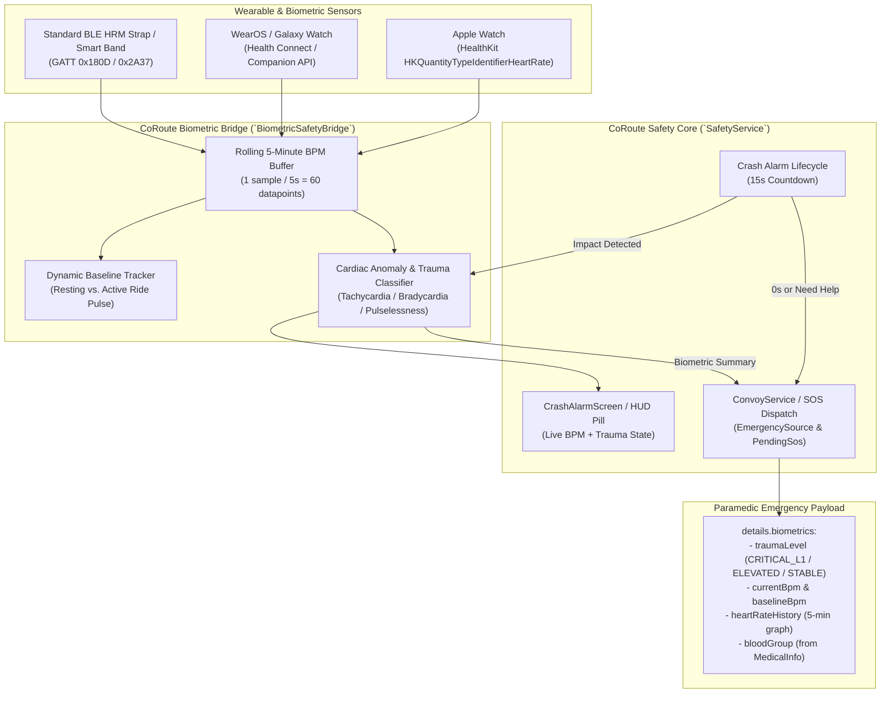

# FEAT-04: Smartwatch Biometric Trauma & Pulse Verification — Technical Analysis

> **Feature ID**: FEAT-04  
> **Feature Name**: Smartwatch Biometric Trauma & Pulse Verification  
> **Tier Entitlement**: Pro Rider / Road Captain (and Tour Operator)  
> **Priority**: High (Post-Crash Trauma Escalation & Paramedic Triage)  
> **Target Release Line**: v3.47.0+  

---

## 1. Problem Statement & Operational Context

In high-speed motorcycle accidents, especially solo touring or group rides across remote mountain ghats, canyons, and rural highways, riders are frequently ejected into roadside ditches, ravines, dense foliage, or under guardrails where they are visually obscured from passing traffic or trailing riders.

Under standard crash detection:
- A phone or handlebar unit triggers an emergency crash countdown (15 seconds) based on IMU shock ($> 6.5\text{ g}$) and sudden halt ($> 25\text{ km/h} \to 0$).
- If the rider is unconscious, internally hemorrhaging, or experiencing traumatic cardiac arrest, the countdown expires and sends a generic automated crash SOS.
- First responders and convoy members receive the location, but possess **zero visibility** into the physiological urgency of the victim. Dispatch priorities treat all crash alerts identically, leading to preventable fatalities during the "Golden Hour".

**FEAT-04 (Smartwatch Biometric Trauma & Pulse Verification)** bridges consumer and medical wearable sensors (Apple Watch via HealthKit, WearOS / Galaxy Watch via Health Connect, and standard Bluetooth Low Energy Heart Rate Service `0x180D`) directly into CoRoute's emergency dispatch pipeline.

---

## 2. Technical Architecture & Data Flow



---

## 3. Cardiac Anomaly Classification Protocol

The anomaly engine continuously maintains a rolling 5-minute window of heart rate measurements recorded during the ride. When a crash event or external impact occurs, the engine tracks heart rate in real time through the 15-second countdown:

| Classification | Physiological Indicator | Condition Criteria | Dispatch Escalation |
| :--- | :--- | :--- | :--- |
| **`criticalTraumaLevel1`** | **Traumatic Cardiac Arrest / Pulselessness** | $\text{BPM} = 0$, sudden flatline, or sensor loss of pulse while watch remains on wrist post-impact ($\ge 4.0\text{ g}$). | **IMMEDIATE CRITICAL L1 ALERT**: Triggers high-priority siren, flags paramedic triage as Level 1 Trauma / Asystole. |
| **`criticalTraumaLevel1`** | **Severe Tachycardia / Acute Hemorrhage Shock** | $\text{BPM} \ge 160$ post-impact, or $\text{BPM} \ge \text{Baseline} + 60\text{ BPM}$ sustained across countdown. | **CRITICAL L1 ALERT**: Flags hypovolemic / hemorrhagic shock risk. |
| **`elevatedTrauma`** | **Acute Stress / Moderate Tachycardia** | $\text{BPM} \in [120, 159]$ with elevated heart rate variability. | **HIGH SEVERITY**: Flags high pain/stress or conscious distress. |
| **`stableTrauma`** | **Normal Sinus Rhythm** | $\text{BPM} \in [50, 119]$ post-impact. | **STANDARD CRASH SEVERITY**: Stable vitals. |
| **`unverified`** | **Sensor Disconnected / Watch Off Wrist** | Watch unlinked, battery depleted, or watch detached during crash ejection. | **CLEAN FALLBACK**: Dispatches standard crash SOS without delay or failure. |

---

## 4. Paramedic Emergency Payload Integration

When the SOS is raised (either via countdown expiration `CRASH_AUTO` or rider confirmation `NEED_HELP`), `BiometricSafetyBridge` packages a structured biometric record attached to `PendingSos.toMessage()` under `details.biometrics`:

```json
{
  "type": "SOS",
  "lat": 18.5204,
  "lng": 73.8567,
  "alertType": "CRITICAL_TRAUMA_L1",
  "clientId": "rider-1730000000000",
  "auto": true,
  "speedBeforeKmh": 84.5,
  "impactG": 7.8,
  "source": "CRASH_AUTO",
  "details": {
    "speedBeforeKmh": 84.5,
    "impactG": 7.8,
    "traumaLevel": "CRITICAL_TRAUMA_L1",
    "biometrics": {
      "traumaLevel": "CRITICAL_TRAUMA_L1",
      "traumaDescription": "Severe Post-Impact Tachycardia (168 BPM) - Critical Trauma Level 1",
      "currentBpm": 168,
      "baselineBpm": 82,
      "sensorSource": "APPLE_HEALTHKIT",
      "watchOnWrist": true,
      "bloodGroup": "O+",
      "heartRateHistory": [
        {"ts": 1730000000, "bpm": 80},
        {"ts": 1730000030, "bpm": 82},
        {"ts": 1730000060, "bpm": 85},
        {"ts": 1730000290, "bpm": 168}
      ]
    }
  }
}
```

---

## 5. Subscription Entitlement & Gating

- **Pro Rider**, **Road Captain**, and **Tour Operator** tiers: Fully unlocked.
- **Community (Free)** tier: Gated. If a free rider pairs a smartwatch, the app displays an upgrade banner: *"Upgrade to Pro to unlock Smartwatch Biometric Trauma & Pulse Verification."*
- Managed cleanly via `FeatureGates.isUnlocked(Feature.biometricTraumaPulse)`.

---

## 6. Resilience & Edge Cases

1. **Watch Ejection / Disconnect on Impact**:
   - In violent crashes, a watch may break or fly off the rider's wrist.
   - If heart rate data ceases within 3 seconds of impact and watch status switches to disconnected, the bridge marks the state as `unverified` (or flags `watchDisconnectedDuringImpact = true`) and proceeds immediately with normal crash dispatch.
2. **Zero Battery Overhead**:
   - The biometric listener only subscribes to pulse events while `_port.rideActive` is `true`.
   - Polling frequency is clamped to 1 sample every 5–10 seconds, drawing $< 2\%$ battery over 4 hours.
3. **Medical Privacy & Data Minimization**:
   - Heart rate history is strictly in-memory (RAM only) during the ride.
   - It is never uploaded to the cloud unless an actual emergency SOS is triggered.
