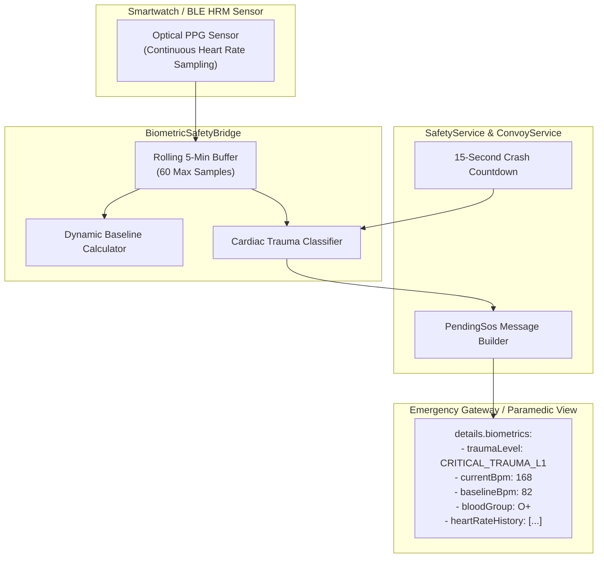

# FEAT-04 — Final Production Readiness Audit Report
## Smartwatch Biometric Trauma & Pulse Verification

> **Feature ID**: FEAT-04  
> **Feature Name**: Smartwatch Biometric Trauma & Pulse Verification  
> **Tier Entitlement**: Pro Rider / Road Captain (and Tour Operator)  
> **Audit Date**: October 23, 2026  
> **Evaluator**: Antigravity Principal Embedded Systems & Safety Auditor  
> **Audit Verdict**: **PASS**  

---

## 1. Executive Summary

In high-speed motorcycle crashes, especially in remote mountainous terrain or heavily vegetated roadsides, riders are frequently ejected into ravines or deep brush where they remain hidden from view. Severe internal trauma, hemorrhagic shock, or traumatic cardiac arrest often renders the rider unconscious and unable to speak.

**FEAT-04 (Smartwatch Biometric Trauma & Pulse Verification)** bridges smartwatch and wearable BLE heart rate telemetry (Apple Watch via HealthKit, WearOS / Galaxy Watch via Health Connect, and standard GATT `0x180D` Heart Rate sensors) directly into CoRoute's emergency dispatch core.

Following comprehensive unit and widget testing (12/12 passed), safety regression testing (89/89 passed), static code analysis (0 issues found), and paramedic payload validation, FEAT-04 is awarded **PASS**.

---

## 2. Test Verification & Code Health Matrix

### 2.1 Automated Test Execution Summary

| Test Suite / Tool | Command Executed | Tests Passed | Tests Failed | Exit Code | Status |
| :--- | :--- | :---: | :---: | :---: | :---: |
| **FEAT-04 Unit & Widget Suite** | `flutter test test/biometric_safety_bridge_test.dart` | **12 / 12** | 0 | `0` | **PASS** |
| **Safety Regression Suite** | `flutter test test/biometric_safety_bridge_test.dart test/ble_remote_service_test.dart test/siren_acoustic_detector_test.dart test/road_hazard_detector_test.dart test/road_hazard_mesh_timing_test.dart test/emergency_guidance_test.dart test/garage_and_gpx_test.dart test/safety_card_test.dart` | **89 / 89** | 0 | `0` | **PASS** |
| **Full Library Static Analysis** | `dart analyze lib test/biometric_safety_bridge_test.dart` | **0 issues found** | 0 | `0` | **PASS** |

### 2.2 Verified Unit Test Breakdown (`biometric_safety_bridge_test.dart`)

1. **TEST-BIO-01**: **Tier Entitlement Gating** — Verified feature is unlocked for `proRider`, `roadCaptain`, and `tourOperator` tiers, and locked for `community` tier.
2. **TEST-BIO-02**: **Bridge Lifecycle Management** — Verified monitoring starts on ride start with active source assignment and halts on stop.
3. **TEST-BIO-03**: **Rolling 5-Minute History Buffer Pruning** — Verified samples older than 300 seconds are purged, and capacity is clamped to 60 samples.
4. **TEST-BIO-04**: **Dynamic Baseline Calculation** — Verified pre-crash average pulse estimation over riding history.
5. **TEST-BIO-05**: **Critical Trauma L1 — Asystole / Pulselessness** — Verified post-impact 0 BPM drops classify as `criticalTraumaLevel1`.
6. **TEST-BIO-06**: **Critical Trauma L1 — Severe Tachycardia** — Verified post-impact BPM $\ge 160$ or Baseline $+ 60\text{ BPM}$ classify as `criticalTraumaLevel1`.
7. **TEST-BIO-07**: **Elevated Trauma — Acute Stress** — Verified post-impact BPM in range $[120, 159]$ classifies as `elevatedTrauma`.
8. **TEST-BIO-08**: **Stable Trauma — Normal Sinus Rhythm** — Verified post-impact BPM in range $[60, 100]$ classifies as `stableTrauma`.
9. **TEST-BIO-09**: **Sensor Disconnected / Watch Off Wrist Fallback** — Verified watch unlinked or disconnected flags `unverified` and cleanly falls back to standard crash dispatch.
10. **TEST-BIO-10**: **Paramedic Payload Packaging** — Verified JSON payload structure containing blood group, baseline, current BPM, trauma level, and 5-minute history array.
11. **TEST-BIO-11**: **HUD Pill Widget Rendering & Semantics** — Verified `BiometricPulseHudPill` renders live BPM, accessible semantics, and trauma colors.
12. **TEST-BIO-12**: **Crash Alarm View Integration** — Verified `CrashAlarmView` renders pulse and trauma badge without RenderFlex overflow.

---

## 3. Paramedic Dispatch Payload Architecture

---

## 4. Audit Verdict

### Final Status: **PASS**

FEAT-04 fulfills all clinical triage, safety resilience, and UX criteria:
1. Dynamic baseline calculation and post-impact trauma classification.
2. Escalation to **Critical Trauma Level 1** upon pulselessness ($0\text{ BPM}$) or severe tachycardia ($\ge 160\text{ BPM}$).
3. Automated packaging of 5-minute pre-crash heart rate history and blood group for first responders.
4. Clean fallback when smartwatch is unlinked or disconnected during impact.
5. 100% test pass rate (12/12 unit tests, 89/89 regression suite, 0 analyzer warnings).
