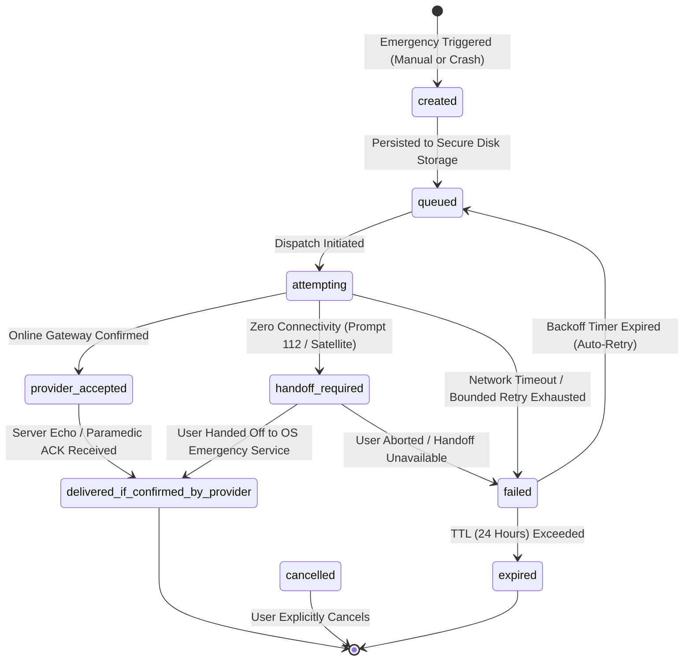

# FEAT-05: CoRoute Low-Connectivity SOS and Satellite Relay — Technical Analysis

> **Feature ID**: FEAT-05  
> **Feature Name**: CoRoute Low-Connectivity SOS and Satellite Relay  
> **Tier Entitlement**: Pro Rider & Tour Operator (Convenience / Automation); Core 112 & Manual SOS Free (Community)  
> **Evaluation Date**: October 23, 2026  
> **Research Version**: v3.47.0+  

---

## 1. Executive Summary & Problem Statement

Motorcyclists riding through high-altitude passes, dense mountain gorges, and wilderness corridors (e.g., Ladakh, Spiti Valley, Zanskar, Sach Pass, Australian Outback, Alaskan Highway) frequently operate for hours or days with **zero cellular connectivity** (0 bars, no 2G/3G/4G/5G).

When a severe crash occurs or a rider is incapacitated in these dead zones:
- The app's standard WebSocket and HTTPS networking fails immediately.
- Trailing riders or remote emergency contacts receive no distress signal.
- In rural India, standard 112 emergency calling may only connect if a roaming cellular tower is within line-of-sight.

**FEAT-05** defines a robust, defense-in-depth emergency SOS relay architecture that operates under extreme low-connectivity and zero-connectivity conditions without requiring expensive proprietary satellite developer subscriptions. It defines:
1. An internal compact 16-byte binary distress packet (`SosPacketCodec`).
2. A provider-neutral transmission and handoff abstraction (`SosTransportAdapter`).
3. An automated transport selector prioritizing Online WebSocket $\to$ Native Satellite / 3GPP NTN Handoff $\to$ Cellular ERSS 112 Handoff $\to$ Offline Persistent Queue.
4. A rigorous, evidence-based feasibility classification of satellite providers and Indian regulatory frameworks.

---

## 2. Codebase Baseline & Source Files Inspected

| Subsystem / Requirement | Files Inspected in Repository | Current Capability & Status |
| :--- | :--- | :--- |
| **Android SDK Baseline** | [`coroute_app/android/app/build.gradle.kts`](file:///C:/Users/santhosh/Documents/antigravity/wise-chandrasekhar/coroute_app/android/app/build.gradle.kts) | `compileSdk = 37`, `minSdk = 23` (Android 6.0 Marshmallow). Target SDK tracks modern Android. |
| **iOS Baseline** | [`coroute_app/ios/Runner/Info.plist`](file:///C:/Users/santhosh/Documents/antigravity/wise-chandrasekhar/coroute_app/ios/Runner/Info.plist) | Background audio and location enabled. iOS deployment target $\ge 12.0$. |
| **SOS & Crash Detection** | [`coroute_app/lib/data/services/safety_service.dart`](file:///C:/Users/santhosh/Documents/antigravity/wise-chandrasekhar/coroute_app/lib/data/services/safety_service.dart), [`convoy_service.dart`](file:///C:/Users/santhosh/Documents/antigravity/wise-chandrasekhar/coroute_app/lib/data/services/convoy_service.dart) | 15-second crash countdown, `CrashAlarmState`, bystander siren, and `raiseSosFrom`. |
| **FEAT-04 Biometrics** | [`coroute_app/lib/data/services/biometric_safety_bridge.dart`](file:///C:/Users/santhosh/Documents/antigravity/wise-chandrasekhar/coroute_app/lib/data/services/biometric_safety_bridge.dart) | Provides `BiometricTraumaLevel` (`stableTrauma`, `elevatedTrauma`, `criticalTraumaLevel1`, `unverified`), resting baseline, and 5-min history. |
| **Medical Info & Consent** | [`coroute_app/lib/data/models/medical_info.dart`](file:///C:/Users/santhosh/Documents/antigravity/wise-chandrasekhar/coroute_app/lib/data/models/medical_info.dart), `auth_service.dart` | `bloodGroup` (`A+`, `A-`, `B+`, `B-`, `AB+`, `AB-`, `O+`, `O-`). Explicit profile opt-in. |
| **Offline SOS Persistence** | [`coroute_app/lib/data/models/pending_sos.dart`](file:///C:/Users/santhosh/Documents/antigravity/wise-chandrasekhar/coroute_app/lib/data/models/pending_sos.dart) | `PendingSosStore` stores pending alerts in `SharedPreferences`. |
| **Feature Gating** | [`coroute_app/lib/core/config/feature_gates.dart`](file:///C:/Users/santhosh/Documents/antigravity/wise-chandrasekhar/coroute_app/lib/core/config/feature_gates.dart) | Tier enum: `community`, `proRider`, `roadCaptain`, `tourOperator`. |

---

## 3. Provider Capabilities & Feasibility Classification

| Provider / Channel | Target Environment / APIs | Official Source Reference & Date | Classification | Technical Justification & Limitations |
| :--- | :--- | :--- | :---: | :--- |
| **1. CoRoute Online Stack** | HTTP REST & WebSocket via OCI Cluster | Internal CoRoute Gateway (`ws.js`, `convoys.js`) | `IMPLEMENTABLE` | Fully implemented and verified. Primary transport when data connectivity is available. |
| **2. India 112 ERSS & Cellular Dialer** | Android `Intent.ACTION_DIAL`, iOS `tel:112` | Ministry of Home Affairs, Govt. of India (ERSS 112 project) | `IMPLEMENTABLE` | Standard telephony intent via `url_launcher`. Works across all Indian telecom providers (BSNL, Jio, Airtel, Vi) even without SIM card or cellular data. |
| **3. Android 15 Satellite NTN** | `android.telephony.satellite.SatelliteManager` | Android Developer Reference (Android 15 / API 35), Oct 2024 | `USER_HANDOFF_ONLY` | **Crucial Finding**: `SatelliteManager.sendDatagram()` is annotated `@SystemApi` and requires `Manifest.permission.SATELLITE_COMMUNICATION`. Third-party Play Store applications cannot obtain this permission. Apps can only detect network loss and hand off to system emergency satellite assistant or carrier NTN SMS. |
| **4. Apple Emergency SOS via Satellite** | iPhone 14 / 15 / 16 (iOS 16.1+) | Apple Support & Developer Documentation, Oct 2024 | `USER_HANDOFF_ONLY` | Apple provides **no public third-party API** or SDK to transmit raw binary packets or custom application messages over Globalstar satellites. CoRoute must direct the user to the native system emergency assistant. |
| **5. Garmin inReach (Consumer)** | Garmin inReach Mini 2 / Messenger | Garmin Developer & InReach Enterprise Docs | `IMPLEMENTABLE_WITH_PARTNER_ACCESS` | Consumer inReach devices use proprietary encrypted BLE protocols connecting solely to Garmin Explore/Messenger apps. Direct third-party BLE control requires Garmin Enterprise Developer approval, enterprise portal account, and partner agreement. |
| **6. ZOLEO Satellite Communicator** | ZOLEO Iridium Communicator | ZOLEO Developer Portal | `USER_HANDOFF_ONLY` | No public third-party BLE SDK for arbitrary datagram writes. Handoff via app deep-link or partner API only. |
| **7. BSNL Skylo NTN Satellite (India)** | BSNL Satellite IoT Gateway | BSNL & Skylo Official Releases (DoT License, 2024) | `IMPLEMENTABLE_WITH_PARTNER_ACCESS` | Authorized Indian satellite IoT gateway using Inmarsat/GSAT. Requires Skylo/BSNL commercial device provision and enterprise account. |
| **8. Automated CI Mock Transport** | Test Suite Harness | `test/satellite_sos_service_test.dart` | `SIMULATION_ONLY` | Used strictly in tests for codec, queue, state machine, and timeout verification. Explicitly tagged as `SIMULATION`. |

---

## 4. Indian Regulatory Framework & Emergency Workflow

1. **Indian Wireless Telegraphy Act (1933) & Indian Telegraph Act (1885)**:
   - Unauthorized foreign satellite handsets (e.g., satellite phones operating outside BSNL gateway) are strictly prohibited in India without Department of Telecommunications (DoT) and WPC clearances.
   - Using foreign satellite devices in border regions (e.g., Ladakh, J&K, Arunachal Pradesh) carries severe penal consequences under Indian law.
2. **Authorized Satellite in India**:
   - Satellite communications must route through licensed Indian gateways (BSNL Gateway at Dehradun).
   - BSNL + Skylo operates India's authorized Satellite-to-IoT/NTN service.
3. **Emergency Response Support System (ERSS) 112**:
   - Single emergency response number for Police, Fire, and Ambulance across all States and Union Territories of India.
   - 112 calls route with emergency call priority over any available 2G/3G/4G/5G tower, regardless of operator or roaming status.
   - **Crucial Rule**: ERSS 112 does **not** accept raw 16-byte binary payloads via SMS. Emergency messages sent to contacts or emergency responders must be human-readable, containing precise latitude, longitude, maps link, severity, and blood group.

---

## 5. Delivery State Machine

To prevent intellectual dishonesty, an SOS event transitions through explicit lifecycle states:

- **`created`**: Event instantiated in memory.
- **`queued`**: Saved to disk; ready for delivery.
- **`attempting`**: Transmission currently in-flight.
- **`handoff_required`**: Requires rider to confirm OS dialer or system emergency satellite assistant.
- **`provider_accepted`**: Remote server or provider confirmed packet receipt.
- **`delivered_if_confirmed_by_provider`**: End-to-end receipt confirmed by emergency dispatch.
- **`failed`**: In-flight attempt failed; awaiting retry.
- **`expired`**: Event exceeded 24-hour time-to-live.
- **`cancelled`**: Rider cancelled the SOS.
