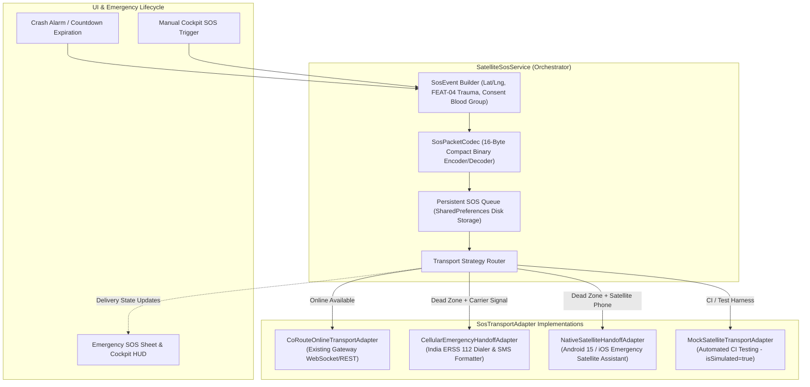

# FEAT-05: CoRoute Low-Connectivity SOS and Satellite Relay — Implementation Plan

> **Feature ID**: FEAT-05  
> **Feature Name**: CoRoute Low-Connectivity SOS and Satellite Relay  
> **Target Release Line**: v3.47.0+  

---

## 1. Architectural Blueprint & Component Map

---

## 2. Phase-by-Phase Execution Schedule

### Phase 1: Feature Gates Configuration
- **File**: `coroute_app/lib/core/config/feature_gates.dart`
- **Actions**:
  - Add `Feature.satelliteSosRelay` to `Feature` enum.
  - Set required tier: `SubscriptionTier.proRider` (unlocked for `proRider`, `roadCaptain`, `tourOperator`).
  - Add feature title and description.
  - Guarantee core emergency dialer (112) is available to all tiers including `community`.

### Phase 2: Compact 16-Byte Binary Codec (`SosPacketCodec`)
- **File**: `coroute_app/lib/domain/safety/sos_packet_codec.dart`
- **Actions**:
  - Implement fixed-point signed 32-bit coordinates ($10^7$ scaling).
  - Implement 16-bit altitude with `0x7FFF` sentinel.
  - Implement 32-bit timestamp (epoch seconds).
  - Implement 8-bit trauma classification (mapped from FEAT-04).
  - Implement 8-bit byte containing 4-bit blood group + 4-bit modulo-16 checksum.
  - Implement encoding and decoding with comprehensive validation.

### Phase 3: SOS Domain Model & Delivery State Machine
- **File**: `coroute_app/lib/domain/safety/sos_event.dart`
- **Actions**:
  - Define `SosDeliveryState` enum (`created`, `queued`, `attempting`, `handoffRequired`, `providerAccepted`, `deliveredIfConfirmedByProvider`, `failed`, `expired`, `cancelled`).
  - Define `SosEvent` class with timestamp, coordinates, trauma level, consented blood group, retry count, and TTL.
  - Define `SosTransmissionResult` with status, provider ID, error message, and `isSimulated` flag.

### Phase 4: Provider-Neutral Transport Abstraction
- **File**: `coroute_app/lib/data/services/sos_transport_adapter.dart`
- **Actions**:
  - Abstract class `SosTransportAdapter`.
  - Concrete adapter: `CoRouteOnlineTransportAdapter`.
  - Concrete adapter: `CellularEmergencyHandoffAdapter` (with ERSS 112 message formatter).
  - Concrete adapter: `NativeSatelliteHandoffAdapter`.
  - Concrete adapter: `MockSatelliteTransportAdapter` (`isSimulated = true`).

### Phase 5: SOS Orchestration Service (`SatelliteSosService`)
- **File**: `coroute_app/lib/data/services/satellite_sos_service.dart`
- **Actions**:
  - Singleton / factory with `ValueNotifier<List<SosEvent>> activeEventsNotifier`.
  - Queue management, bounded retry backoff (1s, 2s, 4s... max 5 attempts).
  - Disk persistence via `SharedPreferences`.
  - Auto-routing between available transports.

### Phase 6: Automated Testing & Audit Documentation
- **File**: `coroute_app/test/satellite_sos_service_test.dart`
- **Actions**:
  - Implement 15 unit and integration tests.
  - Run `flutter test test/satellite_sos_service_test.dart`.
  - Run full safety regression suite.
  - Run `dart analyze`.
  - Produce comprehensive audit report and field validation checklist.
