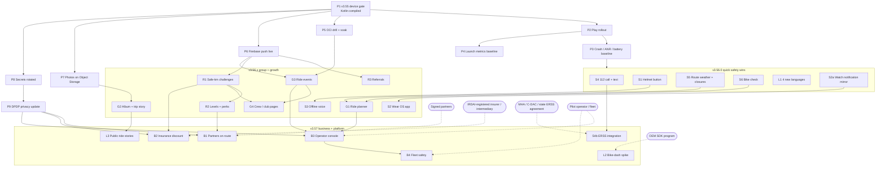

# CoRoute next release plan (v3.56)

Nov 9, 2026 · plan for the owner · baseline: v3.55 code (pubspec `3.55.0+10019`, gateway 904 / 904 tests, 66 admin switches)

## Summary

v3.56 adds the items the owner approved for the next release, grouped into three milestones:

| Milestone | Theme | What ships | Effort (engineer-weeks) |
|---|---|---|---|
| **v3.56.0** | Quick safety wins | Helmet / headset button for talk and SOS, 112 one-tap fallback, weather and road alerts on the planned route, pre-ride bike check, Tamil / Kannada / Malayalam / Marathi for safety screens and spoken alerts, plus the v3.55 carry-over fixes | ~14 |
| **v3.56.x** | Group and growth (with the larger safety items) | Ride planner by the weakest tank, Wear OS watch backup, offline phone-to-phone voice, ride album and trip story, ride events, crew / club pages, safe-km challenges, rider levels, referral rewards | ~38 |
| **v3.57** | Business and platform | Partners on route, insurance safe-rider discount, operator console for tour companies and rentals, fleet safety for companies, public ride story pages, bike-dash feasibility, 112 ERSS integration if access is granted | ~35 + partner time |

Plain truths up front:

- **v3.55 has not been on a phone yet.** The 3.55 Kotlin has never been compiled; every "Needs device check" row in [FEATURE_STATUS.md](FEATURE_STATUS.md) is still open. Nothing in this plan starts before the v3.55 device gate and Play rollout (see "What must happen first").
- **Four items depend on outside parties more than on code:** 112 ERSS (restricted government system), insurance (an IRDAI-registered insurer or intermediary), bike dashboards (closed OEM programs), partner offers (signed partners). The code for them is the smaller part.
- **Effort sizes:** S = up to 1 engineer-week, M = 2–3, L = 4–6, XL = 8 or more. They assume one engineer who knows this codebase, and include tests and the device pass. They do not include translation, legal or partner lead time.

## Contents

1. [What must happen first](#what-must-happen-first)
2. [Safety items](#safety)
3. [Group items](#group)
4. [Growth items](#growth)
5. [Business items](#business)
6. [Platform items](#platform)
7. [Known limits carried forward from v3.55](#known-limits-carried-forward-from-v355)
8. [Milestone plan](#milestone-plan)
9. [Dependency graph](#dependency-graph)
10. [Success metrics per milestone](#success-metrics-per-milestone)
11. [Open owner decisions](#open-owner-decisions)

---

## What must happen first

None of these are new features, but each one blocks part of v3.56.

| # | Before | Why it blocks | Blocks |
|---|---|---|---|
| P1 | **v3.55 device gate passed**: Gradle build of the 3.55 Kotlin (`TtsChannel.kt`, `MediaVolumeGuard.kt`, `PhoneCallChannel.kt`, `RideNotification.kt`, `PushChannel.kt`, `CoRouteMessagingService.kt`), `flutter test`, and the audio / siren / lock-screen / pillion checks in [DEPLOY_PROMPT_v3.55.md](DEPLOY_PROMPT_v3.55.md) | The helmet button, Wear OS and offline voice all build on the ride foreground service, the shared ride mic and the critical-alert path. Building on code that has never run would stack unknowns. | Everything |
| P2 | **Play Store production rollout** (listing live, `PLAY_STORE_URL` set) | Growth items need real riders. Play vitals are needed for the baseline. | All growth, all business |
| P3 | **Crash / ANR baseline**: 2–4 weeks of Play vitals on 3.55 (crash-free users, user-perceived ANR rate, top 5 clusters) plus battery drain per riding hour from [BATTERY.md](BATTERY.md) | Every v3.56 item adds a radio, sensor or background job. Without a baseline we cannot tell what made things worse. Play's bad-behaviour limits are 1.09 % crashes and 0.47 % ANR; our target is well under both. | Go / no-go of each milestone |
| P4 | **Launch metrics baseline** from `feature_analytics.js` / admin analytics: weekly active riders, rides per rider, share of group rides, share of rides with a planned route, average group size, Day-30 retention | Success metrics below are written as change from this baseline. | Success metrics |
| P5 | **OCI two-VM drill and 30-minute soak** (sets the live-rider cap, [SERVER_LOAD.md](SERVER_LOAD.md)) | Events, albums and challenges add load and storage. | v3.56.x |
| P6 | **Firebase project live** (`FCM_SERVICE_ACCOUNT_JSON` in Vault, 4 client values in the build) | Event reminders, challenge results, referral rewards and album notices use push. | v3.56.x growth |
| P7 | **Review photos and APKs on Object Storage** (code exists, settings only, [features_355/platform.md](features_355/platform.md)) | The ride album must not fill the VM disks. | Ride album |
| P8 | **Secrets rotation** (JWT secret, DB password, DuckDNS token into Vault) | Hygiene before partners and businesses get accounts. | v3.57 |
| P9 | **Privacy policy update for India's DPDP Act 2023** (consent records, purpose limits, erase) | Insurance, fleet and partner items share rider data with third parties under explicit consent. | v3.57 |

---

Each item below uses the same rows. "Switch" is the proposed id for Admin > Feature switches (`gateway/src/feature_flags.js`); new switches are on by default and not locked unless stated, and the app treats an unknown switch as on (existing rule). "Name in the app" follows [UX_NAMING_GUIDE_v3.55.md](UX_NAMING_GUIDE_v3.55.md) (sentence case, no internal terms).

## Safety

### S1. Helmet / headset button for talk and SOS

| | |
|---|---|
| Goal | Let riders talk to the group and raise SOS from the helmet set or earbud button, gloves on, phone in the tank bag. |
| User value | No reaching for the phone while riding. Most Indian group riders already own a Bluetooth helmet set (Sena, Cardo, Blueride, cheap 5–7 k sets) or ANC earbuds. |
| Current code | `lib/data/services/ble_remote_service.dart` already turns media keys (play / pause, headset hook, next, volume) into gestures: single press = talk, double = hazard marker, triple or 2.5 s long press = SOS, and calls `SafetyService` / `IntercomService`. **Gap found while reading the code:** it listens through Flutter's `HardwareKeyboard`, so it only hears keys while CoRoute is in the foreground with the screen on. Helmet buttons send AVRCP media commands, which Android delivers to the app holding the **active media session**; there is no `MediaSession` in the Kotlin today. Also `batteryLevelNotifier` is a fixed 95 (placeholder). |
| Approach | 1) Add a native `MediaSessionCompat` owned by the ride foreground service (`RideNotification.kt` / the service started via `flutter_foreground_task`), active only during a ride; forward `onMediaButtonEvent` to Dart over a new `coroute/media_button` channel that feeds the existing gesture engine (timings, debounce, SOS rules unchanged). 2) Keep the `HardwareKeyboard` path for HID remotes (camera shutters) with the screen on. 3) SOS from a button always opens the normal 15 s countdown (`SafetyService` crash-alarm path), never sends at once. 4) "Test your button" screen in Settings > Voice & sound that shows which gesture was heard. 5) Remove the fake battery level (show nothing unless a BLE Battery Service is read). 6) Hands-free and push-to-talk mic routing stay as in 3.55 (helmet mic only while held). |
| Dependencies | None external. No public Sena / Cardo SDK: their buttons are reached through standard AVRCP / HFP only. A deeper integration (dedicated button mapping, mesh hand-off) would need a partnership with the maker. |
| Privacy & safety | No new data. Accidental triple press while adjusting volume: countdown + "I'm OK" covers it; track false SOS openings. The SOS gesture keeps working when `headsetButton` is off (same rule as `bleRemote` today; `sos` is locked). |
| Known Android limit | Only one app gets media buttons: the one that played audio last. If the rider plays Spotify after the ride starts, Spotify gets play / pause. Options (owner decision D1): (a) accept it and tell the rider ("Media buttons go to your music app while music plays"); (b) CoRoute re-claims the session after each CoRoute voice line (it already takes audio focus for alerts), which may make the button pause CoRoute instead of music; (c) use a gesture music apps ignore (long press of the call button is often taken by the phone assistant). Recommended: (a) + (b), measured on device. |
| Switch | `headsetButton` (group Riding). SOS gestures ignore it. |
| Name in the app | **Helmet button** (setting "Use my helmet or earbud button"); test screen "Test your button". |
| Effort | **M (3)** |
| Risks | OEM differences in media-button routing (Xiaomi / Realme / Vivo background limits); helmet sets that send only HFP (call button answers a call). |
| Verify (devices) | Sena or Cardo set + one budget set + TWS earbuds, on 3 phone brands (Pixel / Samsung, Xiaomi, Realme or Vivo): screen off, app in background, 30 presses each gesture → correct action ≥ 29 / 30; triple press opens the countdown, never sends without it; Spotify playing → documented behaviour; incoming call → button answers the call, no talk; after the ride ends the session is released (Spotify gets its buttons back). |

### S2. Smartwatch (Wear OS): crash backup, wrist SOS, haptic turn and hazard cues

| | |
|---|---|
| Goal | A watch that backs up the phone's crash detection, gives a wrist SOS, and taps the wrist for turns and hazards. |
| User value | The phone may fly off the mount in a crash; the watch stays on the rider. Haptic cues work when the helmet set is off or music is loud. |
| Current code | `SafetyService.externalImpact(source: wearable, g, atMs)` exists since 3.16 ([WEARABLE_HOOK.md](WEARABLE_HOOK.md)) and opens the same crash alarm; the server already accepts `source: WEARABLE`. `biometric_safety_bridge.dart` (heart-rate trauma levels) and `smart_airbag_bridge_service.dart` (airbag vests) exist as bridges with no real device link. No Wear module in `android/`. |
| Approach | 1) New native Wear OS module (Kotlin, Compose for Wear OS; not Flutter: smaller, better battery, Health Services access). 2) Phone ↔ watch over the Wearable Data Layer (`MessageClient` for live events, `DataClient` for ride state). 3) Watch side: high-g + tumble detector at 50 Hz while a ride is active (own thresholds; no third-party app can use Pixel / Galaxy system fall detection); sends `IMPACT{g, atMs}` → phone calls `externalImpact`. The alarm shows on both; "I'm OK" on either cancels both. 4) Wrist SOS: hold the watch SOS tile 2 s → phone SOS countdown. If the phone is unreachable and the watch has LTE, the watch dials 112 (own dialer intent). 5) Haptics: turn left / right / arrive patterns from `nav_prompts.dart`, hazard pattern from road hazards, siren and SOS of another rider. 6) Optional heart rate via Health Services into the existing `biometric_safety_bridge` (only "pulse present / absent" in the alert, see privacy). 7) **Cheap reach for non-Wear watches:** most watches sold in India (Noise, boAt, Fire-Boltt, Amazfit) run closed systems with no third-party apps but mirror phone notifications with a buzz. Post short ride notifications ("Turn left 200 m", "Pothole ahead") on a dedicated low-noise channel the rider can mirror. No crash backup there. |
| Dependencies | Google Play services on the watch; Wear OS 3+ (Pixel Watch, Galaxy Watch 4+, some Fossil / TicWatch). Wear OS share in India is small: the watch app reaches a minority; the notification mirror reaches most. |
| Privacy & safety | Heart rate stays on the watch / phone; only "pulse detected yes / no" goes to responders with an open alert (same rule as medical info). The watch never sends an SOS without the countdown, except Need Help. Health permission asked only when the rider turns pulse on. |
| Switch | `wearApp` (group Safety); the watch crash backup obeys `crashDetection` (locked) and `sos` (locked) for the alarm itself; `wearApp` off stops haptics and pairing prompts only. |
| Name in the app | **Watch** (Settings > Ride safety > Watch); tile "CoRoute SOS". |
| Effort | **L (6)** watch app + bridge; notification mirror **S (1)** (can ship in v3.56.0). |
| Risks | Watch crash false positives (arm movements while riding: wave, glove adjust); battery on small watches; Data Layer latency when the phone's Bluetooth is busy with the helmet set. |
| Verify (devices) | Pixel Watch and Galaxy Watch with 2 phones: drop tests on a mat (watch strapped to a dummy arm), 2 h ride with zero false impacts, wrist SOS with phone screen off, haptic turn patterns recognised by a rider without looking, phone in airplane mode + LTE watch → 112 dial screen, battery drain per hour on the watch. Noise / boAt watch: mirrored cues arrive within 2 s. |

### S3. Offline phone-to-phone voice

| | |
|---|---|
| Goal | Group talk that works with no mobile signal, between phones riding close together. |
| User value | Today the intercom needs internet (3.55 known limit). Ghats, Ladakh, Spiti, the North-East and long highway stretches have no signal exactly where riders need to talk. |
| Current code | Intercom: `intercom_service.dart` sends 20–40 ms PCM16 frames (16 kHz, 8 kHz in data saver) over the gateway WebSocket; floor control and VOX live there. Mesh: `p2p_mesh_service.dart` + `domain/mesh/` (`mesh_transport.dart` interface, `mesh_packet_codec.dart`, `mesh_telemetry_packet.dart`) run over `udp_broadcast_mesh_transport.dart`, which needs every phone on one hotspot / LAN. Mesh carries SOS and telemetry today. |
| Approach | 1) New `NearbyMeshTransport implements MeshTransport` using Google **Nearby Connections** (Bluetooth + BLE + Wi-Fi hotspot / Wi-Fi Direct, chosen by Play services; strategy `P2P_CLUSTER`), so riders need no shared hotspot. Wi-Fi Aware only as a later option: few Indian phones support it. 2) Voice codec: PCM16 at 256 kbit/s is too heavy for a mesh. Encode **Opus at 12–16 kbit/s** with Android `MediaCodec` (Opus encoder from Android 10; fall back to 8 kHz PCM on older phones). 3) New mesh packet type `VOICE` with sequence numbers, a small jitter buffer in the existing player, and the same floor rule as online talk (one speaker at a time; SOS beats voice). 4) One-hop relay for voice (lead ↔ middle ↔ sweeper), TTL 2, to cover a stretched group; telemetry and SOS keep their own TTL. 5) Automatic hand-over: the intercom uses the gateway when online and the mesh when the socket is down; the rider sees "Talk · nearby" vs "Talk · online". 6) Voice cleanup (`voice_cleanup.dart`) runs before encoding, unchanged. |
| Dependencies | Google Play services (Nearby Connections), no agreement needed. Permissions: `NEARBY_WIFI_DEVICES` (Android 13+), `BLUETOOTH_SCAN` / `ADVERTISE` / `CONNECT`; Play Data safety entries. |
| Privacy & safety | Voice is only sent while the rider talks; peers are limited to the ride's members by a key derived from the join code (the mesh already uses the join code). No recording. |
| Range (honest) | Realistic phone-to-phone range on a bike is **50–200 m** (phone in a tank bag, bodies and engines in the way), better line of sight. That covers a tight group and regroups, not a group spread over 2 km. It does not replace a helmet mesh (Cardo / Sena ~1 km+). Say so in the app. |
| Switch | `offlineVoice` (group Group); also needs `offlineMesh` and `intercom`. |
| Name in the app | **Talk without signal** (status "Talk · nearby"); never "mesh". |
| Effort | **XL (8)** |
| Risks | Nearby Connections reconnect time (2–10 s) when riders move in and out of range; Bluetooth contention with the helmet set's A2DP (audio stutter); battery (radio always on); OEM background limits. Mitigation: only while signal is lost or the rider turns it on. |
| Verify (devices) | 4 phones (2 brands each side), helmet set on 2: parked at 25 / 50 / 100 / 200 m; riding in formation at 40–60 km/h on a road without signal (or with mobile data off): talk round trip < 400 ms within 100 m, intelligible speech, no A2DP stutter, relay through the middle rider, SOS during talk wins, battery drain per hour vs online talk. |

### S4. India 112 (ERSS)

| | |
|---|---|
| Goal | Reach 112 fast with the rider's location; integrate with ERSS where a sanctioned route exists. |
| User value | Faster help from police / ambulance, with location the responder can use. |
| Current code | 112 is already a button in the SOS sheet, the crash alarm screen and the assist banner (`SafetyConstants.emergencyNumber = '112'`, `highwayHelpline` also listed). Emergency texts open the messages app (no `SEND_SMS` permission, by Play policy). Server SMS goes through the DLT gateway (`emergency_sms_gateway.js`) to the rider's own contacts. |
| Research findings | **No public ERSS API.** ERSS (MHA, built by C-DAC) takes calls, SMS, e-mail, the 112 India app and the phone panic button, and receives alerts from AIS-140 vehicle trackers through state command centres. Third-party access is by agreement with MHA / C-DAC or a state police ERSS centre, case by case. Plan for months, not weeks, and no guarantee. **Android rule:** a third-party app cannot place a call to an emergency number by itself; `ACTION_CALL` to 112 opens the dialer, the rider presses call. **Android Emergency Location Service (ELS):** when 112 is dialled from the phone, Android can send the handset location to the ERC where the state has enabled ELS; coverage in India is partial and must be checked per state. |
| Approach (v3.56.0, fallback) | 1) "Call 112" stays one tap to the dialer with 112 filled in (that is the fastest Android allows). 2) New "Text 112" opens the messages app to 112 with a prefilled text: "Motorcycle accident / emergency. <lat,lng> <Google Maps link> near <place>. Name, bike, blood group." (rider taps send; SMS to 112 is accepted by ERSS, confirm per state). 3) Before the call, show the location in words big enough to read out ("Near Mile 34, NH48, Karnataka · 12.97, 77.59"), using the cached reverse geocode, so the rider or a bystander can say it. 4) Bystander mode on the lock screen (Medical ID already there): "Call 112" + the same location text. |
| Approach (v3.57, if access) | Write to MHA / C-DAC and one state ERSS (Karnataka, Kerala or Telangana suggested) for a pilot: CoRoute SOS with crash data pushed to the ERC as a structured alert, like AIS-140 panic alerts. Build only after a signed agreement. |
| Privacy & safety | The 112 text is composed by the rider's phone and sent by the rider. A future ERSS feed would send only for an open SOS / crash alert, with a one-time consent screen. Never auto-dial (also impossible). |
| Switch | `emergency112` (group Safety, locked, like `emergencySms`): the 112 buttons can never be switched off. |
| Name in the app | **Call 112**, **Text 112**. |
| Effort | Fallback **S (1)**; ERSS integration **unknown (L–XL)**, gated by access. |
| Risks | ERSS access may never be granted; SMS to 112 handling differs by state. |
| Verify (devices) | Never call 112 in tests. Point the number to a test value in a debug build and check the dialer and the SMS composer open with the right text; read-out text matches the map; lock-screen bystander flow on 2 phones; with the debug override off, confirm the dialer opens with 112 (do not press call). |

### S5. Weather and road alerts ahead on the planned route

| | |
|---|---|
| Goal | Warn about rain, fog, strong wind and closed or risky ghat roads on the planned route, for the time the rider will reach each stretch. |
| User value | Decide before leaving (start earlier, change route), and get a heads-up 20–40 km before the stretch. |
| Current code | App `weather_service.dart` samples points along the route at the expected time (`samplePoints`, named after planned stops) and calls the gateway `POST /geo/weather`; gateway `geo.js` asks Open-Meteo (`config.weatherUrl`), 0.1° grid cache, rate limit per minute. Today the ride sheet shows one rain line. Road reports: `road_hazards.js` / `road_and_places.js` (crowd pothole / rough road with expiry), `road_risk.js`, admin warnings (`admin_warnings.js`). Cockpit cards and "speak while moving" exist (`ride_advisories.dart`, `RideTapGate`). |
| Approach | 1) Gateway: extend `geo.weather` to return per sample, at its ETA: rain amount and probability, visibility (fog), wind gusts, temperature; same cache and rate limit. 2) App: a "Weather on your route" timeline in the trip planner and pre-ride sheet ("Heavy rain likely 14:30–15:30 near Agumbe ghat"); in ride, a spoken line 20–40 km before (P1, once per stretch), re-checked every 30 min. 3) Road closures and ghat risk: new gateway collection `road_closures` (same shape and expiry rules as `road_hazards`): entered by admins (from state / BRO / district notices) and reported by riders ("Road closed" kind, needs 2 riders to show, expires in 24 h unless renewed). 4) Landslide **risk** (not closure): ghat stretch (from OSM curvature, `bend_advisor.dart`) + heavy rain forecast at ETA → "Landslide risk on this ghat in heavy rain. Ride with care." Never claim a road is closed without a report. |
| Dependencies | Open-Meteo (already used; check its terms for commercial use, or buy an API plan if needed). IMD warnings: no open API; IMD gives data access on request: ask (owner D6). GSI landslide forecasts (Bhusanket) cover few districts: research only. NHAI's Rajmargyatra has no public API. |
| Privacy & safety | Route samples go to the gateway as today (rounded to the grid); nothing new about the rider. A wrong "closed" report could send riders on a worse road: show source and age ("Reported by 3 riders, 2 h ago"), allow "Still closed? / Open now". |
| Switch | `weather` (existing) for the forecast; new `routeAlerts` (group Riding) for closures and landslide risk. |
| Name in the app | **Weather on your route**, **Road closed**, **Landslide risk**. |
| Effort | **M (3)** |
| Risks | Forecast accuracy in hills is poor; alert fatigue in monsoon (cap: at most one weather line per 30 min). |
| Verify (devices) | Unit tests on ETA sampling and caps; gateway tests for closures (2-rider rule, expiry, admin entry audited); a planned route through a ghat in monsoon (or a recorded forecast replayed) → card at the right distance; offline → "Weather not available" without errors. |

### S6. Pre-ride bike check

| | |
|---|---|
| Goal | A 30-second check of tyres, brakes, chain, lights and fuel for this ride, based on the bike and the planned distance. |
| User value | Catches the two most common ride-stoppers in India: low fuel on a long stretch and tyre / chain problems. |
| Current code | Pre-ride phone check (`presentation/diagnostics/pre_ride_phone_check_screen.dart`) and the checklist on join (`presentation/widgets/pre_ride_checklist_sheet.dart`) exist. Garage `bike_profile.dart` has tank, reserve, mileage, odometer, service interval (`isServiceDueSoon`); `fuel_range.dart` / `fuel_economy_service.dart` know range; route distance from `route_plan.dart`. |
| Approach | 1) Add a "Bike check" step after the phone check: tyres (pressure hint from bike type + pillion seated: "Solo 25/29 psi, with pillion 25/33 psi" from a small preset table, rider can edit), brakes, chain, lights / horn, documents (licence, RC, PUC, insurance date if entered). 2) Fuel for this ride: planned distance vs range from the active bike → "You need about 9 L for 310 km; your tank holds 13 L. Fill up before X" or "One fuel stop needed". 3) Service due soon from the garage. 4) All optional and skippable; remembers "checked today". |
| Dependencies | None. Pressure presets need a source (owner's manuals); show "check your manual" when unknown. |
| Privacy & safety | Stays on the phone. Never blocks SOS or joining (same rule as "Complete your bike"). |
| Switch | `bikeCheck` (group Riding). |
| Name in the app | **Bike check**. |
| Effort | **S–M (2)** |
| Risks | Wrong pressure presets: keep them as hints with the source shown. |
| Verify (devices) | Join a ride with a planned route of 300 km on a 10 L bike → fuel line correct; pillion seated → pressure hint changes; skip works; checklist never shows mid-ride. |

---

## Group

### G1. Ride planner with fuel stops and breaks by the weakest tank

| | |
|---|---|
| Goal | Plan a group route with fuel stops and breaks placed so the bike with the smallest range never runs short. |
| User value | No more "someone is on reserve" detours; breaks planned at real places (fuel, dhabas, rest areas). |
| Current code | Live only today: `domain/fuel/group_fuel_consensus.dart` finds the bottleneck bike during the ride; `group_break_planner.dart` (fatigue levels) and `regroup_point.dart` pick stops live; `route_essentials_service.dart` and gateway `essentials.js` / `poi_cells.js` give fuel, food, rest areas along a corridor; `trip_planner_screen.dart` + `route_stops_panel.dart` edit stops; joined riders' bikes carry tank / mileage (`bikeComplete`, garage sync). |
| Approach | 1) New pure-Dart `domain/route/ride_stop_planner.dart`: input route line, riders' usable range (tank − reserve) × mileage × safety margin 0.8, break interval (default 90–120 min, shorter at night or above 3,000 m using `night_care` / `altitude_care`), fuel stations and food / rest places from the corridor. Output a stop list with reasons ("Fuel: Pulsar 150 has 210 km range"). 2) In the trip planner: "Plan stops for the group" button for the trip owner; uses riders who joined or accepted a crew invite; for riders not yet joined, the trip owner can pick a typical bike. 3) Stops become normal planned stops (existing `STOP` flow), so the cockpit, regroup and roll call work unchanged. 4) EVs: range in km from battery and km/kWh, charging stations from OSM `amenity=charging_station` (add to `essentials.js` filters). |
| Dependencies | OSM data quality for fuel stations (good on highways, weak in remote areas): warn when the gap between stations exceeds the weakest range ("No fuel station known for 140 km: carry extra fuel"). |
| Privacy & safety | The planner sees only range numbers, not other riders' bike details beyond what the group already sees. |
| Switch | `ridePlanner` (group Group). |
| Name in the app | **Plan stops for the group**. |
| Effort | **M (3)** |
| Risks | Stations closed at night; plan must not override live `groupFuel` warnings. |
| Verify (devices) | Unit tests with synthetic routes (one 9 L bike in a group of 12 L bikes); a real 250 km group route with 3 phones: stops placed before the weakest range minus margin, live fuel warnings still work. |

### G2. Shared ride album and auto trip story

| | |
|---|---|
| Goal | Riders add photos to the ride; photos sit on the route map; the app builds a short trip story after the ride. |
| User value | The fun part of group riding, kept inside CoRoute instead of scattered across WhatsApp. Drives sharing and repeat rides. |
| Current code | Photo pipeline from place reviews and avatars: phone downsizing, magic-byte checks, EXIF strip, moderation queue (`review_photos.js`, `avatars.js`); `object_store.js` (OCI PAR, no SDK); trip report and replay (`timeline.js`, `tracks.js`, `trip_review_sheet.dart`); Marketing studio painter (`domain/marketing/marketing_layout.dart`) can render a story image. |
| Approach | 1) Gateway `ride_album.js`: `POST /api/rides/:groupId/photos` (members only, during or up to 7 days after the ride), stores to Object Storage, keeps a **rounded** position (snapped to the ride's own track, ±100 m) taken from the phone's EXIF before stripping. 2) App: "Add photos" on the trip report; photos as pins on the replay map; one tap to share a photo outside. 3) Trip story: an image / short slideshow built on the phone from the trip numbers (distance, hours, riders, longest stretch, highest point), 3–6 photos and the route shape, using the Marketing studio painter; shared through the share sheet. 4) Album visibility: ride members only; each rider can delete their photos; account erase removes them. |
| Dependencies | P7 (Object Storage) first. Storage budget: OCI free tier is 20 GB Object Storage; set a quota per ride (e.g. 100 photos, 1 MB each) and a retention (owner D8). |
| Privacy & safety | Home privacy: hide pins within 1 km of the start and end by default (riders often start at home). Faces of other riders: the album is members-only; a rider can ask to remove a photo of them (report → uploader or trip owner removes). No upload while moving (button disabled above 8 km/h, pillion can). |
| Switch | `rideAlbum` (group Community); `tripStory` (group Community). |
| Name in the app | **Ride album**, **Trip story**. |
| Effort | **L (5)** |
| Risks | Storage cost growth; moderation load (start with report-only, no pre-approval inside private albums). |
| Verify (devices) | 3 phones: add photos during a stop and after the ride, pins on the right part of the route, start / end hidden, delete and erase remove the object, story renders on a low-end phone (2 GB RAM) in < 5 s, share sheet works on WhatsApp / Instagram. |

### G3. Ride events (public rides by clubs, with sign-ups and capacity)

| | |
|---|---|
| Goal | Clubs and organisers publish a ride with date, meeting point, route, capacity and rules; riders sign up; on the day it becomes a normal CoRoute group ride. |
| User value | Riders find rides to join; clubs fill rides without spreadsheets and WhatsApp polls. A strong growth loop. |
| Current code | Crews (invitation-only circles, up to 100 riders) and crew ride invites (`crews.js`, `crew_ride_invites.js`); public ride and discovery (`public_ride.js`, `discovery.js`); plans and seats (`entitlements.js`, `membership_routes.js`: one plan per group ride, Small 2–6 / Large 7–12); push (`push.js`); website pages (`pages.js`). |
| Approach | 1) Gateway `ride_events.js`: event `{organiser (club), title, startAt, meet point, planned route, capacity, min score level optional, rules text, status}`, sign-ups with waitlist, cancel, reminders by push (24 h, 2 h). 2) Discovery: list of upcoming events near the rider (city-level, opt-in), and a share link `/e/<code>` that opens the app (App Links already on `/join/`; add `/event/`). 3) On the day, the organiser starts the ride and signed-up riders get the existing **Ride invitation** flow (crew ride invite code reused). 4) **Capacity vs plans:** a Large Group ride holds 12; club rides are often 20–60. Needs a decision (owner D9): an "Event" plan for organisers, or several linked groups (A / B / C squads) each up to 12, which also matches how big rides actually split. 5) Free events only in v3.56.x; paid events (collect fees) are v3.57 and need Razorpay Route (marketplace payouts, organiser KYC, GST). |
| Dependencies | Organiser verification process (admin approves clubs); Razorpay Route for paid events (v3.57). |
| Privacy & safety | Strangers riding together: show organiser verified badge, rules, emergency contact requirement; sign-up shows username only to other riders, first name to the organiser; report / block applies; women-only events option (organiser flag; enforcement is the organiser's). Meeting point is public; the live ride is not. |
| Switch | `rideEvents` (group Community). |
| Name in the app | **Ride events**; organiser = **Club**; actions "Sign up", "Leave waitlist". |
| Effort | **L (6)** (free events) |
| Risks | Moderation of public listings; no-shows; organiser misuse (commercial tours without permits). |
| Verify (devices) | Gateway tests (capacity, waitlist promotion, cancel, two nodes); 4 phones: create → sign up 3 with capacity 2 → waitlist → one cancels → promoted with push → event day invite → join with bike check; link opens the app on both hosts. |

### G4. Crew / club pages with badges and shared history

| | |
|---|---|
| Goal | A page per crew showing rides together, total km, badges and upcoming events. |
| User value | Identity and pride for crews and clubs; a reason to keep riding together in CoRoute. |
| Current code | Crews (`crews.js`, `crew_routes.js`, `crew_polls`), crew ride invites link rides to a crew, stored trips and `/api/me/stats`, rider score, leaderboard rounding and privacy floors (`public_privacy.js`). |
| Approach | 1) Record `crewId` on rides started from a crew invite (already known at invite time). 2) Crew page: rides together, km together (rounded), members' badge counts, last 5 rides (date and region, no exact routes), upcoming events. 3) Crew badges: "10 rides together", "1,000 km together", "Monsoon ride", "Zero overspeed month" (from score counts, never speed). 4) **Club = public crew** (owner D10): a crew admin may make the crew page public (name, logo, rounded totals, events); members are listed only if each opts in. |
| Dependencies | G3 for events on the page. |
| Privacy & safety | Members private by default; no member's routes or dates shown publicly; crew page totals follow the 10-rider privacy floor for public pages. |
| Switch | `crewPages` (group Community). |
| Name in the app | **Crew page**; public form **Club page**. |
| Effort | **M (3)** |
| Risks | Badge inflation; crews that want chat (still no chat: owner rule from 3.55). |
| Verify (devices) | Gateway tests for totals and privacy; 3 phones: crew ride → page updates after the ride report; public toggle hides members who did not opt in. |

---

## Growth

### R1. Monthly safe-km challenges and badges

| | |
|---|---|
| Goal | Monthly challenges like "500 safe km in November", counting only km ridden within the limit, with badges. |
| User value | A reason to ride with CoRoute on every ride; rewards safe riding, never speed. |
| Current code | Rider score (`rider_score.js`, `rider_score_service.dart`) already gets per-ride overspeed episodes, separation, breaks and the phone's five counts; leaderboard rules (3 rides of 10 km+, implausible-ride filter, username only, opt-out). |
| Approach | 1) Gateway `challenges.js`: monthly challenge definitions (admin-created; templates "safe km", "rides with breaks", "night-free month"); progress = km of server-recorded rides **minus km in overspeed episodes**; rides with implausible numbers don't count. 2) Badges stored per rider; shown on My profile and crew pages. 3) Optional public challenge board (usernames, rounded km, same opt-out as leaderboards). 4) Push on milestones (50 %, done). |
| Rules (safety) | Never speed, never "fastest", never time-limited stretches; a ride with a 40 %+ overspeed episode earns 0 safe km for that ride. No incentive to ride tired: km beyond 4 h without a break don't count (same cap as the score). |
| Privacy & safety | Uses data the score already uses. Opt-out hides the rider publicly but keeps private progress. |
| Switch | `challenges` (group Community). |
| Name in the app | **Monthly challenge**, **Badges**. |
| Effort | **M (2)** |
| Risks | Riders padding km with car rides (phone in a car): filter by motion pattern is weak; keep rewards non-monetary until R3 fraud checks exist. |
| Verify (devices) | Gateway tests (overspeed km removed, month boundary IST, implausible rides); 2 phones: one ride within limit, one with a forced overspeed (on a test track or replay) → correct progress. |

### R2. Rider levels with partner perks

| | |
|---|---|
| Goal | Turn the existing levels (Learner / Steady / Skilled / Ace Rider) into perks from partners. |
| User value | Real rewards for safe riding (service discounts, gear offers). |
| Current code | Levels exist in `rider_score.js`; coupons exist (`plan_pricing.js`); Marketing studio binds coupons to images. |
| Approach | 1) v3.56.x: level badges on profile, crew page and a "Perks" screen listing CoRoute perks (plan coupons by level, e.g. Ace Rider: 20 % off Small Group). 2) v3.57: partner perks from B1 (service centres, gear shops) unlocked by level, delivered as single-use codes. |
| Dependencies | Partners (B1) for non-CoRoute perks. |
| Privacy & safety | Partners never see the score; they see only "code valid / used". |
| Switch | `riderPerks` (group Community). |
| Name in the app | **Perks**. |
| Effort | **S (1)** now; partner part inside B1. |
| Risks | Gaming the score to unlock perks (smoothness counts are self-reported, 25 % of the score): require 3 server-recorded rides and a minimum of 30 days at the level. |
| Verify (devices) | Level change → perk appears; code single-use across two nodes. |

### R3. Referral rewards tied to Marketing studio coupons

| | |
|---|---|
| Goal | Riders invite friends; both get a coupon when the friend completes a real first ride. |
| User value | Cheaper plans for riders who bring riders. |
| Current code | Friend invite links (`invite_codes`, `/join/friend/<CODE>`), coupons and plan pricing (`plan_pricing.js`, Razorpay), Marketing studio QR (`/get?coupon=CODE`: **does not apply the coupon yet**, a 3.55 limit). |
| Approach | 1) Fix the coupon link: `/get?coupon=CODE` stores the code through sign-up (like the friend invite) and pre-fills it on Plan payment. 2) Referral = the existing friend invite link plus a reward rule: after the new rider's first ride of 10 km+ recorded by the server, both get a single-use coupon generated from an admin "Referral" coupon template. 3) Admin: referral campaign settings (reward %, cap per rider per month, end date) and a report (invites, sign-ups, qualified, coupons used). 4) Marketing studio: "Referral" starter template with `{code}` = the rider's own link. |
| Dependencies | None external. |
| Fraud & privacy | One reward per new phone number (verified at sign-up) and per device; cap 10 rewards per rider per month; no reward for accounts that share a device with the referrer; coupons expire in 60 days. The referrer sees only "Your friend finished a ride", never their trips. |
| Switch | `referrals` (group Community). |
| Name in the app | **Invite friends**, **Your reward**. |
| Effort | **M (2)** |
| Risks | Coupon abuse (fake accounts): the qualified-ride rule plus caps. |
| Verify (devices) | Gateway tests (qualification, caps, two nodes); 2 phones: invite → sign-up → first ride → both coupons → apply at payment (Razorpay test mode). |

---

## Business

### B1. Partners on route (service centres, fuel, hotels, dhabas) with offers

| | |
|---|---|
| Goal | Partner places on the map and route essentials, with offers riders can use. |
| User value | Trusted stops with a discount; partners get riders who are already nearby. First real revenue line beyond plans. |
| Current code | Map places and route essentials from OSM (`poi_cells.js`, `essentials.js`, `map_places_service.dart`), CoRoute rider reviews with moderation, coupons, Marketing studio, `RideTapGate` (no taps while moving). |
| Approach | 1) Gateway `partners.js`: partner accounts (business name, GST, location(s), category, offer text, validity, single-use or reusable code), admin approval, audit. 2) Partner places appear as normal places with a "Partner offer" tag; offer card only when stopped or in planning (never as a moving popup, never in a safety moment). 3) Redemption: rider shows a code / QR; partner marks it used in a simple partner web page (`/partner`), giving counts only. 4) Ranking stays honest: partners never outrank the nearest hospital, and rider reviews are never editable by partners. 5) Billing (later): monthly listing fee or per-redemption, GST invoices. |
| Dependencies | Signed partners (sales effort, the main cost); legal templates (partner terms, offer liability); ASCI ad-disclosure rules ("Partner offer" label); GST registration of CoRoute. |
| Privacy & safety | Partners see counts and redemption time only, never who. No location sharing with partners. No offers during SOS / crash / rider-down. |
| Switch | `partnerOffers` (group Places). |
| Name in the app | **Partner offer**. |
| Effort | **XL (8)** |
| Risks | Ads eroding trust in a safety app; partner churn; fake offers. |
| Verify (devices) | Gateway tests (approval, ranking guard, redemption single-use across nodes); 2 phones + a partner browser: offer shown only when stopped, redeemed once. |

### B2. Insurance safe-rider discount (opt-in)

| | |
|---|---|
| Goal | Riders with a good score can get a discount on two-wheeler insurance from a partner insurer, by their choice. |
| User value | Money back for safe riding. |
| Feasibility (honest) | CoRoute cannot sell or recommend specific insurance without being an **IRDAI-registered intermediary** (corporate agent, web aggregator, or similar). IRDAI has allowed telematics-based motor add-ons ("pay as you drive / how you drive") since 2022, so an insurer *can* price on riding data, but the product and the discount are theirs. Path: partner with an insurer (or a registered intermediary) that offers a telematics add-on; CoRoute shares a **score certificate** on the rider's request and links to the insurer's own purchase flow. |
| Approach | 1) "Share my safety score" in Rider score: creates a signed, time-limited certificate (score band, level, rides counted, km, date range; no routes, no speeds, no places) the rider sends to the insurer or the insurer fetches with the rider's one-time code. 2) Partner API for the insurer to verify a certificate. 3) Revoke at any time; record consent (DPDP Act). |
| Dependencies | Insurer / intermediary agreement (months); legal review; DPDP consent records (P9). |
| Privacy & safety | Explicit opt-in per share; nothing sent by default; insurer never gets raw trips. Make sure a bad score can never be pulled by an insurer without consent (no lookup by phone number). |
| Switch | `insuranceDiscount` (group Platform). |
| Name in the app | **Share my safety score**. |
| Effort | **L (4)** tech, after a partner signs. |
| Risks | No insurer interest at CoRoute's current size; regulatory change. |
| Verify (devices) | Gateway tests (certificate signature, expiry, revoke, no extra fields); end-to-end with the insurer's sandbox. |

### B3. Operator console for tour companies and rental fleets

| | |
|---|---|
| Goal | A web console where a tour company or rental fleet runs many rides, bikes and riders at once. |
| User value | Tour operators (Ladakh, Spiti, Goa, Kerala tours) and rentals get live safety over every customer; CoRoute gets B2B revenue. |
| Current code | Admin console (Flutter, `lib/presentation/admin/`), live group map, Ride Guardian links, safety report, timeline, plans (`entitlements.js`; a legacy `tourOperator` tier exists and maps to 12 seats), staff roles (`staff.js`). |
| Approach | 1) Organisation accounts with staff roles (owner, ride manager, viewer). 2) Fleet garage: bikes owned by the organisation, assigned to riders per ride (works with the bike-swap logic). 3) Console web pages: all live rides on one map, open alerts first, rider check-in status, fuel stops plan (G1), trip reports. 4) Rides above 12: same decision as events (squads or an operator plan). 5) Billing per bike per month or per tour, GST invoice. |
| Dependencies | Pricing and contracts (owner D13); a pilot operator. |
| Privacy & safety | Customers consent at join ("This ride is run by <operator>, who can see your live location and safety alerts during the ride"); location visible only during the ride; operator never gets the rider's medical info outside an open alert. |
| Switch | `operatorConsole` (group Platform). |
| Name in the app | **Operator console**; organisation = **Tour operator** / **Rental fleet**. |
| Effort | **XL (8)** |
| Risks | Scope creep into booking / payments; server load with many simultaneous rides (P5). |
| Verify (devices) | Gateway tests (org roles, cross-org isolation); pilot with 1 operator, 2 tours, 10+ phones. |

### B4. Two-wheeler fleet safety for companies and delivery

| | |
|---|---|
| Goal | Safety (crash detection, SOS, overspeed alerts, score) for company and delivery two-wheeler fleets. |
| User value | Fewer injuries for delivery and field riders; a large B2B market. |
| Feasibility (honest) | Different from leisure riding: many short trips, shift-based, employer-owned data needs, gig-worker laws (e.g. Rajasthan 2023 and Karnataka gig worker acts, Code on Social Security). Treat as a separate product track; pilot with one fleet. |
| Approach | Reuse B3 organisations with a "fleet" mode: shift start / end instead of rides, crash / SOS to the fleet safety desk, weekly safety score per rider, overspeed reports by zone. Location visible to the employer **only during a shift**. |
| Dependencies | B3; a pilot company; legal review of worker monitoring and consent. |
| Privacy & safety | Shift-only tracking, rider sees exactly what the employer sees, score never used alone for penalties (contract clause), DPDP consent. |
| Switch | `fleetSafety` (group Platform). |
| Name in the app | **Work shift**. |
| Effort | **XL (10)** |
| Risks | Battery on all-day shifts (8–10 h); surveillance perception; price pressure. |
| Verify (devices) | 8-hour shift battery test on budget phones; pilot with 10–20 riders for 4 weeks. |

---

## Platform

### L1. More languages: Tamil, Kannada, Malayalam, Marathi

| | |
|---|---|
| Goal | Safety screens and spoken alerts in Tamil, Kannada, Malayalam and Marathi, next to English, Hindi and Telugu. |
| User value | Riders understand alerts at once in their own language: a safety gain, not only reach. |
| Current code (verified) | `lib/core/l10n/l10n.dart`: `AppLanguage { system, en, hi, te }`, map-based tables in `strings_core.dart`, `strings_safety.dart`, `strings_screens.dart` (about 190 keys per language), used by 25 files (217 `L10n.t` calls). Only safety screens and spoken alerts are translated; **every other screen stays English** (3.16 decision). TTS tags `en-IN`, `hi-IN`, `te-IN`; `TtsChannel.kt` checks `isLanguageAvailable`. |
| Approach | 1) Add `ta`, `kn`, `ml`, `mr` to `AppLanguage` with native labels and TTS tags `ta-IN`, `kn-IN`, `ml-IN`, `mr-IN`. 2) Translate all keys (professional translator + one rider-reviewer per language for road words: "speed breaker", "ghat", "pillion"). 3) Add the 3.55 strings that are still English-only in spoken lines (siren, horn, missing-rider, pillion) to the tables for all languages. 4) If the phone lacks the TTS voice: prompt to download it (Google TTS) and fall back to English speech with the screen in the chosen language. 5) Font check: Manrope has no Indic glyphs; confirm the system Noto fallback renders all four scripts in cards and the ride notification. 6) A key-coverage test that fails when a language misses a key. |
| Dependencies | Translation vendor (1–2 weeks lead time). |
| Privacy & safety | None new. Spoken length grows in some languages: check P0 lines still fit the alarm timing. |
| Switch | None needed (language is a rider setting); optional `extraLanguages` (group Platform) to hide the four new choices if a translation problem is found. |
| Name in the app | Native names: தமிழ், ಕನ್ನಡ, മലയാളം, मराठी. |
| Effort | **M (3)** engineering + translation time. Translating all screens is a separate, much larger job (owner D15). |
| Risks | Bad translations of safety lines; missing TTS voices on budget phones. |
| Verify (devices) | Each language on 2 phones: every safety screen, crash alarm, SOS sheet, siren line, missing-rider check; TTS voice present / absent paths; long strings do not overflow at 360 dp width. |

### L2. Bike-dash screens (TVS SmartXonnect, RE Tripper, Android Auto)

| | |
|---|---|
| Goal | Show CoRoute navigation and alerts on the bike's own dash screen. |
| Feasibility (honest) | **Closed today.** TVS SmartXonnect, Royal Enfield Tripper, Bajaj, Hero and Ather connected dashes pair only with the maker's own app over private protocols; there is no public SDK. **Android Auto has no two-wheeler mode in India**; the few motorcycles with Android Auto / CarPlay are premium imports. Reverse-engineering the protocols would break terms and risk the Play listing. |
| Approach | 1) v3.57: feasibility spike and OEM outreach (TVS, Royal Enfield, Bajaj, Hero, Ather): pitch CoRoute group safety alerts as a partner integration. 2) Build only after an OEM program gives an SDK. 3) Meanwhile, the helmet button (S1), watch haptics (S2) and spoken alerts cover "eyes on the road". |
| Dependencies | OEM partnership and SDK. |
| Switch | `bikeDash` (group Platform), only if built. |
| Effort | Spike **S (1)**; build **L–XL** per OEM after an SDK. |
| Risks | No OEM response; each OEM is a separate integration. |
| Verify | Spike output: a one-page answer per OEM (program exists? terms? cost?). |

### L3. Opt-in public ride story pages on the website

| | |
|---|---|
| Goal | A rider or trip owner can publish a ride story page on the website (route shape, numbers, photos, riders who agreed). |
| User value | Something to share beyond WhatsApp; free marketing for CoRoute through real rides. |
| Current code | Website pages (`pages.js`, `gateway/public/`), trip story (G2), privacy floors and rounding (`public_privacy.js`), leaderboards' username-only rules. |
| Approach | 1) "Publish story" on the trip report → page `/ride-story/<random id>` (not guessable, not indexed unless the rider chooses "Allow search engines"). 2) Content: route shape with the first and last 2 km cut, distance / hours / riders count, chosen photos, usernames only of riders who each said yes (asked by push), no dates finer than month, no times of day. 3) Unpublish at any time; account erase removes it. 4) Open Graph image from the trip story. |
| Dependencies | G2. |
| Privacy & safety | Off by default; every rider shown must consent; never live; never exact home area. |
| Switch | `publicRideStories` (group Community). |
| Name in the app | **Publish story**. |
| Effort | **M (2)** |
| Risks | Misuse to publish others' photos: only the uploader's own photos, or photos whose uploader agreed. |
| Verify (devices) | Gateway tests (consent, cut ends, unpublish); page at phone / mid / desktop widths, light and dark; WhatsApp link preview. |

---

## Known limits carried forward from v3.55

| Limit | Status in v3.56 | Plan |
|---|---|---|
| **Siren direction cannot be known with one mic** | Stays. | Research spike **S (1)** in v3.56.x: some phones expose stereo capture from 2–3 mics (~10–15 cm apart). Time difference could give left / right at best, not front / back, and the phone's mount angle is unknown. Ship only if a device test shows ≥ 90 % correct left / right on 3 phones; otherwise keep "never claims behind". |
| **Intercom voice needs internet** | Fixed for riders within ~200 m by S3. | Beyond that, still needs signal; say so in the app. |
| Helmet button works only with the app in front (found in this review) | Fixed by S1 (media session). | — |
| BLE remote battery shows a fixed 95 % (found in this review) | Fixed by S1. | — |
| Siren in a pocket at 80 km/h may be missed | Stays (physics). | Mount check (`mountCheck`) already tells the rider. |
| Helmet / earbud mics never used for detection | Stays (by design). | — |
| Call-only (HFP) helmet sets get critical lines on the phone speaker | Stays. | Recheck with S1 test sets. |
| Coupon QR link does not apply the coupon | Fixed by R3. | — |
| Sound DSP runs on the UI isolate | Move to a background isolate **S (1)** if the 3.55 baseline (P3) shows jank on low-end phones. | Decide from Play vitals. |
| iPhone app pending | Not in v3.56 scope. | Owner D16. |
| Kotlin of 3.55 never compiled | Must be done before v3.56 starts (P1). | — |

---

## Milestone plan

Order inside each milestone = recommended build order.

### v3.56.0: quick safety wins (~14 engineer-weeks; about 6–7 weeks with 2 engineers)

| Order | Item | Effort | Why first |
|---|---|---|---|
| 1 | S4. 112 one-tap call + "Text 112" + read-out location (fallback) | S (1) | Highest safety value per hour; no outside dependency. Start the ERSS letter in parallel. |
| 2 | S1. Helmet / headset button (media session) + carry-over fixes | M (3) | Riders already own the hardware; fixes a real background gap found in this review. |
| 3 | S5. Weather and road alerts ahead | M (3) | Builds on working weather code; monsoon / winter-pass season value. |
| 4 | S6. Pre-ride bike check | S–M (2) | Small, uses garage data already collected. |
| 5 | L1. Tamil, Kannada, Malayalam, Marathi (safety screens + speech) | M (3) | Safety lines understood at once; translation lead time runs in parallel from week 1. |
| 6 | S2a. Watch notification mirror (non-Wear watches) | S (1) | Haptic cues for most Indian watches at low cost. |
| — | Carry-over: siren DSP isolate (only if P3 shows jank) | S (1) | — |

### v3.56.x: group and growth, plus the larger safety items (~38 engineer-weeks)

Suggested split: **v3.56.1** (planner, challenges, referrals, Wear OS), **v3.56.2** (album, trip story, events, crew pages, offline voice).

| Order | Item | Effort |
|---|---|---|
| 1 | G1. Ride planner by the weakest tank | M (3) |
| 2 | R3. Referral rewards + coupon link fix | M (2) |
| 3 | R1. Monthly safe-km challenges and badges | M (2) |
| 4 | R2. Rider levels and CoRoute perks (partner perks later) | S (1) |
| 5 | S2. Wear OS watch app (crash backup, wrist SOS, haptics) | L (6) |
| 6 | G2. Ride album + trip story | L (5) |
| 7 | G4. Crew / club pages | M (3) |
| 8 | G3. Ride events (free) | L (6) |
| 9 | S3. Offline phone-to-phone voice | XL (8) |
| 10 | Siren direction spike | S (1) |

S3 is last only because it is the largest and riskiest; if the owner ranks "talk without signal" above growth, move it to v3.56.1 and push G3 back.

### v3.57: business and platform (~35 engineer-weeks + partner lead time)

| Order | Item | Effort | Gate |
|---|---|---|---|
| 1 | L3. Public ride story pages | M (2) | G2 shipped |
| 2 | B1. Partners on route with offers (+ partner perks for R2) | XL (8) | First 10 signed partners in one region |
| 3 | B3. Operator console | XL (8) | Pilot operator signed; pricing decided |
| 4 | B2. Insurance safe-rider discount | L (4) | Insurer / intermediary agreement |
| 5 | B4. Fleet safety | XL (10) | B3 + pilot company + legal review |
| 6 | L2. Bike-dash feasibility spike + OEM outreach | S (1) | — |
| 7 | S4b. ERSS integration | L–XL | Only with a signed MHA / C-DAC / state agreement |
| — | Paid events (Razorpay Route) | M (3) | Organiser KYC, GST |

---

## Dependency graph

---

## Success metrics per milestone

Measured against the P3 / P4 baselines over the first 4 weeks after each release reaches 100 % rollout.

| Milestone | Metric | Target |
|---|---|---|
| **v3.56.0** | Crash-free users (Play vitals) | ≥ 99.5 % and not worse than the 3.55 baseline |
| | User-perceived ANR rate | < 0.3 % (Play limit 0.47 %) |
| | Battery drain per riding hour | No more than +2 percentage points vs 3.55 with the helmet button on |
| | Helmet button: SOS countdowns opened by the button that ended in "I'm OK" within 5 s (accidental) | < 1 per 100 riding hours; zero SOS sent without a countdown |
| | Riders who pair a helmet button (of group riders) | ≥ 15 % |
| | Rides with a planned route that got a route weather check | ≥ 80 % |
| | Bike check completed (of rides where shown) | ≥ 40 % |
| | Riders using ta / kn / ml / mr | Tracked; ≥ 50 % of riders whose phone is in that language |
| **v3.56.x** | Group rides with planned stops from the planner | ≥ 25 % of group rides with a route |
| | "Ran out of fuel" group events (fuel status + rider stopped) | Down vs baseline |
| | Referral: invited riders who complete a first ride | ≥ 30 % of sign-ups from invites |
| | Monthly challenge participation | ≥ 20 % of monthly active riders |
| | **Guardrail:** overspeed minutes per 100 km | Must not rise (gamification must not push speed) |
| | Ride album: group rides with ≥ 1 photo | ≥ 30 % |
| | Ride events: average fill rate; no-show rate | ≥ 60 %; < 25 % |
| | Day-30 retention | +5 points vs baseline |
| | Wear OS: false watch impacts | < 1 per 50 riding hours |
| | Offline voice: field test success (talk heard within 100 m) | ≥ 95 % of presses |
| **v3.57** | Signed partners live / offer redemptions per month | ≥ 50 partners in 2 regions / tracked |
| | Paying operators | ≥ 3 operators on the console |
| | Insurance: insurer live; riders who share a score | 1 insurer; tracked |
| | Fleet pilot | 1 pilot, 4 weeks, battery ≤ 6 % per hour on budget phones |
| | Non-plan revenue share | Tracked (first B2B revenue) |
| | Safety guardrail | Crash-free and ANR targets from v3.56.0 still met |

---

## Open owner decisions

| # | Decision | Options | Recommendation |
|---|---|---|---|
| D1 | Helmet button vs music app media buttons | (a) accept, tell the rider; (b) CoRoute re-claims the media session after its own voice lines; (c) other gesture | (a) + (b), decided after device tests |
| D2 | Helmet triple-press SOS on by default? | On / off until the rider tests the button | Off until "Test your button" is done once, then on |
| D3 | Wear OS app native or Flutter | Native Kotlin / Flutter | Native (battery, Health Services) |
| D4 | Ship the watch notification mirror in v3.56.0? | Yes / wait for the Wear app | Yes |
| D5 | Start the ERSS outreach now (MHA / C-DAC + one state) | Yes / later | Yes, in parallel; no build until signed |
| D6 | Weather source for commercial use | Open-Meteo free / Open-Meteo paid plan / other; request IMD data access | Check Open-Meteo terms, buy a plan if needed; request IMD access |
| D7 | Who enters road closures | Admins only / admins + riders (2-rider rule) | Admins + riders |
| D8 | Ride album quota and retention | e.g. 100 photos per ride, kept 12 months; or tied to plan | 100 per ride, 12 months; longer on paid plans |
| D9 | Events and operator rides above 12 riders | New Event / Operator plan; or squads of up to 12 linked together | Squads (matches how big rides really split), plus an operator plan in v3.57 |
| D10 | Club = public crew, or a new entity? | Public crew / new "Club" | Public crew (one concept, less code) |
| D11 | Paid events (collect fees) | v3.57 with Razorpay Route / never | v3.57, after free events prove demand |
| D12 | Referral reward size and caps | e.g. 20 % off one month for both, 10 per month cap | As stated; review after 4 weeks |
| D13 | B2B pricing (operators, fleets) | Per bike per month / per tour / per shift | Per bike per month, pilot discount |
| D14 | Insurance path | Partner insurer with telematics add-on / registered intermediary / skip | Partner insurer; CoRoute shares a certificate only |
| D15 | Translate all screens (not only safety) into the 6 Indian languages? | Safety only (v3.56.0) / all screens later | Safety only now; all screens as a separate project |
| D16 | iPhone app timing | Before v3.57 / after | Owner call (not in this plan's estimates) |
| D17 | New admin switch ids | As proposed in each item | Accept; `emergency112` locked |
| D18 | Partner offers in the ride flow | Planning and stopped only / also spoken while moving | Planning and stopped only (no ads while moving, never in safety moments) |

### Proposed new admin switches (summary)

| Id | Group | Locked | Item |
|---|---|---|---|
| `headsetButton` | Riding | no (SOS gestures ignore it) | S1 |
| `wearApp` | Safety | no (alarm follows `crashDetection` / `sos`) | S2 |
| `offlineVoice` | Group | no | S3 |
| `emergency112` | Safety | **yes** | S4 |
| `routeAlerts` | Riding | no | S5 |
| `bikeCheck` | Riding | no | S6 |
| `ridePlanner` | Group | no | G1 |
| `rideAlbum`, `tripStory` | Community | no | G2 |
| `rideEvents` | Community | no | G3 |
| `crewPages` | Community | no | G4 |
| `challenges` | Community | no | R1 |
| `riderPerks` | Community | no | R2 |
| `referrals` | Community | no | R3 |
| `partnerOffers` | Places | no | B1 |
| `insuranceDiscount` | Platform | no | B2 |
| `operatorConsole` | Platform | no | B3 |
| `fleetSafety` | Platform | no | B4 |
| `extraLanguages` (optional) | Platform | no | L1 |
| `bikeDash` (only if built) | Platform | no | L2 |
| `publicRideStories` | Community | no | L3 |
