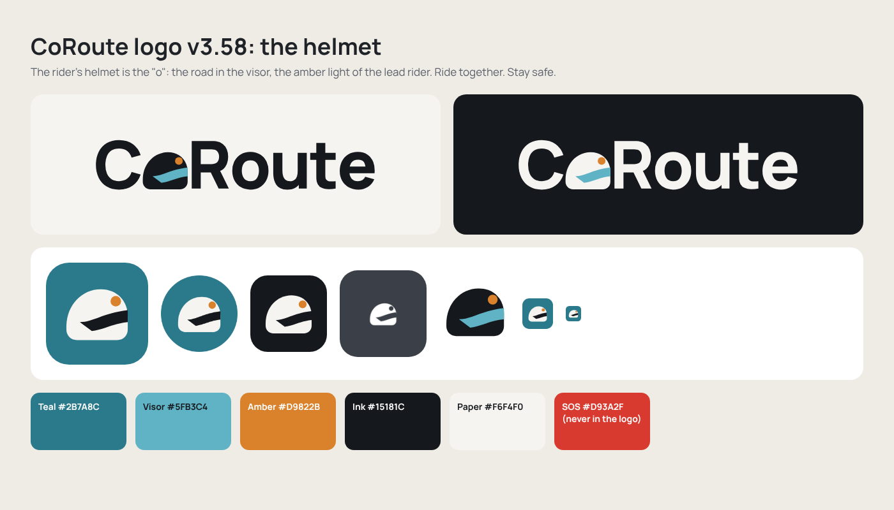

# CoRoute brand guide v3.58: the helmet logo

Chosen by the owner on 14 Nov 2026 (wordmark concept 3, "Helmet"). It replaces the old curved-road mark everywhere.

## The idea

The rider's helmet is the "o" in **CoRoute**. The visor holds the road ahead; the amber light is the lead rider
(and the sun on the road). Motto: **Ride together. Stay safe.**

## Files (one source of truth)

All logo files are generated by `python3 tool/brand/build_brand.py` (needs fontTools and rsvg-convert). Change the
geometry or colours there, run it, and every output below is rewritten. Never edit the PNGs by hand.

| File | Use |
|---|---|
| `docs/brand/svg/coroute-wordmark.svg` | wordmark on light backgrounds (ink letters, teal visor) |
| `docs/brand/svg/coroute-wordmark-on-dark.svg` | wordmark on dark or teal backgrounds (paper letters) |
| `docs/brand/svg/coroute-wordmark-teal.svg` | teal letters, paper visor (print, merchandise) |
| `docs/brand/svg/coroute-wordmark-mono.svg` | one colour (stamps, embroidery, fax) |
| `docs/brand/svg/coroute-wordmark-currentcolor.svg` | follows CSS `color` (website header/footer, mocks) |
| `docs/brand/svg/coroute-icon.svg` / `-square.svg` / `-dark.svg` | app icon: rounded, full square (stores), on ink |
| `docs/brand/svg/coroute-helmet*.svg` | the helmet alone (ink, on dark, one colour) |
| `docs/brand/svg/coroute-adaptive-*.svg` | Android adaptive icon foreground and monochrome layers |
| `docs/brand/png/*` | previews, 1200 px wordmarks, 1024 px icon, the brand board |

Generated into the product:

| Where | Files |
|---|---|
| Android launcher | `mipmap-*/ic_launcher.png`, `ic_launcher_round.png`, `ic_launcher_foreground.png`, `ic_launcher_monochrome.png` (Android 13+ themed icons); `mipmap-anydpi-v26/ic_launcher.xml` + `ic_launcher_round.xml`; background colour `@color/ic_launcher_background` = teal |
| Android notifications | `drawable/ic_stat_coroute.xml` (white helmet, visor and light cut out). Used by the ride notification, push messages (`CoRouteMessagingService`), the ride foreground service (`BackgroundService.rideNotificationIcon` + manifest meta-data), the crash alarm (`alarm_notifier.dart`) and Firebase's own notifications (manifest `default_notification_icon`). Kept from resource shrinking by `res/raw/keep.xml` |
| Android splash | `drawable-*/splash_icon.png` (the rounded icon on the theme background) |
| Flutter screens | drawn in code: `lib/core/ui/coroute_logo.dart` (`CoRouteAppIcon`, `CoRouteWordmark`, `CoRouteHelmet`). Splash, welcome, sign-in, update-required, licences page, admin consoles, the shared ride card. `assets/branding/coroute_icon.png` (1024 px) stays for anything that needs a bitmap |
| iOS / Flutter web | `ios/Runner/Assets.xcassets/AppIcon.appiconset/*` (square, no alpha), `web/favicon.png`, `web/icons/*` |
| Play Store | `store/icon_512.png` (512 px, full square, no alpha; Play adds the mask), `store/ic_launcher_foreground_432.png`, `store/coroute_mark.svg`; feature graphic and screenshots in `docs/store/play_assets_v3.58/` (rendered by `node tool/store_assets/render.js`) |
| Website | `favicon.svg`, `favicon-32.png`, `apple-touch-icon.png`, `icon-192.png`, `icon-512.png`, `icon-maskable-512.png`, `site.webmanifest` (teal theme), header/footer wordmark (`partials/`), receipt mark, `og-image.png`, `brand/*` (wordmark SVGs, icon) |
| E-mails | `gateway/src/email_brand.js`: hosted `brand/email-wordmark.png` (150 x 28 shown) with teal "CoRoute" alt text; teal buttons and links in every template (welcome, lifecycle, offers, marketing studio, receipts, security). Ride summary map line is teal |

## Colours

| Token | Hex | In the logo |
|---|---|---|
| Teal | `#2B7A8C` | icon background; buttons; links |
| Visor teal | `#5FB3C4` | visor in the wordmark |
| Amber | `#D9822B` | the light on the helmet |
| Ink | `#15181C` | letters on light; visor on the icon |
| Paper | `#F6F4F0` | letters on dark; helmet on the icon |
| SOS red | `#D93A2F` | **never in the logo**: red is reserved for emergencies |

## Rules

- Clear space around the wordmark: the height of the "C" on every side. Around the icon: 10 % of its size.
- Minimum sizes: wordmark 80 px wide on screen (18 dp in the app); icon 16 px (favicon) / 24 dp (status bar uses
  the one-colour helmet).
- Do not stretch, rotate, outline, add shadows or gradients, recolour the helmet red, or put the helmet anywhere but
  the "o". Do not set "CoRoute" in another font next to the icon: use the wordmark.
- On photos or busy backgrounds use the icon, or the wordmark on a solid paper/ink panel.
- The old curved-road mark (three dots on a road, dark square) is retired. If you find it anywhere, replace it.

## Release checklist for the logo (ships in build 3.55.0+10030 with rounds 11-12)

1. Launcher icon on Android 8, 12, 13+ (themed icons on and off), round-icon launchers, Pixel and Samsung.
2. Status bar and notification shade: ride notification, SOS/crash alarm, push message, foreground service: white
   helmet, never a white square.
3. Splash in light and dark; welcome, sign-in, update-required; licences page; share card image.
4. Play Console: upload `store/icon_512.png` and `docs/store/play_assets_v3.58/feature_graphic_1024x500.png`; the
   store icon change is reviewed with the next release.
5. Website: favicon in Chrome/Safari/Firefox, iOS home-screen icon, link preview (og-image) in WhatsApp; e-mail test
   send to Gmail (images on and off) and Outlook.
