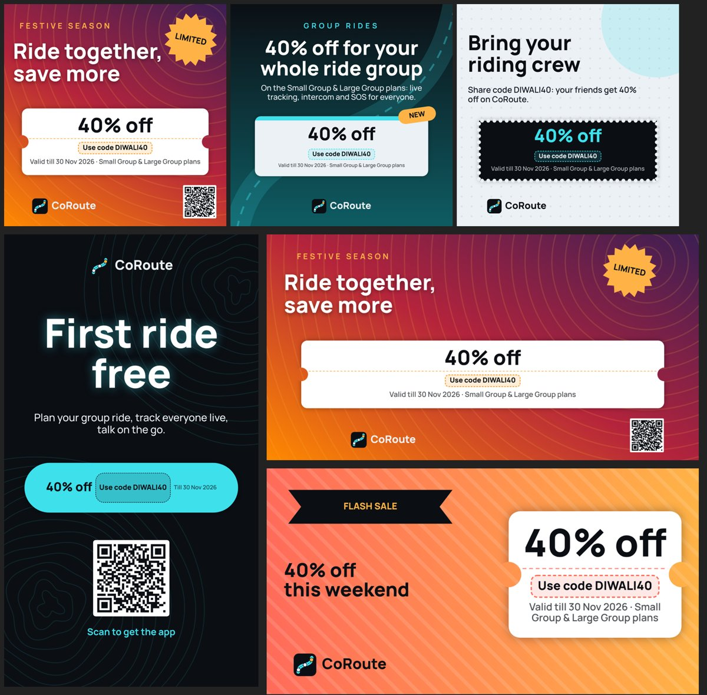

# Marketing studio (3.55)

An image creator in the admin console for coupon and special-offer posts (Instagram, WhatsApp
status, banners). Admins start from a starter template or a blank canvas, bind a real coupon, edit
every layer, save the template on the gateway and share full-resolution PNGs with a ready caption.

*Starter templates rendered by the visual-check script (a JS copy of the painter, see below).
Top: Festive offer, Group ride plan discount, Referral. Bottom: First ride free (story), Festive
offer re-laid as a banner, Weekend flash sale.*

## Where it is

- Admin console > Overview > Sections > **Marketing studio**.
- Payments > Coupons > **Make an offer image** (under the coupon list).
- Admin switch **Marketing studio** (`marketingStudio`, group Platform, on by default). Off: every
  `/api/admin/marketing/*` call answers `403 FEATURE_OFF` and the studio says so. Riders never see
  anything of it.

## Using it

1. **New image**: pick a starter (Festive offer, Group ride plan discount, First ride free, Referral,
   Weekend flash sale) or a blank canvas in one of the sizes.
2. **Bind a coupon** (ticket button or Template tab). Only ACTIVE or SCHEDULED coupons are offered.
   Text with `{code}`, `{discount}`, `{validUntil}`, `{plan}`, `{name}`, `{cap}` and `{link}` fills
   in from the coupon. Nothing is copied into the template: the values come from the coupon each
   time the template is opened, so a coupon edit (discount, expiry, plans) shows up by itself.
   Unbound: sample values are shown and a banner says so; export is blocked while the template
   shows coupon data.
3. **Edit**: tap a layer to select it; drag to move (snaps to the centre lines, pink guides),
   bottom-right handle to resize, top handle to rotate (snaps to 45 degree steps), pinch and twist on
   touch. Toolbar: Add (text, coupon block, logo, QR code, uploaded image, LIMITED / NEW badges,
   ribbon, pill, circle, rectangle, star), undo / redo, duplicate, delete, bring forward / send
   backward. Layers tab: reorder by dragging, hide, lock. Layer tab: every property of the selected
   layer. Template tab: name, size, coupon, link, caption, background.
4. **Save** (stored on the gateway; another admin's newer save is detected and not overwritten).
5. **Export and share**: edit the caption (written for you when the template caption is empty:
   offer, code, validity and link), **Copy caption**, then **Share PNG** (current size) or **Share all
   sizes** (1080x1080 post, 1080x1920 story / status, 1200x628 banner, re-laid by relative
   positions). To keep a copy, choose "Save image" / "Save to Files" in the share sheet.
   An expired, paused or used-up coupon asks for confirmation before exporting.

## Layers and options

| Layer | Options |
| --- | --- |
| Background (template level) | solid colour, 2-4 colour gradient with direction, uploaded image (fill / show all), built-in patterns drawn in code (contour lines, road, dots, stripes, rings, chevrons) with colour and strength, optional tint |
| Text | content (multi-line, placeholders), font (Manrope brand font, system sans, serif, monospace), size, weight, colour, alignment, letter spacing, line height, upper case, italic, shadow (colour, blur, offset), shrink to fit the box |
| Coupon block | ticket, pill (one row), card or stamp; headline / code line / footer text with placeholders (default `{discount}`, `Use code {code}`, `Valid till {validUntil} · {plan}`); fill, text and accent colours; the code line sits in a dashed chip |
| Logo | the CoRoute mark (drawn from the app icon), with or without the "CoRoute" word |
| Shape / badge | rectangle (corner radius), pill, circle, ribbon, star, burst badge; fill, outline, label (LIMITED, NEW, ...) |
| Image | uploaded JPEG / PNG / WebP, fill or show all, rounded corners |
| QR code | content (default `{link}`), module and background colours |

Every layer: position, size, rotation, opacity, hidden, locked, editor-only name.

**Link and QR code.** `{link}` is the template's link, or (empty) `<server>/get?coupon=<CODE>`, the
download page. A custom link may contain `{code}`. The QR encoder is pure Dart
(`lib/domain/marketing/qr_encoder.dart`: byte mode, level M, versions 1-10, up to 213 bytes), checked
module for module against the Python `qrcode` reference encoder for versions 1, 4, 7, 8, 9 and 10
and all eight masks.

## Rendering

`MarketingRenderer` (`lib/presentation/admin/marketing/marketing_painter.dart`) draws the template
JSON with a `Canvas`. The editor preview scales the canvas and calls it; the export records the
same drawing at full size (`PictureRecorder` -> `toImage` -> PNG), so preview and export match.

Geometry is relative: `x`, `y` = layer centre as a fraction of the canvas, `w`, `h` = fractions of
the canvas width / height. Lengths (font size, stroke, radius, shadow, letter spacing) are units of
1 px on a canvas whose short side is 1080 px. Changing the size (or "all sizes") keeps every
centre; logos, QR codes, images and round badges keep their pixel shape; text, coupon blocks and
bars keep their width fraction; text and coupon lines shrink to fit; layers are nudged back
inside the canvas (`mkRetarget` in `lib/domain/marketing/marketing_layout.dart`).

## Gateway

`gateway/src/marketing_templates.js`, registered in `routes.js` after authentication. Every route
has `requireAdmin` first (riders get 403 before anything else), then the `marketingStudio` switch.

| Method and path | What |
| --- | --- |
| `GET /api/admin/marketing/templates?status=active\|archived\|all` | list (summaries, limits, size presets) |
| `POST /api/admin/marketing/templates` | create (201) |
| `GET /api/admin/marketing/templates/:id` | one template + live coupon view |
| `PUT /api/admin/marketing/templates/:id` | replace; `baseUpdatedAt` -> 409 `CONFLICT` when someone saved meanwhile |
| `PATCH /api/admin/marketing/templates/:id/status` | `{status: active\|archived}` |
| `POST /api/admin/marketing/templates/:id/duplicate` | copy named "... (copy)" |
| `DELETE /api/admin/marketing/templates/:id` | delete |
| `GET /api/admin/marketing/coupons` | bindable coupons (public fields + placeholders) |
| `POST /api/admin/marketing/images` | raw image bytes -> `{image: {id, width, height, ...}}` |
| `GET /api/admin/marketing/images` | uploaded images |
| `GET /api/admin/marketing/images/:id` | the bytes (admin only, `nosniff`) |
| `DELETE /api/admin/marketing/images/:id` | 409 `IMAGE_IN_USE` while a template uses it |

**Schema** (version 1): `{version, name, status, size: {preset, width, height}, background,
couponCode, link, caption, layers: [...]}`. The gateway rebuilds the template from known fields only
(unknown keys dropped, colours upper-cased) and refuses with 400 and a `path`:

- name 1-80 characters; size preset `instagram_post` 1080x1080, `instagram_story` /
  `whatsapp_status` 1080x1920, `banner` 1200x628, or `custom` 200-4096 px per side;
- at most 40 layers (`TOO_MANY_LAYERS`) and 10 image layers; unique layer ids;
- text up to 500 characters, coupon lines 160, badge labels 40, caption 1000, link / QR content 300;
- colours `#RRGGBB` or `#RRGGBBAA`; every number range-checked (position -0.5..1.5, size
  0.005..3, rotation -360..360, font size 4..600, weight 100..900, ...);
- image references must be uploaded image ids (`rp_` + 24 hex) that exist (`UNKNOWN_IMAGE`);
- a newly bound coupon must exist (`COUPON_NOT_FOUND`) and be active or scheduled
  (`COUPON_NOT_ACTIVE`); a coupon that expired or was paused after binding stays bound (saving
  works) and the view carries a `warning`;
- the whole template at most 200,000 characters of JSON.

**Coupon safety.** Templates store only the coupon code, which riders type anyway. The coupon view
(`couponView`) carries code, name, campaign, discount, cap, validity, status, plans and computed
placeholders; never the store key, usages, rider ids, allowed users or internal notes (tested).

**Storage.** Templates and image metadata are documents in `subscription_config`
(`k='mkt_template'`, `k='mkt_image'`), so they are in the hourly critical backup. Image bytes go
through the review-photo store (`review_photos.js`): magic-byte type check (JPEG / PNG / WebP only,
SVG and GIF refused), 2 MB, EXIF / GPS / text metadata stripped, random names, disk outside
`public/` or Object Storage (`REVIEW_PHOTO_STORE=par`, objects under `review-photos/`). Caps: 300
templates, 300 images.

**Audit.** Admin audit log entries (Settings > Audit log): `marketing.template.create`, `.update`,
`.duplicate`, `.archive`, `.activate`, `.delete`, `marketing.image.upload`, `marketing.image.delete`.

## Files

- `gateway/src/marketing_templates.js` (new), `gateway/src/routes.js` (one line),
  `gateway/src/feature_flags.js` (one catalog entry).
- `lib/domain/marketing/`: `marketing_template.dart` (model, limits, JSON), `marketing_placeholders.dart`,
  `marketing_layout.dart` (scaling, hit test, snapping, undo / redo, z-order), `qr_encoder.dart`,
  `starter_templates.dart`. Pure Dart.
- `lib/presentation/admin/marketing/`: `marketing_studio_screen.dart` (list, starters),
  `marketing_editor_screen.dart`, `marketing_inspector.dart` (property panels, colours, layers list),
  `marketing_painter.dart` (renderer, preview painter, PNG export), `marketing_api.dart`.
- Entry points: `master_admin_dashboard.dart` (Sections row), `admin_promotions_tabs.dart` (Coupons tab row).
  The nine-section nav is unchanged.
- Packages: only existing ones (`share_plus`, `image_picker`, `http`, `provider`). No new dependency.

## Tests

- `gateway/test/marketing_templates_355.test.js`: rider 403 on every route (no token 401), schema
  validation (sizes, colours, layer types, text length, 40-layer limit, unknown keys dropped),
  coupon binding (only active, placeholders, follows coupon edits, warning after pause, no internal
  fields), images (SVG / GIF / JSON / >2 MB refused, metadata stripped, in-use delete refused),
  duplicate / archive / conflict / audit, the `marketingStudio` switch.
- `test/marketing_template_355_test.dart`: JSON round trip of every starter, lenient reading,
  placeholders (gateway rules, India-time dates, links), retarget maths, rotated hit test,
  snapping, undo / redo, z-order and duplicate limits, QR reference vectors and capacity.
- The starter templates were also run through the gateway's `cleanTemplate` (accepted unchanged
  apart from the empty `name` field).

## Visual check (not shipped)

`docs/features_355/marketing_preview/` holds a JS copy of the painter (`render.html`), a Dart dump of
the starters with QR matrices (`dump_starters.dart`) and a Puppeteer script (`render.js`); usage is in
the header of `render.js`. It made the image above. It mirrors the Flutter painter by hand, so small
differences are possible (text measuring, shadows).

## Limits

- Flutter could not be run in this environment: the editor and the Flutter painter are checked
  by `dart analyze` and the pure tests, not on a device.
- Save to device goes through the share sheet (no `path_provider` / gallery package in the app).
- Fonts: the bundled Manrope plus the platform's sans, serif and monospace; no font upload.
- The QR code and `{link}` open `<server>/get?coupon=CODE`. The website and the app do not apply
  the coupon from that link yet; riders type the code shown on the image.
- One undo history per editor session (not saved).
- The "all sizes" export is an automatic re-layout; extreme aspect changes may need a manual
  touch in the editor (change the size in the Template tab and adjust).
