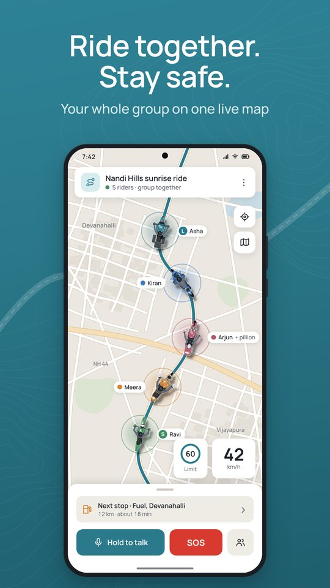
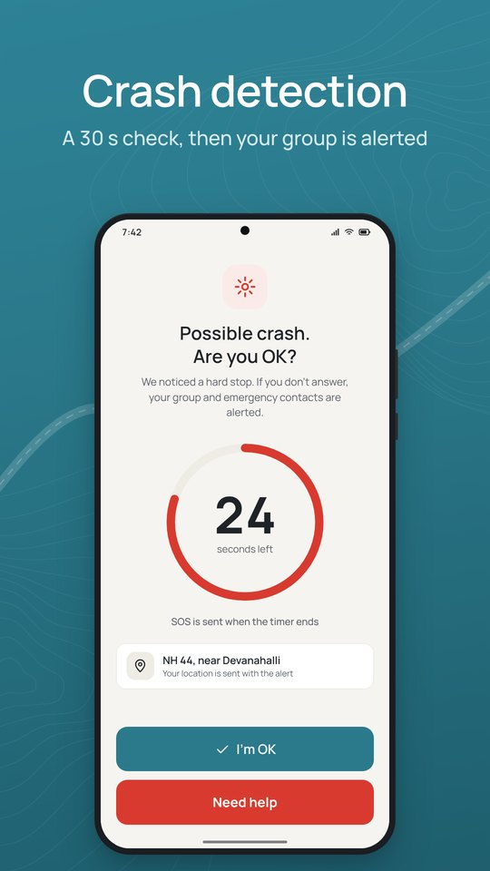
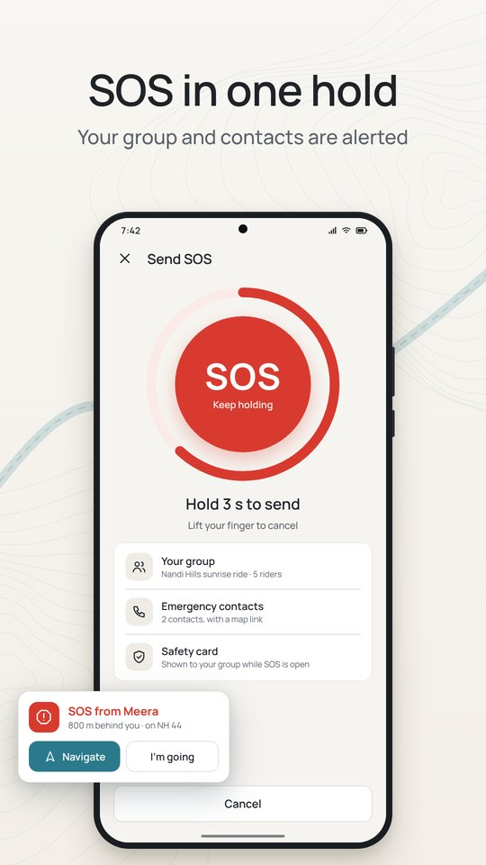
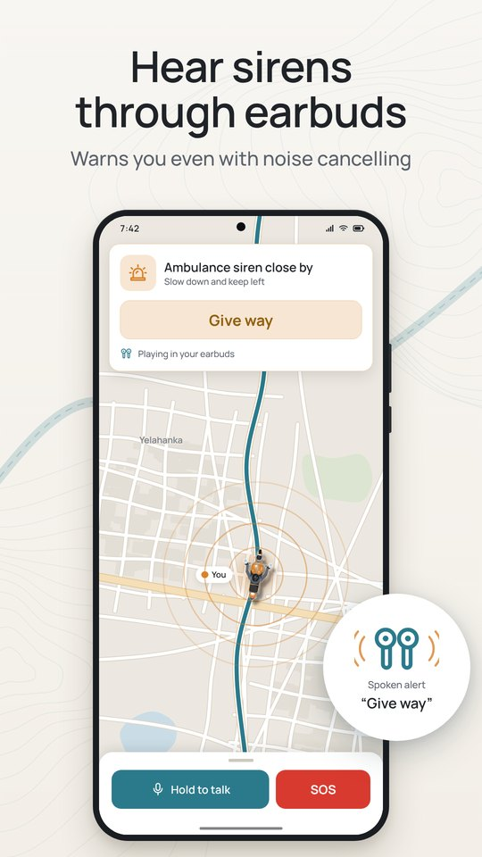
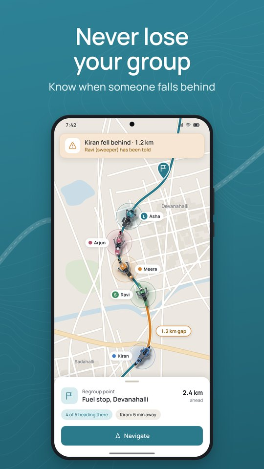
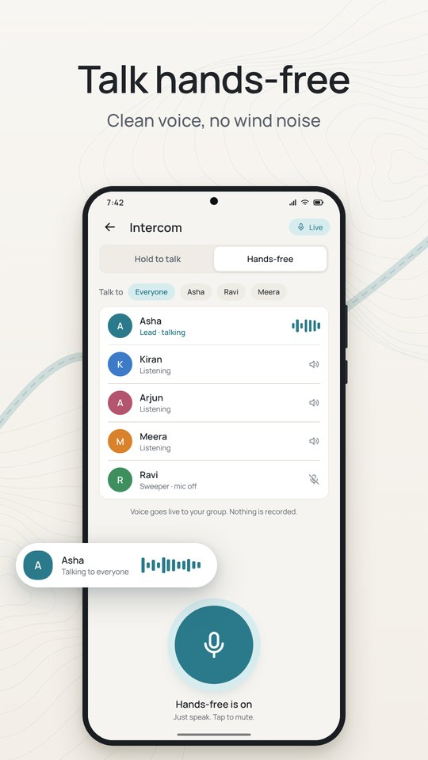
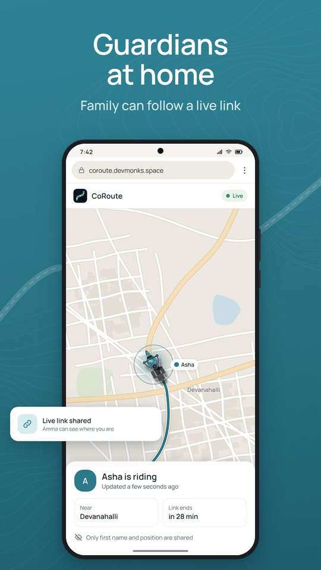
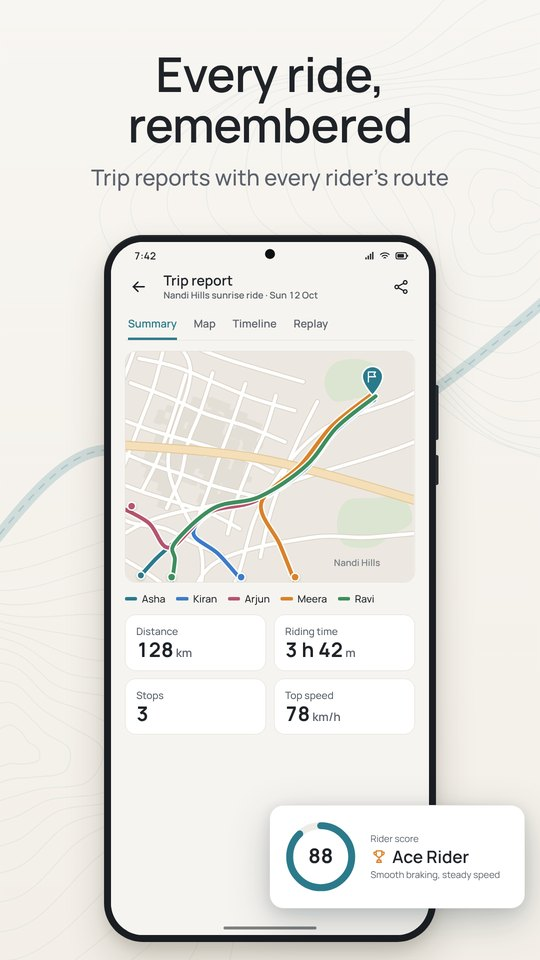

# CoRoute investor memo

**The safety and coordination layer for India's motorcycle riders**

November 2026 · Pre-launch · Prepared from the product's own documentation and code. Every market figure cites a public source; anything we could not source is marked **[OWNER TO FILL]**.

---

## 1. Executive summary

**What CoRoute is.** An Android app (iOS in development) that turns the rider's own phone into a crash detector, an SOS beacon that still works without mobile data, a siren listener for riders wearing noise-cancelling earbuds, and a hands-free group intercom. Groups share one live map with riding roles and fall-behind alerts. Family can follow a ride from a browser link with no app.

**Why it matters.** Two-wheeler riders were **44.8 % of India's 1,72,890 road deaths in 2023** (MoRTH, reported Aug 2025 [S1]). Group rides, a fast-growing leisure activity, are still organised on WhatsApp, which has no safety layer.

**What is different.** In our desk research of Indian and international riding apps (November 2026, section 6), no competitor combined automatic crash detection, an SOS with three offline paths, siren alerts and a live intercom. We found no app anywhere with siren alerts for earbud users.

**Business model.** Safety is free for every rider, in every configuration. Revenue comes from **group plans** (the host pays, everyone else joins free), sold **only on the website** to comply with Google Play's payments policy, and from a **B2B operator and club console** with approval and per-operator limits. Partner perks, an opt-in insurance safe-rider certificate and fleet safety come later. The admin can switch the whole product between **Paid**, **Free for everyone** and **Free up to limits** without an app update.

**Status.** The v3.55 app and gateway are code-complete and covered by automated tests (904 / 904 server tests at the last full documented run, 9 Nov 2026). 3.56 adds website payments, access modes and the operator console. The website is live at https://coroute.devmonks.space. Still to do: real-device validation of the sensor and audio features, the production deploy of the latest build, and the Google Play launch. **CoRoute has no users, revenue or ratings yet**, and this memo claims none.

**The ask.** **[OWNER TO FILL]**: see section 13.

---

## 2. The problem and the evidence

### 2.1 Two-wheeler riders carry the highest road risk in India

| Indicator | Figure | Source |
|---|---|---|
| Road accidents in India, 2023 | 4,80,583 | MoRTH *Road Accidents in India 2023*, via DT Next / PTI, 28 Aug 2025 [S1] |
| Road deaths in India, 2023 | 1,72,890 | same [S1] |
| Share of deaths who were two-wheeler riders | 44.8 % (the highest of any road-user group) | same [S1] |
| Implied two-wheeler rider deaths | about 77,000 (our arithmetic: 44.8 % × 1,72,890) | derived from [S1] |

### 2.2 The market keeps adding riders

| Indicator | Figure | Source |
|---|---|---|
| Domestic two-wheeler dispatches, FY2025 | 19.61 million (+9.1 %) | SIAM data via Autocar Professional, 2025 [S2] |
| of which motorcycles | 12.25 million (+5.1 %) | same [S2] |
| Royal Enfield sales, FY2025 | over 1 million motorcycles | Free Press Journal, 2025 [S3] |
| Royal Enfield domestic sales, CY2025 | 10,71,809 (+25 %) | BikeAdvice, Jan 2026 [S4] |
| Royal Enfield One Ride 2025 | 150,000+ riders in 1,400+ cities | Royal Enfield [S5] |
| Indian households with at least one smartphone | 85.5 % | MoSPI *Comprehensive Modular Survey: Telecom, 2025*, via Eastern Mirror [S6] |

Royal Enfield is a proxy for leisure and touring riding (mid-size motorcycles bought for weekend and long rides). We did not find a public, sourced count of riding clubs or group riders in India. **[OWNER TO FILL if a credible source is found.]**

### 2.3 What riders do today, and why it fails

| Today's tool | Where it breaks |
|---|---|
| **WhatsApp live location** (15 min / 1 h / 8 h) [S7] | Expires mid-ride; each rider is a separate bubble with no single map; no roles, no fall-behind alert, no SOS, no crash detection, no voice while riding; stops without data. |
| **Google Maps location sharing** [S8] | Built for one person following another; no group session, no ride end, no safety triggers. |
| **Phone calls between riders** | Unsafe at speed, one-to-one only, fail in low signal. |
| **Hardware intercoms** (Cardo, Sena, BluArmor) | Cost money, need every rider to own compatible hardware; no crash detection or SOS stated. |

Three gaps follow from this:

1. **Solo crash with nobody around.** Help depends on a passer-by; the rider may not be able to call.
2. **No signal where it matters.** Ghats, passes and highways have dead zones; most apps fail silently.
3. **Riders who cannot hear the road.** Noise-cancelling earbuds, helmet sets and music hide sirens.

---

## 3. The product

CoRoute covers the ride from start to home: start or join with a 6-digit code or link, ride with live safety, come home with a trip report.

<figure><figcaption>Live group map</figcaption></figure>
<figure><figcaption>Crash check, 30 s</figcaption></figure>
<figure><figcaption>SOS on every screen</figcaption></figure>
<figure><figcaption>Siren alerts</figcaption></figure>

### 3.1 The true differentiators

| Capability | How it works | Status |
|---|---|---|
| **Crash detection with a 30 s check** | After an impact and a stop the phone shows "Possible crash. Are you OK?" with a 30-second countdown and a spoken prompt. "I'm OK" cancels; "Need help" sends at once; no answer sends the SOS to the group and emergency contacts. | Built; needs real-road validation |
| **False-alarm suppression** | Non-severe impacts need post-impact evidence (bike or rider down, or an abrupt stop); riding on after a jolt cancels the alarm; repetitive shocks (rough road, a loose phone) need strong evidence; the severe-impact path is never weakened; per-bike learning from "I'm OK". In synthetic scenario tests, potholes, speed breakers, rough road, a loose phone in a tank bag and a phone drop raised 0 alarms, while all crash scenarios still alarmed. | Built; synthetic results only, device tuning pending |
| **SOS that works without signal** | (1) The rider's phone texts the emergency contact, lead, sweeper and nearest riders a live link; (2) the server texts emergency contacts through an SMS provider when the SOS reaches it directly or via another rider's phone, plus a "safe now" text; (3) a phone-to-phone mesh relays SOS between riders on a shared hotspot, and keeps running in SOS-only mode even if the mesh is switched off. | Built; device check pending |
| **Siren alerts for ANC earbud users** | The phone's built-in microphone recognises wail, yelp and hi-lo sirens (including the Indian ambulance hi-lo), names ambulance / police / fire engine when confident, and says "Keep left and give way" in the earbuds or helmet set. Alerts only after 2.5 s of continuous siren. Synthetic tests: alert 2.8–3.1 s after onset at 13 dB under ride noise; 0 false alerts in 20 minutes of mixed negative audio. | Built; lab results only |
| **Live hands-free intercom with voice cleanup** | Push-to-talk or hands-free, to everyone or one rider, over mobile data. Wind and engine high-pass, noise and breath suppression, a voice gate, AGC and a limiter; about 12 ms added latency. Relayed live, never recorded. | Built; device check pending |
| **Guardian live link** | A browser link (no app) showing first name and position; ends on its own; during an open alert it also shows the medical info the rider entered. Arrival message to guardians. | Built |
| **Privacy by design** | Encrypted in transit; no ads; no third-party analytics or tracking SDKs; no sale of data; recorded routes deleted after 90 days; account deletion in the app. | Built (policy published on the website) |

### 3.2 Group coordination

Live map with bike-shaped markers (two riders when a pillion is seated); Lead / Middle / Sweeper roles and optional automatic roles; the sweeper is told when a rider falls behind; stretch alert with a smart regroup point; missing-rider check with hold-to-send SOS; buddy pairs for 7+ riders; roll call at start and arrival; a group speed limit with a lower limit near stops and in towns; a lock-screen ride notification with SOS, "Wait for me" and talk controls.

<figure><figcaption>Roles and alerts</figcaption></figure>
<figure><figcaption>Intercom</figcaption></figure>
<figure><figcaption>Guardian link</figcaption></figure>
<figure><figcaption>Trip report</figcaption></figure>

### 3.3 Between rides

Unique usernames, friends by username or invite link (mutual approval), crews with polls (no chat to moderate), crew ride invitations by push, a private rider score (0–100; speed is only ever penalised, never rewarded; SOS and crash alarms never lower it), opt-in public leaderboards by username, trip reports with replay and GPX export.

### 3.4 Run-the-business tools (built)

- **Web admin** (`/admin`): payments and refunds, plans and pricing (list price plus an optional time-boxed offer), coupons, marketing studio (coupon-bound post, story and banner images), website board, revenue charts, access mode, notifications and opt-in offer e-mails.
- **App admin console**: riders, rides, safety, moderation, analytics trends, and **66 feature switches** that turn any feature off for everyone in seconds; SOS, crash detection, emergency texts and medical ID are locked on.
- **Operator console** (`/operator`, 3.56): roster, scheduled rides, live multi-ride map, attendance reports, broadcasts (see section 7.4).

---

## 4. Technology and moat

### 4.1 Safety engine on the phone

Crash detection, rider-down, fatigue, road-surface detection and fuel range run on the phone from its own sensors. The crash path and road-surface path are ordered so a lowside slide can never be reported as a pothole (a defect found and fixed in the v3.55 safety scenario review, which found and fixed 11 defects, each with a regression test). The phone keeps working when the server is unreachable.

### 4.2 Offline paths

The SOS is stored on the phone and delivered by whatever path works first: socket, the rider's own SMS, a relay by another rider's phone, the phone-to-phone mesh, and then the server's SMS. A battery reserve below 10 % keeps an SOS beacon possible. Route maps are saved on the phone for areas without signal; "no signal ahead" warnings come from the rider's own coverage log.

### 4.3 Audio DSP

A single shared ride microphone serves both siren detection and the intercom. The siren detector and voice cleanup are written in-house (no third-party audio SDK), with documented lab results and known limits (one mic cannot tell direction, so alerts never say "behind"; a phone in a pocket at speed may not hear a siren). Alerts are routed by context: duck or pause music, play critical lines on the alarm stream (heard at media volume 0 and through Do Not Disturb when allowed), hold ordinary lines during a phone call and summarise them afterwards.

### 4.4 Two-node high availability on a small budget

The Node.js gateway runs on two Oracle Cloud VMs behind a network load balancer. VM1 carries live rides and WebSockets; VM2 serves the website, payments and admin and holds a mirror copy of every live ride, so it takes over if VM1 fails. Scheduled jobs run once across both nodes through leases. Data is in Oracle Autonomous Database; secrets in OCI Vault; encrypted backups to Object Storage. The live-rider capacity of this setup is an estimate (200–700 live riders) until the planned 30-minute soak test measures it.

### 4.5 Privacy and compliance by design

- Positions are shared only with the ride group and only during the ride; guardians see first name and position only.
- Medical info goes to responders only while an SOS or crash alert is open; operators see an emergency contact only during an open SOS, and every view is audited.
- Public numbers on the website are hidden until at least 10 riders or events are behind them; leaderboards use usernames only, with opt-out.
- The Play app is consumption-only: no payment SDK, no prices or buying words, no steering to the website. A scan tool checks the app source before every release.
- DPDP Act 2023 alignment (consent records, purpose limits, erase) is planned before any third-party data sharing (partners, insurance, fleets).

### 4.6 Where the moat comes from

Honestly assessed, individual features can be copied. The defensible parts are:

1. **Accumulated safety engineering**: the crash, siren and offline-SOS paths combine sensor logic, audio DSP, Android lock-screen and audio-routing behaviour, and server-side delivery. Each has documented edge cases and fixes; reproducing it reliably takes time.
2. **Trust positioning**: "Safety is free. Always." plus a strict privacy stance (no ads, no trackers) is hard for ad-funded or data-sharing competitors to match. Trilyt's Play data-safety section, for example, states that data is not encrypted and may be shared with third parties.
3. **Network effects in groups and clubs**: every group ride brings riders who joined free; guardians, crew invites and club rosters bring more.
4. **Road data that compounds**: lead-reported road hazards saved for later rides and rider place reviews (stored without rider ids).

---

## 5. Market

### 5.1 Method (TAM / SAM / SOM)

We do not have a sourced count of motorcycle riders using smartphones, or of group or club riders, in India. We therefore set out the method and leave the inputs to be filled from credible sources. **Do not present these as numbers until each input is sourced.**

| Layer | Definition | Formula | Inputs available | Value |
|---|---|---|---|---|
| **TAM** | Motorcycle riders in India with a smartphone | motorcycles in use × riders per motorcycle × smartphone share | New motorcycles: 12.25 M in FY2025 [S2] (a yearly flow, **not** the base in use); smartphone household share 85.5 % [S6] | **[OWNER TO FILL]**: needs a sourced count of motorcycles in use (e.g. MoRTH / Vahan registration data) |
| **SAM** | Riders who ride in groups or tour (our first market) | TAM × share of riders who ride in groups or tour | Proxy signals only: RE FY2025 sales over 1 M [S3]; One Ride 2025 150,000+ riders [S5] | **[OWNER TO FILL]**: needs a survey or a cited club/touring figure |
| **SOM** | Riders we can reach in 3 years | SAM × reachable share (cities and clubs in the GTM plan) × expected adoption | Our own funnel once live | **[OWNER TO FILL]**: set from the first 3–6 months of launch data |
| **Revenue pool** | Paying hosts + operators | (SOM × host share × paid conversion × ARPU × 12) + (operators × operator ARPU × 12) | Plan defaults in section 7 | **[OWNER TO FILL]** |

The financial model template (`financial_model_template.xlsx`) carries these as inputs.

### 5.2 Segments

| Segment | Need | How CoRoute serves it |
|---|---|---|
| Weekend and touring groups (friends, 3–12 riders) | Stay together, talk, handle breakdowns | Group map, roles, intercom, regroup; host plan |
| Riding clubs (20–200 members) | Organise many rides, safety of members, attendance | Operator / club console, crews, broadcasts |
| Tour operators (Ladakh, Spiti, Goa, Kerala tours) | Live safety over every paying customer | Operator console with live multi-ride map and SOS contacts |
| Solo commuters and tourers | Someone knows if they fall | Free crash detection, SOS, guardians |
| Rental and corporate fleets (later) | Duty of care | Operator console now; fleet mode later |

---

## 6. Competition

Source: our desk research of store listings and product sites, 11 Nov 2026 (`docs/COMPETITOR_ANALYSIS_2026-11.md`). Install and rating figures are as shown on the pages fetched.

| Player | Group map | Voice | Crash / SOS | No-signal SOS | Price | Notes |
|---|---|---|---|---|---|---|
| **CoRoute** | Yes, roles + alerts | Live PTT + hands-free, voice cleanup | Crash detection (30 s) + SOS | Phone SMS, server SMS, phone-to-phone | Safety free; host plans | Pre-launch |
| **Trilyt** (Accelryde, New Delhi) | Yes | Voice messages + text chat | One-tap emergency alert | Not mentioned | Free | Play: 1,000+ installs, 4.7★ (14 reviews); building operator software; Play data safety says data not encrypted |
| **Asteride** | Pack Track (limited) | Chat only | SOS info only | Not stated | Free | Play: 10K+ installs, 4.4★; strong community and planning |
| **RideClan** | Yes | Not stated | Group and family SOS | Not stated | Free | Turn-by-turn moto navigation |
| **MileVoy** | Yes, leader / sweep | Not stated | One-press SOS, crash detection | Not stated | Free, no ads | Android only; closest on safety |
| **Riding Verse** | Yes | Not stated | Not stated | Not stated | Free | Clubs, events, paid-ride registration |
| **Detecht** (Sweden) | Buddies | No | Crash detection (60 s) | Not stated | Freemium with ads | ~763K installs; not India-focused |
| **Cardo / Sena / BluArmor** | Via app | Hardware intercom | Not stated | Mesh (hardware) | Hardware purchase | Coexist rather than compete |
| **WhatsApp + Google Maps** | Separate bubbles | Calls | None | None | Free | The real default |

**Where competitors lead today:** being on Play already (Trilyt, Asteride), iOS availability, community and event discovery (Asteride, Riding Verse), turn-by-turn navigation (RideClan, Trilyt), paid-ride registration for clubs (Riding Verse).

**Where CoRoute leads:** the combination of crash detection with false-alarm suppression, three offline SOS paths, siren alerts for earbud users, live intercom with voice cleanup, guardian links and medical ID, riding roles and group-safety logic, and a privacy stance with no ads or trackers.

**Our response to the gaps** (from the competitor analysis): launch on Play leading with safety and privacy; consider free hosting for small groups (now possible with the *Free up to limits* access mode); a one-tap hand-off to Google Maps / Mappls for navigation rather than building it; the operator / club console (built in 3.56); iOS (owner decision on timing).

---

## 7. Business model

### 7.1 Principles

1. **Safety is never gated.** SOS, crash alerts, emergency texts, medical ID, guardians, the missing-rider check, stretch alert, buddy pairs and roll call work for every rider in every mode.
2. **Joining is free.** One member with a plan hosts; everyone else joins with the code and gets the host's group features for that ride.
3. **The Play app sells nothing.** Plans are bought on the website; the app shows only neutral plan status.

### 7.2 Access modes (set in the web admin, no app update)

| Mode | Who hosts group rides | Use |
|---|---|---|
| **Paid** (default) | Riders with a group plan; everyone else rides solo and joins for free | Monetise from day one |
| **Free for everyone** | Every rider, up to a configured rider limit (default 12) | Launch period, campaigns, market entry |
| **Free up to limits** | Every rider within limits (defaults: 6 riders per ride, 8 hosted group rides a month, a chosen set of group features); a plan unlocks more | Freemium: free small groups, paid larger groups and full features |

A mode change can be scheduled at an India-time date ("Free now, Paid from 1 Dec"), and never shortens or refunds a plan that is running.

### 7.3 Group plans (current default configuration)

| Plan | Riders (host included) | Default list price | Period |
|---|---|---|---|
| Community | Solo + join any ride | Free | — |
| Small Group | 2–6 | ₹49 | 30 days |
| Large Group | 7–12 | ₹99 | 30 days |

These are the defaults in the gateway code when no catalogue has been saved; the admin can change list prices and add time-boxed offers ("₹99 → ₹49 Launch offer until 30 Nov"), coupons and a minimum price. Plans do not auto-renew; upgrades are prorated. **Launch prices: [OWNER TO FILL].** See `business_model_and_pricing.md`.

### 7.4 Operators and clubs (B2B)

Tour operators, riding clubs, rental fleets and corporate fleets apply on the website. A CoRoute admin approves each one with limits and features (defaults per type, e.g. a riding club: 150-member roster, 2 live rides at once, 12 rides a month, 40 riders per ride). Approved operators get a roster (which riders accept in the app), scheduled rides with public sign-up pages, a live map of every ride with SOS banners, attendance and CSV reports, and broadcasts. Operator rides take their seats from the operator limits, not anyone's personal plan, which also answers the "rides above 12 riders" need. **Operator pricing (per operator, per bike or per tour): [OWNER TO FILL]**; the plan's recommendation is per bike per month with a pilot discount.

### 7.5 Partner perks and future lines

| Line | Status | Notes |
|---|---|---|
| **Partner perks** | Notification kind built (3.56): opt-in, labelled "Partner perk", curated real-world perks only | Partners on the map with offers is planned (v3.57). Revenue model (listing fee or per redemption) **[OWNER TO FILL]** |
| **Insurance safe-rider certificate** | Planned (v3.57) | Rider-initiated, signed score certificate for a partner insurer's telematics add-on. CoRoute does not sell insurance (needs an IRDAI-registered partner). |
| **Fleet safety** | Planned (v3.57) | Shift-only tracking for company and delivery fleets; separate product track with legal review. |
| **Paid club events** | Planned (v3.57) | Fee collection needs marketplace payouts, organiser KYC and GST. |

### 7.6 Cost structure

Most logic runs on phones; the server relays. Main cost drivers: cloud VMs and database (currently two Oracle Cloud VMs), server SOS SMS (MSG91 or Twilio, per message), transactional e-mail over SMTP, payment-gateway fees on website sales, Play developer account, and people. Push notifications use Firebase Cloud Messaging, which has no per-message charge. Unit economics framework: `business_model_and_pricing.md`.

---

## 8. Go-to-market

| Channel | Mechanism | What is already built |
|---|---|---|
| **Riding clubs** | One host brings 5–11 riders who join free; clubs become operator rosters and crews | Operator / club console, crews, crew ride invites, public ride sign-up pages |
| **Dealers and OEM community rides** | "The safety app for your club ride / One Ride" pitch to dealers and club captains | — (sales effort) |
| **WhatsApp loops** | Ride invite links and codes shared in existing WhatsApp groups; guardian links reach families; friend invite links | Join links and codes, guardian link, friend invite link |
| **App Store Optimisation** | Listing leads on safety and privacy; screenshots ordered crash → SOS → sirens → group; review prompt only after an incident-free ride | Listing text and graphics drafted to Play policy |
| **Content** | Explainers ("Riding with ANC earbuds: why you can't hear the ambulance"), route safety guides, 15-second demo reels, moto-vlogger crews | Website, marketing studio, website board |
| **Transparency** | Live, privacy-safe impact numbers on the website (hidden until 10+ behind each number) | Built |

Launch sequence (proposal): closed testing with a few clubs → Play production → city-by-city club partnerships → content and creator seeding. **City order, partner clubs and budget: [OWNER TO FILL].**

---

## 9. Roadmap

From `NEXT_RELEASE_PLAN_v3.56.md`. Effort is in engineer-weeks (one engineer who knows the codebase).

| Milestone | Theme | Main items | Effort |
|---|---|---|---|
| **Before anything** | Launch gates | v3.55 device gate (compile native code, phone tests), Play production rollout, crash/ANR baseline, launch metrics baseline, two-VM drill and soak, Firebase live, secrets rotation, DPDP privacy update | — |
| **v3.56 (built in code)** | Business foundations | Website-only payments, Play payments policy compliance, access modes, operator / club console, partner-perk notification kind, offer e-mails, server SOS SMS | done in code; device and deploy pending |
| **v3.56.0** | Quick safety wins | One-tap 112 fallback, helmet / headset button for talk and SOS, weather and road alerts on the planned route, pre-ride bike check, Tamil / Kannada / Malayalam / Marathi safety screens, watch notification mirror | ~14 |
| **v3.56.x** | Group and growth | Ride planner by the weakest tank, referral rewards, safe-km challenges, rider levels, Wear OS watch app, ride album and trip story, crew / club pages, free ride events, offline phone-to-phone voice | ~38 |
| **v3.57** | Business and platform | Public ride story pages, partners on route with offers, insurance safe-rider certificate, fleet safety pilot, bike-dash feasibility, 112 ERSS integration (only with a signed government agreement), paid events | ~35 + partner lead time |

iPhone app timing is an open owner decision (D16).

---

## 10. Metrics we will track

Definitions only; there is no data yet. Full definitions and where to pull each one: `traction_and_kpis.md`.

- **Acquisition:** installs, sign-ups, sign-ups from invites / guardian links.
- **Activation:** riders who complete a first ride within 7 days of sign-up; riders who add an emergency contact.
- **Engagement:** weekly active riders, rides per active rider, share of group rides, average group size, km and riding hours.
- **Retention:** Day-30 rider retention; monthly hosts who host again.
- **Monetisation:** paying hosts, host-to-paid conversion, ARPU, active operators, revenue net of refunds.
- **Safety quality:** crash alarms per 1,000 riding hours, share cancelled with "I'm OK" (false-alarm rate), SOS answered and median first-response time, siren alerts per riding hour.
- **Reliability:** crash-free users and user-perceived ANR rate (Play vitals), battery drain per riding hour.

---

## 11. Risks and mitigations

| Risk | Mitigation |
|---|---|
| **Google Play policy** (payments, background location, SMS, full-screen intents) | Consumption-only app with a policy scan before every release; permissions documented and justified in the listing; SMS only when the rider switches on emergency texts; heads-up fallback where full-screen intents are denied. |
| **Safety liability** (a missed crash or SOS) | Clear terms and in-app wording that CoRoute assists and does not replace emergency services; multiple delivery paths; one-tap 112 fallback planned for v3.56.0; **legal review of terms and liability language [OWNER, pending]**. |
| **False alarms** eroding trust | Evidence-based crash rules, ride-on cancel, per-bike learning, 30 s check; 0 false alarms in synthetic scenarios so far; real-road tuning is a launch gate; every sensor and audio feature has an admin switch (safety core locked on). |
| **Battery drain** | GPS slows when stopped; microphone opens only when needed and is released below 15 % battery; battery per riding hour is a tracked release gate. |
| **Competition** (free Indian apps, Trilyt already on Play) | Lead on safety and privacy; *Free up to limits* mode to match free small groups; operator console for the B2B angle; ship to Play fast. |
| **Regulatory: DPDP Act 2023** | Data minimisation and 90-day route deletion already; consent records, purpose limits and erase update planned before any partner, insurer or fleet data sharing. |
| **iOS gap** (one iPhone rider can push a group back to WhatsApp) | Guardian links already work in any browser; web join for guests proposed; iOS timing is an owner decision. |
| **Scale on a small budget** | Two-node failover today; soak test to measure capacity; Object Storage for photos and APKs; paid capacity added as riders grow. |
| **Execution risk of a small team** | Feature switches allow instant rollback per feature; automated tests on the server; staged Play rollouts. **Team plan: [OWNER TO FILL].** |

---

## 12. Team

**[OWNER TO FILL]**

Guidance: for each founder and key hire, give name, role, relevant experience (riding, safety, mobile, Indian market), and time commitment. List advisors only with their consent. State open roles you will hire with this round. Do not list anyone who has not agreed to be named.

---

## 13. The ask and use of funds

**[OWNER TO FILL]**

| Item | Guidance |
|---|---|
| Amount and instrument | e.g. amount, SAFE / CCPS / convertible note, any committed participants (only if committed) |
| Use of funds | Suggested buckets: device testing and launch; iOS; growth (clubs, content, creators); B2B sales (operators, partners); infrastructure (paid capacity, SMS); legal and compliance (terms, DPDP, company); team |
| Runway | Months of runway the round buys, from the financial model |
| Milestones | The 12-month milestones the round funds (e.g. Play launch, iOS, first paying operators, retention target), each measurable |
| Cap table | Current holders and option pool, pre- and post-round |

---

## Appendix A. Feature list (v3.55 code, with 3.56 additions)

**Safety (free, every rider):** SOS hold with durable delivery and SMS fallback; crash detection with 30 s check and false-alarm suppression; crash learning per bike; rider-down check; emergency texts and roster; server SOS SMS with "safe now"; medical ID on the lock screen and to responders during an alert; guardian live link and arrival message; nearby-rider assistance network; offline phone-to-phone mesh (SOS-only fallback); SOS battery reserve; solo check-in by ETA; no-signal-ahead notices; siren alerts; pre-ride phone check; road hazards from the lead saved for later rides; sharp-bend warning; smart speed limits (incl. school and hospital zones); high-altitude and night care; fatigue score; phone-mount check.

**Groups:** live map with bike markers and pillion seat; Lead / Middle / Sweeper roles and automatic roles; Trip owner / Trip head; regroup; stretch alert and smart regroup point; missing-rider check; group break planner; buddy pairs; roll call; route to group; bike and pillion swap; group fuel sharing; intercom with voice cleanup; group speed limits; public ride, nearby groups; weather on the route.

**Sound and lock screen:** music ducking or pausing for alerts; critical lines on the alarm stream; lower music when speeding; call-aware alerts; lock-screen ride notification with talk and mute.

**Places:** fuel by type, hospitals, mechanics, food, stays; route essentials; historic places; rider place reviews with moderated photos; fuel range and auto-route to fuel.

**Community:** usernames, profiles, friends, crews, polls, crew ride invites, push notifications, rider score, leaderboards, trip reports, replay, GPX.

**Business and admin:** Community / Small Group / Large Group plans; website payments (Razorpay on the website only), list price and offers, coupons; access modes; operator / club console; web admin (payments, pricing, coupons, marketing studio, board, revenue, notifications, offers e-mail); app admin (riders, rides, safety, moderation, analytics, 66 feature switches).

## Appendix B. Architecture summary

- **App:** Flutter (Android first; iOS folder present, app pending), Kotlin native code for audio, telephony, lock-screen notification and sensors.
- **Gateway:** Node.js, WebSocket rooms for live rides, REST APIs, website and web admin served by the gateway.
- **Hosting:** two Oracle Cloud VMs behind a network load balancer (live node + web node with a mirror of every ride and automatic failover), Oracle Autonomous Database, OCI Vault for secrets, Object Storage for backups and photos.
- **Messaging:** Firebase Cloud Messaging for push; SMS provider (MSG91 or Twilio) for server SOS texts only; SMTP for transactional e-mail.
- **Payments:** Razorpay Checkout on the website only, server-computed amounts, HMAC-verified webhooks.
- **Quality:** gateway test suite (904 / 904 at the last full documented run); pure-Dart tests for app logic; Playwright smoke tests for the web admin and operator console; safety scenario review; payments security review.

## Sources

- [S1] DT Next / PTI, "1.72 lakh people died in 4.80 lakh road accidents in 2023: Road Ministry report", 28 Aug 2025. https://www.dtnext.in/news/national/172-lakh-people-died-in-480-lakh-road-accidents-in-2023-road-ministry-report-844831
- [S2] Autocar Professional, "FY25: A Year of Revival for the 2-Wheeler Industry" (SIAM data), 2025. https://www.autocarpro.in/analysis/fy25-a-year-of-revival-for-the-2-wheeler-industry-126152
- [S3] Free Press Journal, "Royal Enfield Celebrates Historic 1 Million Sales Milestone for FY 2025", 2025. https://www.freepressjournal.in/automobiles/royal-enfield-celebrates-historic-1-million-sales-milestone-for-fy-2025
- [S4] BikeAdvice, "Royal Enfield Sales Cross 1 Million Units in 2025", 23 Jan 2026. https://bikeadvice.in/?p=90643
- [S5] Royal Enfield, One Ride. https://royalenfield.com/OneRide/
- [S6] Eastern Mirror, "85.5 pc of Indian households now own at least 1 smartphone: Centre" (MoSPI *Comprehensive Modular Survey: Telecom, 2025*). https://www.easternmirrornagaland.com/855-pc-of-indian-households-now-own-at-least-1-smartphone-centre
- [S7] Tom's Guide, WhatsApp live location durations. https://www.tomsguide.com/how-to/how-to-share-your-live-location-in-whatsapp
- [S8] Google Maps Help, location sharing. https://support.google.com/maps/answer/7326816?hl=en
- Competitor sources: listed in `docs/COMPETITOR_ANALYSIS_2026-11.md` (Trilyt: https://play.google.com/store/apps/details?id=com.trilyt.app; Asteride: https://play.google.com/store/apps/details?id=com.asteride; MileVoy: https://milevoy.com/; Detecht: https://appgoblin.info/apps/se.app.detecht).
