# Operator Onboarding Guide

*From applying to your first ride and the report afterwards, step by step.*

Version: CoRoute 3.56 · November 2026

> The screenshots come from a CoRoute test environment. The names, usernames, phone numbers and links in them are test data, not real organisations or riders.

---

## Before you start

| You need | Why |
|---|---|
| A CoRoute account, the one you ride with | The application and the console both sign in with it. |
| Your organisation's business e-mail and phone | The CoRoute team uses them to contact you. Riders never see them. |
| The CoRoute usernames of your lead riders and sweepers | Leads and sweepers must be on your roster before you can assign them to a ride. |
| A laptop or tablet with a current browser | The console is a web page. It also works on a phone, but the live map is easier to use on a bigger screen. |

## Overview of the steps

1. Apply on the website.
2. Wait for approval. The CoRoute team sets your limits.
3. Sign in to the console at **/operator**.
4. Build your roster (invite by username, or share a link).
5. Add co-organisers.
6. Schedule a ride.
7. Assign the lead and sweeper.
8. Invite your roster, or open a public sign-up page.
9. On ride day: start the ride, watch the live map and handle any SOS.
10. After the ride: attendance, CSV export and monthly reports.

---

## Step 1: Apply

1. Open **/operators/apply** on the CoRoute website. If you are not signed in, press **Sign in** and use the account you ride with. If you have no account yet, the page links to **Get the app**.

   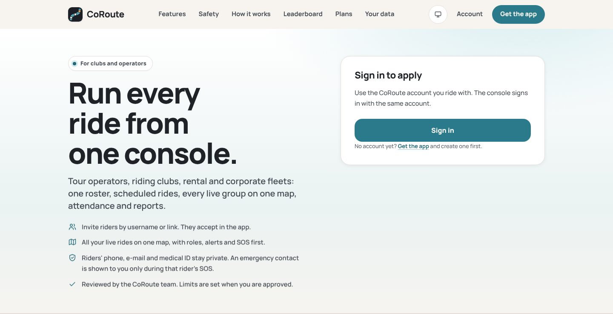

2. Fill in the form **Apply for the operator console**:
   - **You are a**: Tour operator, Riding club, Rental fleet or Corporate fleet.
   - **Organisation name**: 3 to 80 characters.
   - **City**: where you run rides from.
   - **Expected riders**: a number.
   - **Business contact** (only the CoRoute team sees it): **Business e-mail** and **Business phone**.
   - **Website or social page** (optional).
   - **What rides do you run?**: 10 to 500 characters. Do not put phone numbers or e-mail addresses here. The form refuses them and asks you to use the contact fields.

   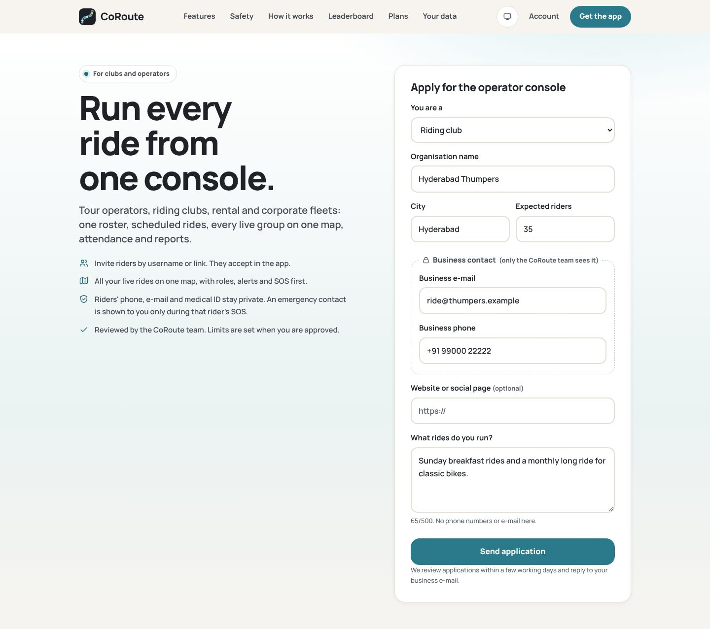

3. Press **Send application**. You see "Application sent. We will reply to your business e-mail." and your status, **Waiting for review**.

   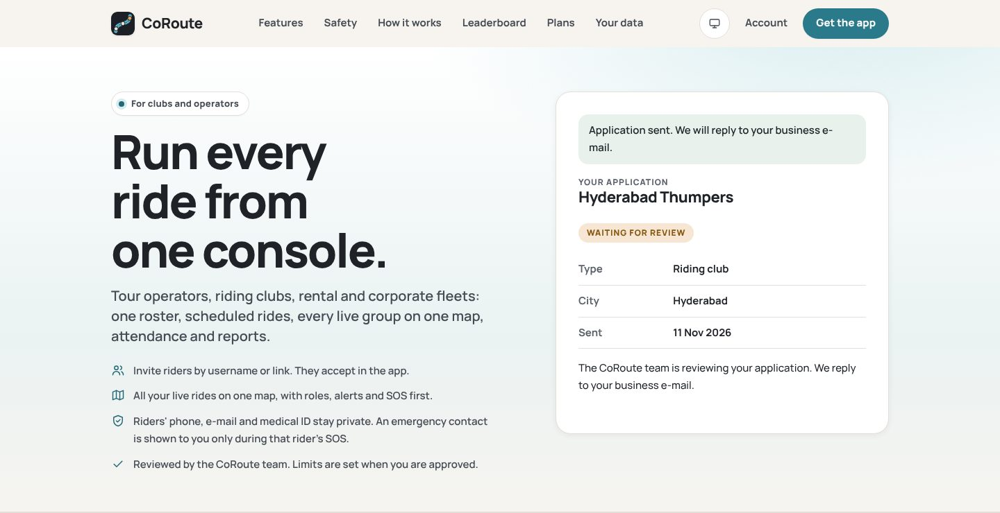

Good to know:
- Each account can have one application. A rejected application can be sent again.
- You can send up to 5 applications a day ("Too many applications today. Try again tomorrow.").

## Step 2: Approval (done by CoRoute)

A CoRoute administrator reviews your application in the CoRoute web admin and can:
- **Approve** it, with your limits, features and a validity in days. The defaults come from the template for your operator type.
- **Reject** it, with a reason that you will see.

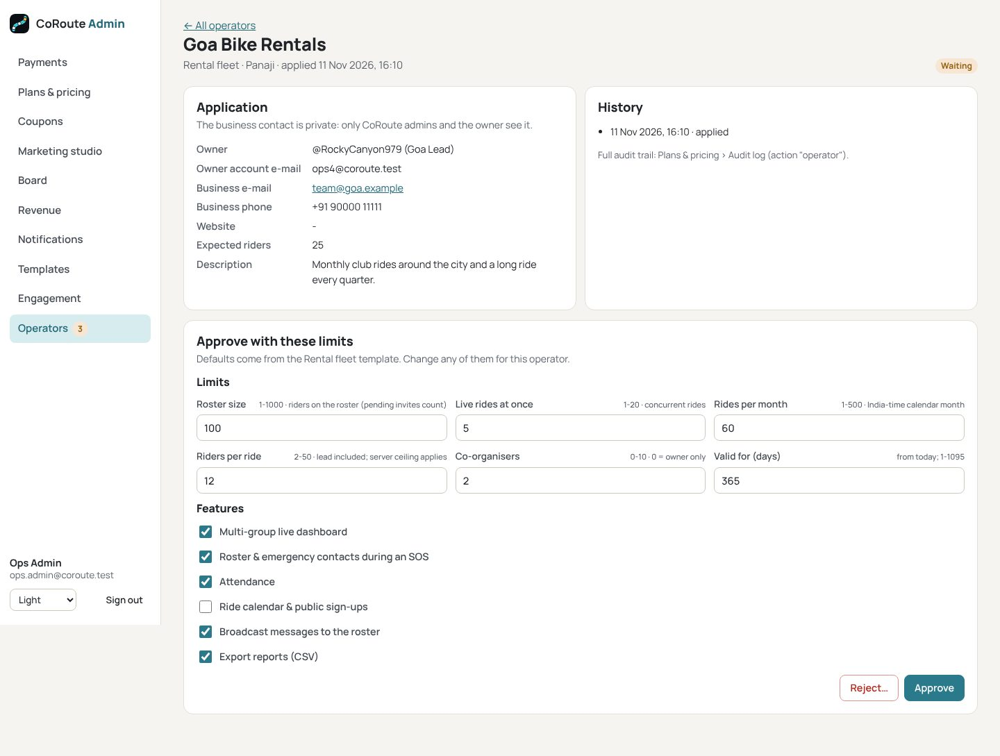

When SMTP e-mail is configured, you get an e-mail about the decision. Your limits appear on the console's **Overview** page under **Your plan**.

**What approval creates.** Your roster is created as a special CoRoute crew, a "club". You are its owner. Riders see your invites in the app's normal crew invite list (**People > Requests**). In the app, the club cannot be renamed, deleted or handed over, and you, as owner, cannot leave it.

## Step 3: Sign in to the console

1. Open **/operator**.
2. Enter your **Email or callsign** and **Password**, then press **Sign in**.
3. If your account runs an approved operator, or is a co-organiser of one, the console opens on **Overview**.

Other cases:
- *"No operator account"*: this account does not run an operator and is not a co-organiser of one.
- *"Application waiting for review"*: your application has not been decided yet.
- *"Application not approved"*: the page shows the reason.

You are signed out after **60 minutes** without activity. If you are an owner or co-organiser of more than one operator, a selector at the top left switches between them.

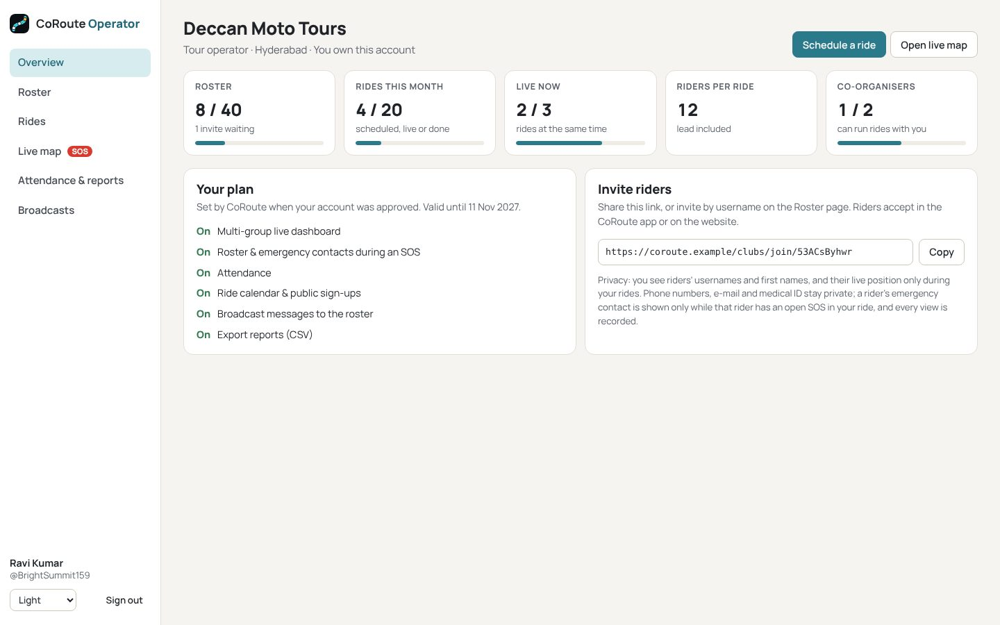

The **Overview** page shows:
- tiles for roster, rides this month, live rides, riders per ride and co-organisers, each with a usage bar;
- **Your plan**: your features, and the date your account is valid until;
- **Invite riders**: your invite link, with a **Copy** button;
- a privacy note on what you can see.

## Step 4: Build your roster

Open **Roster**.

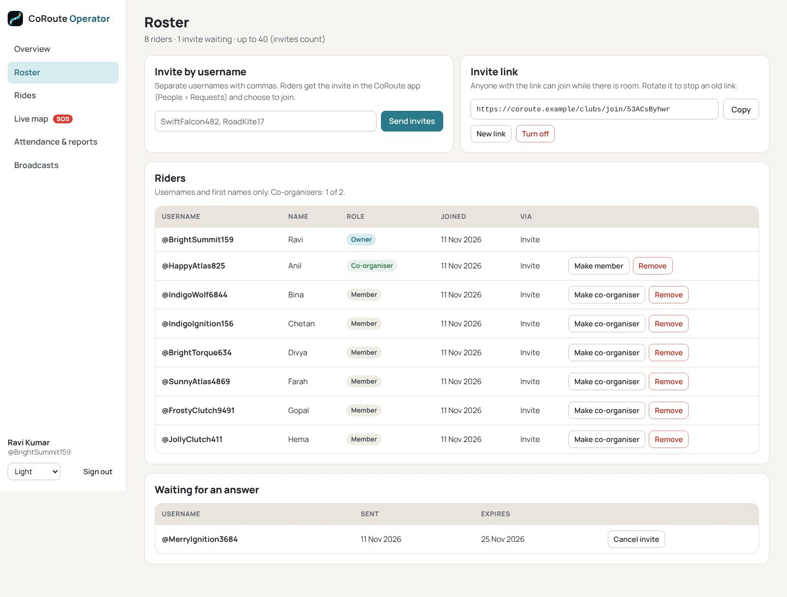

**Invite by username**
1. Type one or more CoRoute usernames, separated by commas (for example `SwiftFalcon482, RoadKite17`).
2. Press **Send invites**. A message sums up the result: *invited*, *already invited*, *already on the roster*, *not found*, or *not sent (roster full)*.
3. The rider gets the invite in the app under **People > Requests**, or sees it on **/clubs**, and chooses to join. They do not need to be your friend in CoRoute.
4. Invites waiting for an answer are listed under **Waiting for an answer**, with **Cancel invite**. An invite expires after 14 days.

**Invite link**
- **Copy** the link (`/clubs/join/<code>`) and share it in your chat group or on your website. Anyone with the link can join while there is room.
- **New link** makes a new link, and the old one stops working.
- **Turn off** disables the link. **Turn on** enables it again.

**Limits.** Waiting invites count toward your roster size. When the roster is full, the page says "Your roster is full. Cancel waiting invites or remove riders to invite more."

**What riders see when they join.** On **/clubs**, riders see your club, your upcoming rides with their sign-up links, and your latest broadcasts. They also see this note: "Clubs see your username and first name, and your live position only during their rides. Your phone, e-mail and medical ID stay private (an emergency contact is shown to the organiser only while you have an open SOS in their ride)."

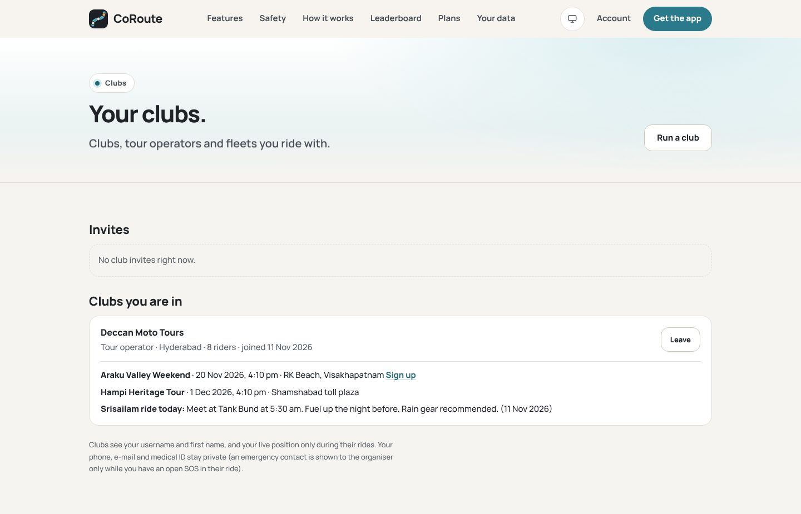

## Step 5: Add co-organisers

Co-organisers can run rides with you: schedule, start, invite, manage the roster and watch the live map.
- In **Roster > Riders**, press **Make co-organiser** next to a member. Only the owner can do this, and only up to your co-organiser limit.
- **Make member** removes the co-organiser role.
- Only the owner can remove a co-organiser from the roster.
- Co-organisers sign in at **/operator** with their own CoRoute account.

## Step 6: Schedule a ride

Open **Rides** and press **New ride**. Fill in:

| Field | Notes |
|---|---|
| **Ride name** | 3 to 80 characters. |
| **Starts (India time)** | Within the next year. |
| **Riders** | Up to your riders-per-ride limit, lead included. |
| **Meeting point** and **Destination** | Free text, for example "Cubbon Park gate" and "Nandi Hills". |
| **Lead rider** | A username on your roster. The lead becomes the trip owner in the app. |
| **Sweeper** | Optional. A username on your roster, who joins as sweeper. |
| **Notes** | Up to 500 characters, shown on the public page. Phone numbers and e-mail addresses are refused. |
| **Public sign-up page on the CoRoute website** | Only if "Ride calendar & public sign-ups" is in your plan. |
| **I approve each sign-up** | On by default. |

Press **Schedule ride**. The ride appears in the list as **Scheduled**.

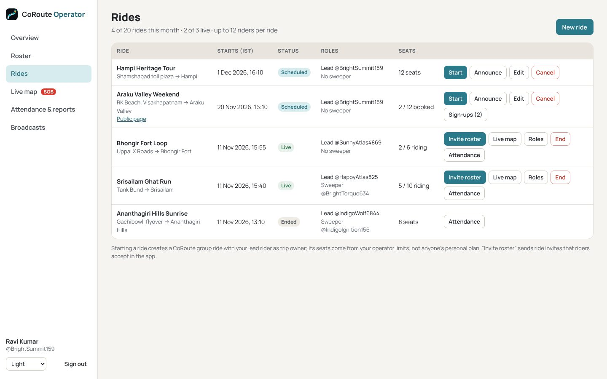

A scheduled ride can be changed with **Edit** or cancelled with **Cancel**. A cancelled ride stops counting against your monthly rides.

## Step 7: Assign the lead and sweeper

- Set the **Lead rider** and **Sweeper** in the ride form. Both must be on your roster.
- The lead runs the ride in the app: route, group settings such as the speed limit and spread alert, and ending the ride.
- During the live ride, **Roles** lets you set a rider in the ride to **Lead**, **Sweeper** or **Middle (pack)**. The group sees the change at once.

Pick a lead and sweeper who know the ride organiser procedure (see *Ride Organiser SOP*). The sweeper rides at the back and gets the "rider behind the sweeper" alerts.

## Step 8: Invite riders

There are three ways, and you can combine them:

1. **Announce** (scheduled ride): the roster gets a notice with the ride name, date and meeting point.
2. **Public sign-up page**: the ride gets a page at `/rides/<slug>` on the CoRoute website. Signed-in riders sign up, or **Ask to join** when you approve sign-ups. Manage them under **Sign-ups (n)** in the ride row (**Approve** / **Decline**). Approved riders see the 6-digit join code on the page once the ride is live.

   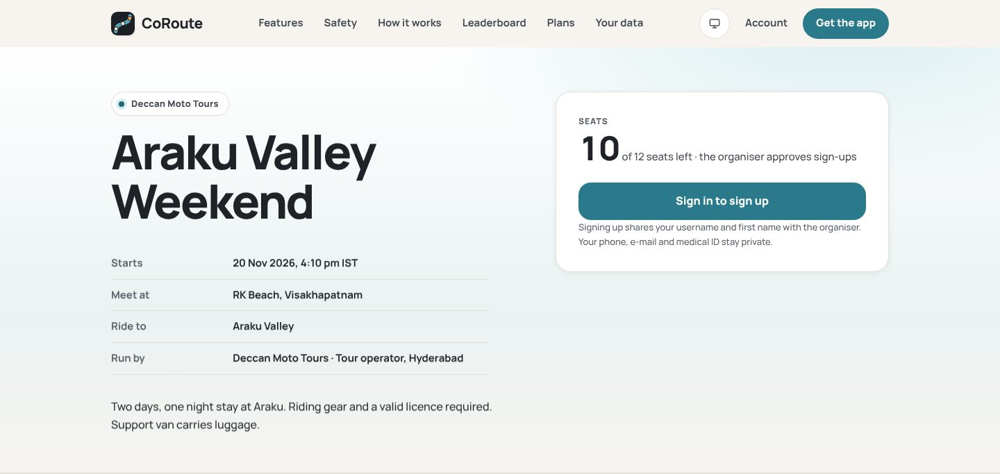

3. **Invite roster** (live ride): every roster rider who is not yet in the ride gets a ride invite in the app, while seats last.

## Step 9: Ride day

1. **Before the start**: run the pre-ride briefing (see *Safety Briefing Template*).
2. **Start**: on the ride row, press **Start**. A CoRoute group ride starts with your lead as trip owner, and it shows on the lead's phone. The message tells you how many seats it has. If you are already at your live-rides limit, end another ride first.
3. **Invite roster**: press it once the ride is live. Riders accept in the app's ride invite screen.
4. **Live map**: open **Live map**.

   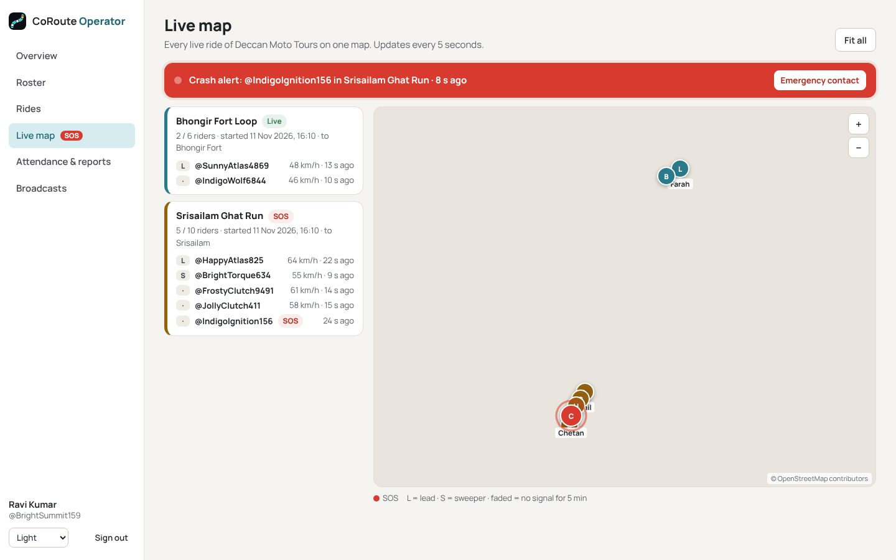

   - Each live ride is a card with its riders, role (L, S), speed and last update. Click a card to focus on that ride, and press **Fit all** to show everything.
   - Faded markers mean no signal for 5 minutes. On mountain roads this is often only a coverage gap.
   - Without the multi-group feature, the map shows one ride at a time. Open it from the **Live map** button on a ride row.

5. **If an SOS or crash alert opens**:
   - A red banner appears ("SOS: @rider in ride · time" or "Crash alert: ..."), and **SOS** shows in the navigation on every page.
   - Press **Emergency contact** in the banner. This needs "Roster & emergency contacts during an SOS" in your plan. You see:
     - the emergency contact's name and phone;
     - the rider's phone;
     - the medical info;
     - the last position.

     The view is recorded in the audit log, and it closes for good once the SOS is resolved.

   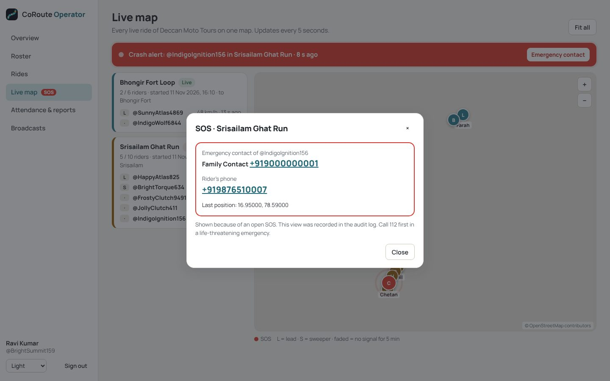

   - Follow the emergency procedure in the *Ride Organiser SOP*. **In a life-threatening emergency, call 112 first.**

6. **End**: press **End** when the ride is over. It ends for every rider, as when the trip owner ends it in the app.

## Step 10: After the ride

- **Attendance** (on the ride row, or click a ride in **Attendance & reports**) shows:
  - joined, finished, total distance and incidents;
  - for each rider: role, joined, left, Finished or Left early, distance and incidents.

  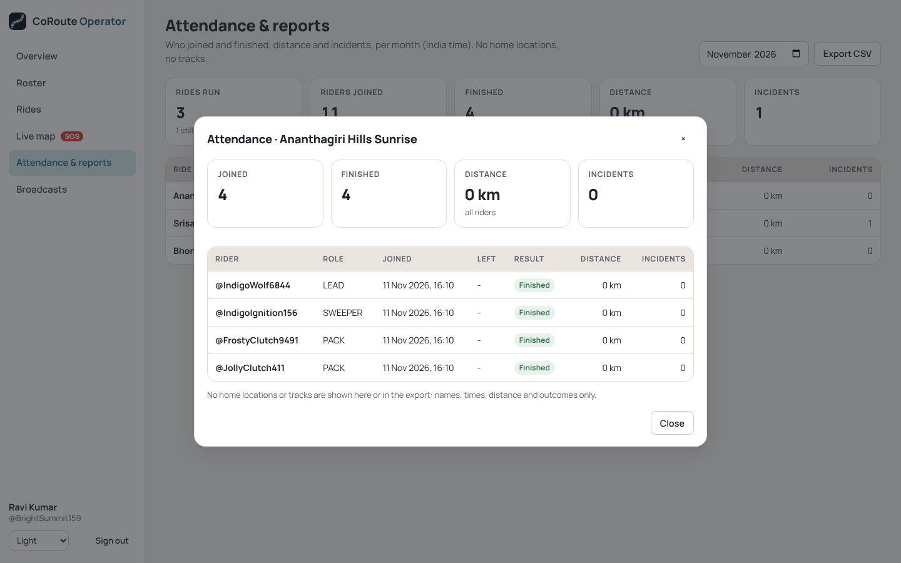

- **Attendance & reports** shows monthly totals: rides run, riders joined, finished (with the % of riders), distance and incidents. Pick the month with the month field.
- **Export CSV** downloads `coroute-YYYY-MM-attendance.csv`, if "Export reports (CSV)" is in your plan. Each export is recorded in the audit log.

  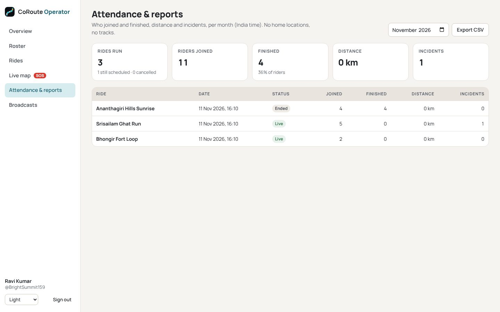

- **Broadcasts**: send a thank-you or the next ride date. See the *Operator Console Manual* for the rules.

  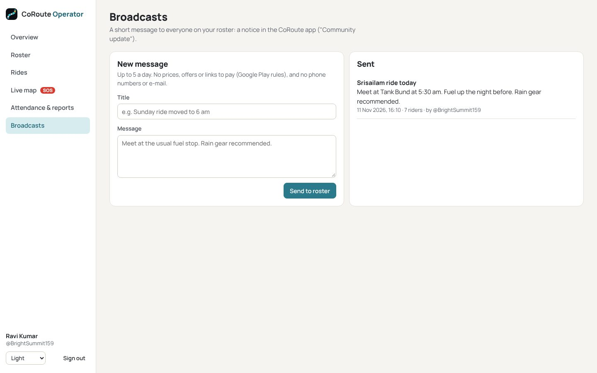

## Checklist: your first week

- [ ] Application sent, approval e-mail received.
- [ ] Signed in at /operator, limits checked under **Your plan**.
- [ ] Leads and sweepers invited, and they have accepted.
- [ ] Co-organisers added (if any).
- [ ] Every rider has set an emergency contact and medical info in the app (see *Safety Briefing Template*).
- [ ] First ride scheduled with a lead and a sweeper.
- [ ] Riders invited (announce, public page or invite roster).
- [ ] Ride started, live map open on a laptop at base.
- [ ] After the ride: attendance checked, CSV exported if needed.

Need help? See *Support and Escalation*. **Emergencies: call 112 first.**
