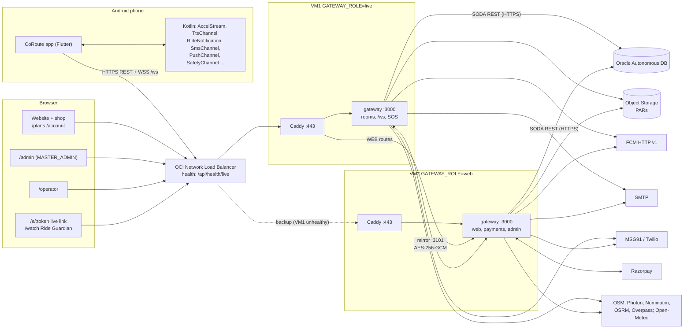
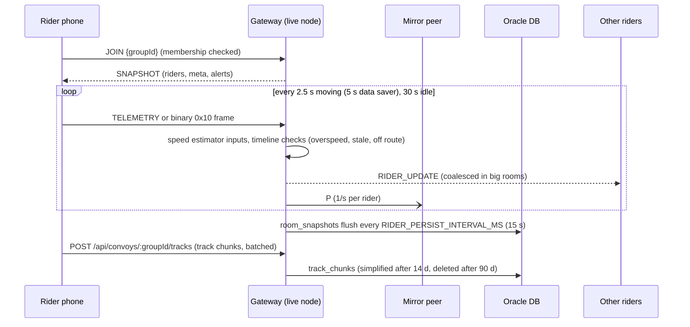
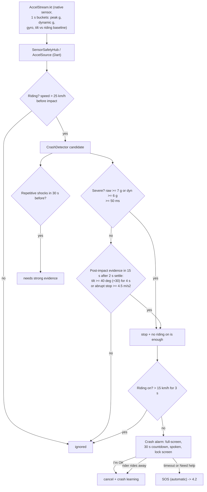
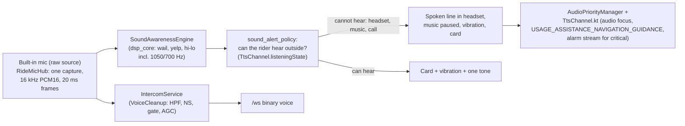
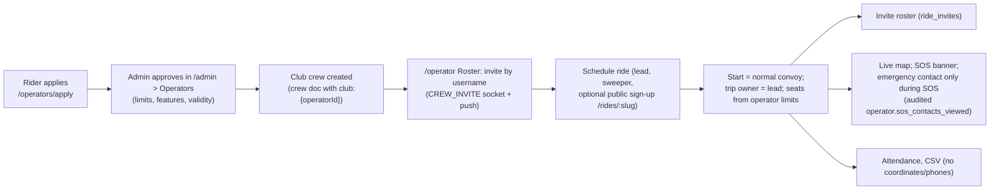

# CoRoute architecture

Status: written 11 Nov 2026 from the code in this repository (app `3.55.0+10022`, gateway `3.55.0`
with the 3.56 web/payments/operator work in the tree). Where a document and the code disagree, the
code wins and this page says so.

Related: [api_reference.md](api_reference.md) · [data_model.md](data_model.md) ·
[mobile_app.md](mobile_app.md) · [deployment_and_operations.md](deployment_and_operations.md) ·
[security_overview.md](security_overview.md)

---

## 1. System overview

CoRoute is a motorcycle group and solo riding **safety** platform for India. It has four parts:

| Part | Technology | Where | Purpose |
|---|---|---|---|
| Android app | Flutter 3.47.1 / Dart 3.13.1, Kotlin platform code, package `space.devmonks.coroute_app`, minSdk 23, targetSdk 36, compileSdk 37 | `lib/`, `android/app/` | Riding cockpit, live group map, SOS, crash detection, intercom, siren alerts, social. **Consumption-only** (no prices or payments: Google Play policy). |
| Gateway | Node.js 22 (engines `>=20`), Express 4, `ws` 8 | `gateway/src/` | REST API, WebSocket realtime hub, safety engine (timeline, safety network), jobs, push/mail/SMS, website and web consoles. |
| Website and web consoles | Static HTML + vanilla JS served by the gateway | `gateway/public/` | Public site, rider shop (`/signin`, `/plans`, `/account`, `/receipt`), web admin (`/admin`), operator console (`/operator`), live emergency pages (`/e/:token`), Ride Guardian (`/watch`). |
| Database | Oracle Autonomous Database (Always Free), JSON collections through ORDS **SODA** REST | OCI Hyderabad | All persistent state. Reached **only from the gateway**, schema user `COROUTE` (never ADMIN). |

Infrastructure: two OCI Always Free VMs behind an OCI Network Load Balancer (TCP 443/80, source IP
preserved), Caddy for TLS on each VM, OCI Vault for secrets, OCI Object Storage (pre-authenticated
request URLs, "PARs") for backups, review photos and diagnostics logs. Domains:
`https://coroute.devmonks.space` (canonical, `PUBLIC_ORIGIN`) and `https://coroute.duckdns.org`
(legacy, `LEGACY_ORIGINS`, kept fully served for installed 3.54/3.55 apps for at least 6 months).



### 1.1 Two-VM roles

`GATEWAY_ROLE` (`gateway/src/config.js`) is `live`, `web` or `all` (single VM, default). The role
only decides which node **prefers** a scheduled job; routing is decided by Caddy.

| Node | Serves | Notes |
|---|---|---|
| VM1 `live` | `/ws`, convoy/room REST, SOS dispatch and live links, Ride Guardian, live pages, admin screens that read live rooms | Caddy on VM1 sends LIVE routes to `127.0.0.1:3000` and WEB routes to VM2 (falls back to itself if VM2 is down). The matcher is generated from `gateway/deploy/route_split.md` by `deploy/gen_caddy_routes.js`. |
| VM2 `web` | Website, auth, profile reads, payments, memberships, coupons, reviews/photos, other admin, downloads | Holds a **mirror copy** of every live ride, so it can take over riders if VM1 fails. |

Failover: the NLB health-checks `GET /api/health/live` on each VM (VM1 primary, VM2 `is_backup`).
VM1 unhealthy, then all traffic goes to VM2, which already has every room in memory. When VM1 is
back it syncs (`syncing` then `serving`) and riders are handed back at `MIRROR_HANDBACK_PER_SEC`
after `MIRROR_HANDBACK_DELAY_MS`. Drills: [deployment_and_operations.md](deployment_and_operations.md#8-failover-drills).

### 1.2 Mirror (live replication between nodes)

`gateway/src/mirror.js`. Off unless `MIRROR_LISTEN_HOST` / `MIRROR_PEER_URL` are set.

- Link: WebSocket path `/mirror` on `MIRROR_LISTEN_PORT` (3101). Mutual HMAC-SHA256 challenge with
  a key derived (HKDF) from `MIRROR_KEY`; then every frame is AES-256-GCM with per-direction
  session keys and a 64-bit counter nonce (replay or reorder closes the link). Heartbeat 1 s;
  3.5 s silence = dead link.
- Messages: `HELLO`, `SNAP`/`SNAP_END` (room snapshots), `EV` (one replicated room event with a
  per-origin sequence, acked by `EA`), `P` (positions, coalesced 1/s, droppable), `LU` (riders with
  a live socket here; `o` = any signed-in socket, used to avoid duplicate pushes), `U` (personal
  message for a rider on the peer), binary `0x02` voice, `XS` + extensions.
- Registered extensions: `pr` (public ride state), `ff` (feature switches poke), `am` (access
  mode poke). A poke only triggers a re-read; the database stays the truth.
- Lanes: 0 = SOS, alerts, roster, durable events (never dropped); 1 = other events (oldest dropped
  beyond 20 000); 2 = positions and voice (dropped under backpressure).
- Durable events (SOS, crash and member reports, resolve, respond, chat) are written to the
  database first. Remote events never re-run the timeline, safety network or SMS on the peer (the
  origin node already did them).
- Room authority: the node holding sockets of a room runs its automation; with sockets on both or
  none, the `live` node.

### 1.3 Job leases (exactly-once scheduled jobs)

`gateway/src/job_lease.js`, collection `leases`, one document per job. Creating a lease is an
insert guarded by a unique index; renew, take-over and hand-back are compare-and-replace
(`SodaClient.compareAndReplace`). A run is recorded before it starts, so a job runs at most once per
interval across nodes. A node of the non-preferred role takes an expired lease only after
`JOB_LEASE_GRACE_MS` (120 s), and hands it back when the preferred node asks.

| Job | Interval | Prefers | Module |
|---|---|---|---|
| `retention` | `RETENTION_RUN_EVERY_MINUTES` (360) | web | `retention.js` |
| `convoy-auto-end` | 60 min | live | `retention.js` |
| `db-keepalive` | `DB_KEEPALIVE_EVERY_MINUTES` (720) | web | `retention.js` |
| `subscriptions` | hourly | web | `subscription_lifecycle.js` |
| `rider-score-daily` | 24 h | web | `rider_score.js` |
| `public-stats` | per store | web | `public_stats.js` |
| `username-backfill` | once at start | web | `social_routes.js` |
| `coupon-seed` | once | web | `subscription_routes.js` |
| `diag-log-retention` | 6 h | web | `diag_logs.js` |
| `guardian-push` | 15 s | live | `guardian_push.js` (only with `GUARDIAN_PUSH_ENABLED`) |
| `sos-sms` | 15 s | web | `sos_sms.js` |
| `push-campaigns` | 30 s | web | `push_campaigns.js` |
| `push-news-caps` | 6 h | web | `push_campaigns.js` |
| `offer-emails` | 60 s | web | `offer_emails.js` |
| `mail-retry` | 5 min | web | `purchase_email.js` / `mailer.js` |
| `backup-critical`, `backup-full` | `BACKUP_CRITICAL_EVERY_MINUTES`, daily after `BACKUP_FULL_HOUR_UTC` | web | `backup_jobs.js` |

### 1.4 Per-node caches

Feature switches (`feature_flags.js`) and the access mode (`access_mode.js`) are each one cached
document per node, re-read every 30 s and on a mirror poke; the access-mode schedule boundary is
checked every 15 s. A failed first read leaves every feature **on**; a database outage keeps the
last known access mode.

---

## 2. Components inside the gateway

| Area | Main modules |
|---|---|
| Wiring | `server.js`, `app.js` (factory `createApp`, used by the tests with an in-memory SODA) |
| Config | `config.js` (env catalogue: [deployment_and_operations.md](deployment_and_operations.md#2-environment-variable-catalogue)) |
| Persistence | `oracle/soda.js` (ORDS SODA REST client), `oracle/memory_soda.js` (tests, `ORACLE_SODA_URL=memory`), `oracle/repo.js` (one function per business operation) |
| Auth | `auth.js` (`AuthService`, `UserGate`, `requireAuth`, `requireAdmin`), `password_hash.js` + `password_hash_worker.js` (scrypt, bcrypt legacy) |
| Realtime | `ws.js` (`Hub`), `convoys.js` (`ConvoyManager`, rooms, roles, swaps, capacity), `timeline.js` (`TimelineEngine`: offline, stale, overspeed, possible incident, sweeper, regroup, auto roles), `mirror.js` |
| Safety | `safety_network.js` (help from nearby riders of other groups), `discovery.js` (groups nearby), `public_ride.js` (public ride, safe contact, road warnings), `signal_ahead.js`, `guardians.js` + `guardian_routes.js` + `guardian_push.js` + `guardian_arrival.js` (Ride Guardian), `emergency_sms_gateway.js` + `sos_sms.js` (server SMS), `safety_audit.js`, `road_hazards.js`, `road_and_places.js`, `road_risk.js`, `buddies.js` |
| Maps | `geo.js` (`GeoProxy`: Photon search, Nominatim reverse, OSRM route, cache), `geo_links.js` (pasted map links), `essentials.js`, `poi_cells.js`, `net_geo.js`, `geo_math.js` |
| Plans and payments | `entitlements.js`, `access_mode.js`, `membership_routes.js`, `subscription_routes.js`, `subscription_lifecycle.js`, `plan_pricing.js`, `admin_plans.js`, `razorpay_gateway.js`, `payment_security.js`, `web_shop.js`, `purchase_email.js` |
| Social | `usernames.js`, `friends.js`, `avatars.js`, `social_routes.js`, `crews.js`, `crew_routes.js`, `crew_ride_invites.js`, `rider_score.js`, `leaderboard.js` |
| Operators | `operators.js`, `operator_routes.js` |
| Messaging | `push.js` (FCM HTTP v1), `push_campaigns.js`, `notifications.js` (wires push, SMS, mail, templates), `mailer.js` (nodemailer SMTP), `offer_emails.js`, `templates.js`, `marketing_templates.js`, `board.js`, `policy_terms.js` (Play policy guard) |
| Admin | `web_admin.js`, `admin_analytics.js`, `admin_warnings.js`, `feature_flags.js`, `feature_analytics.js`, `engagement.js`, `diag_logs.js`, `staff.js` |
| Website | `pages.js` (page assembly, partials), `public_stats.js`, `public_privacy.js`, `public_live.js`, `domains.js` |
| Housekeeping | `retention.js`, `backups.js` + `backup_jobs.js`, `object_store.js`, `anonymise.js` |

---

## 3. Realtime protocol (WebSocket)

Endpoint `wss://<host>/ws`. The JWT is passed as `?token=` or `Authorization: Bearer`. Max frame
256 KiB. The account gate runs on connect; a refused account is closed with **4403** (hold/block,
do not retry) or **4401** (gone/signed out). Up to `WS_MAX_SOCKETS_PER_USER` (8) sockets per account.

On success the server sends:

```json
{ "type": "HELLO", "userId": "...", "serverTime": 1731234567890, "heartbeatSec": 30, "protocol": 2,
  "features": ["ack","sos2","respond","presence","checkin","roster","net1","discovery1","pubride1",
               "ride316","featurePolicy1","bin1","ride355","vehicle1","pillion2"] }
```

`net1`, `discovery1`, `pubride1` appear only when `SAFETY_NET_ENABLED`, `DISCOVERY_ENABLED`,
`PUBLIC_RIDE_ENABLED` are on. An app uses a protocol feature **only when it is listed**; that is how
old apps and new gateways stay compatible. If any admin switch is off, a `FEATURE_FLAGS` snapshot
follows HELLO.

| HELLO feature | Since | Unlocks |
|---|---|---|
| `ack`, `sos2`, `respond`, `presence`, `checkin`, `roster` | 3.14 | clientId outbox with `ACK`; SOS v2; `SOS_RESPOND`; presence; `CHECK_IN`; emergency SMS roster |
| `net1` | 3.15 | safety network (`ASSIST_*`, `EMERGENCY_*`) |
| `discovery1` | 3.15 | groups nearby (`DISCOVERY`, `WAVE`) |
| `pubride1` | 3.15+ | public ride (`PR_*`, `ROAD_WARN*`) |
| `ride316` | 3.16 | sweeper role, follow-up check-in, town limit, live links |
| `featurePolicy1` | 3.55 | admin feature switches over the socket |
| `bin1` | 3.55 | binary telemetry frames (first byte `0x10`) |
| `ride355` | 3.55 | `ROLE_SWAP`, `ROLE_AUTO`, `SWAP_*`, roles via `ROLE_CHANGED` |
| `vehicle1` | 3.55 | `RIDER_VEHICLE` (live bike colour/model) |
| `pillion2` | 3.55 | `PILLION_SEAT` / `PILLION_UNSEAT` (else legacy `CORIDER`) |

Binary voice frames: byte 0 = `0x01` START, `0x02` FRAME, `0x03` END; bytes 1..2 header length
(uint16 BE); JSON header `{to?, seq?, sampleRate?, codec?, streamId?}`; rest PCM16LE mono (16 kHz,
or 8 kHz in data saver). The server rewrites the header with `{streamId, from, fromName, groupId,
ts}` and relays to the room or one rider.

Outbound priority per socket: lane 0 (safety and control: `ALERT`, `ALERT_RESOLVED`,
`SOS_RESPONSE`, `EMERGENCY_UPDATE`, `ERROR`, `ACK`, `RECONNECT`, `TRIP_STATUS`, `HELLO`,
`ASSIST_REQUEST`, `ROAD_HAZARD` ...), lane 1 (roster, chat, the rest), lane 2 (positions, latest
per rider only). Rooms above `WS_COALESCE_ABOVE` (20) sockets coalesce positions to one per rider
per `WS_COALESCE_MS` (500 ms). Voice is never queued.

Full message list: [api_reference.md §3](api_reference.md#3-websocket-protocol).

---

## 4. Data flows

### 4.1 Live ride positions



- The phone records GPS through `geolocator` in a foreground service (`flutter_foreground_task`,
  type `location|microphone`), distance filter 8 m moving / 25 m stopped (`AppConfig`).
- Points that cannot be sent wait in a local SQLite queue (`sqflite_track_queue.dart`) and the
  socket outbox (`outbox_store.dart`, same `clientId` on resend so nothing is applied twice).
- The timeline tick (`TIMELINE_TICK_MS`, 2 s) judges what no fix can trigger (offline, stale,
  parked incident, sweeper distress, regroup arrival, end of overspeed).

### 4.2 SOS end to end

```mermaid
sequenceDiagram
  autonumber
  participant R as Rider phone
  participant G as Gateway
  participant Grp as Own group phones
  participant N as Nearby riders (other groups)
  participant Gd as Ride Guardian browsers
  participant S as SMS provider
  participant C as Emergency contacts
  R->>R: SOS hold 3 s (or crash countdown 30 s ran out)
  R->>R: PendingSos stored on disk, live link code made (22 chars)
  alt online
    R->>G: SOS {clientId, lat/lng, smsLinkToken, clientSentSms?}
    G->>G: raiseSos (serialised per group, deduped by clientId)
    G-->>R: ACK
    G-->>Grp: ALERT (lane 0), full-screen alarm on lock screen
    G->>G: safety_network.onEmergency: candidates riding toward the point
    G-->>N: ASSIST_REQUEST (point + distance only, max 3 pending)
    N-->>G: ASSIST_ANSWER accept -> first name, vehicle, medical info, emergency contact while open
    G->>Gd: guardian-push job (web push, high urgency)
    G->>G: emergencyGateway.dispatchForSos (skipped if phone already texted)
    G->>S: one text per contact, row key alertId:SOS:sha256(number)
    S->>C: "CoRoute SOS ... Live: /e/<code>"
  else no internet
    R->>C: 3.57: SMS from the rider's SIM by itself (SEND_SMS); denied: messages app prefilled, rider presses Send
    R->>R: resend over internet when back online (same clientId)
  end
  Note over R,C: On resolve or cancel: ALERT_RESOLVED to group, "safe now" SMS to the same contacts
```

Rules that must never break (also in [incident_response_and_sos_ops.md](incident_response_and_sos_ops.md)):

- The app never blocks or replaces a 112 call; the live page shows **Call 112**.
- SOS, crash detection, emergency texts and Medical ID are **locked on** admin switches; the
  access mode can never gate safety.
- The socket alarm budget is per type (`WS_ALARMS_PER_10S`), so a rider who just sent `WAIT` can
  still send `SOS`.
- Medical info goes with the alert only while it is open and is removed on resolve, at trip end and
  by retention.

### 4.3 Crash detection pipeline

All on the phone; motion data is never uploaded.



- Sources: `lib/domain/safety/crash_detector.dart`, `riding_motion.dart`, `rider_down_detector.dart`,
  `crash_learning.dart`, `mount_classifier.dart`; `lib/data/services/safety_service.dart`,
  `sensor_safety_hub.dart`; Kotlin `AccelStream.kt`, `UrgentAlertActivity.kt`, `RideNotification.kt`.
- Server side backup: `timeline.js` "possible incident" (hard stop from `INCIDENT_FROM_KMH` to
  `INCIDENT_STOP_KMH` within 15 s, then still for `INCIDENT_STILL_S`) asks the lead and the 2 nearest
  riders to check. Tuned for red lights (group still 300 s).
- Wearable and handlebar remote can open the same alarm (`SafetyService.externalImpact`).

### 4.4 Siren and audio pipeline



- Detection runs only during a ride, with **Siren alerts** on (setting, default on) and admin switch
  `sirenDetector` on, battery OK, no call, permission granted. Off releases the mic at once.
- First alert about 2.8 to 3.1 s after a continuous siren starts (synthetic tests). Nothing is
  recorded or sent.
- Ordinary lines duck other apps' music (or pause with "Pause music during alerts"); critical lines
  pause music and use the alarm stream without a headset. "Lower music when speeding"
  (`speed_audio_service.dart`, `MediaVolumeGuard.kt`). Calls: `PhoneCallChannel.kt`,
  `call_alert_queue.dart`. Horn alerts were **removed** (owner, 10 Nov).

### 4.5 Intercom

- Push-to-talk or hands-free (VOX) from `IntercomService`; frames 20 ms PCM16 at 16 kHz (8 kHz in
  data saver), cleaned by `voice_cleanup.dart` (about 12 ms added latency).
- Gateway relays START/FRAME/END to the room or one rider (`to`), one floor at a time, max
  `VOICE_MAX_STREAM_MS` (60 s) per stream, `VOICE_MAX_FPS` (100). Voice is **never stored**; only
  `voice_log` metadata (who, to whom, how long) for `RETENTION_VOICE_LOG_DAYS` (7).
- Through a failover the mirror forwards voice frames to the peer only while it has sockets in that
  room. Intercom requires internet (offline phone-to-phone voice is a v3.56 plan item).
- In a "free up to limits" ride without `intercom` in its features, `VOICE_START` is refused with
  `GROUP_FEATURE_LOCKED`.

### 4.6 Web purchase to app capabilities

```mermaid
sequenceDiagram
  participant B as Browser (/plans)
  participant G as Gateway (web node)
  participant RZ as Razorpay
  participant A as App (rider's phone)
  B->>G: POST /api/auth/login (same CoRoute account), token in sessionStorage
  B->>G: GET /api/membership/quote?plan&coupon
  B->>G: POST /api/membership/order (amount from plan_pricing.computeQuote)
  G->>RZ: create order (amount echoed back or 502 GATEWAY_AMOUNT_MISMATCH)
  B->>RZ: Razorpay Checkout (web JS)
  RZ-->>B: payment_id, signature
  B->>G: POST /api/membership/verify (HMAC check, fetchPayment amount/currency)
  RZ-->>G: webhook (raw-body HMAC; one active URL, other 410)
  G->>G: claimRazorpayOrder (CAS) -> settlePaidOrder once
  G-->>A: SUBSCRIPTION_ACTIVATED (socket) or push if app closed
  A->>G: GET /api/membership/my -> capabilities
```

The app never sees a price, coupon, plan name or the access mode; it reads only
`capabilities` (`GET /api/me/capabilities`). Security details: [security_overview.md §6](security_overview.md#6-payments).

### 4.7 Access modes

The admin sets **Paid** (default), **Free for everyone** or **Free up to limits** in `/admin` >
Plans & pricing > Access mode (`access_mode.js`, one document in `subscription_config`,
`k='access_mode'`). Changes, including a scheduled change in India time, send
`CAPABILITIES_CHANGED {version}` to every connected app, and live rides get a `CONFIG` with the new
capacity and `groupFeatures` (never fewer seats mid-ride). `PAYMENTS_ENABLED=false` overrides
everything to free. Safety is never in the gateable list. Contract and texts:
[docs/features_355/access_modes.md](../../features_355/access_modes.md).

### 4.8 Operator rides



Feature switch `operators`. Details: [docs/features_355/operators.md](../../features_355/operators.md)
and the operators handbook [../operators/](../operators/).

### 4.9 Push, mail and SMS

- **Push**: `push.js` sends FCM HTTP v1 **data-only** messages (host allowlist
  `fcm.googleapis.com`; OAuth via `google-auth-library`). Off unless `FCM_SERVICE_ACCOUNT_JSON` or
  `FCM_SERVICE_ACCOUNT_FILE` is set (tokens are still stored). Up to 5 tokens per rider; 30 pushes
  per rider per 10 min per node; retries with backoff. Social pushes are skipped when a socket on
  either node already showed the event. Campaign kinds (Update, Event, Safety tip, Community,
  Partner perk) each have an Android channel and an opt-out; safety, ride, social and plan pushes
  cannot be turned off.
- **Mail**: `mailer.js` (nodemailer, `SMTP_*`, `MAIL_FROM`, `MAIL_REPLY_TO`). Used for receipts,
  refund mails, opt-in offer e-mails, operator application notices. Unset = mail off.
- **SMS**: `sos_sms.js` (MSG91 or Twilio, DLT template ids), `SMS_PROVIDER=off` until DLT approval;
  delivery receipts at `POST /api/sms/receipts/:provider/:token`. Older provider chain in
  `emergency_sms_gateway.js` (Twilio, AWS SNS, Infobip, webhook, WhatsApp) remains the fallback path
  when the provider is `off`.

### 4.10 TLS, domains and the NLB

- Caddy on each VM gets certificates for both names by ACME DNS-01 through DuckDNS
  (`_acme-challenge.coroute.devmonks.space` is a CNAME to the DuckDNS challenge name). Caddy needs a
  build with the `caddy-dns/duckdns` module and the `DUCKDNS_TOKEN` (from Vault).
- HSTS: `max-age=300` on `coroute.devmonks.space` until verified (raise to one year after a stable
  week, owner decision); one year with `includeSubDomains` on the DuckDNS name. Never
  `includeSubDomains` on `devmonks.space` itself.
- `REDIRECT_LEGACY_HOST=true` 301s website pages on the old host to `PUBLIC_ORIGIN`, but never
  `/api`, `/ws`, `/.well-known/`, `/e/`, `/watch`, `/uploads/`, `/status` or POSTs.
- The app tries `coroute.devmonks.space` first and falls back to `coroute.duckdns.org`
  (`lib/core/config/gateway_hosts.dart`). A `COROUTE_API` build define disables the fallback.
- `/.well-known/assetlinks.json` is identical on both hosts (App Links for `/join`, `/get`, ...).

---

## 5. External services

| Service | Used for | Data sent | Config |
|---|---|---|---|
| Oracle Autonomous DB | all storage | everything persistent | `ORACLE_SODA_URL`, `ORACLE_USER`, `ORACLE_PASSWORD` |
| OCI Object Storage | backups (encrypted), review photos, diagnostics logs, push images | ciphertext / photos without EXIF / redacted logs | `BACKUP_PAR_URL`, `REVIEW_PHOTO_PAR_URL`, `DIAG_LOG_PAR_URL` |
| Firebase Cloud Messaging | push | push token, usernames and short text, no location | `FCM_*` |
| SMTP provider | e-mail | e-mail address, receipt / offer content | `SMTP_*` |
| MSG91 / Twilio | SOS SMS | contact numbers, rider first name, live link | `SMS_*`, `MSG91_*`, `TWILIO_*` |
| Razorpay | website payments | order amount, rider e-mail/phone prefill | `RAZORPAY_*` or admin-saved keys |
| Google Sign-In | app and website sign-in | ID token verified server side | `GOOGLE_CLIENT_IDS`, `GOOGLE_WEB_CLIENT_ID` |
| OSM Photon / Nominatim / OSRM / Overpass | search, reverse, routes, places | query text or rounded coordinates, no rider id | `GEO_*`, `POI_OVERPASS_URL`, `ESSENTIALS_OVERPASS_URL` |
| Open-Meteo | weather on route | rounded route points | `WEATHER_URL` |
| OpenStreetMap tiles | maps (phone and live page) | tile requests from the viewer | none |
| Google Play In-App Review | rating card | none from CoRoute | Play library |
