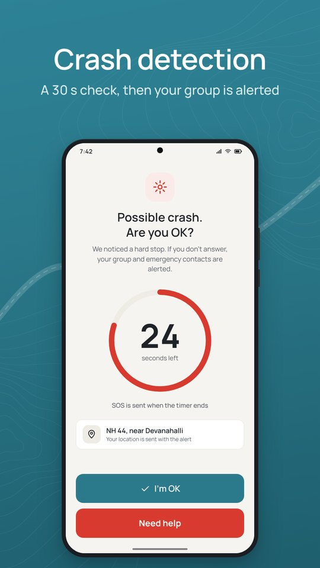
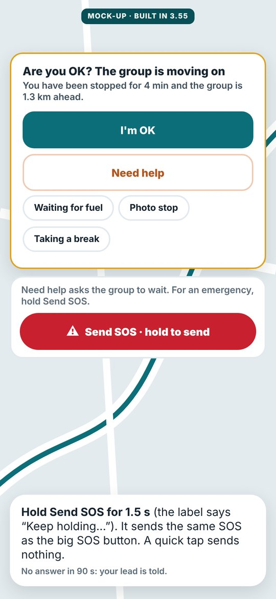

# CoRoute safety guide

Every feature in this guide is free and on for every rider. None of them has an off switch, except **Siren alerts**, which you can turn off in Settings.

> [!IMPORTANT]
> **In an emergency, call 112 first.** CoRoute alerts your group, your emergency contact and nearby riders, but it does not call emergency services for you. If you cannot call, send an SOS: the people it alerts can call for you.

## 1. In an emergency: what to do

**If you are hurt or in danger**

1. **Call 112** (national emergency). 108 is the ambulance and 100 the police. The SOS screen also offers the highway helpline **1073**.
2. **Hold SOS for 3 seconds** so your group and emergency contact know where you are.
3. If you can, **Share live link** from the SOS screen with family: it shows your first name and position for 30 minutes.
4. Stay where you are if it is safe. Keep the phone on you: your location updates every 10 seconds.
5. When help has reached you, tap **Help reached me**. Your emergency contact gets a "safe now" text where text alerts are available.

**If another rider is down**

1. Make the scene safe: warn traffic, switch on hazard lights, do not move the rider unless there is danger.
2. **Call 112.** Read out the place shown on the SOS card.
3. In CoRoute, tap **I'm going** or **I'm with them** so your group knows who is helping.
4. Open the rider's alert to see their **medical info** (blood group, allergies, notes) and their **emergency contact**. They are shown to responders only while the alert is open.
5. The rider's lock screen also shows their **Medical ID**, so anyone can read it without unlocking the phone.

**If you are asked to help a rider of another group**

You may see a request with the emergency point and the distance. Tap **I Can Help** only if you can get there safely, or **Can't Assist**. After you accept you see the rider's first name, bike type and colour, and their medical info and emergency contact while the alert is open.

## 2. SOS

| Step | What happens |
|---|---|
| You press and hold **SOS** | A ring fills for **3 seconds**. Let go early and nothing is sent. This stops rain, gloves or a tank bag from sending an SOS by mistake. |
| The ring is full | Your group gets your SOS with your location, by voice and on screen. Your emergency contact gets a text with a live link and your coordinates, and you can call them in one tap. |
| Your group | The SOS stays on every screen until it is closed, with distance, direction and **Navigate**. Riders answer **I'm going** or **I'm with them**. The nearest hospital is shown. |
| Nearby riders | Up to 3 riders of other groups riding toward you on the same road may be asked to help (see section 8). |
| You are safe | Tap **Help reached me**, or **False alarm** if it was a mistake. |

**Where to find SOS:** the red button on the ride map, the ride notification on your lock screen, and the **Send SOS** button on an "Are you OK?" card (held for 1.5 seconds there).

### When there is no internet

- Your SOS is saved on the phone and sent the moment the phone reconnects. It is never sent twice. The app says: "SOS queued. It goes out the moment the phone reconnects. Call 112 if you can."
- **Emergency texts:** when you hold SOS, or a crash alarm runs out without an answer, your phone texts your emergency contact **by itself**, from your own number, even with the screen locked: your name, what happened, the time, a live link and your coordinates. After pressing SOS you have 10 seconds to cancel before the text goes; a crash alarm's countdown is that window. The SOS screen shows the status, for example "Texted your emergency contact from your phone. Delivered." With no signal the phone tries again by itself (after 30 s, 2, 5 and 10 minutes, and when the network returns). When the SOS is closed, they get a "safe now" text. Your carrier's normal SMS charges apply (at most 30 emergency texts a day).
- To make this work, allow **Emergency texts** when CoRoute asks (after you save your emergency contact, or in **Safety health**). If you do not allow it, the text opens in your messages app with everything filled in: tap **Send** (or **Text the group now** on the SOS screen).
- Without internet, your lead, sweeper and the nearest riders get a text too (status, for example, "Texted 2 of 3").
- **Test it:** **Safety health › Send a test text to my emergency contact** sends one short text after you confirm. Test alarms never text anyone.
- **Ride solo without internet** (Home): crash detection and SOS by text work on your phone alone, with no group and no data.

## 3. Crash detection

During a ride (from about 12 km/h) your phone's motion sensor watches for a crash: a hard impact followed by signs that the bike or rider went down, or an abrupt stop. Everything is worked out on your phone. Motion data is never sent.

| Moment | What you see | What you hear | What to do |
|---|---|---|---|
| Possible crash | Full screen, also over the lock screen: "Possible accident detected. Are you okay?" with a **30-second** countdown: "Sending SOS to your group in 30 seconds." | Alarm sound; music pauses | Fine? Tap **I'm OK**. Nothing is sent. Need help? Tap **Need Help** to send at once. |
| No answer | "Crash SOS sent" | | Your group and emergency contact are alerted, marked "Automatic alert". |
| You ride on | "Crash alarm cancelled. You are riding." | Spoken | Nothing to do. |
| Your next stop | "Still okay? Anything hurt?" | | **Yes, fine** or **Need help**. |

Why 30 seconds: it gives a rider with the phone in a pocket or tank bag time to hear and answer.

**It learns.** Each **I'm OK** makes the matching kind of alarm a little less sensitive for that bike, so a bump that fooled it once is less likely to fool it again. A severe impact or a tumble always raises the alarm, however much it has learned.

*The crash countdown (illustration).*

## 4. "Bike down?"

If the bike falls over while you are stopped or walking (for example on a slope or soft ground) and nothing moves for about a minute, CoRoute opens the same 30-second countdown, titled **Bike down?**. Picking up the phone, walking away or lifting the bike cancels it.

## 5. "Are you OK?" checks

| Check | When it asks | Your answers | If you do not answer |
|---|---|---|---|
| **The group is moving on** (missing-rider check) | You have been stopped for 3 minutes, most of the group is moving, and the nearest moving rider is more than 1 km away and getting further | **I'm OK** · **Need help** (asks the group to wait) · **Waiting for fuel** · **Photo stop** · **Taking a break** · red **Send SOS · hold to send** (1.5 s) | After 90 seconds your lead and sweeper are told: "Stopped while the group moved on and did not answer Are you OK" |
| **Far from your group** | You have been far from the group for some minutes | **I'm OK** | After 2 minutes your lead is told |
| **Solo ride ETA check-in** | A solo ride with a destination and an emergency contact: you have not arrived well after your expected time, and you are stopped | **I'm fine** · **Add 30 min** | After 3 minutes your emergency contact gets a text with your last known position. If you then tap I'm fine, they get a follow-up. |
| **Break reminder** | About 2 hours of riding without a break, then hourly; earlier when you seem tired (long stretch, night, many short stops, wobbly steering) | **I'm alert** · **Taking a break** | Nothing is sent |

"Need help asks the group to wait. For an emergency, hold Send SOS."

A rider who is riding normally is never reported as "no reply". If you or your pillion answers, it counts for both of you.

*The missing-rider check (mock-up).*

## 6. Siren alerts

With earbuds, a helmet headset or music, you may not hear an ambulance behind you. **Siren alerts** listen through the phone's own microphone during rides and warn you. Nothing is recorded or sent. The switch is in **Settings › Siren alerts** (on by default).

| You | What you hear | What you see and feel |
|---|---|---|
| Earbuds, helmet set or music; siren close | Music pauses. In your ears: "Ambulance siren close by. Keep left and give way." (Police, Fire engine, or "Emergency vehicle" when the kind is not clear) | Strong vibration; card "AMBULANCE SIREN · GIVE WAY"; heads-up on the lock screen |
| Siren getting louder | "Ambulance approaching. Keep left and give way." | Card shows Approaching |
| Siren far away | "Emergency vehicle siren in the distance." | Card, medium vibration |
| Phone speaker, no music | One short tone (you can hear the siren yourself) | Card and strong vibration |

- The alert comes about **3 seconds** after a siren starts. Short chirps, horns, musical truck horns, reversing beepers, ringtones and temple music do not set it off.
- One microphone cannot tell direction, so CoRoute says "close by" or "approaching", never "behind". A siren coming toward you also counts as approaching.
- The side to keep to follows your phone's country (left in India).
- The kind (ambulance, police, fire engine) is a best guess and is said only when the sound pattern makes it likely.

## 7. Ride Guardian: family can follow your ride

Create a **Guardian link** from the ride's settings card (**Ride Guardian**). Family open it in a browser; they do not need an account.

| Level | What they see |
|---|---|
| **Basic** | Status without exact location |
| **Live** | Your last reported location during the ride |
| **Emergency only** | Your location only when help is requested |

- Optional PIN (4 to 8 digits) and a maximum time. Share the link at once; it cannot be shown again.
- While your SOS or crash alert is open, guardians also see your medical info.
- They are told when you enter a stretch where your phone had no signal before, and when you expect to be back online.
- When you arrive, the page says "Arrived safely. Location sharing has stopped." and the link ends 2 hours later. Links also end at the time you picked, or 6 hours after the ride.
- Stop a link at any time from **Your links**.

## 8. Help from nearby riders

When you send an SOS or crash alert, **your own group is always alerted first**. CoRoute may also ask a few riders of other groups who are already riding toward you on the same road and may reach you sooner: at most 3 at a time, never everyone nearby.

| Before a rider accepts | After a rider taps **I Can Help** |
|---|---|
| Only the emergency point, the distance and roughly how long it takes | Also your first name and your bike type and colour, so they can find you; while your alert is open, your medical info and emergency contact |

They never get your phone number or your ride mates' numbers. When the alert closes they lose access at once. Riders heading toward an accident on the same road get a short caution with the place only, no names. Help nearby riders and Ask nearby riders to help me are always on; CoRoute can pause them for everyone, for example during maintenance, and your own group is still told.

## 9. Your Medical ID and emergency contact

Set them in **Profile › Emergency contact & Medical ID**.

- **Emergency contact:** a name and phone number. SOS lets you call or text this person in one tap.
- **Medical info (optional):** blood group, allergies, notes for a doctor. "Shown to responders in an emergency and on your lock screen."
- Who sees medical info: your ride group, your guardians, and a rider who accepted to help, only while your SOS or crash alert is open. CoRoute staff never see it.

## 10. Battery and phone placement

**Battery**

- Start the ride charged. A USB charger on the bike is best for long rides.
- **Battery saver** turns on by itself at 20 %. It never reduces SOS or crash detection.
- Below 10 % (and not charging), **Battery saver for SOS** takes over: map downloads, hands-free talk and other extras stop, and your last location is sent to your group once, so they know where you were if the phone dies.
- Allow CoRoute to run in the background (no battery restriction). See *Troubleshooting* for your phone brand.

**Where to put the phone**

| Place | Crash detection | Siren alerts | Notes |
|---|---|---|---|
| **Handlebar mount** | Best | Best | Recommended. Use a firm, vibration-damped mount. |
| **Tank bag** | Good | Good | Keep the phone held firmly, not loose. |
| **Jacket pocket** | Works, less precise | May miss sirens at speed | Wind and clothing muffle the sound. |
| **Backpack / loose in a bag** | Less reliable | Often misses | A loose phone can look like a bump; CoRoute guards against this. |

CoRoute checks this during the first minutes of the ride and may show "Phone not in a mount? Crash detection works best with the phone in a handlebar mount."

## 11. What CoRoute cannot do (honest limits)

- **It is not a certified safety device.** It depends on your phone, its sensors, GPS and network, any of which can fail or be late.
- **Crash detection cannot catch every crash.** A slow fall onto soft ground, a fall before you have started riding (detection starts from about 12 km/h), a bike that falls long after you parked it, or a phone that flies off the bike may not be recognised. It can also, rarely, alarm when nothing happened: that is why you have 30 seconds to answer.
- **A phone in a pocket at speed may miss sirens.** Wind and clothing can bury the sound. Very fast "phaser" sirens and two sirens at once are harder to recognise. Music playing on the phone's own speaker pauses detection.
- **It needs battery and permissions.** If the phone is off, the app was closed by the phone's battery manager, or location, notifications or the microphone are blocked, safety features cannot work. Run **Safety health** before long rides.
- **Texts need you or a bystander to press Send** on phones from Google Play when the internet is down. If the phone is locked and you cannot reach it, the text may wait until someone does.
- **Help from other riders depends on who is nearby** and riding the same road.
- **The full-screen alarm** may show only as a notification on some Android 14+ phones until you allow full-screen alerts.

## 12. Before every ride: checklist

- [ ] Phone charged (or charging on the bike)
- [ ] **Safety health** shows no problems
- [ ] Emergency contact saved (Profile row is not amber)
- [ ] Phone in a mount or held firmly in a tank bag
- [ ] Headset connected, if you use one
- [ ] For long solo rides: a destination set, so the ETA check-in can look out for you
- [ ] Family has a **Guardian link**, if they want to follow
