# CoRoute user guide

This guide covers the CoRoute app for Android, version 3.55. It replaces the earlier rider manual. Screens in this guide are illustrations: your phone may show slightly different wording or layout.

> [!IMPORTANT]
> CoRoute is a riding aid, not a certified safety device. Your phone, GPS or network can fail. In an emergency, call **112** first.

**Contents**

1. [Getting around the app](#1-getting-around-the-app)
2. [Safety](#2-safety)
3. [Group riding](#3-group-riding)
4. [Talk: intercom, chat, music and calls](#4-talk-intercom-chat-music-and-calls)
5. [Navigation and maps](#5-navigation-and-maps)
6. [Community: friends, crews, reviews](#6-community-friends-crews-reviews)
7. [Trips and rider score](#7-trips-and-rider-score)
8. [Notifications](#8-notifications)
9. [Settings](#9-settings)
10. [Your data and your account](#10-your-data-and-your-account)
11. [Getting help](#11-getting-help)

---

## 1. Getting around the app

The bar at the bottom has five tabs:

| Tab | What it is for |
|---|---|
| **Home** | Start a ride (**Start Ride**, **Plan a route**), join one (**Join Ride**), ride solo without internet, and see your bike status. During a ride, Home becomes the ride map (the cockpit). |
| **Trips** | Your past rides: trip reports, maps, timelines, replays and the leaderboards. |
| **People** | Friends, crews, requests and invitations. Search riders by username. |
| **Alerts** | Recent ride and safety notices. |
| **Profile** | You, your bikes, your safety details, your score, help and your account. |

### Profile

The Profile tab is kept short on purpose:

- **Top box:** your picture, name and **@username**. Tap it to open **My profile** (details, stats, **Edit details**, **Change password**). The **gear** icon in the box opens **Settings**.
- **My bikes:** your garage.
- **Emergency contact & Medical ID:** amber until you add a contact.
- **Rider score** card and **Leaderboard**.
- **Help:** **Send feedback**, **Rate CoRoute**, **Privacy & terms**.
- **Account:** **Sign out**, **Delete account**.

### The ride map (cockpit)

While you ride, the map shows your group, the route, your speed and the speed limit. Big buttons sit at the bottom: **Hold to talk**, **SOS** and the riders list. Cards appear at the top for things that need your attention, ranked so that safety always comes first.

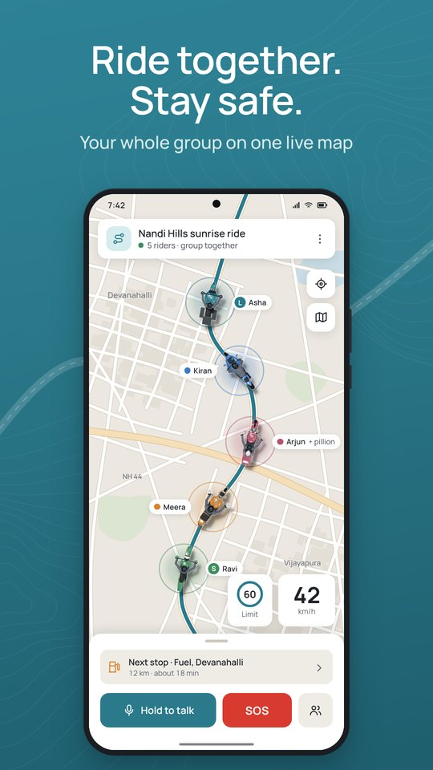 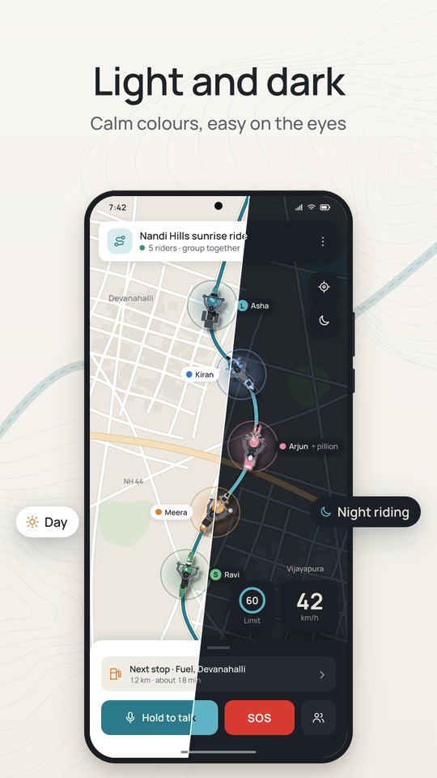

*Ride map (illustration) and the night map.*

**Speak while moving, act when stopped.** Cards that need a choice (off the route, a bike swap request, a historic place, a place review) only show their buttons once you have stopped for a few seconds. While you move, CoRoute says one short line and shows a small chip. Safety cards (SOS, crash countdown, "Bike down?", sirens, "Are you OK?") are never held back. A pillion can always tap.

---

## 2. Safety

Every safety feature is free and on for every rider. In **Settings › Safety is always on** you can see the full list: crash detection; SOS, also on the lock screen; emergency texts; Medical ID for responders; "Are you OK?" check-in; solo ride ETA check-in; no-signal ahead; break reminder; road warnings; auto re-route; help nearby riders; ask nearby riders to help me; clear voice in group talk; screen stays on while riding.

The *CoRoute safety guide* explains each one in depth, with limits and what to do in an emergency. Here is the short version.

### SOS

1. Press and hold the red **SOS** button. A ring fills for **3 seconds**. Let go early and nothing is sent.
2. When the ring is full, your SOS goes to **your group** (voice and location) and your **emergency contact** (text, and you can call). Your location updates every 10 seconds.
3. The SOS stays on every screen of your group until it is closed. Riders answer with **I'm going** or **I'm with them**.
4. From the SOS screen you can **Share live link** (your first name and position for 30 minutes) and see the nearest hospital.
5. When you are safe, close it with **Help reached me** or **False alarm**.

The SOS button is also on the ride notification on your lock screen, so you can reach it without unlocking.

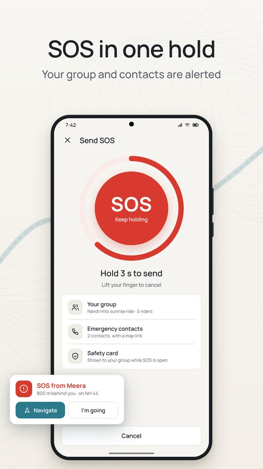 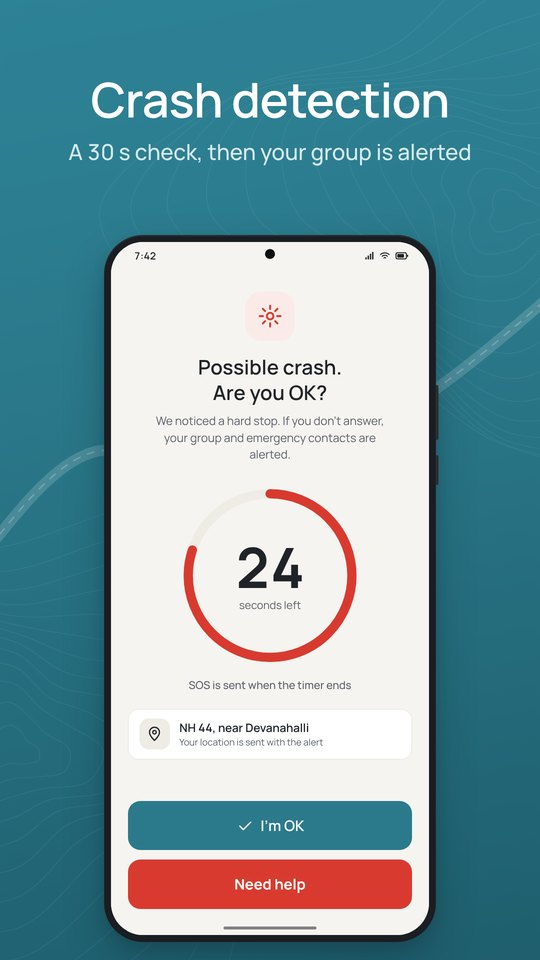

*Hold SOS for 3 seconds (left). The crash countdown gives you 30 seconds (right). Illustrations.*

### Crash detection

During a ride (from about 12 km/h) the phone's motion sensor watches for a crash. Everything is worked out on your phone.

| What happens | What you see | What you hear | What you do |
|---|---|---|---|
| A possible crash | Full screen: "Possible accident detected. Are you okay?" with a **30-second** countdown, also over the lock screen | Alarm sound; music pauses | Tap **I'm OK** if you are fine. Nothing is sent. Tap **Need Help** to send at once. |
| No answer after 30 s | "Crash SOS sent" | | Your group and emergency contact are alerted, marked as automatic. |
| You ride on | "Crash alarm cancelled. You are riding." | The same line, spoken | Nothing. It counts as I'm OK. |
| Next stop after an "I'm OK" | "Still okay? Anything hurt?" | | **Yes, fine** or **Need help**. |

Each **I'm OK** teaches CoRoute a little about your bike, so bumps that fooled it once are less likely to fool it again. A severe impact always raises the alarm.

### "Bike down?"

If the bike falls over while you are stopped or walking and nothing moves for about a minute, CoRoute opens the same 30-second countdown titled **Bike down?**.

### "Are you OK?" checks

| Check | When | Your choices | If you do not answer |
|---|---|---|---|
| **The group is moving on** | You have been stopped for 3 min and the group has ridden more than 1 km away | **I'm OK**, **Need help** (asks the group to wait), **Waiting for fuel**, **Photo stop**, **Taking a break**, or hold the red **Send SOS** for 1.5 s | After 90 s your lead and sweeper are told |
| **Far from your group** | You have been far from the group for a while | **I'm OK** | After 2 min your lead is told |
| **Solo ride ETA** | A solo ride with a destination and an emergency contact: you have not arrived well after your expected time and you are stopped | **I'm fine**, **Add 30 min** | After 3 min your emergency contact gets a text |
| **Break reminder** | After about 2 hours of riding (earlier if you seem tired) | **I'm alert**, **Taking a break** | Nothing is sent |

A rider who is riding normally is never reported as "no reply". If you or your pillion answers "Are you OK?", it counts for both of you.

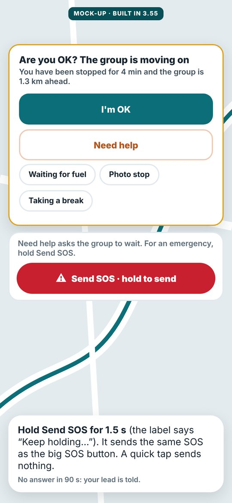

*"Are you OK? The group is moving on" (mock-up).*

### Emergency contact and Medical ID

Add them in **Profile › Emergency contact & Medical ID**. Medical info (blood group, allergies, notes for a doctor) is optional. When you add it, it shows on your lock screen during an emergency and goes to the people helping you only while your SOS or crash alert is open. CoRoute staff never see it.

### Ride Guardian (live link for family)

Open the ride's settings card on the map and choose **Ride Guardian** to create a **Guardian link**. Pick what they see:

- **Basic:** status without exact location;
- **Live:** your last reported location;
- **Emergency only:** your location only when help is requested.

You can add an optional PIN (4 to 8 digits) and a maximum time. Share the link at once: it cannot be shown again. Links end at the time you pick, or 6 hours after the ride. When you arrive, the guardian page says "Arrived safely" and location sharing stops. You can stop a link at any time from **Your links**.

### Help from nearby riders

If you send an SOS or crash, your own group is always alerted first. CoRoute may also ask up to 3 riders of other groups who are riding toward you on the same road. Before one accepts they see only the emergency point and the distance. After one taps **I Can Help**, they see your first name, your bike type and colour and, while your alert is open, your medical info and emergency contact. They never get your phone number. In the same way, you may be asked to help others: tap **I Can Help** or **Can't Assist**.

### Sirens

With **Siren alerts** on (Settings, on by default), the phone listens during rides for ambulance, police and fire engine sirens. It is meant for riders who cannot hear outside: earbuds, a helmet headset or music. Nothing is recorded or sent.

| Your situation | What you hear | What you see and feel |
|---|---|---|
| Earbuds, helmet set or music, siren close | Music pauses. In your ears: "Ambulance siren close by. Keep left and give way." (or Police / Fire engine, or "Emergency vehicle" when the kind is not clear) | Strong vibration, a card such as "AMBULANCE SIREN · GIVE WAY", a heads-up on the lock screen |
| Siren getting louder | "Ambulance approaching. Keep left and give way." | Card updates to Approaching |
| Siren far away | "Emergency vehicle siren in the distance." | Card, medium vibration |
| Phone speaker, no music (you can hear outside) | One short tone, no speech | Card and strong vibration |

The alert comes about 3 seconds after the siren starts, so short chirps, horns and reversing beepers do not set it off. CoRoute says "close by" or "approaching", never "behind": one phone microphone cannot tell direction. Which side to keep to follows your phone's country (left in India).

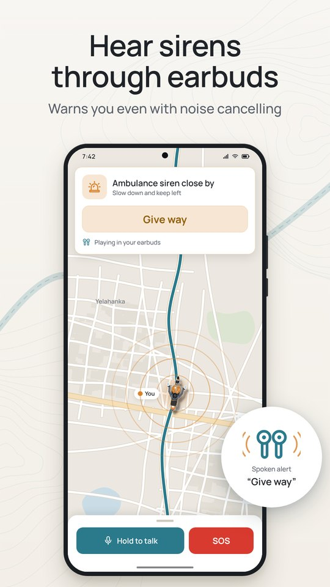

*Siren alert through earbuds (illustration).*

### Other ride warnings

| Warning | What you hear or see |
|---|---|
| Over the speed limit | A warning line. Far over: "Slow down. 95 km/h, limit 65." Music gets quieter, then pauses (see section 4). |
| Road hazard ahead (pothole, speed breaker, rough road) | "ROAD HAZARD AHEAD" card, "300 m ahead", and a spoken line |
| Rider accident ahead on your road | A short caution with the distance |
| Sharp bend, school or hospital zone, high altitude, night riding | Short spoken tips and cards |
| No signal ahead | A card saying your phone had no signal there on earlier rides; your group and guardians are told when you expect to be back online |
| Low battery (under 10 %) | "Battery saver for SOS is on": CoRoute stops extras to keep SOS and crash detection running, and sends your last location to your group once |
| Phone not in a mount | "Phone not in a mount? Crash detection works best with the phone in a handlebar mount." |

### Safety health

**Settings › Safety health** (also a tile on the ride map) checks your phone: location, notifications, microphone, Bluetooth, battery limits, full-screen alerts and sound. Each problem has a button that opens the right system page: **Allow**, **Battery settings**, **Sound settings**, **Show steps** or **Open settings**.

---

## 3. Group riding

### Before the ride

- **Create:** **Home › Plan a route** (or **Start Ride**). Set the start (your location by default), the **Destination** and up to the allowed number of stops (long-press the map to add one). Name the trip, then **Confirm and Create Trip**. You become the **Trip owner**.
- **Share:** tap **Share code** and send it to your riders. Or invite a crew from **People** (see section 6).
- **Join:** **Home › Join Ride** and enter the code, or accept a **Ride invitation**.
- **Your safety details:** you need your phone number and an emergency contact before you ride with a group ("Add your safety details").
- **Complete your bike:** make and model, type and colour are needed (engine, tank and mileage for fuel bikes). This is asked once, never in the middle of a ride and never for SOS.
- **Start:** the trip owner taps **Start the ride**.

If your account cannot host a group ride, CoRoute says so plainly ("Hosting a group ride needs a group plan." or "This ride is full."). There is nothing to buy in the app. Group hosting is managed in your CoRoute account on the website, and at times CoRoute may make group hosting free for everyone. Joining a ride is always free.

### Who does what

| Role | Who | What they can do |
|---|---|---|
| **Trip owner** | Created the trip | Everything, including removing riders and ending the trip |
| **Trip head** | Picked by the trip owner | Changes the trip's settings only |
| **Lead** | Riding role: rides first and guides the group | Runs the ride on the road: stops, route, pause, regroup, roles |
| **Middle** | Riding role: rides between | |
| **Sweeper** | Riding role: rides last | Told when someone falls behind |

The trip owner (or the Lead) sets riding roles from a rider's card, or turns on **Automatic roles** (the rider in front leads, the last one sweeps). CoRoute tells each rider by voice where to ride.

### On the road

| Situation | What you see or hear |
|---|---|
| A rider falls behind | "Kiran fell behind · 1.2 km", and the sweeper is told |
| The group is stretched out | A spread alert to the lead |
| Regroup | A regroup point everyone can navigate to |
| You leave the group's route | "You left the group's route": **Route to group**, **Ask group to wait** or **Keep my own route** (buttons when stopped) |
| Start and arrival | A roll call: "Joined" / "Not yet", then "Arrived" / "On the way" and "Everyone has arrived" |
| 7 or more riders | Buddy pairs: each rider looks out for one other |
| Low fuel | Fuel range warnings; a rider low on fuel can be routed to a fuel station |

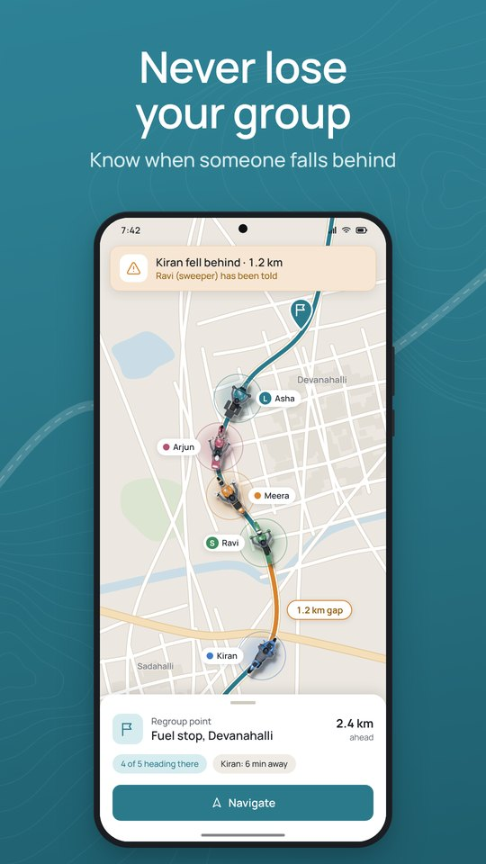

*The sweeper is told when a rider falls behind (illustration).*

**Riding pillion.** Join with **I'm riding pillion (no bike)** and pick the bike you sit on. The rider of that bike sees "Kiran is riding pillion with you" and can **Decline** within a minute or **Remove pillion** later. The group sees one bike with two people ("Asha + Kiran"). Your phone keeps its own crash detection and SOS.

**Swaps.** From a rider's card: **Swap bikes**, or **Change places (rider and pillion)**. The other rider accepts when stopped.

**Bike markers.** Each bike is drawn in its type and colour. A ring shows the state: amber when stopped or with a warning, pulsing red during an SOS.

### Ending the ride

Only the trip owner can end the trip for everyone (**End Ride**). Any rider can leave. After the ride CoRoute may ask "How was the ride?" and offer to rate places you stopped at. Both are optional.

---

## 4. Talk: intercom, chat, music and calls

### Group talk (intercom)

- **Hold to talk:** hold the button and speak. Or switch to **Hands-free** and just speak.
- **Talk to:** everyone, or one rider.
- **Mute** stops you hearing the group. On the lock screen the ride notification has **Talk** / **Talk off** and **Mute** / **Unmute**, usable without unlocking.
- CoRoute cleans up your voice (breathing, wind and engine noise) before the group hears it. A rider who talks very loudly is levelled so they do not blast your ears.
- Voice is relayed live and never stored.

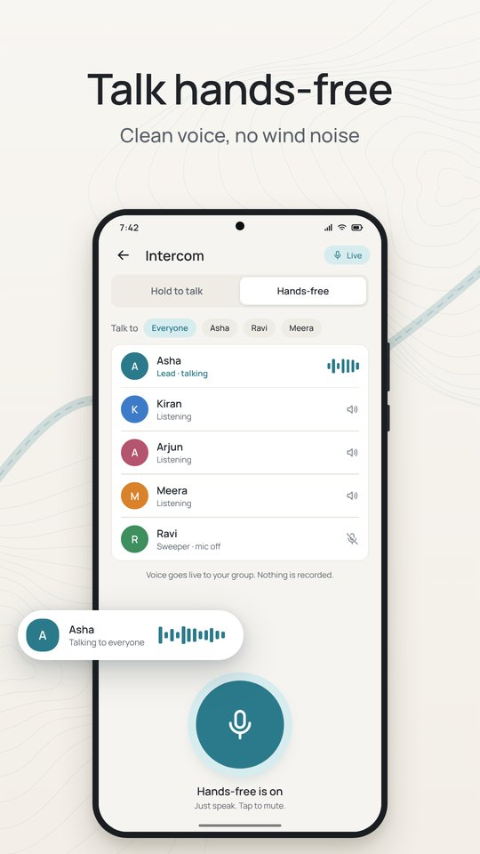 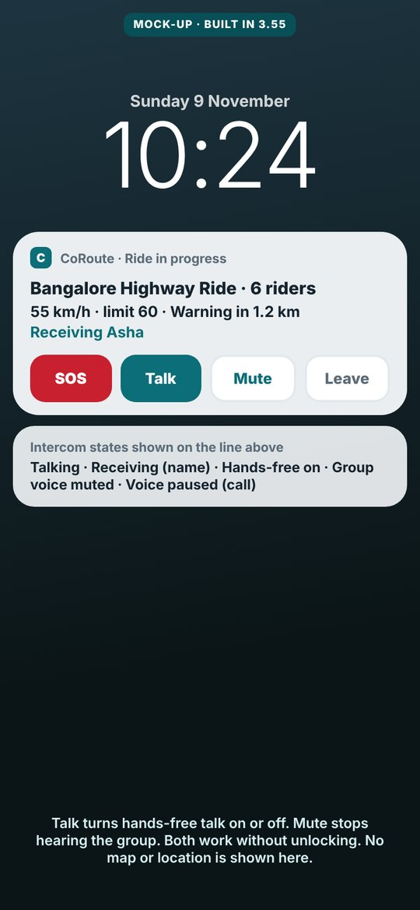

*Intercom (illustration) and the ride notification on the lock screen (mock-up).*

With a helmet headset or earbuds: push-to-talk uses the headset microphone while you hold it. Hands-free talk uses the phone's microphone, cleaned in software, so siren detection keeps working.

The ride notification shows one line such as "55 km/h · limit 60 · Warning in 1.2 km · Receiving Asha". Intercom states: **Talking**, **Receiving** (name), **Group voice muted**, **Hands-free on**, **Voice paused (call)**.

### Ride chat

Tap the **Chat** button on the map (group rides). A red badge shows unread messages.

- **Quick replies**, one tap each: **Fuel**, **Break**, **Wait for me**, **I'm OK**, **Slow down**, **Regroup here**, **On my way**, **Arrived**. Change the order in **Settings › More settings › Chat quick replies**.
- **Typing** is possible only when you are stopped (or riding pillion). While moving: "Riding: one-tap replies only. Stop to type."
- Incoming quick replies are spoken in one short line ("Kiran: fuel stop"). Short texts are read out; long ones show as a banner.
- During an SOS, chat is never spoken.
- Long-press a message to **Hide messages from** that rider (this phone only) or **Report message**.
- After the ride the chat is kept on your phone and shown in the trip report.

### Music, alerts and calls

| Situation | What happens |
|---|---|
| Music playing, ordinary alert (hazard, directions, group) | Music gets quieter for the line, then comes back. With **Pause music for alerts** on, it pauses instead. |
| Emergency or critical alert (SOS, crash countdown, "Bike down?", siren close, "Are you OK?", far over the limit) | Music pauses. With a headset the line plays in your helmet or earbuds, loud enough to hear. On the speaker it plays as an alarm, heard even at media volume 0. |
| Over the limit (**Lower music when speeding**, on by default) | About 10 % over: music to 60 %. 25 % over: 30 %. 40 % over: music paused. It comes back when you are back under the limit. If you change the volume yourself, CoRoute stops touching it. |
| Phone rings | Ordinary lines wait. Critical lines still play. |
| On a call | Ordinary lines are held. A critical alert plays a short tone and phrase in your call audio (the caller does not hear it). After the call: "Safety alert during your call: …" then "While you were on the call: 2 road warnings, Asha fell behind." |
| Voice alerts off | Ordinary lines are silent. **Emergencies are always spoken.** |

---

## 5. Navigation and maps

### Planning and search

- The trip planner opens a map search for the start, destination and each stop. Results show the name, a short address and the distance. If India has nothing, tap **Search everywhere**.
- **Paste a map link** or coordinates into the search box: Google Maps (including `maps.app.goo.gl` short links), Apple Maps, OpenStreetMap, Waze, plus codes and plain coordinates. A **Pasted location** row appears at the top.
- **Share to CoRoute:** in Google Maps, share a place and pick **Plan a ride in CoRoute**.
- If search fails, CoRoute tells you why (offline, too many searches, search busy, signed out) and offers **Retry**.

### Navigate in Google Maps or Mappls

Tap **Navigate** on a stop, the destination or a place. CoRoute opens turn-by-turn directions in your navigation app and keeps running in the background: your group, crash detection, alerts and talk all continue. Choose the app in **Settings › More settings › Navigation app**: Automatic (Google Maps, else Mappls, else any map app), Google Maps, Mappls, or any map app.

CoRoute also re-routes you automatically if you leave the route.

### Offline maps (automatic)

There is nothing to download by hand. When a ride starts (on Wi-Fi, unless data saver is on) and while you ride, CoRoute saves the map along your route. The saved map is kept **7 days after the trip**, then deleted. All saved maps stay under 300 MB; the oldest go first. The ride in progress is never deleted. Past trips are shown from the internet.

### Places on the map

Fuel stations (by fuel type), hospitals (always shown), mechanics, food, stays and **Historic places**. Tap a place for details, **CoRoute rider reviews** and **Navigate**. On a ride you can find **Fuel stations near you** and route to one.

---

## 6. Community: friends, crews, reviews

### Username and profile

Your **username** is how other riders see you. Change it in **My profile** once every 30 days. You can add a profile picture. Non-friends see only your username and picture; friends also see your first name and ride totals. Your phone number, e-mail, location and medical info are never shown on your profile.

### People tab

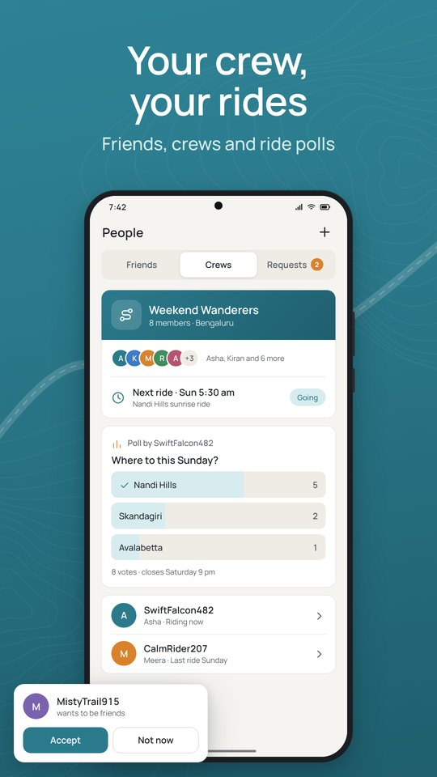

*People: friends, crews, polls and requests (illustration).*

- **Friends:** search by username (or **Enter an invite code**) and **Send request**. Friendship needs both sides to accept. **Share my invite link** sends "Ride with me on CoRoute".
- **Requests:** **Accept** or **Decline**.
- From a friend's card: **View profile**, **Remove friend** or **Block**. A blocked rider cannot send you requests or see your profile, and is not told.
- **People you rode with** suggests riders from your recent group rides.

### Crews

A **crew** is a standing circle of riding friends. **Create a crew**, invite friends, and plan rides with **polls**. Roles: **Crew admin**, up to 3 **Co-admins**, and **Members**. A crew has no chat: members vote.

- **Polls:** single or multiple choice, named or anonymous, with a closing time (there is a "Ride date" template). **Save my vote**, change it or **Remove my vote** until the poll closes.
- **Start a ride** (or **Invite crew to my ride** while you run a live ride): pick members, they get a **Ride invitation** and tap **Accept** or **Decline**. No code is shared. Only the trip owner can invite.

### Reviews and ratings

- **How was the ride?** After a ride: stars, quick chips and an optional note.
- **Rate places from your ride:** at most 2 places where you stopped. Photos appear only after the CoRoute team approves them.
- **Rate CoRoute:** in **Profile › Help**. CoRoute may also ask now and then, never during a ride and never after an SOS.

See the *Community guidelines* for the rules.

---

## 7. Trips and rider score

### Trip reports

Every ride is in the **Trips** tab. A trip report has:

- **Summary:** distance, riding time, stops, top speed, ride chat;
- **Map:** each rider's route in their own colour;
- **Timeline:** who stopped, fell behind, lost signal or arrived;
- **Replay** of the ride, and a GPX file of your route;
- a private **Safety summary** (hard brakes, minutes over the limit, breaks, alerts). "From your phone only. Only you can see this."

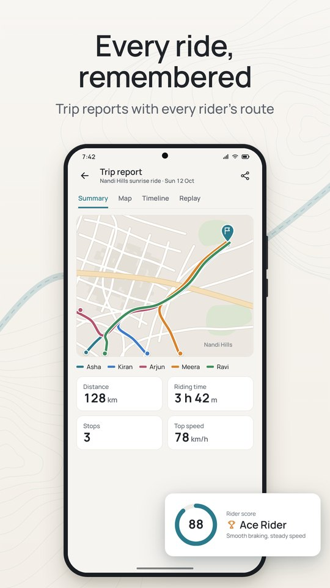

*Trip report (illustration).*

### Rider score

Your **rider score** (0 to 100) shows how safely you ride. It appears after 3 rides of 10 km or more. Parts: **Speed discipline**, **Smoothness**, **Safety habits** and **Regular riding**. Levels: **Learner** (under 50), **Steady** (50 to 69), **Skilled** (70 to 84), **Ace Rider** (85 and up).

- It never rewards speed. Riding faster under the limit never adds points.
- SOS, crash alarms and "Bike down?" checks never lower it.
- Your score uses your ride safety report: five counts per ride (hard brakes, breaks, highest tiredness, break reminders, minutes over the limit). Never your route or position.
- Only you see your score.

### Leaderboards

**Profile › Leaderboard** (and the website) list top riders by **Top score**, **Longest ride**, **Most km**, **Most hours** and **Most rides**. Riders appear by username only, after 3 rides of 10 km or more. To leave the boards, turn off **Settings › Show me on leaderboards**.

---

## 8. Notifications

| What | When |
|---|---|
| **Ride notification** | During every ride: speed, limit, next warning, intercom state; buttons **SOS**, **Talk**, **Mute**, **Leave** |
| **SOS** and **Critical ride alerts** | Another rider's SOS (full screen over the lock screen, or a heads-up), critical lines during calls |
| **Crash countdown** | Your own crash or "Bike down?" alarm |
| **Friends** and **Ride invites** | Friend requests, accepted requests, crew invites, new polls and ride invitations, when CoRoute is closed (usernames only, never your location) |
| **News and updates**, **Events**, **Safety tips**, **Community** | Optional messages from CoRoute. Each has its own switch. |
| **Partner perks** | Off unless you turn it on |

Turn push messages on or off in **Settings › Push notifications**. Safety and ride alerts always arrive. To let critical alerts sound through Do Not Disturb, allow CoRoute in your phone's Do Not Disturb settings.

---

## 9. Settings

Open **Profile ›** gear. Settings are short on purpose: safety features have no switch.

| Group | Row | What it does |
|---|---|---|
| Safety | **Safety is always on** | The list of features that are always on |
| | **Safety health** | "Check your phone is ready" |
| | **Emergency contact & Medical ID** | Your contact and medical info |
| | **Speed warning** | Your own limit (the group's limit, or 50 to 120 km/h). The stricter limit always applies. |
| Ride | **Voice alerts** | "Emergencies are always spoken" |
| | **Siren alerts** | "Listens on your phone during rides. Nothing is recorded." On by default. Off releases the microphone at once. |
| | **Language** | System, English, Hindi or Telugu (safety screens and spoken alerts) |
| | **Battery saver** | "Turns on by itself when low" (at 20 %). Never reduces SOS or crash detection. |
| | **Data saver** | Uses less mobile data |
| App & privacy | **Appearance** | Light, dark or automatic |
| | **Push notifications** | Plus a switch for each kind of message |
| | **Show me on leaderboards** | Your username on public boards |
| **More settings** | **Pause music for alerts** | Off: music only gets quieter |
| | **Lower music when speeding** | On by default |
| | **Fuel** | Tank range |
| | **Navigation app** | Which app **Navigate** opens |
| | **Chat quick replies** | The order of the quick replies |
| | **Permissions**, **Features guide** | Tools and help |

**Quick settings** on the ride map: three big tiles, **Voice**, **Night map** and **Battery saver**. "Emergencies are always spoken."

---

## 10. Your data and your account

- **Location** is shared only with the group you are riding with, and only during the ride. Recorded routes are deleted after 90 days.
- **Voice** is never stored. **Siren listening** stays on your phone.
- **Crash detection** runs on your phone. Motion data is not sent.
- **Medical info** goes to responders only while your alert is open. Staff never see it.
- **Diagnostics:** the app keeps a technical log on your phone (7 days at most) with no messages, names, phone numbers or exact places. It is sent only when you choose.
- **Privacy & terms** (Profile › Help) opens the privacy policy, the terms of use and **Your data**.
- **Delete account:** Profile › Account › **Delete account**. "Your account, profile and ride history will be deleted. This cannot be undone." If you can no longer sign in, use the account deletion page on the CoRoute website.

The *Privacy summary for riders* explains this in more detail.

---

## 11. Getting help

- **Profile › Help › Send feedback:** pick **Report a problem**, **Suggest a safety feature** or **Other**, write your message, and turn on **Attach diagnostics log** if the support team should see what happened. Turn on **You may reply by e-mail** if you want an answer.
- **View diagnostics** (inside Send feedback) shows the log on your phone, and lets you send it or share the file.
- See the *FAQ* and *Troubleshooting* guides for common questions and fixes.
