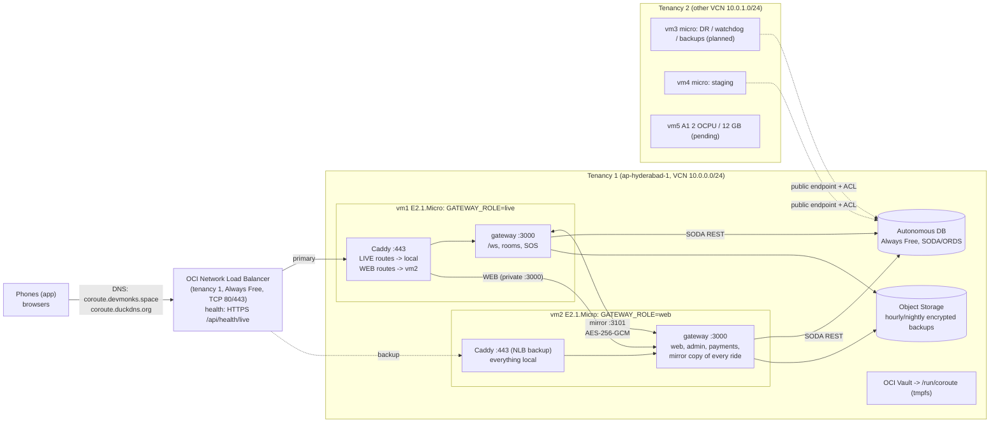
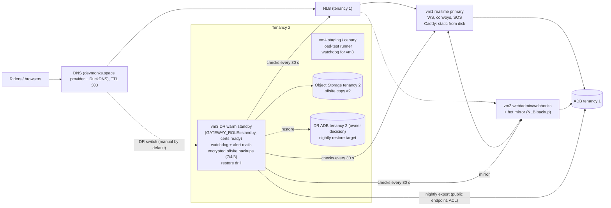

# CoRoute infrastructure plan v3.56 (12 Nov 2026)

Scope: what we can run on the OCI Always Free resources we have (4 micros today, an A1 when capacity is granted),
how much traffic it carries, what was changed in the gateway for speed, and how we survive failures. Cost: **€0**.

No real IP addresses, OCIDs or account e-mails are in this document; hosts are `vm1`..`vm5`. Real values live in
the untracked `gateway/deploy/inventory.local.env` (template: `inventory.example.env`).

Contents: 1 current topology · 2 target topology · 3 roles and memory budgets · 4 measured performance and capacity ·
5 scaling steps · 6 failure scenarios · 7 vm5 (A1) plan, routing and map tiles · 8 cost and Always Free limits ·
9 security · 10 what was implemented in v3.56 · 11 owner decisions.

---

## 1. Current topology (verified from the RUNBOOK, Caddyfiles and code)

How traffic is actually split:

* **There is no 10 Mbps flexible load balancer in the path.** The diagram's "load balancer" is the Always Free
  **Network** Load Balancer (layer 4, source IP preserved, no bandwidth shape). Keep it that way: the flexible LB's
  10 Mbps would cap position traffic at roughly 1,000 riders.
* The NLB sends everything to **vm1** while `/api/health/live` there answers 200; **vm2** is the NLB backup.
* **Caddy on vm1** splits by route (`deploy/route_split.md`, generated matcher): LIVE routes (sockets, rooms, SOS,
  live links, guardian, admin screens that read rooms) go to vm1's gateway; every other route goes to vm2's gateway
  over the VCN (vm1 itself as fallback when vm2 fails its `/api/health` check).
* **Mirror** (`src/mirror.js`): vm1 and vm2 keep identical in-memory rides over an encrypted link; durable events
  (SOS, alerts, chat) are stored in the database first, then replicated, then acknowledged to the sender. If vm1
  fails, the NLB moves riders to vm2 which already has every ride; when vm1 is back it syncs and riders are handed
  back (25 per second after 15 s).
* **Job lease** (`src/job_lease.js`): every scheduled job runs exactly once across the nodes; jobs that touch rooms
  prefer the `live` node, the rest prefer `web`. **GATEWAY_ROLE** only decides that preference (and the
  `X-CoRoute-Node` header); routing is Caddy's.
* TLS: both names on both VMs by ACME DNS-01 through DuckDNS (`_acme-challenge` CNAME), so any VM holding
  `DUCKDNS_TOKEN` can obtain certificates without DNS pointing at it (used for the vm3 DR standby below).

## 2. Target topology

### 2a. Today: 4 micros

### 2b. When vm5 (A1, 2 OCPU / 12 GB) arrives

Two options; **B2 first** (no network change), B1 when traffic needs it.

* **B2, worker (recommended first):** vm5 runs Valhalla motorcycle routing, the self-hosted tile service (if
  chosen), Umami analytics, nightly intel/analytics batch jobs and optional Ollama. Realtime stays on vm1/vm2.
* **B1, realtime on A1:** one A1 OCPU has roughly 8x the sustained CPU of a whole E2.1.Micro (1/8 OCPU baseline),
  so the A1 is where realtime capacity really comes from. The NLB is in tenancy 1 and vm5 is in tenancy 2: the A1
  can only become the NLB primary through **cross-tenancy local VCN peering** (LPG pair, free, same region only; NLB
  IP-address backends reachable through the peering must be verified in the console first) or by moving public DNS
  to vm5 (vm5's Caddy then forwards WEB routes to vm2 over TLS and loses the NLB's 30 s failover). The clean answer is
  an **A1 in tenancy 1** (its own 4 OCPU / 24 GB Always Free allowance is unused): run the capacity retry loop there
  too, make it the NLB primary with `GATEWAY_ROLE=live`, keep vm2 as the mirror, and vm1 becomes a second web node.

## 3. Roles and memory budgets

| VM | Role (v3.56) | Processes and budget (RSS) | Disk |
|---|---|---|---|
| vm1 | **realtime primary** (`GATEWAY_ROLE=live`): `/ws`, convoys, SOS, live links, guardian | kernel + systemd + sshd + journald ≈ 150 MB; fail2ban ≈ 40 MB; Caddy 40 MB + ≈ 100 KB per WebSocket (≈ 290 MB at 2,500); gateway heap cap 384 MB, RSS ≈ 120 MB idle, ≈ 180 MB at 3,000 sockets (MemoryHigh 640 MB / MemoryMax 700 MB); page cache rest. Swap 2 GB (swappiness 10). **Ceiling ≈ 2,500-3,000 sockets** before swapping: set `LIVE_RIDER_CAP=2500`. | 45 GB |
| vm2 | **web / admin / webhooks + hot mirror** (`GATEWAY_ROLE=web`), NLB backup | same base; gateway (scrypt hashing: 2 x 32 MB per sign-in at peaks); Caddy serves static from disk. On failover it carries vm1's sockets too (same ceiling). | 48 GB |
| vm3 | **DR warm standby** (`GATEWAY_ROLE=standby`, running, no jobs, `/api/health/live` 503), **watchdog**, **offsite backups**, **restore drill** | base ≈ 190 MB; Caddy 40 MB (certificates pre-provisioned); standby gateway ≈ 110 MB (heap cap 320 MB); watchdog ≈ 30 MB (MemoryMax 96 MB); nightly export ≈ 150-250 MB for minutes; restore drill holds the whole backup in memory (≈ 3-4x the JSON size; fine at today's tens of MB, move it to vm5 above ~150 MB). Swap 4 GB. | 96 GB (backups: 14 dirs, a few MB each) |
| vm4 | **staging / canary**, load-test runner, second watchdog (watches vm3) | base ≈ 190 MB; staging gateway ≈ 150 MB; load generator 100-200 MB while it runs. **Umami (MIT, needs PostgreSQL ≈ 300-400 MB) does not fit next to staging: deferred to vm5.** | 48 GB |
| vm5 | **worker** (B2): Valhalla, tiles, Umami, batch, Ollama | Valhalla build 8-12 GB peak (one-time, with 8 GB swap, `concurrency=2`), serve 2-4 GB; Caddy static tiles ≈ 0; Umami + PostgreSQL ≈ 400 MB; Ollama + 1.5B model ≈ 2 GB (optional); batch jobs ≤ 1 GB. | 50 GB: Valhalla ≈ 12 GB + India PBF 1.5 GB + PMTiles 2-4 GB |

Node flags: keep `--max-old-space-size=384` on the micros (3,000 sockets used ≈ 75 MB of heap). `--max-semi-space-size=16`
was measured and gave no gain (CPU 24.5 % vs 24.0 %, same RSS): not set. permessage-deflate stays **off** (below).

## 4. Measured performance (local load tests) and capacity on the micro

Machine: 2 vCPU Xeon 2.1 GHz container, in-memory database (MemorySoda), load generator on the same machine (it
competes for CPU, so these are conservative). Tools: `gateway/tool/load/ws_load.js` and `http_load.js`.
"CPU" = percent of one core used by the gateway process.

### 4.1 WebSocket fan-out: before vs after the v3.56 changes

| Scenario | CPU before | CPU after | Fan-out p50/p95/p99 before | after | DB calls/s before | after | SOS delivered (p99) |
|---|---|---|---|---|---|---|---|
| 2,000 riders, groups of 8, **1 fix/s** | 37.7 % | **32.0 %** | 1 / 7 / 20 ms | **1 / 4 / 10 ms** | 209 | **84** | 98/98 (4 ms) -> 98/98 (3 ms) |
| 3,000 riders, groups of 8, **0.4 fix/s (the app's cadence)** | 37.3 % | **23.7 %** | 1 / 12 / 47 ms | **1 / 3 / 9 ms** | 305 | **123** | 98/98 (34 ms) -> 98/98 (12 ms) |
| 500 riders, rooms of 50, 1 fix/s, app with `posbatch1` | 22.2 % | **10.7 %** | 1 / 3 / 7 ms | 263 / 499 / 504 ms (by design: 500 ms flush) | 53 | **22** | 686/686 (3 ms) -> 686/686 (4 ms) |
| same, older app (no `posbatch1`) | 22.2 % | 16.1 % | 1 / 3 / 7 ms | 271 / 504 / 528 ms | 53 | 22 | 686/686 (6 ms) |

Frames received per second in the 50-rider rooms: 23,867 before, **1,118** after (one `RIDER_UPDATES` frame per
window instead of one message per rider). Per socket in the gateway: ≈ 6 KB heap, ≈ 9-12 KB RSS (unchanged).

Where the gain comes from: the socket hot path no longer re-reads the account and session from the database every
30 s per rider (DB calls -60 %, and in production no position ever waits for an ADB round trip), positions are
throttled per rider and batched for big rooms, and SOS / alerts keep their priority lane. Part of the CPU drop at
3,000 riders is MemorySoda's linear scans disappearing from the hot path; on the real ADB that same work is HTTP +
TLS + JSON per call, also gone.

Other measurements:

* **permessage-deflate on**: gateway RSS 161 MB -> **603 MB** at 2,000 sockets (≈ 236 KB zlib state per socket) and
  CPU 10.7 % -> 23.5 % in the 50-rider rooms. Off on the micros (`WS_DEFLATE=off`, the default).
* **Caddy in front of 3,000 WebSockets** (no TLS locally): 41 MB idle -> **337 MB** (≈ 98 KB per proxied socket: two
  32 KB copy buffers plus goroutines and bufio); CPU about two thirds of the gateway's. With TLS add ≈ 10-30 KB per
  socket. **Caddy, not Node, sets the memory ceiling on a 1 GB micro.**
* **Static assets** (`/assets/site.css`, 52 KB), 50 connections:

  | Path | req/s | p50 / p99 | bytes sent | Node CPU |
  |---|---|---|---|---|
  | Node `express.static` (before) | 3,515 | 12.6 / 41.7 ms | 52 KB (uncompressed) | 100 % of a core |
  | Caddy proxy + on-the-fly gzip | 1,292 | 35 / 105 ms | 13 KB | 50 % |
  | Caddy `file_server`, on-the-fly gzip | 2,459 | 20 / 65 ms | 13 KB | 0 |
  | **Caddy `file_server`, precompressed (v3.56)** | **12,199** | **3.4 / 15.6 ms** | 12 KB | **0** |

* HTTP API (mixed `/api/health`, `/api/meta`, `/status`, pages): ≈ 3,100-3,700 req/s locally at 100 % of a core;
  the new metrics + load-shed middleware cost ≈ 2 % of that (profiled).

### 4.2 Scaling to the E2.1.Micro, honestly

The micro has a **1/8 OCPU sustained baseline** (AMD EPYC 7551, burstable). One OCPU is one physical core; per core
it is a little slower than the test machine. Sustained, the micro has about **1/7-1/8 of one local core**; with burst
credits it gets close to a full core for a while. Divide local numbers by **6-8 for sustained load**.

Per rider at the app's cadence (0.4 fix/s, groups of 8): gateway ≈ 0.008 % of a local core, Caddy (with TLS) about
the same again, ≈ 0.016 % in total.

| Capacity of ONE micro | Sustained (baseline) | Peak (burst credits, minutes) | Limit |
|---|---|---|---|
| Concurrent riders on WebSockets (vm1) | **≈ 500-600** comfortable, ≈ 900 at saturation | ≈ 2,500 | memory (Caddy ≈ 100 KB/socket) ≈ 3,000 |
| HTTP API, cheap reads | ≈ 400 req/s | ≈ 2,500 req/s | CPU |
| Static assets via Caddy (precompressed) | ≈ 1,500 req/s | ≈ 8,000 req/s | CPU / NIC |
| Sign-ins (scrypt) | ≈ 5-10 /s | ≈ 40 /s | CPU (by design) |

Saturation is graceful: positions coalesce (stale positions are dropped first), SOS and alerts keep their lane, the
load shedder answers non-essential reads with 503, and `LIVE_RIDER_CAP` refuses new ride joins with "Server busy"
before memory runs out (phones still send emergency SMS on their own).

Other bottlenecks:

* **Database (ADB Always Free, 1 OCPU, fixed small session limit):** after v3.56 a live rider costs ≈ 0.035 SODA
  calls/s (consent 60 s, account and session 120-240 s, room snapshot every persist interval). 3,000 riders ≈ 105
  calls/s, 10,000 ≈ 350/s: near what a 1-OCPU ADB answers comfortably through ORDS. `ORACLE_MAX_INFLIGHT=10` per
  node keeps 2-3 nodes inside the session pool; SOS alerts, sessions and leases bypass that budget.
* **Egress:** 10 TB/month free. Positions ≈ 1.1 KB/s per rider in a group of 8 (≈ 4 MB/hour); 1,000 riders riding
  around the clock ≈ 2.9 TB/month. **Voice** is the real egress risk (32 KB/s per speaker per listener: a group of 10
  with one continuous speaker ≈ 1 GB/hour).
* **NLB:** no bandwidth shape on the Network LB; do not switch to the 10 Mbps flexible LB.

## 5. Scaling steps

| Riders (concurrent) | Do this | Trigger to move on |
|---|---|---|
| **now -> 1k** | v3.56 release (this round): static from Caddy, batching, gate TTL, DB budget, load shedding, metrics. `LIVE_RIDER_CAP=2500`, `SHUTDOWN_DRAIN_MS=15000`, NLB health interval 5 s. Watch `/metrics` on vm1. | sustained > 500 live riders, or event-loop lag p99 > 100 ms for 10 min, or `%st` (CPU steal) > 30 % on vm1 |
| **1k -> 5k** | Realtime onto an A1: best an **A1 in tenancy 1** as NLB primary (`GATEWAY_ROLE=live`, `LIVE_RIDER_CAP=8000`), vm2 stays the mirror, vm1 becomes a second web node; otherwise vm5 via cross-tenancy peering (decision 2). `INTEL_CONSENT_TTL_MS=300000`. Keep the micros as standby: on failover they carry ≈ 2.5k, the rest get "Server busy" until the A1 is back. | ADB calls > 300/s, A1 CPU > 60 % |
| **5k -> 20k** | A1 at its full Always Free size (4 OCPU / 24 GB) as live primary (≈ 15k riders by the local numbers, 1:1 per core); a **second A1** (the other tenancy's allowance) as mirror peer so a failover does not drop 15k riders onto a micro. Cut DB calls: `WS_GATE_TTL_MS=300000`, `RIDER_PERSIST_INTERVAL_MS` 60 s, consent 10 min. Beyond ≈ 20k: shard convoys across two live pairs (route by join code / groupId in Caddy); not built, and the honest point where a paid database tier is cheaper than more engineering. | — |

## 6. Failure scenarios and recovery

| Failure | What happens | Recovery | RPO / RTO |
|---|---|---|---|
| **vm1 down** (crash, reboot, bad release) | NLB health `/api/health/live` fails; traffic goes to vm2, which already holds every ride (mirror). Phones reconnect (0.3-1 s first retry, ≤ 10 s backoff) and re-join. A release uses `SHUTDOWN_DRAIN_MS`: 503 first, then RECONNECT, so phones land on vm2 directly. | automatic. vm1 comes back `syncing` -> `serving`; riders are handed back. | durable events 0 (stored before ack); positions ≤ 1 s · 30-60 s |
| **vm2 down** | vm1's Caddy sends WEB routes to vm1 itself (health check, ≤ 5 s); vm1 runs alone; web-preferring jobs move to vm1 after the 120 s lease grace. More load on vm1: load shedding protects rides. | automatic; restart vm2. | 0 · ≤ 5 s for web |
| **ADB down / stopped** | Rides continue in memory; SOS still reaches the group and the peer (stored later; phones resend by clientId); phones send their own emergency SMS. Account checks use cached entries (no mass sign-out). New sign-ins and web pages that need the DB fail. NLB health is DB-independent, so it does not flap. | ADB restarts itself; if stopped (7 days idle): start it in the console (the keep-alive job prevents this). If lost: restore the newest backup into a new ADB (`scripts/backup_restore.js`). | hourly (critical set) / 24 h (full) · minutes / ≈ 1 h |
| **Tenancy 1 suspended** (vm1, vm2, NLB, ADB, Vault, bucket gone) | Watchdog on vm3 (other tenancy) mails after 90 s. | **Promote vm3**: the DR ADB in tenancy 2 already holds last night's restore (decision 3), secrets from the tenancy-2 Vault copy, certificates pre-provisioned; `deploy/dr/promote_vm3.sh` sets `GATEWAY_ROLE=all`, switches both DNS names to vm3 (DuckDNS by API, devmonks.space by API or by hand). Same `JWT_SECRET`: tokens stay valid; sessions newer than the backup must sign in again. | ≤ 24 h of data · 15-30 min (manual) |
| **Region outage (ap-hyderabad-1)** | Everything in tenancy 1 is down. If tenancy 2's home region is different, as above. If tenancy 2 is also Hyderabad: nothing in OCI survives. | Restore an encrypted backup (weekly copy on the owner's own storage, decision 7) onto any machine with Node 22 + Caddy. | ≤ 1 week · hours |
| **vm3 down** | DR, watchdog and offsite backups stop; production unaffected. vm4's watchdog mails. | restart vm3; backups catch up (`Persistent=true` timers). | — |
| **DuckDNS outage** | DNS of the legacy name and certificate renewals fail (certificates are valid 90 days, renewed at 30 days left). | wait, or move the ACME challenge to the devmonks.space provider's Caddy DNS module. | — |
| **Bad release** | `release.sh` stops at the first failed health gate (staging first) and switches that VM back automatically. | `release.sh --rollback vmN`. | 0 · seconds |

## 7. vm5 (A1) plan: routing, map tiles, batch, AI

* **Valhalla motorcycle routing** (`gateway/deploy/valhalla`, MIT, India tiles, ODbL attribution): fits 12 GB for the
  build with 8 GB swap and `concurrency=2` (the compose file says 3 for a 4-OCPU A1; change it in `.env`), serves in
  2-4 GB. vm5 is in another tenancy, so the gateways reach it over the internet: `deploy/caddy/Caddyfile.vm5-worker`
  serves `routing.<domain>` over HTTPS **only to the gateways' public egress IPs**. Switch with `ROUTER_KIND=valhalla`,
  `GEO_ROUTE_URL=https://routing.<domain>` on vm2 then vm1; OSRM stays the fallback and the SOS helper matrix stays on
  OSRM. Decision 4.
* **Map tiles:** the app draws **raster OSM tiles from `tile.openstreetmap.org`** (`lib/core/theme/map_tiles.dart`,
  `AppConstants.osmTileUrl`; offline packs are keyed by that URL). The OSM tile servers' usage policy does not allow
  heavy app traffic, so this is a growth risk. Options (decision 5):
  1. **Protomaps PMTiles (BSD) India extract** served by Caddy as static range requests (`tiles.<domain>`, already in
     the vm5 Caddyfile). Needs an **app change** to vector rendering (e.g. `vector_map_tiles` for flutter_map,
     or MapLibre), a style, new offline-pack logic: a project of its own.
  2. **Raster from the same data on vm5** (a server-side renderer such as tileserver-gl, BSD-2): only the tile URL
     changes in the app (plus the offline pack key); costs CPU/RAM on vm5 (cache rendered tiles on disk).
  3. Stay on OSM tiles for now with the current per-device cache; revisit at 1k daily riders.
* **Intel / analytics batch jobs**: nightly aggregates, rider score recomputes and the restore drill (when the backup
  outgrows vm3) on vm5; the gateway's job lease keeps live jobs on the gateways.
* **Umami (MIT) + PostgreSQL** website analytics: on vm5 (≈ 400 MB), cookie-less; add its script tag only to the
  marketing pages' CSP (decision 6).
* **Ollama (MIT), optional**, with an Apache-2.0 model (Qwen2.5-1.5B-Instruct or Mistral-7B; note Qwen2.5-3B is NOT
  Apache-2.0): ≈ 10 tokens/s for 1.5B on 2 OCPU, so batch only (summaries for admin, never in a rider-facing path).
* **Second realtime node**: the largest capacity gain of all (section 2b, B1) once the network question is answered.

## 8. Cost: €0, and the Always Free limits we depend on

Verify the numbers in the console (Governance > Limits, Quotas and Usage) once a quarter; Oracle may change them.

| Resource | Always Free allowance (per tenancy) | Our use |
|---|---|---|
| AMD E2.1.Micro | 2 instances, 1/8 OCPU + 1 GB each | tenancy 1: vm1, vm2; tenancy 2: vm3, vm4 (all used) |
| Ampere A1 | 4 OCPU + 24 GB total (3,000 OCPU-h, 18,000 GB-h / month) | tenancy 2: vm5 2 OCPU / 12 GB pending; tenancy 1: **unused** |
| Block volume | 200 GB total (boot + block), 5 volume backups | tenancy 2: 96 + 48 + 50 = 194 GB: **no room for more**; tenancy 1: ≈ 93 GB |
| Autonomous Database | 2 databases, 1 OCPU each, 20 GB storage each | tenancy 1: production; tenancy 2: DR ADB (proposed) |
| Network Load Balancer | 1 | tenancy 1 (in use) |
| Flexible Load Balancer | 1, 10 Mbps | not used (keep it so) |
| Object Storage | 20 GB total (Standard + IA + Archive), 50,000 API requests / month | tenancy 1: backups, photos, diagnostics; tenancy 2: offsite copy (≈ 60 requests/month) |
| Outbound data | 10 TB / month | positions ≪ 1 TB today; voice is the one to watch |
| Vault | software keys, 150 secrets | tenancy 1: production secrets; tenancy 2: DR copy (proposed) |
| Notifications / Monitoring | free tiers | not needed: own watchdog + SMTP |

Everything added in v3.56 is free and permissively licensed: Caddy (Apache-2.0), Node (MIT), `ws` (MIT), nodemailer
(MIT-0), fail2ban (GPL, an OS package, not shipped with our code), Valhalla (MIT), Protomaps (BSD), Umami (MIT),
PostgreSQL (PostgreSQL licence), Ollama (MIT). Not used: k6, Grafana, Metabase (AGPL).

## 9. Security

* **SSH:** keys only, no root, no passwords (`deploy/host/files/sshd-10-coroute-hardening.conf`, applied by
  `host/apply.sh`, which refuses if the operator has no authorized key). **The RUNBOOK (section 8, before this round)
  contained two admin user names with plaintext passwords and enabled SSH password login. The passwords were removed
  from the RUNBOOK in this round; they must be treated as compromised: lock or rotate both accounts (decision 1) and
  note that they remain in git history.**
* **fail2ban** (sshd jail, systemd backend, increasing bans), **unattended-upgrades** (security only, never reboots,
  never Node.js/Caddy).
* **Firewall:** vm1/vm2 keep iptables (OCI Ubuntu images ship iptables rules; enabling ufw there risks a lockout):
  80/443 public, 3000 and 3101 only from the peer's private IP. vm3/vm4/vm5: ufw 22/80/443 (as today). The OCI
  security lists / NSGs remain the outer layer.
* **Secrets:** OCI Vault -> tmpfs `/run/coroute` (never on disk, never in git or logs). DR: a copy in the tenancy-2
  Vault (works when tenancy 1 is suspended) or a 0600 file on vm3 as a stopgap. `BACKUP_ENCRYPTION_KEY` also offline
  in the owner's password manager (without it no backup can be read).
* **Backups** are AES-256-GCM encrypted before they leave the gateway process (authenticated header, fresh salt per
  file). The old `nightly_backup.py` uploaded **plaintext** gzip JSON; it now uses the encrypted exporter.
* **Metrics** are loopback-only (plus an optional bearer token) and 404 at Caddy; no ids or e-mails in labels.
* **ADB** reachable only from the ACL'd public IPs (vm3/vm4/vm5) and the tenancy-1 VCN; schema user `COROUTE`, never ADMIN.

## 10. What v3.56 implements (code, tested)

Gateway (`gateway/src`), all backwards compatible, defaults safe:

| Change | Where | Default |
|---|---|---|
| Per-rider position throttle in rooms of any size (leading edge at once, latest wins) | `ws.js` `WS_POS_MIN_MS` | 800 ms |
| `RIDER_UPDATES` batch frames for apps announcing `posbatch1` (app updated); large rooms flush once per window | `ws.js`, `lib/data/services/realtime_service.dart` | on |
| SOS / alerts priority lane, stale positions dropped first under backpressure (existing, now covered by tests) | `ws.js` | — |
| Socket hot path: cached account + session up to 120 s with stale-while-revalidate (holds / blocks / sign-outs still immediate) | `auth.js`, `sessions.js`, `ws.js` `WS_GATE_TTL_MS` | 120 s |
| Heartbeat interval, permessage-deflate switch | `WS_HEARTBEAT_MS`, `WS_DEFLATE` | 30 s, off |
| Prometheus `/metrics` (HTTP, DB per op/collection, event-loop lag + ELU, memory, WS counters, caches, shedding) | `metrics.js` | loopback only |
| Load shedding of non-essential reads (hard-coded never-list: SOS, alerts, auth, rides, webhooks, health) | `load_shed.js` | on (off in tests) |
| DB connection budget with priority bypass (alerts, sessions, leases) and fast fail | `oracle/soda.js` `ORACLE_MAX_INFLIGHT` | 16 (10 on micros) |
| HTTP keep-alive above Caddy's, health DB-ping micro-cache, drain before shutdown | `app.js`, `routes.js`, `mirror.js` | 75 s, 2 s, 0 (15 s on vm1/vm2) |
| ETag before compression for intel layers; Node gzip off behind Caddy | `intel/engine.js` `NODE_COMPRESSION` | on (off via apply.sh) |
| `GATEWAY_ROLE=standby` for the DR node (no leases, health/live 503) | `config.js`, `job_lease.js`, `mirror.js` | — |

Deploy / ops (`gateway/deploy`): Caddy static `file_server` with precompressed assets + immutable caching + upstream
keep-alive + `/metrics` 404 (`caddy/Caddyfile.vm1/.vm2`, new `vm3-dr`, `vm3-dr-http`, `vm4-staging`, `vm5-worker`);
`host/apply.sh` (per role, `--dry-run`); `release.sh` + `remote_release.sh` (symlinked releases, health gates,
automatic rollback, Git Bash compatible); `dr/` (standby install, promote, demote, DNS switch, file secrets);
`watchdog/` (own watchdog, alert / recovery / daily mails, optional auto-promote); `nightly_backup.py` (encrypted,
7/4/3, offsite PAR, verified) + `backup/` units + restore drill (`scripts/restore_drill.js`); `staging/` (smoke,
quick load gate, seeding). Load tools in `gateway/tool/load`. Tests: `test/ws_perf_356`, `infra_356`,
`watchdog_356`, `restore_drill_356`.

## 11. Owner decisions

1. **Compromised admin passwords**: lock/rotate the two accounts named in the old RUNBOOK section 8 and confirm key
   access for the release agent before `host/apply.sh` disables SSH passwords.
2. **Realtime on A1**: try for an A1 in **tenancy 1** (recommended) and/or accept cross-tenancy peering for vm5; until
   then vm5 is a worker (B2). Also: what is tenancy 2's home region (decides the region-outage story)?
3. **DR database**: create the second Always Free ADB in tenancy 2 as the DR target, restored nightly from the
   encrypted backup (RPO 24 h). Without it, a tenancy-1 suspension means a manual restore first (+ ≈ 1 h).
4. **Valhalla on vm5**: build India tiles and switch `ROUTER_KIND=valhalla` after a week of side-by-side checks.
5. **Map tiles**: PMTiles vector (app project), server-rendered raster on vm5, or OSM tiles for now.
6. **Umami analytics** on vm5 (privacy-friendly, cookie-less) yes/no.
7. **Weekly encrypted backup copy outside OCI** (owner's own storage) for the region-outage case.
8. **Automatic DR promotion**: off (default, mail + manual `promote_vm3.sh`) or on after 15 min of total outage.
9. **DNS provider of devmonks.space**: if it is Cloudflare, give `dns_switch.sh` a scoped API token (one record) so
   promotion switches both names without a person; otherwise the switch of that name is manual.
10. **Backup key on vm4**: the weekly restore drill runs on vm3 by default; running it on vm4 means the production
    backup key on the staging VM (not recommended).
11. **`LIVE_RIDER_CAP=2500`** on the micros (refuses new ride joins with "Server busy" rather than swapping).
