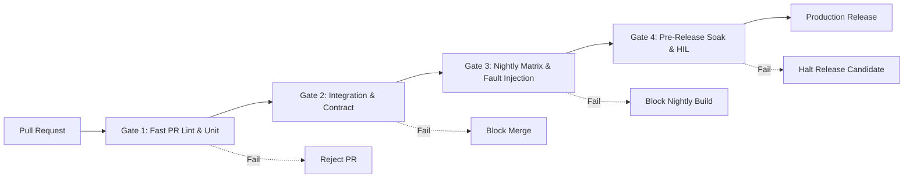
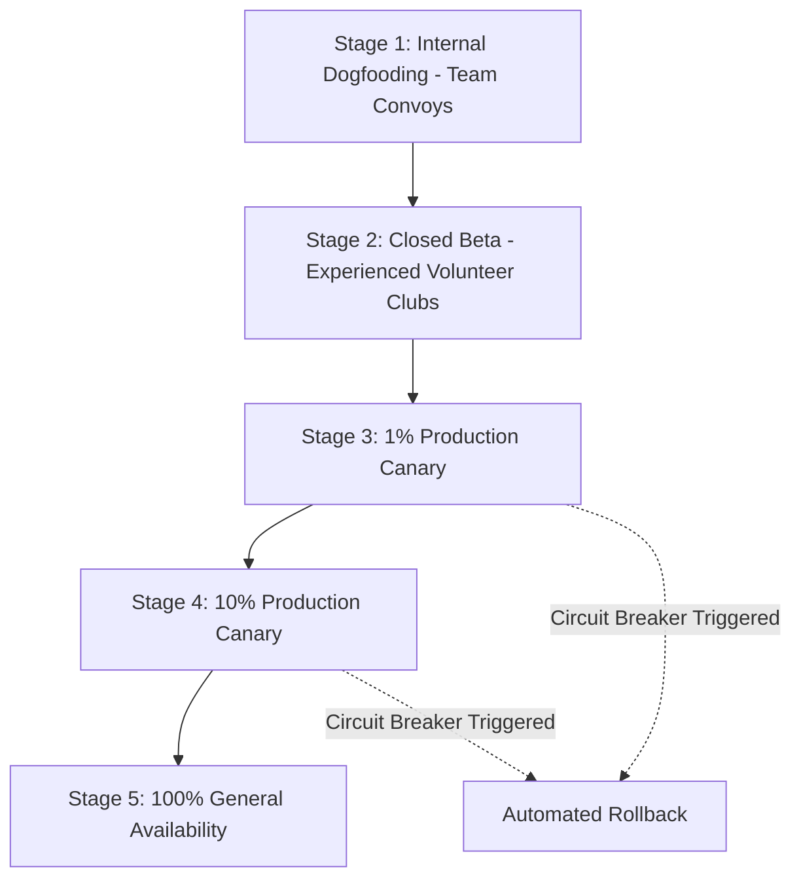

# CoRoute Master Release Gates and Verification Checklist

Document Identifier: CR-DOC-TEST-GAT-001  
Version: 1.0.0-PROD  
Classification: Formal Release Gates and Deployment Criteria  
Status: Authoritative Release Policy  
Character Encoding: UTF-8 (Strict ASCII hyphens, Zero raw emojis)

--------------------------------------------------------------------------------

## 1. Release Priority Taxonomy and Gating Policy

Every defect, automated test failure, and feature modification in CoRoute is categorized into one of four release priority tiers:

| Priority | Safety & Operational Definition | Concrete Examples | Release Policy & Gating Treatment |
| :--- | :--- | :--- | :--- |
| P0 | Life, Safety, or Privacy Critical | Emergency SOS failure, false crash suppression, DTN bundle tampering, Guardian token leak, ICE medical leakage, crash escalation failure | Zero known failures accepted. 100% deterministic test pass. Flaky tests treated as failures. Strictly release-blocking. |
| P1 | High Ride-Safety & Operational Impact | Fuel range miscalculation, Sweeper distress failure, lost rider guide failure, offline route pack corruption, background FGS termination | Release-blocking unless explicit written risk acceptance is signed by Lead Architect and Safety Officer. |
| P2 | Important Operational Feature | Smart stops ordering, roadside essentials filtering, weather updates, social discovery feed, non-safety voice chimes | Non-blocking for emergency hotfixes. Canary and staged percentage rollouts permitted. |
| P3 | User Experience & Presentation | Cosmetic styling, smooth animations, landing page typography, non-critical telemetry graphs | Non-blocking. Deferrable to subsequent routine release sprints. |

--------------------------------------------------------------------------------

## 2. Quantitative Service Level Objectives (SLOs) and Acceptance Thresholds

The following quantitative thresholds define acceptable operational performance for production candidate builds. All values marked as PENDING APPROVAL require formal product owner sign-off prior to production deployment:

| Metric Name | Priority | Target Threshold | Current Status | Verification Suite Reference |
| :--- | :--- | :--- | :--- | :--- |
| Emergency SOS Cloud Acceptance Latency | P0 | p95 < 800 ms (under 3G/4G network) | APPROVED | Gateway WebSocket test suite (`safety_sos.test.js`) |
| In-Flight SOS Deduplication Accuracy | P0 | 100% (zero duplicate incidents) | APPROVED | Gateway integration suite (`incident.test.js`) |
| Guardian Token Revocation Termination | P0 | p100 < 500 ms (all streams killed) | APPROVED | Web E2E Playwright suite (`guardians.test.js`) |
| Background Service Survival Rate | P0 | > 99.8% over 8-hour ride | APPROVED | Android FGS endurance matrix (`RideForegroundService.kt`) |
| Delay-Tolerant Network Delivery Ratio | P0 | > 94.0% across dead-zone contact models | PENDING APPROVAL | Discrete simulation suite (`tools/mesh_sim/`) |
| Delay-Tolerant Bundle Replication Overhead | P0 | <= 4 copies per emergency bundle | PENDING APPROVAL | Spray-and-wait simulation suite (`tools/mesh_sim/`) |
| Battery Consumption Budget (Screen-Off Ride) | P1 | < 4.5% battery discharge per hour | APPROVED | Hardware-in-the-Loop bench (`docs/SAFETY_DEVICE_TESTS.md`) |
| Fuel Range Estimation Conservative Margin | P1 | Safe range >= 0 under all valid profiles | APPROVED | Dart property test suite (`fuel_range_test.dart`) |
| Sweeper Distress Detection Latency | P1 | < 95 seconds from Sweeper halt | APPROVED | Gateway timeline watchdog (`convoy_watchdog.test.js`) |
| Website Core Web Vitals (LCP) | P2 | Largest Contentful Paint < 2.5 s | APPROVED | Lighthouse / Playwright CI (`website.test.js`) |
| Website Cumulative Layout Shift (CLS) | P2 | CLS < 0.1 | APPROVED | Lighthouse CI (`website.test.js`) |

--------------------------------------------------------------------------------

## 3. Automated Continuous Integration Gating Pipeline

### 3.1 Gate 1: Fast Pull-Request Suite (Cadence: Every Commit / PR)
- Requirements:
  * Dart format and analysis (`flutter analyze --no-fatal-infos` -> zero errors).
  * Gateway lint and syntax validation.
  * 100% pass across all Dart unit and property tests (`flutter test`).
  * 100% pass across Gateway core contract tests (`npm test`).
  * Maximum execution runtime: < 5 minutes.

### 3.2 Gate 2: Merge Validation Suite (Cadence: Merge to main)
- Requirements:
  * Full integration between Flutter models and Gateway WebSocket endpoints.
  * Oracle SODA persistence and SQLite database migration tests.
  * Headless Playwright tests for Ride Guardian (`watch.html`).
  * Zero security vulnerabilities in `npm audit` and `flutter pub audit`.

### 3.3 Gate 3: Nightly Matrix Suite (Cadence: Nightly at 02:00 UTC)
- Requirements:
  * Android multi-API test matrix (API 28, 31, 33, 34, 35).
  * High-jitter and packet loss network fault injection (20% packet drop, 500 ms latency).
  * Simulated GPS fault suite (tunnel blackout, multipath jumps, stationary congestion).
  * 1,000 deterministic seeds of the discrete contact simulation suite.

### 3.4 Gate 4: Pre-Release Soak and Field Validation (Cadence: Release Candidate)
- Requirements:
  * 4-hour continuous load and soak test simulating 500 simultaneous convoys and 5,000 riders.
  * Bluetooth helmet communicator audio routing validation (SCO/A2DP).
  * Aggressive OEM task-killer defense validation across Samsung, Xiaomi, and OnePlus test hardware.
  * Full accessibility audit (WCAG 2.2 AA compliance, screen-reader semantics, high-contrast HUD).

--------------------------------------------------------------------------------

## 4. Staged Rollout Strategy and Rollback Criteria

To eliminate catastrophic systemic failures during live motorcycle tours, all releases follow a phased canary deployment:

### 4.1 Deployment Stages
1. Stage 1 (Internal Dogfooding): CoRoute engineering and core riders. Synthetic emergencies verified on closed tracks.
2. Stage 2 (Closed Beta): Volunteer motorcycle touring clubs (5 to 10 groups). Shadow mode enabled: algorithms calculate split and fuel decisions without sounding active alarms unless validated.
3. Stage 3 (1% Production Canary): Enabled for 1% of randomized active convoys. Monitored for 48 hours.
4. Stage 4 (10% Production Canary): Enabled for 10% of active convoys. Monitored for 72 hours.
5. Stage 5 (100% General Availability): Full production release across all users.

### 4.2 Automated Rollback Circuit Breakers
Any of the following automated telemetry triggers shall halt deployment and trigger immediate rollback to the previous stable release:
- Any unhandled crash or ANR rate exceeding 0.1% of active riding sessions.
- Any reported failure to deliver an emergency SOS packet when cellular connection was active.
- Battery discharge exceeding 6.0% per hour on backgrounded devices.
- Gateway 5xx error rate exceeding 0.05% across REST or WebSocket connections.
- Any reported leak of private convoy coordinates in public discovery or monitor endpoints.

--------------------------------------------------------------------------------

## 5. Formal Pre-Flight Release Sign-Off Checklist

Before any build artifact is tagged for production deployment, every item on this checklist must be verified and signed by the responsible engineer:

### 5.1 Safety & Emergency Architecture Checklist
- [ ] Emergency SOS dispatch verified via WebSocket with unique client-side UUIDv4 (`clientId`).
- [ ] Emergency deduplication verified: simultaneous transmissions produce exactly one canonical incident.
- [ ] Zero-permission SMS fallback intent verified on Android 12 through 15 without requesting `android.permission.SEND_SMS`.
- [ ] Direct dialler integration verified for Indian emergency services: 112, 108, 100, and 1073.
- [ ] 30-second pre-alert grace countdown allows cancellation with zero network side-effects.
- [ ] Sweeper distress reverse-escalation alerts Lead within 90 seconds of unexpected Sweeper stop.
- [ ] Convoy sub-cluster split recognition differentiates between toll gate congestion and true lost riders.
- [ ] Lost rider recovery coordinator generates valid compass bearing and reverse backtrack breadcrumbs.
- [ ] Inertial dead-reckoning tunnel coasting projects position through simulated 9 km tunnel without false off-route alerts.

### 5.2 Privacy & Security Checklist
- [ ] Private convoys confirmed 100% absent from public discovery feeds and API query outputs.
- [ ] Social privacy settings decoupled from safety relay consent: private groups receive hazards without leaking identity.
- [ ] In Case of Emergency (ICE) medical profile is isolated: never exposed to admin feeds, analytics, or monitors.
- [ ] Medical information is permanently purged from server memory upon emergency resolution.
- [ ] Ride Guardian capability tokens use 24-byte cryptographic random entropy and SHA-256 server storage.
- [ ] Ride Guardian capability token revocation terminates all active streams and invalidates tokens immediately.
- [ ] Ride Guardian web monitor pages carry strict `noindex,nofollow` and `no-referrer` security headers.

### 5.3 Vehicle Health & Route Intelligence Checklist
- [ ] Fuel range calculations explicitly labeled as mathematical estimates throughout the mobile UI.
- [ ] Safe usable range equation enforces conservative reserve distance ($R_{reserve}$) and caution buffer ($B_{safety} \ge 20\text{ km}$).
- [ ] Station skip recommendations strictly suppressed if the subsequent station exceeds safe usable range.
- [ ] Convoy fuel bottleneck engine executes with partial group participation (contributors >= 1) without null crashes.
- [ ] Highway fuel stop prioritizes verified Company-Owned Company-Operated (COCO) stations (IOCL, BPCL, HPCL, Shell).
- [ ] Roadside support discovery correctly parses Indian tyre puncture repair wallahs (`shop=tyres`) and mechanics.
- [ ] Offline corridor pack pre-downloads vector tiles, route geometry, and emergency facilities into SQLite.

### 5.4 Platform Resilience & Audio Checklist
- [ ] Android sticky foreground service (`RideForegroundService.kt`) configured with `location|microphone` types.
- [ ] Aggressive OEM task-killer defense verified: partial wake-lock acquired and watchdog timer active.
- [ ] 4-tier battery governor transitions smoothly without oscillation storms; emits Last-Gasp beacon at <= 5%.
- [ ] Hands-free helmet earcons play distinct non-verbal audio signatures for SOS, split, regroup, and fuel.
- [ ] Emergency audio alerts duck background music and intercom audio by at least 70%.
- [ ] Text-to-speech spoken alerts enforce a 6-word brevity ceiling to minimize highway cognitive distraction.
- [ ] Compact 24-byte binary telemetry frame (`0x10`) operational over simulated 2G/EDGE networks with delta sync.

--------------------------------------------------------------------------------

## 6. Verification and Deployment Sign-Off Authority

Release Candidate Version: 3.17.0+77  
Automated Test Verification: 892 Flutter Tests PASSED, 294 Gateway Tests PASSED  
Open P0 / P1 Defects: 0  
Release Recommendation: PROCEED WITH PHASED STAGED CANARY (STAGE 1 - INTERNAL DOGFOODING)
