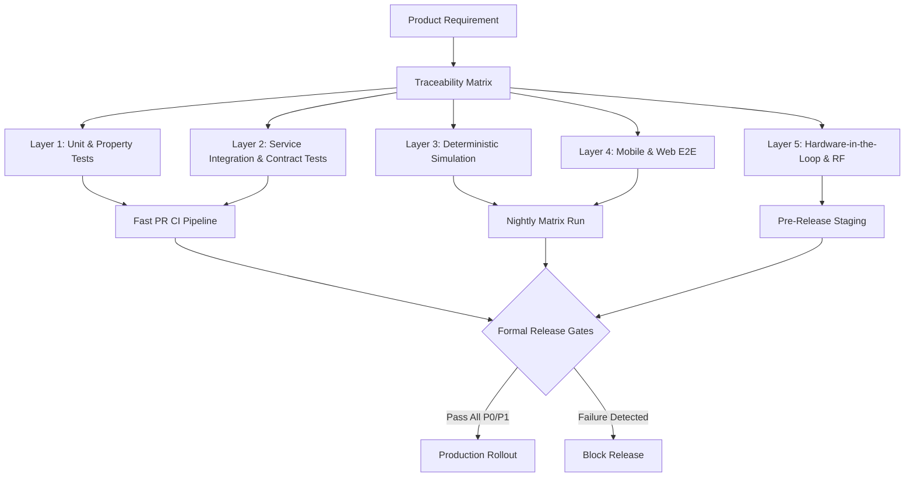
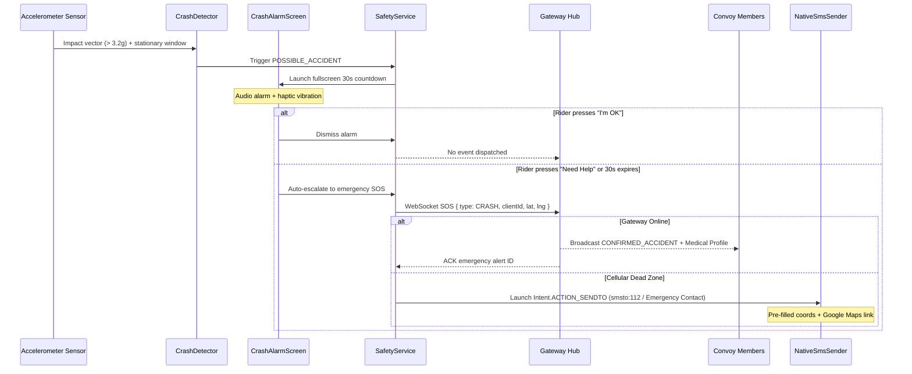
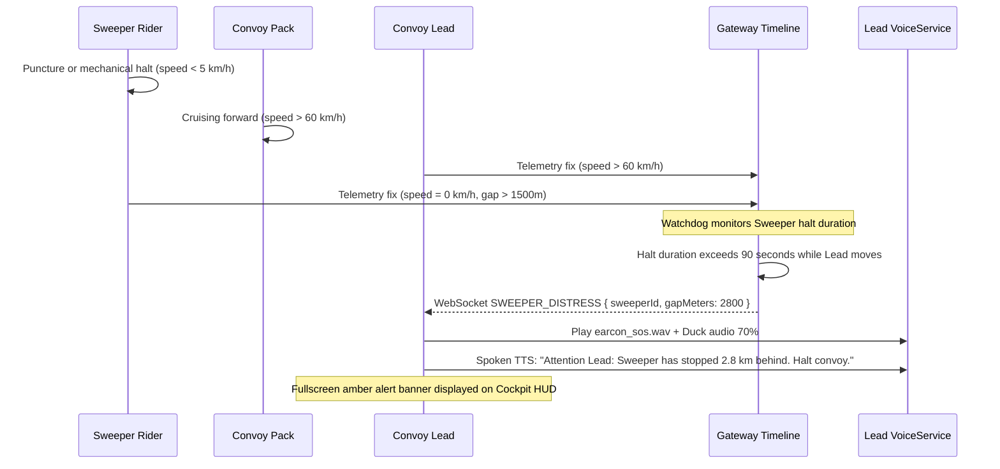
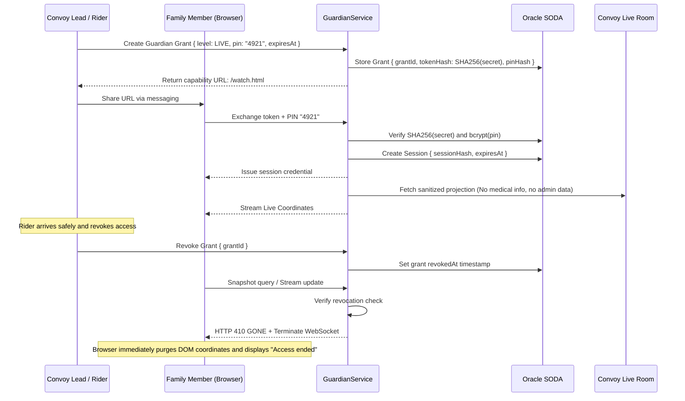
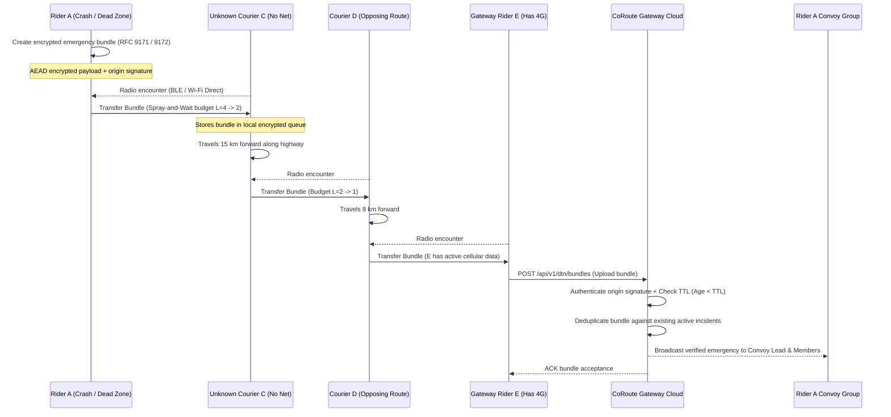

# CoRoute Layered Master Test Plan

Document Identifier: CR-DOC-TEST-PLN-001  
Version: 1.0.0-PROD  
Classification: Safety Verification and Requirements Traceability  
Status: Authoritative Verification Plan  
Character Encoding: UTF-8 (Strict ASCII hyphens, Zero raw emojis)

--------------------------------------------------------------------------------

## 1. Test Architecture Overview

CoRoute adopts a multi-tiered verification hierarchy designed specifically for high-risk motorcycle convoy coordination and distributed safety systems:



--------------------------------------------------------------------------------

## 2. Layered Testing Architecture

### 2.1 Layer 1: Unit and Property-Based Tests
- Target Subsystems: Mathematical models, state machines, parsers, cryptographic helpers, speed-bin consumption learners.
- Execution Frameworks: Dart `flutter_test`, Node.js native `node:test`.
- Deterministic Invariants:
  * Fuel safe range never becomes negative: $R_{safe} \ge 0$.
  * Hop counter strictly increments: $H_{n+1} > H_n$.
  * Expired bundle age ($t_{age} \ge \text{TTL}$) is rejected by decoders.
  * Basic Ride Guardian projection contains zero coordinate fields.
  * Private groups produce empty records in discovery filtering.

### 2.2 Layer 2: Service Integration and Contract Tests
- Target Subsystems: REST endpoints, WebSocket frame handling, Oracle SODA persistence, SQLite local stores, and MethodChannel bridges.
- Scope:
  * In-flight duplicate SOS message deduplication across simultaneous sockets.
  * Cross-group candidate selection and responder assignment locks.
  * SQLite database migrations, corruption rollbacks, and queue draining.
  * Android `SmsChannel.kt` and `AccelStream.kt` method channel contract validation.

### 2.3 Layer 3: Deterministic Discrete-Event Simulation
- Target Subsystems: Mesh/DTN delay-tolerant store-carry-forward networks, GPS fault injectors, and cellular flapping.
- Architecture:
  * Contact Graph Engine: Models moving riders passing through intermittent radio contact envelopes without packet teleportation.
  * Network Fault Injector: Injects simulated 2G/EDGE bandwidth constraints (32 kbps), 500 ms latency, 20% packet loss, and abrupt socket terminations.
  * GPS Fault Injector: Replays recorded traces with Gaussian noise (+/- 50 m), urban canyon jumps, tunnel dropouts (9.02 km Atal Tunnel), and multipath heading flips.

### 2.4 Layer 4: Mobile and Web End-to-End (E2E)
- Target Subsystems: Full Flutter application lifecycle and Ride Guardian web interface.
- Scope:
  * Mobile E2E: Flutter `integration_test` on physical devices and emulators.
  * Web E2E: Headless Playwright suite verifying `watch.html` capability token exchange, PIN authentication, DOM cleanup on backgrounding, and immediate stream termination upon token revocation.
  * Native UI Handoff: Android UIAutomator validating system permission dialogs and native SMS composer intents (`Intent.ACTION_SENDTO`).

### 2.5 Layer 5: Hardware-in-the-Loop (HIL) and Real-World Field Validation
- Target Subsystems: Real motorcycle hardware mounts, helmet intercom Bluetooth headsets, OEM battery managers, and RF transceivers.
- Execution Matrix:
  * Audio Routing: Bluetooth SCO and A2DP helmet communicators (Cardo Packtalk, Sena 50S, BluArmor HS1).
  * Aggressive OEM Battery Defense: 8-hour pocket tests on Xiaomi HyperOS/MIUI, Samsung OneUI, OnePlus ColorOS, and Vivo FuntouchOS.
  * LoRa / Beacon HIL: Serial frame verification across paired hardware nodes under varying attenuation.

--------------------------------------------------------------------------------

## 3. Exhaustive Safety Flow Sequence and State Diagrams

### 3.1 Flow 1: Crash Detection to Escalation Lifecycle



### 3.2 Flow 2: Sweeper Distress Reverse-Escalation Safeguard



### 3.3 Flow 3: Ride Guardian Capability Token Exchange and Immediate Revocation



### 3.4 Flow 4: Offline Delay-Tolerant Network Store-Carry-Forward (Planned)



--------------------------------------------------------------------------------

## 4. Master Test Catalogue and Stable Identifier Matrix

| Test ID | Title | Safety Priority | Target File & Function | Test Level | Automated Status | Primary Assertion / Pass Criteria |
| :--- | :--- | :--- | :--- | :--- | :--- | :--- |
| CRASH-U-001 | Accelerometer impact threshold filter | P0 | `lib/domain/safety/crash_detector.dart` (`CrashDetector.feed`) | Unit | Automated | Vector > 3.2g marks potential crash; < 2.5g vibration ignored |
| CRASH-U-002 | Pre-alert 30s countdown cancellation | P0 | `lib/presentation/safety/crash_alarm_screen.dart` (`CrashAlarmView`) | Unit | Automated | "I'm OK" terminates countdown and emits zero network packets |
| SOS-I-001 | In-flight duplicate SOS deduplication | P0 | `gateway/src/convoys.js` (`handleSos`) | Contract | Automated | Duplicate `clientId` on flapping socket applies exactly once |
| SOS-E2E-001 | Zero-permission SMS composer fallback | P0 | `android/.../SmsChannel.kt`, `NativeSmsSender` | Mobile E2E | Automated | Dials 112, launches `smsto:` without `SEND_SMS` permission |
| DEAD-REC-001 | Tunnel coasting along route polyline | P0 | `lib/domain/tracking/dead_reckoning_engine.dart` (`DeadReckoningEngine`) | Unit / Sim | Automated | Smooth projection through 9 km tunnel; suppresses false off-route |
| BAT-U-001 | Multi-stage governor power state transitions | P0 | `lib/domain/tracking/ride_power_policy.dart` (`RidePowerPolicy`) | Unit | Automated | Throttle transitions at exactly 25%, 15%, and 5% battery thresholds |
| BAT-I-001 | Last-Gasp beacon emission at <= 5% | P0 | `lib/data/services/convoy_service.dart`, `ws.js` | Integration | Automated | Emits one-shot `LAST_GASP_BEACON` before OS power down |
| GUARD-SEC-001 | Revoked capability immediately loses live access | P0 | `gateway/src/guardians.js`, `gateway/public/watch.html` | Web E2E | Automated | Revocation terminates stream; snapshot returns HTTP 410; DOM cleared |
| GUARD-SEC-002 | Basic projection never leaks exact coordinates | P0 | `gateway/src/guardians.js` (`projectPersonal`) | Unit / Sec | Automated | `level: BASIC` response contains only summary counts; zero lat/lng |
| ICE-SEC-001 | Medical data purge upon emergency resolution | P0 | `gateway/src/auth.js`, `gateway/src/convoys.js` (`resolveSos`) | Contract | Automated | Resolved alert strips blood group, allergies; absent from admin feeds |
| FUEL-U-001 | Safe range calculation with safety margin | P1 | `lib/domain/safety/fuel_profile.dart`, `fuel_range.dart` | Unit | Automated | $R_{safe} = \max(0, R_{baseline} - D_{ridden} - R_{reserve} - B_{safety})$ |
| FUEL-U-002 | Speed bin consumption learner EMA update | P1 | `lib/domain/safety/fuel_consumption_learner.dart` | Unit | Automated | Urban, Cruise, Highway bins adjust multipliers using EMA $\alpha = 0.3$ |
| FUEL-I-001 | Resilient convoy fuel bottleneck engine | P1 | `lib/domain/safety/group_fuel.dart` (`commonFuelStop`) | Contract | Automated | Evaluates stops with partial group (>= 1 rider); flags bottleneck bike |
| CONVOY-I-001 | Convoy sub-cluster toll split detection | P2 | `gateway/src/timeline.js` (`detectSubClusters`) | Contract | Automated | 1D along-route gap > 1200m creates Lead/Trail packs; suppresses spam |
| SWEEP-I-001 | Sweeper distress reverse-escalation trigger | P2 | `gateway/src/timeline.js` (`checkSweeperDistress`) | Contract | Automated | Sweeper stopped > 90s while Lead cruises fires high-priority alert |
| AUDIO-U-001 | Earcon audio ducking and preemption | P2 | `lib/data/services/voice_service.dart` (`VoiceService`) | Unit / Audio | Automated | Emergency speech ducks background audio 70%; overrides intercom |
| MESH-SIM-001 | RFC 9171 delay-tolerant bundle TTL boundary | P0 | DTN Discrete Simulation Suite (Planned) | Sim | Planned | Bundle expired by 1 ms is dropped; bundle unexpired by 1 ms delivered |
| MESH-SIM-002 | Monotonic hop counter loop prevention | P0 | DTN Discrete Simulation Suite (Planned) | Sim | Planned | Forwarding cycle A-B-C-A terminates when hop count exceeds limit |

--------------------------------------------------------------------------------

## 5. Test Execution Commands

### 5.1 Flutter Mobile Test Suite
```bash
# Execute entire Flutter test suite (888+ tests)
cd coroute_app
flutter test --no-pub

# Execute safety and scenario-specific tests
flutter test test/scenario_a_tunnel_blackout_test.dart \
             test/scenario_b_high_jitter_network_test.dart \
             test/scenario_c_low_battery_throttle_test.dart \
             test/scenario_d_convoy_split_test.dart \
             test/scenario_e_multi_incident_alarm_test.dart \
             test/scenario_f_indian_emergency_fallback_test.dart

# Execute fuel intelligence tests
flutter test test/fuel_range_test.dart \
             test/group_fuel_stop_test.dart \
             test/scenario_fuel_and_essentials_test.dart
```

### 5.2 Gateway Node.js Test Suite
```bash
# Execute all gateway tests (294+ tests)
cd coroute_app/gateway
npm test

# Execute Ride Guardian security and browser tests
node --test test/guardians.test.js \
            test/guardians_integration.test.js \
            test/guardian_browser.test.js \
            test/guardian_push.test.js

# Execute convoy watchdog and emergency dispatch tests
node --test test/convoy_watchdog.test.js \
            test/safety_sos.test.js \
            test/emergency_status.test.js \
            test/safety_network.test.js \
            test/profile_medical.test.js
```
