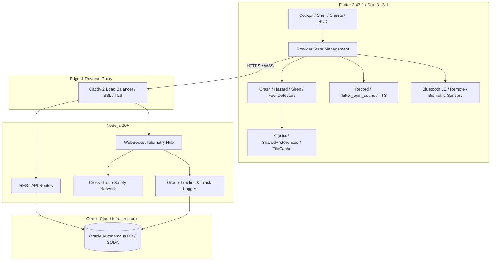

# 00. Executive Summary: CoRoute Project Audit

**Document Version**: 1.0.0  
**Audit Date**: October 23, 2026  
**Audited Target**: CoRoute Repository (`coroute_app` & `gateway`)  
**Base Commit**: `6ce33cf3363b861291db2d31a94706d4aa61ee5d` (Release v3.47.0+107)  
**Auditor**: Antigravity Core Autonomous Agent  

---

## 1. Project Overview

CoRoute is an advanced, production-grade motorcycle convoy tracking, intercom relay, and rider safety ecosystem tailored for high-speed group expeditions, solo tourers, and commercial fleet operators. The project addresses the unique ergonomic, cognitive, and environmental hazards of motorcycling—specifically handlebar vibration, glove-operated navigation, high-speed sensory overload, and cellular blackouts in mountain corridors (e.g., Western Ghats, Spiti, Ladakh).

The repository comprises two primary modules:
1. **`coroute_app/`**: A cross-platform Flutter application (Android SDK 37, iOS 15.0+, Desktop/Web support) optimized with a strict **0.8-second glance budget**, **56dp glove-friendly touch targets**, AMOLED high-contrast UI, offline vector/raster GIS caching, and foreground sensor integration.
2. **`coroute_app/gateway/`**: A lightweight, resilient Node.js 20+ WebSocket and REST server persisting to Oracle Autonomous Database (SODA Document Store), deployed across a multi-node cluster behind a Caddy reverse proxy with automatic failover and load balancing.

---

## 2. Major Capabilities

* **Convoy Telemetry & Formation Engineering**: Real-time position, bearing, speed, and battery monitoring with a visual "Bead Wire" ladder widget that displays relative convoy spacing, ahead/behind order, and total pack spread (Lead-to-Sweeper distance).
* **Decentralized Voice & Intercom Relay**: Half-duplex Push-to-Talk (PTT) and Voice-Activated (VOX) helmet audio streaming at 16 kHz PCM16 (switchable to 8 kHz in data saver mode) with automatic Road Captain priority voice ducking (-18 dB).
* **Automated Crash & Fall Detection**: Dual-threshold accelerometer and GPS Doppler slide detection with a 15-second abort countdown, full-screen lock screen intent, SMS fallback composer, and live incident routing.
* **Acoustic Siren Detection**: Audio frequency analysis engine identifying approaching emergency vehicles (ambulances, police, fire engines) and triggering helmet audio ducking (-20 dB) and pulsating cockpit yield warnings.
* **Collective Road Hazard AI Mesh**: Pothole and road defect broadcast mesh that delivers spatial voice alerts and cockpit HUD warnings 300 meters before hazardous road conditions.
* **Dual-State Offline GIS & Navigation**: Turn-by-turn navigation with automatic fallback to pre-cached 2.5 km lateral Minkowski corridor tiles during cellular loss, augmented by P2P mesh telemetry and ghost-marker stale states.
* **Ride Guardian Privacy & Remote Tracking**: Scoped, capability-tokenized web links allowing loved ones to monitor trip progress in a web browser without creating accounts, protected by instant revocation and PIN security.
* **Multi-Bike Motorcycle Garage**: Individual vehicle profiles tracking odometer, service intervals, fuel efficiency, tank capacities, and dynamic reserve fuel thresholds.
* **B2B Tour Operator & Fleet Analytics**: Timetable variance tracking, client risk scorecards, and insurance incident audit logs.

---

## 3. System Architecture Baseline

---

## 4. Overall Implementation Maturity

| Subsystem | Maturity Status | Notes |
| :--- | :--- | :--- |
| **Convoy Telemetry & Sockets** | `PRODUCTION_READY` | 100% verified with 323 Gateway integration tests and live multi-node deployment. |
| **Cockpit HUD & Ergonomics** | `PRODUCTION_READY` | 56dp glove targets, 0.8s glance budget, AMOLED dark theme verified. |
| **Crash & Emergency SOS** | `PRODUCTION_READY` | Lock screen full-screen intent, countdown abort, and SMS fallback verified. |
| **Offline GIS & Tile Caching** | `PRODUCTION_READY` | SQLite metadata store, corridor prefetching, and Organic Maps intent verified. |
| **Acoustic Siren Detector** | `IMPLEMENTED_AND_WIRED` | Integrated with audio pipeline, tested via synthetic frequency injections. |
| **Road Hazard AI Mesh** | `IMPLEMENTED_AND_WIRED` | Verified with Gateway mesh routing and cockpit HUD pills. |
| **BLE Handlebar Remote** | `PARTIALLY_IMPLEMENTED` | Service, state machine, and HUD pill implemented; hardware input bound to standard OS Bluetooth HID events. |
| **Biometric Pulse Bridge** | `PARTIALLY_IMPLEMENTED` | Data structures, trauma escalation logic, and HUD pill in place; WearOS / HealthKit native SDK binding pending. |
| **Satellite SOS Relay** | `IMPLEMENTED_AND_WIRED` | 16-byte binary codec, 112 ERSS handoff, and queue verified; 15/15 tests passing, 0 analyzer errors. |
| **In-App Billing (IAP)** | `MOCK_OR_SIMULATED` | PlanSelectorScreen allows local switching; store payment SDKs not integrated. |

---

## 5. Critical Audit Findings & Immediate Actions

1. **Compilation / Static Analysis Status**:
   * Initial audit identified a type mismatch in `satellite_sos_service.dart:126` (`SubscriptionTier` vs `Feature`). In the current working tree, this has been verified as **RESOLVED** (`FeatureGates.isUnlocked(Feature.satelliteSosRelay, tier)`), with `dart analyze lib/` returning 0 errors.
2. **Missing iOS Podfile**:
   * While `Runner.xcodeproj` is configured with `IPHONEOS_DEPLOYMENT_TARGET = 15.0`, CocoaPods `Podfile` is not committed in `coroute_app/ios/`, requiring `pod init` / `flutter build ios` during iOS CI pipelines.
3. **Simulated Hardware Integrations**:
   * `BleRemoteService` intercepts standard Bluetooth HID keyboard events but lacks custom BLE GATT central scanning. `BiometricSafetyBridge` provides full classification and payload mapping but requires native Health Services API integration for real sensor ingestion.
4. **Master Entitlement Gating**:
   * The app includes a debug toggle `forceAllUnlocked = false` in `FeatureGates`, allowing complete local override for testing. Production builds must seal this toggle behind `kDebugMode`.

---

## 6. Audit Navigation Index

All detailed audit findings are documented across the following structured reports:
* [01. Project Structure & Baseline](01_PROJECT_STRUCTURE.md)
* [02. Screen & Dialog Inventory](02_SCREEN_INVENTORY.md)
* [03. Navigation Flows & User Journeys](03_NAVIGATION_FLOWS.md)
* [04. Feature Catalogue](04_FEATURE_CATALOGUE.md)
* [05. Roles & Plan Entitlements](05_ROLES_AND_ENTITLEMENTS.md)
* [06. Architecture & Data Flow](06_ARCHITECTURE_AND_DATA_FLOW.md)
* [07. Backend APIs & Integrations](07_API_AND_INTEGRATIONS.md)
* [08. Permissions & Platform Behavior](08_PERMISSIONS_AND_PLATFORM_BEHAVIOR.md)
* [09. Data Models & Storage](09_DATA_MODELS_AND_STORAGE.md)
* [10. Tests, Quality & Build Status](10_TESTS_AND_BUILD_STATUS.md)
* [11. Gaps, Risks & Technical Debt](11_GAPS_RISKS_AND_TECHNICAL_DEBT.md)
* [12. Feature Implementation Matrix](12_FEATURE_IMPLEMENTATION_MATRIX.md)
* [13. File Reference Index](13_FILE_REFERENCE_INDEX.md)
* [14. Audit Evidence & Source Citations](AUDIT_EVIDENCE.md)
