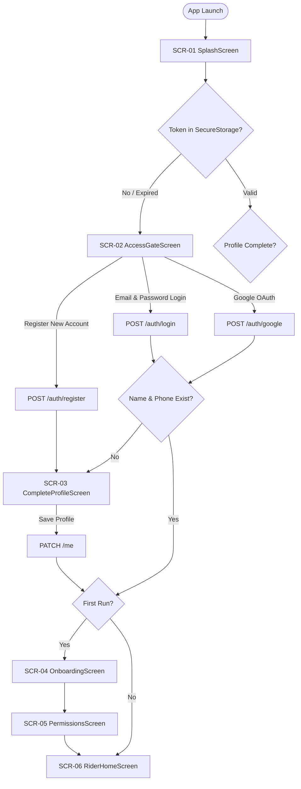
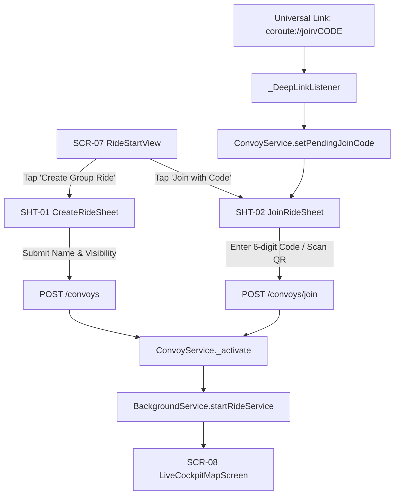
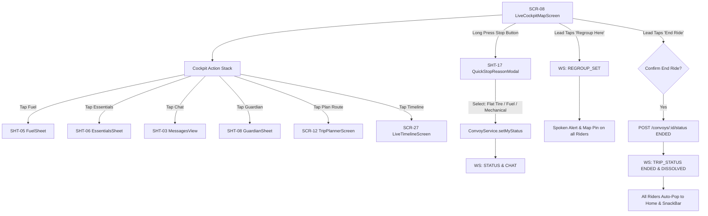
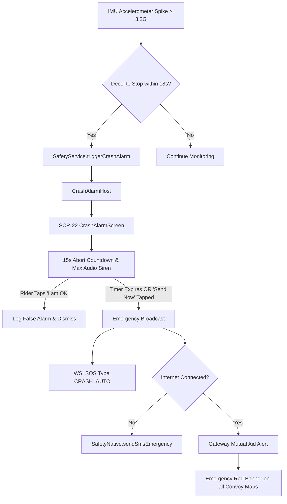
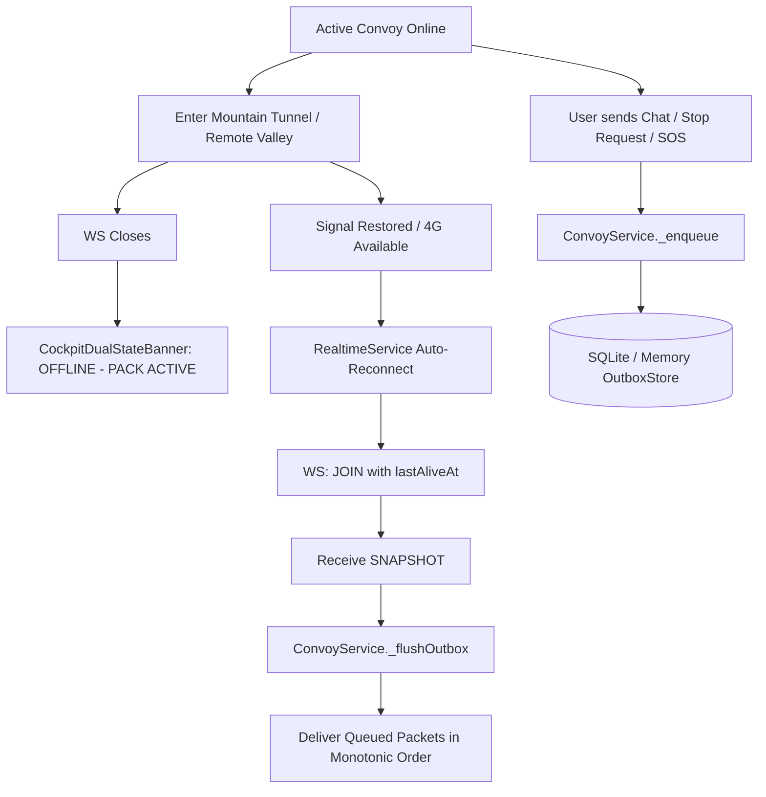

# 03. Navigation Flows & User Journeys

**Target**: CoRoute Navigation Architecture  
**Router Type**: Imperative Navigation with `MaterialPageRoute` & `GlobalKey<NavigatorState>` (`appNavigatorKey`)  
**Shell**: `RiderHomeScreen` with `IndexedStack` (4 persistent tabs)  

---

## 1. Flow 1: First Launch & Authentication

* **Starting Screen**: `SplashScreen`
* **Transitions**: Automatically resolves session token; routes to `AccessGateScreen` if missing, or restores session and verifies whether mandatory profile fields (name, phone, motorcycle model) are present.
* **Failure Path**: If JWT validation fails via `onAuthRejected`, `_SessionBinder` automatically pops all screens back to `AccessGateScreen`.

---

## 2. Flow 2: Ride Creation, Joining & Deep Linking

* **Deep Link Scheme**: Supports custom scheme `coroute://join/{CODE}` and verified web link `https://coroute.duckdns.org/join/{CODE}` via Android App Links (`autoVerify=true`).
* **Active Ride Guard**: If a user clicks an invite link while already in an active convoy, the link is discarded to prevent accidental convoy desertion (`rider_home_screen.dart:223`).

---

## 3. Flow 3: Active Cockpit, Telemetry & Regrouping

---

## 4. Flow 4: Emergency Crash Detection & SOS Abort

* **Lock Screen Override**: Utilizes Android `android.permission.USE_FULL_SCREEN_INTENT` with `showWhenLocked="true"` and `turnScreenOn="true"` in `RideSosActivity` and `MedicalIdActivity`.
* **High-Speed Slide Compensation**: Stop detection window extended from 10.0s to 18.0s for initial speeds > 60 km/h to prevent missing riders sliding on wet pavement.

---

## 5. Flow 5: Offline Loss & DTN Outbox Recovery

---

## 6. Dead Ends & Navigation Analysis

1. **PopScope Behavior**:
   * On `RiderHomeScreen`, Android Back button behavior is strictly controlled:
     * If on tabs 1, 2, or 3 (`Trips`, `Alerts`, `Profile`), Back switches to tab 0 (`Ride`).
     * If on tab 0 during an active ride, Back invokes `BackgroundService.minimizeApp()` to prevent accidental termination of the ride tracking service.
     * Back only exits the app when on tab 0 with **no active ride**.
2. **Missing Deep-Link Back Stack**:
   * Launching the app via `coroute://join/CODE` directly presents `RiderHomeScreen` with `JoinRideSheet` pushed above it. Canceling the join sheet leaves the user cleanly on `RideStartView` without dead ends.
3. **Admin Dashboard Back Navigation**:
   * `MasterAdminDashboard` has a standard `AppBar` back button returning to `AccountScreen`. All sub-screens (`AdminUsersScreen`, `AdminRideHistoryScreen`, `AdminInsightsScreen`) pop cleanly back to the dashboard.
