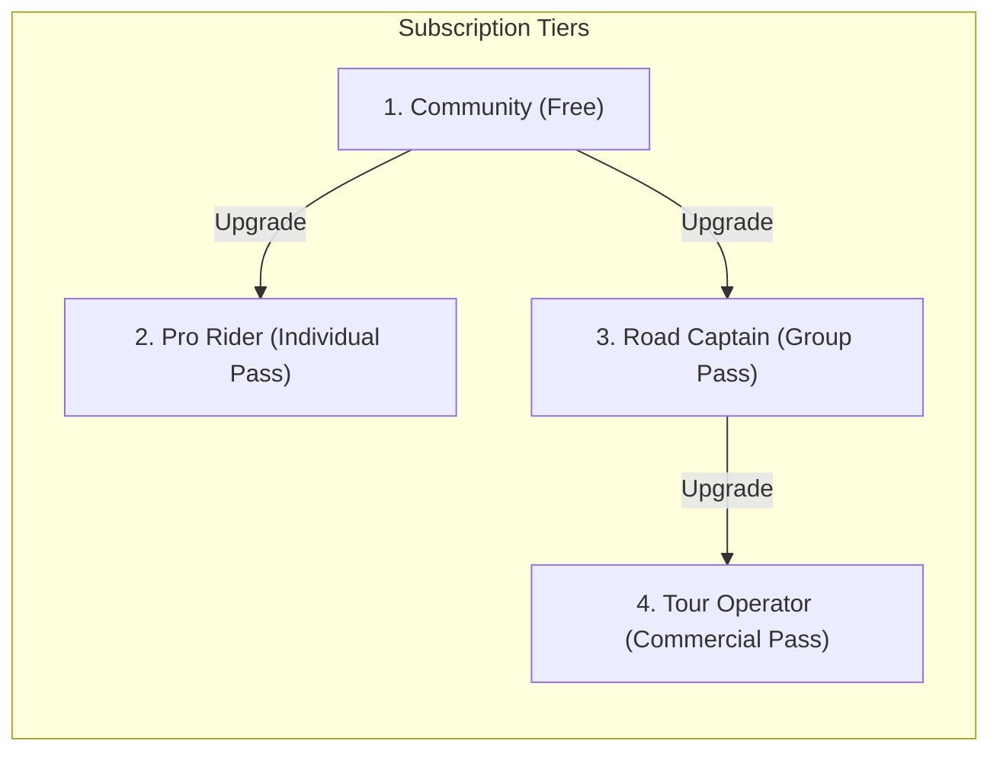

# 05. Roles & Plan Entitlements

**Target**: CoRoute Access Control & Monetization Architecture  
**Source Baseline**: [`feature_gates.dart`](file:///C:/Users/santhosh/Documents/antigravity/wise-chandrasekhar/coroute_app/lib/core/config/feature_gates.dart) & [`plan_subscription_service.dart`](file:///C:/Users/santhosh/Documents/antigravity/wise-chandrasekhar/coroute_app/lib/data/services/plan_subscription_service.dart)  

---

## 1. User Roles

The CoRoute ecosystem defines roles at two distinct levels: **In-Ride Convoy Roles** and **Account Governance Roles**.

### In-Ride Convoy Roles
1. **`LEAD` (Road Captain)**:
   * The host or appointed navigator of the active convoy.
   * Permissions: Can end the ride, pause the trip, add/remove/reorder waypoints, push regroup points, assign the `SWEEPER` role, and trigger priority voice ducking.
2. **`SWEEPER` (Tail Rider)**:
   * Appointed by the `LEAD` to ride at the rear of the convoy formation.
   * Permissions: Telemetry triggers `BEHIND_SWEEPER` alerts if any pack member drops behind their position.
3. **`PACK` (Standard Member)**:
   * Regular convoy participant.
   * Permissions: Streams GPS telemetry, participates in VOX/PTT intercom, requests wait/stops, and sends chat messages.

### Account Governance Roles
1. **`RIDER` (Default)**:
   * Standard authenticated rider account.
2. **`ADMIN`**:
   * Tour manager or regional moderator with access to emergency rosters and contact numbers.
3. **`MASTER_ADMIN`**:
   * Root platform administrator with access to `MasterAdminDashboard`, user moderation, room dissolution, global broadcasts, and database analytics.

---

## 2. Subscription Tiers



1. **`community` (Free Tier)**:
   * Target: Casual weekend riders and small local groups.
   * Limits: Up to **4 bikes** per convoy, 1 cached offline corridor pack, single bike profile.
   * Capabilities: Full safety features (Crash detection, Acoustic Siren detection, Road Hazard reception, Emergency SOS, 112 direct dial, P2P mesh).
2. **`proRider` (Individual Explorer)**:
   * Target: Solo tourers and long-distance adventure riders.
   * Limits: Standard convoy capacity (up to 4 bikes), **unlimited offline corridor packs**, multi-bike garage.
   * Unlocks: Ride Guardian live web share, 2D route replay & GPX export, AMOLED sunlight HUD mode, Smartwatch Biometric pulse bridge, Low-connectivity satellite SOS relay.
3. **`roadCaptain` (Convoy Host Pass)**:
   * Target: Club presidents and group ride organizers.
   * Limits: Unlocks **up to 40 bikes** for any convoy hosted by the captain (guests can join for free on the Community tier).
   * Unlocks: Priority intercom voice ducking (-18 dB), mid-ride dynamic waypoint and regroup push, total convoy spread alerts (Lead-to-Sweeper distance), and road hazard broadcast mesh.
4. **`tourOperator` (Commercial & Fleet Agency)**:
   * Target: Motorcycle rental agencies, guided tour companies, and commercial expeditions.
   * Limits: **Unlimited convoy capacity**.
   * Unlocks: B2B Fleet health index, tour timetable variance tracking, client risk scorecards, dispatcher web console, and insurance incident audit logs.

---

## 3. Feature Entitlement Matrix

| Feature Key | Required Tier | Community | Pro Rider | Road Captain | Tour Operator | UI Gating Checked? | Service Enforced? | Backend Enforced? |
| :--- | :--- | :---: | :---: | :---: | :---: | :---: | :---: | :---: |
| `priorityIntercomDucking` | Road Captain | ❌ | ❌ | ✅ | ✅ | ✅ (`intercom_dock.dart`) | ✅ (`intercom_service.dart`) | ✅ (`ws.js`) |
| `unlimitedConvoyCapacity` | Road Captain | ❌ (Max 4) | ❌ (Max 4) | ✅ (Max 40) | ✅ (Unlimited) | ✅ (`ride_start_view.dart`) | ✅ (`convoy_service.dart`) | ✅ (`convoys.js`) |
| `dynamicWaypointPush` | Road Captain | ❌ | ❌ | ✅ | ✅ | ✅ (`trip_planner_screen.dart`) | ✅ (`convoy_service.dart`) | ✅ (`routes.js`) |
| `totalConvoySpreadAlert` | Road Captain | ❌ | ❌ | ✅ | ✅ | ✅ (`convoy_bead_wire.dart`) | ✅ (`ride_facts.dart`) | ❌ (Client Math) |
| `roadHazardBroadcast` | Road Captain | ❌ | ❌ | ✅ | ✅ | ✅ (`road_hazard_hud_pill.dart`) | ✅ (`road_hazard_detector.dart`) | ✅ (`road_hazards.js`) |
| `guardianLiveShare` | Pro Rider | ❌ | ✅ | ✅ | ✅ | ✅ (`guardian_sheet.dart`) | ✅ (`realtime_service.dart`) | ✅ (`guardians.js`) |
| `unlimitedOfflinePacks` | Pro Rider | ❌ (1 Pack) | ✅ | ✅ | ✅ | ✅ (`offline_map_manager.dart`) | ✅ (`tile_cache_service.dart`) | N/A (Local GIS) |
| `advancedTelemetryReplay` | Pro Rider | ❌ | ✅ | ✅ | ✅ | ✅ (`trip_report_screen.dart`) | ✅ (`trip_storage_service.dart`) | ✅ (`routes.js`) |
| `multiBikeGarage` | Pro Rider | ❌ (1 Bike) | ✅ | ✅ | ✅ | ✅ (`garage_screen.dart`) | ✅ (`settings_service.dart`) | N/A (Local Store) |
| `sunlightHudMode` | Pro Rider | ❌ | ✅ | ✅ | ✅ | ✅ (`appearance_sheet.dart`) | ✅ (`theme_controller.dart`) | N/A (Local Theme) |
| `biometricTraumaPulse` | Pro Rider | ❌ | ✅ | ✅ | ✅ | ✅ (`biometric_pulse_pill.dart`) | ✅ (`biometric_bridge.dart`) | N/A (Client Sensor) |
| `satelliteSosRelay` | Pro Rider | ❌ | ✅ | ✅ | ✅ | ✅ (`crash_alarm_screen.dart`) | ⚠️ Type Error in Service | ❌ (Intent only) |
| `fleetAnalytics` | Tour Operator | ❌ | ❌ | ❌ | ✅ | ✅ (`admin_insights_screen.dart`) | ✅ (`api_client.dart`) | ✅ (`routes.js`) |
| `roadHazardReceive` | Community | ✅ | ✅ | ✅ | ✅ | Universal | Universal | ✅ (`ws.js`) |
| `sirenAcousticDetector` | Community | ✅ | ✅ | ✅ | ✅ | Universal | Universal | N/A (Local Audio) |
| `bleHandlebarRemote` | Community | ✅ | ✅ | ✅ | ✅ | Universal | Universal | N/A (Local BLE) |

---

## 4. Gating Architecture & Verification

1. **Client-Side Enforcement**:
   * Evaluated via `FeatureGates.isUnlocked(Feature feature, [SubscriptionTier? tier])`.
   * Gated UI components are either visually badged with a lock icon, or present an explanatory modal directing the user to `PlanSelectorScreen`.
2. **Backend Enforcement**:
   * Room capacity is strictly enforced in `gateway/src/convoys.js`:
     ```javascript
     const maxAllowed = hostTier === 'tourOperator' ? 1000 : (hostTier === 'roadCaptain' ? 40 : 4);
     if (room.riders.size >= maxAllowed) throw new ConvoyError('Convoy capacity reached for host plan.', 403);
     ```
   * Priority audio ducking flags in `gateway/src/ws.js` verify that only clients with role `LEAD` or verified host entitlement can broadcast priority frames.
3. **Testing Override**:
   * For pre-launch verification, `PlanSubscriptionService` allows riders to freely switch plans on the `PlanSelectorScreen` or toggle `forceAllUnlocked = true` to test any feature without payment processing.
