# 06. Architecture & Data Flow

**Target**: CoRoute System Architecture  
**Paradigm**: Reactive Layered Architecture with Provider State Management & Distributed Real-Time Sockets  

---

## 1. End-to-End System Architecture

```mermaid
graph TD
    subgraph Presentation Layer [Flutter UI]
        Cockpit[SCR-08 LiveCockpitMapScreen]
        Shell[SCR-06 RiderHomeScreen]
        Sheets[Modal Sheets & Dialogs]
        HUD[Cockpit HUD Pills: Siren / Hazard / BLE]
    end

    subgraph State Management [ChangeNotifiers & Providers]
        CS[ConvoyService]
        SS[SafetyService]
        IS[IntercomService]
        AS[AuthService]
        TS[TripStorageService]
        TL[TimelineService]
        TR[TrackRecorder]
    end

    subgraph Domain & Detection Engines [Pure Dart Logic]
        CrashDetect[CrashDetector]
        SirenDetect[SirenAcousticDetector]
        HazardDetect[RoadHazardDetector]
        GeoMath[GeoMath & Haversine Engine]
        FuelRange[FuelRange Calculator]
    end

    subgraph Local Storage & Caching
        Outbox[(SQLite OutboxStore)]
        TrackQueue[(SqfliteTrackQueue)]
        TileCache[(TileCache SQLite DB)]
        Prefs[(SharedPreferences)]
        SecStore[(FlutterSecureStorage)]
    end

    subgraph Networking & Hardware Bridges
        WSClient[RealtimeService / WebSocket]
        HTTPClient[ApiClient / http.Client]
        P2PMesh[P2pMeshService / Wi-Fi Direct]
        NativeAudio[flutter_pcm_sound / Record]
        NativeBG[FlutterForegroundTask / Isolate]
    end

    Cockpit --> CS
    Cockpit --> IS
    Cockpit --> SS
    HUD --> SS
    HUD --> CS
    
    CS --> Domain
    SS --> CrashDetect
    SS --> SirenDetect
    SS --> HazardDetect
    
    CS --> Outbox
    TR --> TrackQueue
    CS --> TileCache
    AS --> SecStore
    
    CS --> WSClient
    TS --> HTTPClient
    IS --> NativeAudio
    CS --> NativeBG
    CS --> P2PMesh
```

---

## 2. State Management Architecture

CoRoute utilizes **Provider (`provider: ^6.1.5+1`)** with a centralized dependency container configured in `lib/main.dart` via `MultiProvider`.

### Key Services & Responsibilities
1. **`ConvoyService` (`lib/data/services/convoy_service.dart`)**:
   * The central orchestrator for group rides.
   * Maintains active convoy state (`ConvoyModel`), participant map (`Map<String, RiderModel>`), outbox queue, and emergency alerts.
   * Listens directly to `RealtimeService.events` and dispatches notifications to the cockpit HUD, bead wire, and sheets.
2. **`RealtimeService` (`lib/data/services/realtime_service.dart`)**:
   * Low-level WebSocket client managing reconnection, exponential backoff, ping/pong heartbeats, and frame serialization.
3. **`IntercomService` (`lib/data/services/intercom_service.dart`)**:
   * Manages half-duplex helmet audio streaming, VOX energy thresholding, and Road Captain priority ducking.
4. **`SafetyService` (`lib/data/services/safety_service.dart`)**:
   * Coordinates crash alarms, fall detection countdowns, bystander siren alerts, and emergency contact SMS dispatch.
5. **`AuthService` (`lib/data/services/auth_service.dart`)**:
   * Session authentication, JWT storage, profile updates, and Google Sign-In orchestration.
6. **`TrackRecorder` (`lib/data/services/track_recorder.dart`)**:
   * High-frequency GPS logging with Douglas-Peucker point decimation into an offline SQLite queue (`SqfliteTrackQueue`).

---

## 3. Data Flow Pipelines

### Telemetry Pipeline
1. `Geolocator` streams device coordinates (2.5s interval while moving, 30s while stationary).
2. `ConvoyService` enriches coordinates with speed, heading, battery level, fuel estimate, and active status.
3. Transmitted as `TELEMETRY` JSON packet over WebSocket.
4. Gateway `ws.js` sanitizes packet and broadcasts `RIDER_UPDATE` to all convoy participants.
5. Client `ConvoyService` updates local `ConvoyModel` and calls `notifyListeners()`, re-rendering the cockpit map and Bead Wire.

### Voice & Intercom Pipeline
1. Microphone captures audio via `record` package (16 kHz / 8 kHz PCM16 mono).
2. VOX gate evaluates RMS amplitude against sensitivity threshold.
3. If open, 20 ms PCM frames are framed with a 1-byte header (`isPriority`) and streamed over the WebSocket.
4. Gateway acts as a raw binary relay, broadcasting audio frames to all room sockets.
5. Receivers route frames to `flutter_pcm_sound` audio sink; if `isPriority` is flagged, background chatter is attenuated by -18 dB.

### Offline DTN Outbox Pipeline
1. When cellular signal drops, WebSocket disconnects.
2. User actions (Chat messages, Stop requests, SOS alerts) are intercepted by `ConvoyService._enqueue`.
3. Action is assigned a client UUID (`o{timestamp}-{seq}-{salt}`) and persisted to `OutboxStore`.
4. UI displays items with a "Waiting for signal" clock badge.
5. Upon 4G restoration, socket emits `JOIN` -> receives `SNAPSHOT` -> triggers `_flushOutbox()`, transmitting pending items in monotonic timestamp order.

---

## 4. Architectural Strengths & Coupling Analysis

* **Strengths**:
  * Clean separation between Domain math (`GeoMath`, `CrashDetector`) and presentation widgets.
  * Resilient offline fallback: app maintains core UI responsiveness and alarm capability during complete network dropouts.
  * Strictly bounded resource limits: track recorders cap memory usage, tile caching buffers to disk, and message lists are clamped.
* **Coupling Concerns & Risks**:
  * `ConvoyService` is an oversized class (~2,400 lines) with extensive responsibilities (GPS telemetry, roster sync, outbox, alerts, stop decisions, audio routing). Refactoring into specialized sub-controllers (e.g. `ConvoyTelemetryManager`, `ConvoyStopManager`) will improve testability.
  * `SafetyService` has tight bidirectional coupling with `ConvoyService` and `SettingsService`.
