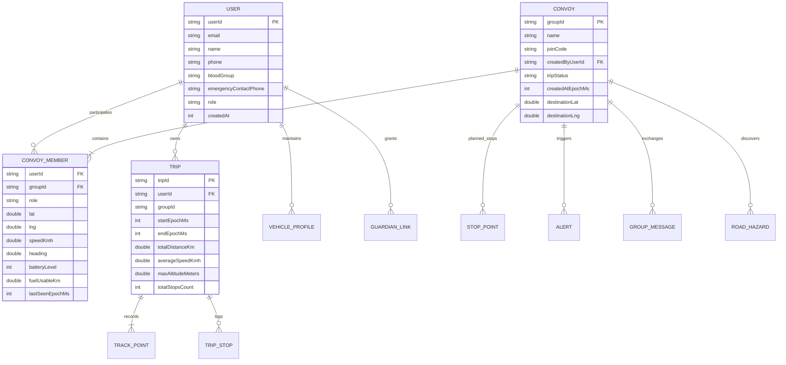

# 09. Data Models, Storage & Persistence

**Target**: CoRoute Data Architecture  
**Mobile Persistence**: SQLite, SharedPreferences, FlutterSecureStorage  
**Cloud Persistence**: Oracle Autonomous Database (SODA Document Store)  

---

## 1. Entity Relationship Diagram (ERD)

---

## 2. Core Domain Models

### 1. `RiderModel` (`lib/data/models/rider_model.dart`)
* Represents a single rider participating in an active convoy.
* Attributes:
  * `userId` (String): Unique identifier.
  * `name` (String): Display name / callsign.
  * `lat`, `lng` (double): Current GPS coordinates.
  * `speedKmh`, `heading` (double): Real-time speed and bearing.
  * `batteryLevel` (int): Device battery percentage (0–100).
  * `isCharging` (bool): Whether device is plugged into motorcycle USB.
  * `role` (String): In-ride role (`LEAD`, `SWEEPER`, `PACK`).
  * `fuelUsableKm` (double?): Estimated fuel range before empty.
  * `statusReason`, `statusMessage` (String): Quick-stop state (`MECHANICAL`, `FLAT_TIRE`, etc.).
  * `lastSeenEpochMs` (int): Timestamp of last received telemetry packet.

### 2. `ConvoyModel` (`lib/data/models/convoy_model.dart`)
* Represents the active convoy room.
* Attributes:
  * `groupId` (String): Unique convoy room identifier.
  * `name` (String): Group ride title.
  * `joinCode` (String): 6-digit alphanumeric entry code.
  * `createdByUserId` (String): User ID of the convoy creator.
  * `tripStatus` (String): Convoy lifecycle state (`STARTED`, `PAUSED`, `ENDED`).
  * `riders` (Map<String, RiderModel>): Live participant index.
  * `stopPoints` (List<StopPointModel>): Sequence of planned waypoints and rest stops.
  * `activeAlerts` (List<AlertModel>): Active emergencies, dropouts, and hazard flags.
  * `messages` (List<GroupMessageModel>): Recent chat and tactical signal history.

### 3. `TripHistoryModel` (`lib/data/models/trip_history_model.dart`)
* Historical summary of a completed motorcycle expedition.
* Attributes:
  * `tripId`, `name`: Identity and label.
  * `distanceMeters`, `durationSeconds`: Total distance and saddle time.
  * `averageSpeedKmh`, `maxSpeedKmh`: Velocity profile.
  * `elevationGainMeters`, `maxAltitudeMeters`: Topographic metrics.
  * `isSyncedWithCloud`: Sync state against `/api/trips`.

### 4. `RoadHazardModel` (`lib/data/models/road_hazard_model.dart`)
* Crowdsourced road defect discovered via IMU accelerometer spike or rider report.
* Attributes:
  * `hazardId`, `latitude`, `longitude`: Coordinate pin.
  * `severity` (`LOW`, `MEDIUM`, `CRITICAL`): Pothole vs speed breaker vs debris.
  * `detectedAtEpochMs`, `verifiedByCount`: Temporal validity and consensus.

### 5. `SosEvent` & `SosPacketCodec` (`lib/domain/safety/`)
* Ultra-compact 16-byte binary payload for emergency satellite or cellular SMS fallback:
  * Byte 0: Magic byte (`0xC0`)
  * Byte 1: Protocol version & Severity flags (Bit 0-1: Severity, Bit 2-7: Version)
  * Bytes 2-5: Latitude (int32 microdegrees)
  * Bytes 6-9: Longitude (int32 microdegrees)
  * Bytes 10-11: Altitude (uint16 meters offset)
  * Bytes 12-14: Timestamp (uint24 minutes since 2026-01-01)
  * Byte 15: CRC-8 Checksum.

---

## 3. Local Storage Engines

1. **SQLite Database (`sqflite: ^2.4.2`)**:
   * **`track_queue.db` (`SqfliteTrackQueue`)**: High-frequency GPS track point cache buffering up to 50,000 track points during cellular dead zones.
   * **`outbox.db` (`OutboxStore`)**: Encrypted persistent store for offline DTN actions (chat, stop updates, SOS).
   * **`tiles.db` (`TileCache`)**: BLOB tile repository storing OpenStreetMap vector/raster tiles indexed by `(z, x, y)`.
   * **`saved_packs.db` (`SavedMapPackStore`)**: Route corridor map pack metadata and bounding boxes.
2. **`SharedPreferences`**:
   * Stores user preferences: `coroute_active_subscription_plan`, `data_saver_mode`, `theme_palette`, `keyRideAlive`, `keyActiveGroupId`, and multi-bike garage profiles (`coroute_garage_vehicles_v1`).
3. **`FlutterSecureStorage`**:
   * Hardware-backed keystore storing the active JWT session token (`coroute_jwt_token`).

---

## 4. Cloud Persistence (Oracle Autonomous Database SODA)

The Gateway persists state in **Oracle SODA (Simple Oracle Document Access)** JSON collections:
* `users`: Account documents, hashed bcrypt passwords, medical contact details, and assigned roles.
* `convoys`: Active convoy metadata, route polylines, and member roster.
* `trips`: Completed ride summaries, elevation profiles, and Douglas-Peucker simplified track polyline strings.
* `analytics`: Aggregated page-view counts, active rider counts, and feature utilization snapshots.
* `guardians`: Active capability tokens for Ride Guardian live web links with automatic expiration TTL.
