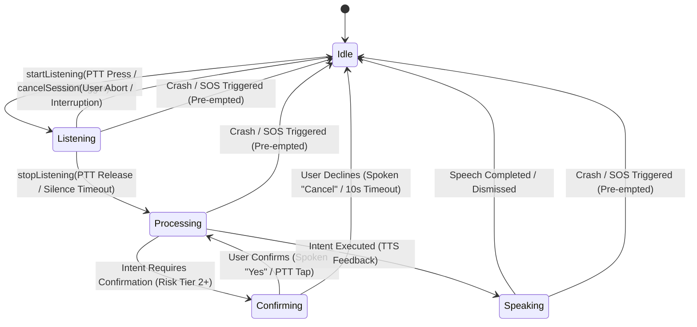

# CoRoute Multilingual Voice Assistant: Architecture & Technical Design

> **Document ID**: `DOC-VA-01`  
> **Milestone**: Milestone 1 — Voice Foundation & Push-To-Talk Lifecycle  
> **Component**: `coroute_app/lib/data/services/voice/` & `coroute_app/lib/presentation/rider/widgets/`  
> **Audience**: Mobile Engineers, System Architects, Safety Engineers  
> **Status**: APPROVED & IMPLEMENTED  

---

## 1. Architectural Overview

The **CoRoute Multilingual Voice Assistant** is an intent-driven, service-backed conversational copilot designed specifically for high-speed motorcycle touring. Unlike general-purpose mobile assistants, it operates under stringent motorcycle safety and cognitive constraints:
- **0.8-second glance budget**: Visual feedback is minimal, high-contrast, and glanceable.
- **56dp minimum touch target**: Compatible with armored leather gloves.
- **Strict safety pre-emption**: Any crash impact, deceleration slide, or Emergency SOS instantly halts voice processing and seizes audio focus.
- **Zero business logic duplication**: Spoken intents resolve to typed domain actions and strictly call authorized existing services (`ConvoyService`, `GeoService`, `IntercomService`, `SafetyService`, `SettingsService`).

### System Component Diagram

```mermaid
graph TD
    subgraph Input Triggers
        PTT[Cockpit PTT Button / BLE Remote]
        HWKey[Hardware Volume / Media Key]
    end

    subgraph Voice Assistant Controller
        VAC[VoiceAssistantController]
        SM[State Machine: Idle -> Listening -> Processing -> Speaking]
        Guard[Single-Active-Session Guard]
    end

    subgraph Speech & Language Engine
        SRA[SpeechRecognitionAdapter]
        LR[LanguageResolver (12 Locales)]
        IR[IntentResolver & Slot Extractor]
        DM[DialogueManager & Disambiguation]
    end

    subgraph Safety & Execution Gates
        VSP[VoiceSafetyPolicy (Risk Tiers)]
        VAE[VoiceActionExecutor]
    end

    subgraph Target CoRoute Services
        CS[ConvoyService]
        GS[GeoService]
        IS[IntercomService]
        SS[SafetyService]
        SetS[SettingsService]
    end

    subgraph Feedback Subsystem
        LRS[LocalizedResponseService]
        TTS[VoiceService Native TTS]
        HUD[VoiceAssistantHudPill]
    end

    PTT --> VAC
    HWKey --> VAC
    VAC --> SM
    SM --> Guard
    Guard --> SRA
    SRA --> LR
    LR --> IR
    IR --> DM
    DM --> VSP
    VSP --> VAE
    VAE --> CS & GS & IS & SS & SetS
    VAE --> LRS
    LRS --> TTS
    LRS --> HUD
```

---

## 2. Push-To-Talk (PTT) Lifecycle & State Machine

Because motorcycle helmets suffer from extreme wind noise (80–120 km/h) and engine acoustic vibration, **Push-to-Talk (PTT)** is the primary operational mode. Background wake-word listening is both battery-draining and vulnerable to false triggers at highway speeds.

### State Transitions



### State Definitions
1. **`Idle`**: Microphone is inactive. No audio recording resources held.
2. **`Listening`**: Audio is routed from helmet microphone to `SpeechRecognitionAdapter`. HUD displays active listening wave pill.
3. **`Processing`**: Audio stream closed or transcribed. `IntentResolver` normalizes tokens into a `VoiceCommandIntent`.
4. **`Confirming`**: For sensitive actions (sending messages, proposing group stops), the assistant prompts the rider with the parsed intent and waits for verbal confirmation ("Yes", "Cancel").
5. **`Speaking`**: Spoken response dispatched via `VoiceService.speak()` or `LocalizedResponseService`. HUD displays status pill.
6. **`Cancelled`**: Session aborted due to timeout, invalid input, rider cancellation, or safety pre-emption.

---

## 3. Pre-emption Hierarchy & Audio Focus Coordination

Motorcycle communications must obey a strict hierarchical priority to guarantee rider survival:

| Priority | Subsystem | Behavior on Collision | Audio Ducking |
| :---: | :--- | :--- | :---: |
| **P0 (Absolute)** | **Crash Detector / Emergency SOS** | Instantly aborts any active voice session. Seizes all audio channels. Sounds countdown alarm siren. | -100 dB (All muted) |
| **P1 (Critical)** | **Road Captain Priority Intercom** | Mutes casual voice assistant dialogues. Broadcasts captain instructions directly. | -18 dB |
| **P2 (Safety)** | **Acoustic Siren Detector** | Directional emergency vehicle detected (600–1800 Hz). Informs rider. | -20 dB |
| **P3 (Operational)**| **Voice Assistant Dialogue** | Ducks background music and casual intercom while rider speaks or assistant responds. | -12 dB |
| **P4 (Background)** | **Casual Intercom / Ambient Music** | Suspended or ducked during higher priority operations. | Baseline |

### Coordination with `IntercomService`
When `VoiceAssistantController` begins listening:
1. `IntercomService.pauseOutgoing()` is invoked so the rider's voice command is **not** transmitted over the group WebSocket radio.
2. Bluetooth SCO audio route is preserved so the helmet microphone remains open.
3. Upon completion or cancellation of the voice session, normal intercom transmission capability is restored.

---

## 4. Pluggable `SpeechRecognitionAdapter` & `TextToSpeechAdapter` Contracts

To prevent vendor lock-in and enable smooth switching between native Android/iOS speech engines, cloud models, and offline recognizers (Vosk, whisper.tflite), all speech input and output are mediated through clean abstract adapters:

### Speech Recognition (`SpeechRecognitionAdapter`)
```dart
abstract class SpeechRecognitionAdapter {
  /// Initializes the recognizer and queries available offline language packs.
  Future<bool> initialize({required String defaultLocale});

  /// Starts listening to audio stream in the requested locale.
  Future<bool> startListening({
    required String localeId,
    required void Function(SpeechRecognitionResult result) onResult,
    required void Function(String error) onError,
  });

  /// Stops capturing speech and completes recognition.
  Future<void> stopListening();

  /// Immediately cancels any active listening session.
  Future<void> cancel();

  /// Queries whether the requested locale is available for offline recognition.
  Future<bool> isLocaleAvailableOffline(String localeId);

  /// Current recognition state.
  bool get isListening;

  /// Releases platform channels or memory buffers.
  Future<void> dispose();
}
```

### Text-To-Speech Output (`TextToSpeechAdapter`)
```dart
abstract class TextToSpeechAdapter {
  /// Synthesizes and plays speech for the provided text in the target locale.
  Future<bool> speak(String text, {required String locale, double volume = 0.8});

  /// Stops any currently playing speech.
  Future<void> stop();

  /// Releases engine resources.
  Future<void> release();
}
```
In production, `NativeVoiceEngineTtsAdapter` bridges directly to `VoiceService` and platform native channels (`TtsChannel.kt`), preserving existing volume ducking, language fallback, and engine initialization without duplicate services.

---

## 5. Concurrency, Hardware Contention & Background Rules

### 1. Microphone Hardware Contention Arbiter
On mobile platforms (Android/iOS), only a single process/channel can capture raw PCM audio from the microphone at any given moment. `IntercomService` continually runs VOX or PTT listening for rider intercom. 
- When `VoiceAssistantController.startListening()` executes, it detects if `IntercomService.isMicMuted` is false, records that intercom was active, and immediately calls `intercomService.setMicMuted(true)`.
- Upon voice session termination (`cancelSession`, `handleSpeechComplete`, or timeout), `_restoreIntercomIfPaused()` safely unmutes the intercom microphone.

### 2. Android 14+ Foreground Service Microphone Enforcement
Under Android 14 (API 34+), background microphone capture is strictly forbidden and results in a `SecurityException` unless the foreground service was initialized with `foregroundServiceType="microphone"` while the app was in the foreground.
- `VoiceAssistantController` tracks application lifecycle state (`onAppBackgrounded()`, `onAppForegrounded()`).
- If the app is backgrounded, `startListening()` immediately rejects the request with `"Voice commands require foreground app"` and fails fast.
- If the app transitions to background during an active speech session, `onAppBackgrounded()` cancels the capture session cleanly.

### 3. Monotonic Session Token Guard
To guard against race conditions from asynchronous speech recognition callbacks, network latency, or late cancellation timeouts:
- Every session generates a strictly incrementing `_sessionToken`.
- All speech events (`onResult`, `onError`, `stopListening`, `handleSpeechComplete`, timers) verify `currentToken == _sessionToken`.
- Expired or stale callbacks are silently dropped, preventing out-of-order execution or state corruption.

### 4. Single-Active-Session Guard
If a rider accidentally double-taps the cockpit PTT button or handlebar trigger while a session is already in `starting` or `listening` state, redundant calls are safely ignored without restarting capture or corrupting audio buffers.

---

## 5. UI Ergonomics & Cockpit HUD Integration

Visual feedback must adhere strictly to CoRoute's motorcycle ergonomic rules:
- **`VoiceAssistantHudPill`**: Rendered at top-center of `LiveCockpitMapScreen`.
- **Dimensions**: 56dp height, high-contrast cyan/amber/red status accenting.
- **Palette**: Deep AMOLED black (`#0B0E14`), pure neon accents, readable in direct sunlight.
- **Dismissal**: Automatically clears within 2.5 seconds after speech feedback completes.
