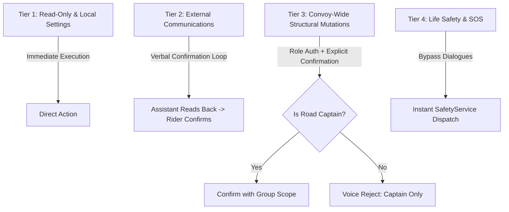

# CoRoute Multilingual Voice Assistant: Safety & Confirmation Policy

> **Document ID**: `DOC-VA-04`  
> **Milestone**: Milestone 5 — Private Intercom & Safety Integration  
> **Audience**: Safety Auditors, Systems Engineers, UX Designers  
> **Status**: APPROVED  

---

## 1. Safety Risk Tiers

To protect riders from unintended operations, voice actions are categorized into 4 strict risk tiers:

### Risk Tier Definitions

| Tier | Classification | Intent Types | Execution Rule | Safety Invariants |
| :---: | :--- | :--- | :--- | :--- |
| **1** | **Low-Risk Local** | `SET_VOICE_VOLUME`, `SWITCH_LANGUAGE`, `QUERY_TRIP_STATUS`, `REPEAT_DIRECTIONS`, `DISCONNECT_INTERCOM` | **Immediate Execution**. Feedback spoken concisely. | No network or state mutations. |
| **2** | **External Communication** | `SEND_MESSAGE`, `REQUEST_INTERCOM`, `REQUEST_REGROUP`, `FIND_ESSENTIALS` | **Verbal Confirmation Required**. Assistant reads back recipient and text. | Draft expires after 15 seconds of silence. |
| **3** | **Group Route / Structural Mutations** | `BROADCAST_ALERT`, `PROPOSE_STOP`, `ADD_WAYPOINT` | **Role Verification + Confirmation**. Allowed for Lead or verified members. | Must validate road coordinates against corridor. |
| **4** | **Life Safety & Emergency** | `TRIGGER_SOS`, `CANCEL_SOS`, `SILENCE_SIREN` | **Deterministic Fast Path**. Bypasses all dialogue queues. | Never delay, never prompt multi-turn confirmation for SOS. |

---

## 2. Verbal Confirmation Engine & Timeout Semantics

When an intent falls into **Tier 2** or **Tier 3**:
1. The assistant transitions to `VoiceState.confirming`.
2. The assistant synthesizes a confirmation prompt:
   - *“Send message to {name}: '{text}'. Say Send or Cancel.”*
3. A **10-second countdown window** begins:
   - Spoken **“Send”**, **“Yes”**, **“OK”**, **“Haan”**, **“Avunu”**, **“Aam”**, **“Sari”** -> Executes the action immediately.
   - Spoken **“Cancel”**, **“No”**, **“Voddhu”**, **“Nahi”**, **“Illa”** -> Aborts the action and clears draft.
   - **Timeout (10 seconds)** -> Session expires silently with a subtle HUD dismiss pill. No transmission occurs.

---

## 3. Disambiguation Policy ("Which Rohit?")

In a group tour with 15–30 riders, duplicate names or phonetically similar callsigns often occur:
1. When recipient slot matches multiple riders (e.g., `"Rohit Sharma"` and `"Rohit Verma"`):
   - The assistant **does not guess** or send to the first match.
   - The assistant asks: *“Which Rohit? Rohit Sharma or Rohit Verma?”*
   - Rider responds: *“Rohit Sharma”* (or simply *“Sharma”*).
   - Recipient is resolved and confirmation loop proceeds.
2. If phonetic confidence score is `< 0.65`:
   - Assistant prompts: *“Did you mean Rohit Sharma?”*

---

## 4. Forbidden Voice Operations

To prevent catastrophic accidental reconfigurations while in motion, the following operations are **strictly prohibited** via voice commands:
1. `DISABLE_CRASH_DETECTION`: Rider must pull over and change in settings screen manually.
2. `DELETE_OFFLINE_MAP_PACKS`: Prevent accidental deletion of life-critical offline GIS data.
3. `REVOKE_GUARDIAN_ACCESS_TOKEN`: Emergency tracking cannot be silenced by voice alone.
4. `RESET_TRIP_TELEMETRY`: Protects accident reconstruction evidence logs.
